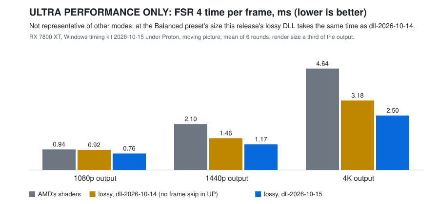

# fsr4-shader-performance-overrides

Makes AMD FSR 4.1.1 upscaling faster on Radeon graphics cards, on Windows and Linux, by replacing
FSR 4's slowest shaders with faster ones. One file to swap, nothing else in the game changes.

## Quick start

> [!WARNING]
> **Never use this in online games or in any game with anti-cheat.** These are modified game files. Anti-cheat
> software can treat a changed DLL or changed shaders as tampering, and that can get an account banned. Use it in
> single-player games only.

**1. Download the zip for your graphics card.**

| Your graphics card | Download |
|---|---|
| A Radeon **RX 7000 or RX 6000** graphics card: the name has "RX" and a four-digit number, such as RX 7800 XT or RX 6700 XT. This includes gaming laptops with their own RX chip (RX 7700S, RX 6700M and the like) | **[fsr4.1.1-cyboman.zip](https://github.com/zgauthier2000/fsr4-shader-performance-overrides/releases/latest/download/fsr4.1.1-cyboman.zip)** |
| **Graphics built into the processor:** most laptops, mini PCs and handhelds. The name is "Radeon Graphics" or "Radeon" with a three-digit number, such as Radeon 780M or 890M; also the Steam Deck | **[fsr4.1.1-igpu-cyboman.zip](https://github.com/zgauthier2000/fsr4-shader-performance-overrides/releases/latest/download/fsr4.1.1-igpu-cyboman.zip)** |
| Radeon RX 9000 | not for these cards: they run a different FSR 4. Do not install it there. |

Not sure which you have? In Windows, open Task Manager, go to Performance and look at the GPU's name; on a
laptop with two, the RX one is the one games use.

**2. Choose a version.** Each zip holds two folders with one file each:

| Folder | Speed | Picture |
|---|---|---|
| `exact` | faster than AMD's | **the same as AMD's, byte for byte** |
| `lossy` | faster again | very close to AMD's, but not the same. Read `WARNING.txt` in that folder first |

If you are not sure, take `exact`.

**3. Put the file in the game's folder.** The game must already run FSR 4.1.1, for example through
[OptiScaler](https://github.com/optiscaler/OptiScaler).

1. Find `amd_fidelityfx_upscaler_dx12.dll` in the game's folder (often next to OptiScaler) and
   rename it to `amd_fidelityfx_upscaler_dx12.dll.orig`. It must be version 4.1.1.2740.
2. Copy the `amd_fidelityfx_upscaler_dx12.dll` from the folder you chose into its place.

This works on Windows and, under Proton, on Linux. Linux users can instead use
[one launch option](#linux-a-launch-option-instead-of-the-dll) and leave the DLL alone.

**4. Check that it worked.** Open OptiScaler's overlay in the game. The FSR version reads
`4.1.1-cyboman` (or `4.1.1-lossy-cyboman`; with the other zip `4.1.1-igpu-cyboman` or
`4.1.1-igpu-lossy-cyboman`), and the upscaler time is lower than before.

**To undo it,** delete the file and rename the `.orig` file back.

## What to expect

<picture>
  <source media="(prefers-color-scheme: dark)" srcset="docs/img/quickstart-dark.svg">
  
</picture>

- **The gain depends on the output resolution.** It is largest at 4K. At 1440p and 1080p the exact
  DLL's gain depends on the card: some keep most of it (an RX 7900 XT 30% at 1440p, an RX 6600 XT 24% at 1080p),
  others show little or nothing (the RX 7800 XT and an RX 7900 XTX at 1080p). The lossy DLL helps at every size,
  because it skips work instead of only doing the same work faster.
- **It depends on your graphics chip, and on Windows or Linux.** FSR 4 time saved at 4K, from testers' timing-kit runs
  up to October 17, 2026 (Windows: about 130 reports; Linux: 13 runs on 8 cards, plus our own RX 7800 XT). The same
  DLL saves much more under Linux on most Radeon cards, most likely because Linux's driver runs two of AMD's shaders
  (the last pass and network pass 11) in a slower mode than Windows does, which leaves more to save.

  | Graphics chip | Exact DLL, Windows | Exact DLL, Linux | Lossy DLL, Windows | Lossy DLL, Linux |
  |---|---|---|---|---|
  | Radeon RX 7600, RX 7900 GRE, XT, XTX | 17 to 29% | 12 to 48% (7900 XTX, 7900 GRE) | 33 to 49% | about 42 to 63% |
  | Radeon RX 7800 XT | 2 to 4% (one report 14%) | 28 to 35% | 29 to 41% | about 50% |
  | Radeon RX 6600 XT, RX 6650 XT, RX 6900 XT | 10 to 20% | 29 to 31% (6600 XT, 6900 XT) | 30 to 41% | about 47 to 48% |
  | Radeon RX 6600, RX 6700, RX 6700 XT, RX 6750 XT, RX 6800 (XT) | 0 to 6% | 29 to 30% (6750 XT, 6800 XT) | 15 to 45% | about 50 to 51% |
  | Integrated graphics and handhelds (Steam Deck, Radeon 890M) | from 8% faster to 4% slower | 5% (Steam Deck) | 23 to 32% | about 29 to 36% |
  | Intel Arc (B580; integrated Arc in one report) | 6 to 10% | not measured | 30 to 33% | not measured |
  | GeForce (GTX 1650, RTX 3060 Ti, 3090, 5070) | none | not measured | 24 to 37% | not measured |
  | Radeon RX 5700 XT, RX Vega, Radeon Pro VII | none (Windows) | 6% (Pro VII) | 42% | about 35% |

  Most Linux cells rest on one or two runs per card. The Linux lossy figures are derived: the Linux kit times a frame
  that runs the network and a frame that skips it, and the lossy DLL alternates them, so the table gives their average.
  On RX 6000 cards under Windows the exact DLL is compared with AMD's shaders with the ghosting fix (the same picture),
  so the table shows only the speed difference. One Windows RX 6700 report with impossible readings is left out. We do
  not yet know what decides where a card falls in its range.
  [Results by graphics chip](docs/results.md#by-gpu-type), [timing kit results](timing-kit/RESULTS.md).
- **It only shows when the graphics card is the limit.** If the processor limits your frame rate,
  the frame rate does not change.
- **The exact DLL cannot change the picture.** Its output was compared with AMD's byte for byte at
  720p, 1080p, 1440p, 4K and 5K, in still and moving scenes. One intended exception: on RX 6000 cards under
  Windows, AMD's own file shows ghosting, and the exact DLL carries the fix, so its picture differs from AMD's there.
- **The lossy DLL trades a little accuracy for speed.** It runs FSR 4's neural network on every
  other frame and carries its result along with the picture's motion in between. Measured
  differences and comparison crops: [exact and lossy compared](docs/exact-vs-lossy.md). What the
  alternating cost means for frame caps and V-Sync: [frame pacing](docs/frame-pacing.md).

One card, one game, as an example of the best case: a Radeon RX 7800 XT, Shadow of the Tomb Raider's benchmark, 4K
output, FSR 4.1.1 Balanced. Your card and your game will give other numbers:

| | FSR 4 time per frame | Frame rate | Picture |
|---|---|---|---|
| AMD's shaders | 4.16 ms | 97 FPS | the reference |
| Exact | 2.99 ms (−28%) | 109 FPS (+12%) | identical |
| Lossy | 2.06 ms (−50%) | 122 FPS (+26%) | still picture within 0.2 dB of AMD's |

More games and resolutions: [all results](docs/results.md).

> [!NOTE]
> **Two settings where you will see little or no gain:**
> - **FSR's debug view (the debug panels FSR can draw over the picture).** The faster shaders do not cover the
>   debug versions of FSR's last pass, so AMD's own slow one runs and most of the gain is gone. Switch the debug view off
>   to measure or to play. FSR's version watermark (the white text in the top left corner, switched on with the
>   `MLSR-WATERMARK` environment variable) is not the debug view: with it on, every DLL keeps its full gain and frame
>   skip works as usual (measured under Proton on an RX 7800 XT). It shows the DLL's version name, such as
>   `4.1.1-CYBOMAN`, so it also tells you which build is running.
> - **Ultra Performance mode (since `dll-2026-10-15`).** The lossy DLL skips frames there too, and runs the network
>   all the same on one in three of the frames it would skip. **Ultra Performance only, not representative of other
>   modes:** at 4K about 3.2 to 2.5 ms per frame on an RX 7800 XT, and its picture costs there are larger than in other
>   modes ([details](docs/releases/dll-2026-10-15.md)).

## New in this release

**[See what this release changes against the previous one, in pictures and figures →](docs/releases/dll-2026-10-15.md)**

> [!TIP]
> **The lossy DLL now skips frames in Ultra Performance too, and the exact DLL is a little faster with the same picture.**
> - **Ultra Performance (figures for Ultra Performance only, not representative of the lossy DLL in other modes):** the lossy DLL
>   skipped no frames there before, so it was about as fast as the exact DLL. Now 4K takes 2.50 ms per frame instead of 3.18 (Windows
>   timing kit, RX 7800 XT), and Shadow of the Tomb Raider's benchmark at 4K Ultra Performance renders 9% more frames (21,699 to
>   23,705; 140 to 154 FPS, one run each). **The price, in Ultra Performance only:** its picture is further from AMD's than with
>   `dll-2026-10-14` there: areas a moving object has just uncovered are less sharp, isolated bright dots (sky seen through leaves)
>   flicker more, tiny fast sparks are dimmer, and a thin wire in a fast pan is fainter. [The comparison with the exact DLL in Ultra
>   Performance](docs/releases/dll-2026-10-15.md#change-1-frame-skip-in-ultra-performance-ultra-performance-only).
> - **Balanced and the other modes:** the lossy DLL's picture and speed are as before (every moving-scene check identical; a few
>   at-rest rows move by a hair).
> - **Exact DLL:** its last shader converts each color once instead of up to four times. Same picture as AMD's; at 4K about 0.02 ms
>   per frame faster than `dll-2026-10-14`'s exact DLL: 3.16 ms against 3.18 (AMD's shaders 5.00 ms; Windows timing kit, RX 7800 XT).
>   In the game benchmark at 4K Balanced, 0.2% more frames than with `dll-2026-10-14`'s exact DLL.
> - **For RX 6000 cards, the RX 7600 and integrated graphics** (measured since with [the timing kit](timing-kit), Windows): the exact
>   DLL's new form is not slower there but about 1% faster than without it (RX 6000, 14 reports; RX 7600 1.5%; a Radeon 890M 2 to 4%,
>   one report).

<a href="docs/releases/dll-2026-10-15.md"><picture>
  <source media="(prefers-color-scheme: dark)" srcset="docs/img/rel-2026-10-15-speed-dark.svg">
  
</picture></a>

**Ultra Performance only, not representative of other modes.** This release's gain is speed, and it is in Ultra Performance alone. In
pictures it costs something there; the release page shows a typical frame and the lossy DLL against the exact DLL on every measure.

> ### Help test it: the timing kit
> **[Download the Windows timing kit](https://github.com/zgauthier2000/fsr4-shader-performance-overrides/releases/download/timing-kit-2026-10-15.3/fsr4-timing-kit-windows.zip)** (experimental, about 11 MB, version 2026-10-15.3): unpack, double-click
> `fsr4time.exe`, wait about 15 minutes (up to about 20 on a slow chip). It times FSR 4 with AMD's shaders and with these DLLs on your graphics card, checks
> that each DLL gives the same picture, and offers to send the result. Reports are in from eleven graphics chips so far;
> every further card helps, including GeForce and Intel Arc. On Linux and the Steam Deck: [the Linux kit](timing-kit).
>
> - New in the Windows kit (2026-10-15.3): the exact DLLs with a last shader tuned for drivers that run it 32-wide, which Windows'
>   driver may do. Slower under Linux and Proton; whether it is faster on Windows is what your result shows.
>   [Details](timing-kit/README.md#in-short)
> - New in the Windows kit (2026-10-15.2): a test of whether asking the driver for 64-wide waves speeds FSR 4 up on Windows,
>   with a control that shows which width your driver uses. [Details](timing-kit/README.md#in-short)
> - New in the kits (2026-10-15): this release's DLLs, each also without one of its two changes that may behave differently on RX
>   6000 cards, the RX 7600 and integrated graphics than on the card the project is developed on; and Ultra Performance (its figures
>   are for that mode only). Results from those chips are the ones most needed now. [What is new](timing-kit/README.md#in-short)
> - Optional: the kit asks for a name or nickname for the [thank-you page](docs/thanks.md).
>
> [What the kits do](timing-kit/README.md#windows-experimental)

## Will it work for me?

| Graphics card | Which zip | Status |
|---|---|---|
| RX 7900, 7800, 7700, 7600 (desktop RDNA3) | `fsr4.1.1-cyboman.zip` | measured here on an RX 7800 XT; testers report large gains on Windows |
| RX 6000 (RDNA2) | `fsr4.1.1-cyboman.zip` | runs, and includes the fix for the shimmering these cards show with AMD's file; at 4K, reports with the exact DLL range from a few percent to about 30%, and we do not yet know what decides it; a few percent at 1440p and below (tester reports) |
| Radeon 780M, 890M and other integrated graphics, Steam Deck | `fsr4.1.1-igpu-cyboman.zip` | experimental: few reports, small gains |
| RX 9000 (RDNA4) | none | no: a different FSR 4 runs there ([open for someone to pick up](docs/rdna4.md)) |
| Any other graphics chip: Nvidia GeForce, Intel Arc and Intel integrated graphics, older Radeon | `fsr4.1.1-cyboman.zip`; for a chip built into the processor try `fsr4.1.1-igpu-cyboman.zip` first | **should run, untested.** FSR 4.1.1's shaders are ordinary DirectX 12 compute shaders: they need Shader Model 6.6 with 8-bit integer dot products, 16-bit types and wave operations, which current drivers from all three makers provide. Users report the DLLs running on a GeForce laptop and on an Arc A770. Nothing has been measured there: the rewrites were made for Radeon chips, so they may or may not be faster than AMD's shaders, and "same picture" has only been verified on Radeon. A [timing-kit](timing-kit/README.md#windows-experimental) result tells both |

You also need a DirectX 12 game in which FSR 4.1.1 already runs, with
`amd_fidelityfx_upscaler_dx12.dll` version 4.1.1.2740.

Both DLLs have AMD's graphics-card check lifted (AMD's own file offers this FSR 4 only on desktop
RX 7000 cards), so they start on any card whose driver can run the shaders: DirectX 12 with Shader
Model 6.6. That is also why they must not go on an RX 9000 card, where a different FSR 4 would
then start as well.

If the first zip is slower than AMD's file on a small RX 6000 card, try the second one: it differs
only in one shader that is built smaller. Details: [GPU support](docs/gpu-support.md).

## Linux: a launch option instead of the DLL

On Linux you can leave AMD's DLL in place and give the game the replacement shaders directly.

1. Download or clone this repository.
2. In Steam, add this to the game's launch options (keep anything already there in front of
   `%command%`):

   ```
   VKD3D_SHADER_OVERRIDE='Z:/path/to/fsr4-shader-performance-overrides/prebuilt' %command%
   ```

   `Z:` is how Proton sees your Linux root, so `Z:/home/you/...` is `/home/you/...`. For the lossy
   version use the folder `prebuilt-lossy` instead, after reading the `WARNING.txt` in it.

- **The game must be using AMD's original DLL.** The launch option does nothing while a DLL from
  this project is installed, because the files are matched to AMD's shaders.
- **The version name does not change** with the launch option; OptiScaler shows plain `4.1.1`.
  The upscaler time is how you tell it applied.
- **The prebuilt files do not fit every setup.** They were made on an RX 7000 desktop card. On
  one tester's RX 6900 XT, Proton laid the same shaders out differently and the picture came out
  darker. If the picture looks wrong, build your own files:
  [Linux guide](docs/linux.md#building-your-own). `./tools/check_prebuilt.sh <dump folder>` tells you
  whether the prebuilt files fit.

If it does not get faster: [Linux guide](docs/linux.md).

## More about the files

Each DLL is AMD's own file with the rewritten shaders swapped in and the version name changed.
How that is done, and how to build it yourself: [`dll/`](dll). There is also a ReShade add-on
that does the same without touching the DLL: [`windows/`](windows).

The scripts that rewrite the Linux shaders and build the files in `prebuilt/` are in [`tools/`](tools)
(they were in the top folder until release `dll-2026-10-11.3`; commands in older posts need `tools/` in front).

**In some games OptiScaler's upscaler time is only reliable with the frame rate uncapped.** If
nothing changes at all, check that the game really runs FSR 4.1.1 with AMD's DLL version
4.1.1.2740; other versions have different shaders. See [shader variants](docs/variants.md).

## Good to know

- **Nothing else changes.** No game files are edited, and the output was compared byte for byte
  with AMD's at 4K, 1440p and 1080p.
- **Game and OptiScaler updates** can put the original DLL back; the launch option keeps working.
- **Never in online games or games with anti-cheat.** This changes the shaders the game renders with, and anti-cheat
  software can treat that as tampering. Single-player games only.
- **Linux:** do not set `RADV_PERFTEST=cswave32` for a game that runs FSR 4; it adds about 1.1 ms.

## More

| Page | What is in it |
|---|---|
| [All results](docs/results.md) | every game measured, benchmark pages with screenshots |
| [Linux guide](docs/linux.md) | requirements, building your own files, troubleshooting |
| [Making a shader dump](docs/shader-dump.md) | step by step, for reporting a wrong image or a missing speedup on Linux |
| [Timing kit](timing-kit) | a download for Linux and the Steam Deck that times every FSR 4 pass on your GPU, no game needed (new; five GPUs so far) |
| [GPU support](docs/gpu-support.md) | which download fits which GPU, integrated GPUs, RX 6000 cards and their shimmering fix |
| [Shader variants](docs/variants.md) | which versions of FSR 4's shaders are covered, and what to do if your game's is not |
| [How it works](docs/how-it-works.md) | what the rewrites do, where the time goes, what else was tried |
| [Exact and lossy compared](docs/exact-vs-lossy.md) | what the lossy DLL changes in the picture, with measurements and crops |
| [Lossy beside FSR 3.1, HelixSR and XeSS](docs/upscaler-comparison.md) | five upscalers on the same test scenes and timing, for comparison |
| [Frame pacing with the lossy builds](docs/frame-pacing.md) | what the alternating upscaler time means for frame caps, V-Sync, latency and overlay readings |
| [RDNA4](docs/rdna4.md) | what is known about the FP8 model on RX 9000 cards; open for anyone who can test on one |
| [Release pages](docs/releases/README.md) | each release against the one before it, in pictures and figures |
| [The lossy DLL's rules](docs/lossy-rules.md) | what the last shader does on a skipped frame, and which fault each rule answers |
| [Earlier releases](docs/changelog.md) | what each release changed, newest first |
| [Research](research) | the probes, data and scripts behind all of it |


## Star History

<a href="https://www.star-history.com/?repos=zgauthier2000%2Ffsr4-shader-performance-overrides&type=date&legend=top-left">
 <picture>
   <source media="(prefers-color-scheme: dark)" srcset="https://api.star-history.com/chart?repos=zgauthier2000/fsr4-shader-performance-overrides&type=date&theme=dark&legend=top-left" />
   <source media="(prefers-color-scheme: light)" srcset="https://api.star-history.com/chart?repos=zgauthier2000/fsr4-shader-performance-overrides&type=date&legend=top-left" />
   
 </picture>
</a>

## Credits and license

The postpass rewrite is adapted from `tools/fsr4cap/postpass_lds.py` in
[bbport](https://github.com/deadinside28/bloodborne_pc), a native Linux port of Bloodborne whose
author found the slow store pattern and wrote the original rewrite for that project's own FSR 4.1.1
runtime. This repository ports it to the shaders vkd3d-proton generates, so it works in ordinary
games.

The scripts are licensed under the GNU GPL v2 or later, like the project they derive from. See
[LICENSE](LICENSE). The prebuilt shaders are modified versions of AMD's, distributed under the same
license together with AMD's notice; see [`prebuilt/NOTICE.md`](prebuilt/NOTICE.md). Not affiliated
with or endorsed by AMD.

Testers who have asked to be named are listed on the [thank-you page](docs/thanks.md).

This repository is maintained independently. If this project has provided value to you, and you want to help support the author, consider formalizing your support with a voluntary micro-donation:

<a href="https://www.buymeacoffee.com/cyboman" target="_blank"></a>
