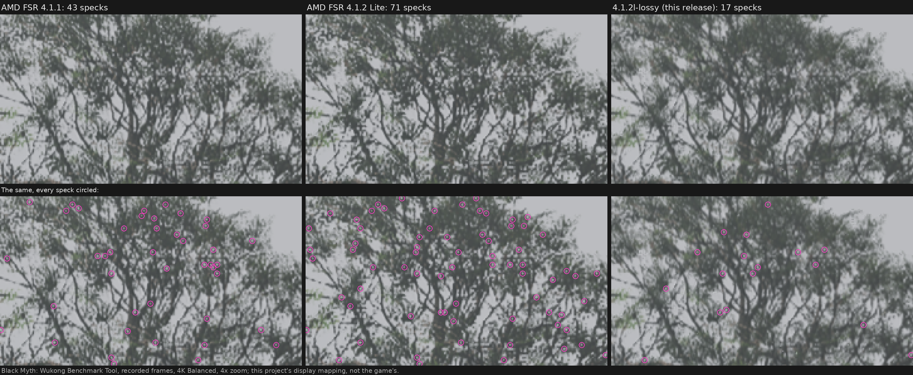

# fsr4-shader-performance-overrides

Makes AMD FSR 4.1.1 upscaling faster on Radeon graphics cards, on Windows and Linux, by replacing
FSR 4's slowest shaders with faster ones. One file to swap, nothing else in the game changes.

> [!TIP]
> **New in `dll-2026-10-29`: `4.1.2l-lossy`, about 18% faster than AMD's FSR 4.1.2 Lite** (Linux; 5 to 13% in Windows timing-kit reports),
> with fewer white specks in foliage on three of six recorded game clips. It is built on Lite, AMD's smaller FSR 4 network, and changes
> the picture. [What's new](#new-in-this-release) · [eight upscalers compared](docs/upscaler-comparison.md) ·
> [recorded game clips, side by side](https://zgauthier2000.github.io/fsr4-upscaler-compare/) · [the Lite builds](docs/lite-builds.md).

## Quick start

> [!WARNING]
> **Never use this in online games or in any game with anti-cheat.** These are modified game files. Anti-cheat
> software can treat a changed DLL or changed shaders as tampering, and that can get an account banned. Use it in
> single-player games only.

**1. Download the archive for your graphics card.**

| Your graphics card | Download |
|---|---|
| A Radeon **RX 7000** graphics card: "RX 7" and three more digits, such as RX 7800 XT or RX 7600, including laptops with their own RX 7000 chip (RX 7700S, RX 7600M and the like) | **[fsr4.1.2-cyboman-rx7000-2026-10-29.7z](https://github.com/zgauthier2000/fsr4-shader-performance-overrides/releases/download/dll-2026-10-29/fsr4.1.2-cyboman-rx7000-2026-10-29.7z)** (8.9 MB) or [.zip](https://github.com/zgauthier2000/fsr4-shader-performance-overrides/releases/download/dll-2026-10-29/fsr4.1.2-cyboman-rx7000-2026-10-29.zip) (100 MB) |
| A Radeon **RX 6000** graphics card: "RX 6" and three more digits, such as RX 6700 XT or RX 6600, including laptops with their own RX 6000 chip (RX 6700M and the like) | **[fsr4.1.2-cyboman-rx6000-2026-10-29.7z](https://github.com/zgauthier2000/fsr4-shader-performance-overrides/releases/download/dll-2026-10-29/fsr4.1.2-cyboman-rx6000-2026-10-29.7z)** (8.9 MB) or [.zip](https://github.com/zgauthier2000/fsr4-shader-performance-overrides/releases/download/dll-2026-10-29/fsr4.1.2-cyboman-rx6000-2026-10-29.zip) (100 MB) |
| **Newer graphics built into the processor** (Radeon 780M, 760M, 880M, 890M and other RDNA 3 and 3.5 chips), and **any other card**: Nvidia GeForce, Intel Arc, older Radeon | **[fsr4.1.2-igpu-cyboman-rdna3-2026-10-29.7z](https://github.com/zgauthier2000/fsr4-shader-performance-overrides/releases/download/dll-2026-10-29/fsr4.1.2-igpu-cyboman-rdna3-2026-10-29.7z)** (8.9 MB) or [.zip](https://github.com/zgauthier2000/fsr4-shader-performance-overrides/releases/download/dll-2026-10-29/fsr4.1.2-igpu-cyboman-rdna3-2026-10-29.zip) (100 MB) |
| **Steam Deck** and **older graphics built into the processor** (Radeon 680M, 660M, 610M, the graphics of Ryzen 7000 and 9000 desktop processors) | **[fsr4.1.2-igpu-cyboman-rdna2-2026-10-29.7z](https://github.com/zgauthier2000/fsr4-shader-performance-overrides/releases/download/dll-2026-10-29/fsr4.1.2-igpu-cyboman-rdna2-2026-10-29.7z)** (8.9 MB) or [.zip](https://github.com/zgauthier2000/fsr4-shader-performance-overrides/releases/download/dll-2026-10-29/fsr4.1.2-igpu-cyboman-rdna2-2026-10-29.zip) (100 MB) |
| Radeon RX 9000 | not for these cards: they run a different FSR 4. Do not install it there. |

The `.7z` and the `.zip` hold the same files. Windows 11 (version 23H2 or later) opens a `.7z` itself; on Windows 10 use
[7-Zip](https://www.7-zip.org/) or take the `.zip`.

Not sure which you have? In Windows, open Task Manager, go to Performance and look at the GPU's name; on a
laptop with two, the RX one is the one games use. Every archive works on every card; the one for your card is the fastest there.

**2. Choose a version.** Each archive holds four folders with one file each, and `WHICH-SHOULD-I-CHOOSE.txt`, a short guide:

| Folder | Network | Speed | Picture |
|---|---|---|---|
| `exact` | FSR 4.1.1 | faster than AMD's | **the same as AMD's, byte for byte** (the RX 6000 and Steam Deck / older built-in graphics archives: AMD's FSR 4.1.2 for RX 6000, which in games looks the same as 4.1.1: [why](docs/amd-411-vs-412.md)) |
| `lossy` | FSR 4.1.1, trained | faster again | close to AMD's, not the same. **This is the build earlier releases called `lossy2`, retrained** (the older, untrained lossy build is no longer included). Brightening catches up more slowly than before. Read `WARNING.txt` in that folder first |
| `4.1.2l-exact` (new) | FSR 4.1.2 Lite, AMD's smaller network | a little faster than AMD's Lite | **the same as AMD's Lite, byte for byte** (not the same as full FSR 4) |
| `4.1.2l-lossy` (new) | FSR 4.1.2 Lite | about 13 to 18% faster than AMD's Lite | close to Lite's, not the same; thin wires shimmer less in motion, small bright details are less accurate. Read `WARNING.txt` in that folder first |

If you are not sure, take `exact`.

**3. Put the file in the game's folder.** The game must already run FSR 4.1.1, for example through
[OptiScaler](https://github.com/optiscaler/OptiScaler).

1. Find `amd_fidelityfx_upscaler_dx12.dll` in the game's folder (often next to OptiScaler) and
   rename it to `amd_fidelityfx_upscaler_dx12.dll.orig`. It must be version 4.1.1.2740.
2. Copy the `amd_fidelityfx_upscaler_dx12.dll` from the folder you chose into its place.

This works on Windows and, under Proton, on Linux. Linux users can instead use
[one launch option](#linux-a-launch-option-instead-of-the-dll) and leave the DLL alone.

**4. Check that it worked.** Open OptiScaler's overlay in the game. The FSR version reads `4.1.2-exact-r3-cyboman`
(or `4.1.2-lossy-r3-cyboman`, `4.1.2l-exact-r3-cyboman`, `4.1.2l-lossy-r3-cyboman`; `r3` is the RX 7000 archive, `r2` the RX 6000 one, `igpu-r3` and
`igpu-r2` the two built-in graphics archives), and the upscaler time is lower than before.

**To undo it,** delete the file and rename the `.orig` file back.

## What to expect

<picture>
  <source media="(prefers-color-scheme: dark)" srcset="docs/img/quickstart-dark.svg">
  
</picture>

- **What the chart compares.** Exact and lossy against AMD's own FSR 4.1.2 on the same card (the model AMD's driver picks there: on RX 7000
  it gives FSR 4.1.1's picture, on RX 6000 a picture that differs only in rounding), and the Lite builds against AMD's FSR 4.1.2 Lite. The
  right column shows how much less time AMD's Lite itself takes than AMD's FSR 4.1.2: Lite is a smaller network with a different picture
  ([how it compares](docs/upscaler-comparison.md)).
- **It depends on your graphics chip, and on Windows or Linux.** Less time per frame than AMD's, moving scene, 1080p / 1440p / 4K
  (exact and lossy against AMD's FSR 4.1.2, the Lite builds against AMD's Lite, the last column Lite against FSR 4.1.2):

  | Graphics card | Source | Exact | Lossy | 4.1.2l-exact | 4.1.2l-lossy | AMD's Lite itself |
  |---|---|---|---|---|---|---|
  | Radeon RX 7800 XT | Linux, this project (release builds) | 16% / 34% / 37% | 34% / 52% / 55% | 3% / 3% / 2% | 15% / 19% / 18% | 39% / 53% / 59% |
  | Radeon RX 7900 XTX | Windows, 1 report | 6% / 25% / 31% | 27% / 40% / 44% | 5% / 6% / 7% | 13% / 16% / 16% | 45% / 49% / 55% |
  | Radeon RX 7900 XT | Windows, 1 report | 11% / 16% / 18% | 30% / 32% / 34% | 6% / 7% / 6% | 11% / 12% / 5% | 47% / 42% / 46% |
  | Radeon RX 7800 XT | Windows, 2 reports | 7% / 8% / 9% | 26% / 26% / 27% | 6% / 6% / 6% | 14% / 14% / 14% | 41% / 36% / 41% |
  | Radeon RX 7600 | Windows, 3 reports | 24% / 25% / 31% | 37% / 37% / 41% | 13% / 10% / 4% | 14% / 15% / 10% | 50% / 44% / 52% |
  | Radeon RX 6900 XT | Windows, 1 report | 2% / 5% / 4% | 19% / 18% / 19% | 6% / 6% / 2% | 10% / 14% / 13% | 38% / 31% / 32% |
  | Radeon RX 6800 XT | Windows, 1 report | 0% / 3% / 5% | 18% / 17% / 19% | 6% / 6% / 4% | 11% / 14% / 13% | 38% / 32% / 33% |
  | Radeon RX 6800 | Windows, 2 reports | 1% / 2% / 2% | 18% / 17% / 16% | 6% / 6% / 7% | 11% / 14% / 11% | 39% / 32% / 34% |
  | Radeon RX 6750 XT | Windows, 4 reports | 1% / 2% / 2% | 18% / 17% / 16% | 7% / 7% / 7% | 11% / 14% / 11% | 38% / 31% / 34% |
  | Radeon RX 6700 XT | Windows, 6 reports | 1% / 2% / 2% | 18% / 17% / 16% | 6% / 7% / 8% | 11% / 14% / 11% | 37% / 30% / 34% |
  | Radeon RX 6700 | Windows, 2 reports | 2% / 2% / 3% | 18% / 17% / 16% | 7% / 7% / 7% | 11% / 15% / 12% | 38% / 29% / 33% |
  | Radeon RX 6650 XT | Windows, 1 report | 3% / 4% / 4% | 18% / 18% / 18% | 6% / 5% / 6% | 12% / 15% / 12% | 36% / 30% / 35% |
  | Radeon RX 6600 XT | Windows, 1 report | 3% / 7% / 4% | 18% / 19% / 18% | 6% / 5% / 6% | 14% / 15% / 12% | 36% / 30% / 34% |
  | Radeon RX 6600 | Windows, 1 report | 4% / 4% / 4% | 19% / 17% / 18% | 6% / 7% / 6% | 14% / 15% / 12% | 36% / 27% / 35% |
  | Radeon RX 6600M | Windows, 1 report | 2% / 3% / 3% | 18% / 17% / 17% | 6% / 6% / 6% | 14% / 16% / 11% | 36% / 29% / 35% |

  The Windows rows are testers' timing-kit reports (kits 2026-10-28 to 2026-10-29.2, median per card) of test builds with this release's
  shaders: the lossy ones carry test weights (the same speed), and the RX 6000 exact and some RX 7000 reports lack AMD's own eleventh network
  shader from FSR SDK 2.4.0, which this release's RX 7000 and RX 6000 exact DLLs add (up to 3% faster at 4K in the two reports so far). Reports of the release's own timing kit (2026-10-29.2) time this release's DLLs themselves. One
  report per card is one run. The Linux row is this project's own RX 7800 XT with the release's builds (AMD's FSR 4.1.2 there = its FSR SDK 2.4.0
  game DLL, Lite in this project's local test harness; two runs each). The same DLL saves much more under Linux on most Radeon cards, most likely
  because Linux's driver runs two of AMD's shaders (the last pass and network pass 11) in a slower mode than Windows does. We do not yet know
  what decides where a card falls in its range.

  Other graphics chips are not in those kits' reports yet. Earlier builds (`dll-2026-10-15` to `dll-2026-10-19`) against AMD's FSR 4.1.1, 4K,
  reports up to October 17, 2026:

  | Graphics chip | Exact DLL, Windows | Exact DLL, Linux | Lossy DLL, Windows | Lossy DLL, Linux |
  |---|---|---|---|---|
  | Integrated graphics and handhelds (Steam Deck, Radeon 890M) | from 8% faster to 4% slower | 5% (Steam Deck) | 23 to 32% | about 29 to 36% |
  | Intel Arc (B580; integrated Arc in one report) | 6 to 10% | not measured | 30 to 33% | not measured |
  | GeForce (GTX 1650, RTX 3060 Ti, 3090, 5070) | none | not measured | 24 to 37% | not measured |
  | Radeon RX 5000 (RDNA 1, e.g. RX 5700 XT) | not supported: does not work | not supported | not supported: does not work | not supported |
  | RX Vega, Radeon Pro VII | does not work: no picture (RX Vega) | 6% (Pro VII, shaders only) | does not work: no picture (RX Vega) | about 35% (Pro VII, shaders only) |

  Newer, one report (Windows, kit 2026-10-28.2, test builds with this release's shaders): **the built-in graphics of a Ryzen Z1 Extreme (RDNA 3)**,
  1080p / 1440p / 4K. The `igpu-r3` exact DLL takes 5% / 6% / 8% and the lossy DLL 21% / 20% / 21% less time than AMD's FSR 4.1.1 (AMD's FSR 4.1.2
  RX 7000 and RX 6000 models run there at 4.1.1's speed; which model AMD's driver picks on such chips, most likely Lite, is not confirmed).
  4.1.2l-exact takes 5% / 1% / 0% and 4.1.2l-lossy 11% / 11% / 8% less than AMD's Lite, which itself takes 36% / 32% / 36% less than FSR 4.1.1.

  **None of this project's DLLs work on Radeon RX 5000 (RDNA 1) cards,** on Windows or Linux: FSR 4 gives only a black picture there
  ([issue #43](https://github.com/zgauthier2000/fsr4-shader-performance-overrides/issues/43)). On RX Vega cards under Windows it is the same.
  The timing kit's reports from those cards show the same picture for every build, the lossy ones included, which a working FSR 4
  cannot do, so the figures this table used to show for them timed no real upscaling. The Linux figures for the Radeon Pro VII
  come from the Linux kit, which times
  the shaders alone; whether games show a picture on it is not known.
  Most Linux cells rest on one or two runs per card. The Linux lossy figures are derived: the Linux kit times a frame
  that runs the network and a frame that skips it, and the lossy DLL alternates them, so the table gives their average.
  [Results by graphics chip](docs/results.md#by-gpu-type), [timing kit results](timing-kit/RESULTS.md).
- **It only shows when the graphics card is the limit.** If the processor limits your frame rate,
  the frame rate does not change.
- **The exact DLL cannot change the picture.** Its output was compared with AMD's byte for byte at
  720p, 1080p, 1440p, 4K and 5K, in still and moving scenes. On RX 6000 cards it gives the picture of AMD's own
  FSR 4.1.2 for RX 6000 (the model AMD's driver uses there), which differs from 4.1.1's only in rounding: in recorded
  game clips no difference could be measured ([AMD's 4.1.1 and 4.1.2](docs/amd-411-vs-412.md)). Under Windows, AMD's
  4.1.1 file shows ghosting on RX 6000 cards; the exact DLL does not.
- **The lossy DLL trades a little accuracy for speed.** It runs FSR 4's neural network on every
  other frame and carries its result along with the picture's motion in between. Measured
  differences and comparison crops: [exact and lossy compared](docs/exact-vs-lossy.md). What the
  alternating cost means for frame caps and V-Sync: [frame pacing](docs/frame-pacing.md).

One card, one game, as an example: a Radeon RX 7800 XT under Linux, Shadow of the Tomb Raider's benchmark, 4K output, FSR 4.1.1 Balanced,
with earlier builds (this release's builds have not been run through it yet). Your card and your game will give other numbers:

| | FSR 4 time per frame | Frame rate | Picture |
|---|---|---|---|
| AMD's shaders | 4.16 ms | 97 FPS | the reference |
| Exact | 2.96 ms (−29%) | 109 FPS (+12%) | identical (RX 7000 build, one run, `dll-2026-10-22`) |
| Lossy2 of `dll-2026-10-19` (this release's lossy is it trained further) | 2.09 ms (−50%) | 121 FPS (+25%) | still picture within 0.5 dB of AMD's (one run) |
| The old untrained lossy (last in `dll-2026-10-22`) | 2.06 ms (−50%) | 122 FPS (+26%) | still picture within 0.2 dB of AMD's |

More games and resolutions: [all results](docs/results.md).

> [!NOTE]
> **One setting where you will see little or no gain: FSR's debug view (the debug panels FSR can draw over the
> picture).** The faster shaders do not cover the debug versions of FSR's last pass, so AMD's own slow one runs and most
> of the gain is gone. Switch the debug view off to measure or to play. FSR's version watermark (the white text in the
> top left corner, switched on with the `MLSR-WATERMARK` environment variable) is not the debug view: with it on, every
> DLL keeps its full gain and frame skip works as usual (measured under Proton on an RX 7800 XT). It shows the DLL's
> version name, such as `4.1.2-EXACT-R3-CYBOMAN`, so it also tells you which build is running.

> [!NOTE]
> **Ultra Performance mode (since `dll-2026-10-15`).** The lossy DLL skips frames there too (with the older lossy build's untrained weights), and runs the network
> all the same on one in three of the frames it would skip. **Ultra Performance only, not representative of other
> modes:** at 4K about 3.2 to 2.5 ms per frame on an RX 7800 XT, and its picture costs there are larger than in other
> modes ([details](docs/releases/dll-2026-10-15.md)).

## New in this release

**[See what this release changes against the previous one, in figures →](docs/releases/dll-2026-10-29.md)**

> [!TIP]
> **New: `4.1.2l-lossy`, about 18% faster than AMD's FSR 4.1.2 Lite** at 4K (Linux; 5 to 13% in Windows timing-kit reports), with fewer
> white specks in foliage on three of six recorded game clips (the picture below) and less shimmer on thin wires in a camera pan. What got
> worse against Lite: more specks on two clips; small bright details, large particles and foliage are less accurate; read its `WARNING.txt`.
> Beside it, `4.1.2l-exact` gives Lite's picture byte for byte, 2 to 3% faster. [The Lite builds](docs/lite-builds.md).
>
> **Lossy is retrained: far fewer dark specks in foliage.** In a recorded Black Myth: Wukong clip about 460 dark specks per frame,
> against 3,824 with the lossy2 of `dll-2026-10-22`; fine diagonal patterns crawl less in motion. **What got worse:** brightening is
> clearly slower (about 3.7 frames to catch up, 2.7 with the game's auto exposure on, against 1.5 / 1.3 before and 0.5 for AMD's file),
> and at 1080p it is 2% slower than lossy2.
>
> **Exact:** a faster first shader in every exact build: 2 to 6% faster than `dll-2026-10-22`'s exact on RX 7000 cards and 2 to 4% on RX 6000
> cards in Windows timing-kit reports. Against AMD's FSR 4.1.1 file, at 1080p / 4K: RX 7900 XTX 7% / 31%, RX 7800 XT 7% / 9%, RX 7600 24% / 26%, RX 6950 XT 7% / 24%, RX 6600 XT 18% / 13%, GeForce RTX 2080
> 2% / 4% ([all cards](docs/releases/dll-2026-10-29.md#speed)). On RX 6000 and Steam Deck / older built-in graphics it now gives the picture of
> AMD's own FSR 4.1.2 for RX 6000, which in games looks the same as 4.1.1: [what AMD's 4.1.2 changes](docs/amd-411-vs-412.md).
> The RX 7000 and RX 6000 exact builds also carry AMD's own eleventh network shader from FSR SDK 2.4.0 (same picture; up to 3% faster in
> Windows reports so far).
>
> - **Version names** now start with 4.1.2: `4.1.2-exact-r3-cyboman`, `4.1.2-lossy-r2-cyboman` and so on.
> - **RX 6000:** the fix for its picture difference under Windows is now AMD's own (constant operand second in the last shader's dot
>   products), about 2% faster on one RX 6700 report; its 4.1.2l-lossy runs 8 groups of work at once instead of 7 on Windows (gain not
>   measured yet).
> - **Not checked yet:** the lossy and Lite builds on Windows and on other cards.
>
> Lossy and Lite figures: Linux (Proton), one Radeon RX 7800 XT, synthetic test scenes and recorded game clips; AMD's Lite measured in
> this project's local test harness.



*4.1.2l-lossy against AMD's Lite: recorded game frames, 4K, 4x zoom, below with every speck circled; this project's display mapping, not the
game's tone mapping. Over the whole clip 473 specks per frame against Lite's 1,004.*

**Earlier: [`dll-2026-10-22`](docs/releases/dll-2026-10-22.md)** split the builds into four, one per kind of graphics card (up to
about 3% faster than the release before, same pictures), and gave each build a version name that says which one runs.

> ### Help test it: the timing kit
> **[Download the Windows timing kit](https://github.com/zgauthier2000/fsr4-shader-performance-overrides/releases/download/timing-kit-2026-10-30.6/fsr4-timing-kit-windows-2026-10-30.6.zip)** (experimental, about 22 MB, version 2026-10-30.6): unpack, double-click
> `fsr4time.exe`, wait about 15 minutes (up to about 25 on a slow chip). It times FSR 4 with AMD's shaders and with this project's
> builds on your graphics card, checks that each gives the picture it should, and offers to send the result. Reports are in from more
> than twenty graphics chips so far; every further card helps, including GeForce and Intel Arc. On Linux and the Steam Deck:
> [the Linux kit](timing-kit).
>
> - New in the Windows kit (2026-10-30.6): **eight test builds of 4.1.2l-exact** (`lt17-test` to `lt24-test`) and five measuring builds (`lt25-test` to `lt29-test`, deliberately slower), not in any release; reports from RX 6000 cards are the ones most wanted.
> - New in the Windows kit (2026-10-29.2): **this release's own DLLs** for your kind of graphics (exact, lossy, 4.1.2l-exact, 4.1.2l-lossy), timed
>   against AMD's own FSR 4.1.2 for your graphics and FSR 4.1.2 Lite, with fewer DLLs so each gets more rounds. It is best run with the
>   processor and graphics in performance mode (a laptop plugged in, not on battery or a power-saving mode). [Details](timing-kit/README.md#in-short)
> - Version 2026-10-29: **three test builds for RX 7000 cards**, to find which part of AMD's own FSR 4.1.2 model for RX 6000
>   made it faster than this project's RX 7000 exact build on the one RX 7000 card reported then. [Details](timing-kit/README.md#in-short)
> - Version 2026-10-28 (fixed in 2026-10-28.2 so that all its reference DLLs run on every card): **how much faster AMD's own FSR 4.1.2 is than its 4.1.1 on your graphics card** (AMD's FSR 4.1.2
>   shaders for RX 6000 and RX 7000 and FSR 4.1.2 Lite, timed on every PC), test builds of the next release, timed only for your kind of
>   graphics, and a run with the graphics card's caches emptied before every frame, as in a game. [Details](timing-kit/README.md#in-short)
> - Optional: the kit asks for a name or nickname for the [thank-you page](docs/thanks.md).
>
> [What the kits do](timing-kit/README.md#windows-experimental)

## Will it work for me?

| Graphics card | Which archive | Status |
|---|---|---|
| RX 7900, 7800, 7700, 7600 (desktop RDNA3) | `fsr4.1.2-cyboman-rx7000-<version>` | measured here on an RX 7800 XT; testers report large gains on Windows |
| RX 6000 (RDNA2) | `fsr4.1.2-cyboman-rx6000-<version>` | runs, and includes the fix for the shimmering these cards show with AMD's file; at 4K, reports with the exact DLL range from a few percent to about 30%, and we do not yet know what decides it; a few percent at 1440p and below (tester reports) |
| Radeon 780M, 760M, 880M, 890M and other RDNA 3 / 3.5 graphics built into the processor | `fsr4.1.2-igpu-cyboman-rdna3-<version>` | experimental: few reports, small gains |
| Steam Deck, Radeon 680M, 660M, 610M and other RDNA2 graphics built into the processor | `fsr4.1.2-igpu-cyboman-rdna2-<version>` | experimental: few reports, small gains |
| RX 9000 (RDNA4) | none | no: a different FSR 4 runs there ([open for someone to pick up](docs/rdna4.md)) |
| Any other graphics chip: Nvidia GeForce, Intel Arc and Intel integrated graphics, older Radeon | `fsr4.1.2-igpu-cyboman-rdna3-<version>` | **runs; few reports.** FSR 4.1.1's shaders are ordinary DirectX 12 compute shaders: they need Shader Model 6.6 with 8-bit integer dot products, 16-bit types and wave operations, which current drivers from all three makers provide. Timing-kit reports from GeForce cards (GTX 1650, RTX 3060 Ti, 3090, 5070) and Intel Arc (B580, 140V) show the exact DLL from no gain (GeForce) to 6 to 10% (Arc), and the lossy DLL 24 to 37% faster (see the table above). The rewrites were made for Radeon chips; a [timing-kit](timing-kit/README.md#windows-experimental) report from your card tells you what it gains |

You also need a DirectX 12 game in which FSR 4.1.1 already runs, with
`amd_fidelityfx_upscaler_dx12.dll` version 4.1.1.2740.

Every DLL has AMD's graphics-card check lifted (AMD's own file offers this FSR 4 only on desktop
RX 7000 cards), so they start on any card whose driver can run the shaders: DirectX 12 with Shader
Model 6.6. That is also why they must not go on an RX 9000 card, where a different FSR 4 would
then start as well.

If the archive for your card is slower than AMD's file, or a game crashes with it, try another archive: they differ only in how
a few shaders are built (the integrated-graphics ones build network pass 11 smaller). Details: [GPU support](docs/gpu-support.md).

## Linux: a launch option instead of the DLL

On Linux you can leave AMD's DLL in place and give the game the replacement shaders directly.

1. Download or clone this repository.
2. In Steam, add this to the game's launch options (keep anything already there in front of
   `%command%`):

   ```
   VKD3D_SHADER_OVERRIDE='Z:/path/to/fsr4-shader-performance-overrides/prebuilt' %command%
   ```

   `Z:` is how Proton sees your Linux root, so `Z:/home/you/...` is `/home/you/...`. For the lossy
   version use the folder `prebuilt-lossy2` instead (the lossy2 of `dll-2026-10-22`: this release's retrained `lossy` and the Lite builds are
   DLLs only for now, and the Linux files did not change in this release; `prebuilt-lossy` is the older lossy build), after reading the `WARNING.txt` in it.

- **The game must be using AMD's original DLL.** The launch option does nothing while a DLL from
  this project is installed, because the files are matched to AMD's shaders.
- **The version name does not change** with the launch option; OptiScaler shows plain `4.1.1`.
  The upscaler time is how you tell it applied.
- **The prebuilt files do not fit every setup.** They were made on an RX 7000 desktop card. On
  one tester's RX 6900 XT, Proton laid the same shaders out differently and the picture came out
  darker. If the picture looks wrong, build your own files:
  [Linux guide](docs/linux.md#building-your-own). `./tools/check_prebuilt.sh <dump folder>` tells you
  whether the prebuilt files fit.

If it does not get faster: [Linux guide](docs/linux.md).

## More about the files

Each DLL is AMD's own file with the rewritten shaders swapped in and the version name changed.
How that is done, and how to build it yourself: [`dll/`](dll); the lossy build's trained weights (it was called lossy2) and the tools that rebuild it
from them: [`research/lossy2`](research/lossy2/README.md). There is also a ReShade add-on
that does the same without touching the DLL: [`windows/`](windows).

The scripts that rewrite the Linux shaders and build the files in `prebuilt/` are in [`tools/`](tools)
(they were in the top folder until release `dll-2026-10-11.3`; commands in older posts need `tools/` in front).

**In some games OptiScaler's upscaler time is only reliable with the frame rate uncapped.** If
nothing changes at all, check that the game really runs FSR 4.1.1 with AMD's DLL version
4.1.1.2740; other versions have different shaders. See [shader variants](docs/variants.md).

## Good to know

- **Nothing else changes.** No game files are edited, and the output was compared byte for byte
  with AMD's at 4K, 1440p and 1080p.
- **If a game crashes with the `exact` DLL** from the RX 7000 / RX 6000 archive, try the `exact` DLL from the
  `fsr4.1.2-igpu-cyboman-rdna3` archive instead: the same picture, byte for byte, with one shader built differently. In timing-kit
  reports on Windows it is about 1 to 1.5% slower on RX 6000 cards and no slower on RX 7000 cards (medians).
- **Game and OptiScaler updates** can put the original DLL back; the launch option keeps working.
- **Never in online games or games with anti-cheat.** This changes the shaders the game renders with, and anti-cheat
  software can treat that as tampering. Single-player games only.
- **Linux:** do not set `RADV_PERFTEST=cswave32` for a game that runs FSR 4; it adds about 1.1 ms.

## More

| Page | What is in it |
|---|---|
| [All results](docs/results.md) | every game measured, benchmark pages with screenshots |
| [Linux guide](docs/linux.md) | requirements, building your own files, troubleshooting |
| [Making a shader dump](docs/shader-dump.md) | step by step, for reporting a wrong image or a missing speedup on Linux |
| [Timing kit](timing-kit) | a download for Linux and the Steam Deck that times every FSR 4 pass on your GPU, no game needed (new; five GPUs so far) |
| [GPU support](docs/gpu-support.md) | which download fits which GPU, integrated GPUs, RX 6000 cards and their shimmering fix |
| [Shader variants](docs/variants.md) | which versions of FSR 4's shaders are covered, and what to do if your game's is not |
| [How it works](docs/how-it-works.md) | what the rewrites do, where the time goes, what else was tried |
| [Exact and lossy compared](docs/exact-vs-lossy.md) | what the older lossy build changes in the picture, with measurements and crops (today's lossy: its `WARNING.txt` and [the lossy2 notes](research/lossy2/README.md)) |
| [Lossy (lossy2) beside FSR 4.1.2 Lite, FSR 3.1, HelixSR and XeSS](docs/upscaler-comparison.md) | six upscalers on the same test scenes and timing, for comparison |
| [Frame pacing with the lossy builds](docs/frame-pacing.md) | what the alternating upscaler time means for frame caps, V-Sync, latency and overlay readings |
| [RDNA4](docs/rdna4.md) | what is known about the FP8 model on RX 9000 cards; open for anyone who can test on one |
| [Release pages](docs/releases/README.md) | each release against the one before it, in pictures and figures |
| [The lossy DLL's rules](docs/lossy-rules.md) | what the last shader does on a skipped frame, and which fault each rule answers |
| [Earlier releases](docs/changelog.md) | what each release changed, newest first |
| [Research](research) | the probes, data and scripts behind all of it |


## Star History

<a href="https://www.star-history.com/?repos=zgauthier2000%2Ffsr4-shader-performance-overrides&type=date&legend=top-left">
 <picture>
   <source media="(prefers-color-scheme: dark)" srcset="https://api.star-history.com/chart?repos=zgauthier2000/fsr4-shader-performance-overrides&type=date&theme=dark&legend=top-left" />
   <source media="(prefers-color-scheme: light)" srcset="https://api.star-history.com/chart?repos=zgauthier2000/fsr4-shader-performance-overrides&type=date&legend=top-left" />
   
 </picture>
</a>

## Credits and license

The postpass rewrite is adapted from `tools/fsr4cap/postpass_lds.py` in
[bbport](https://github.com/deadinside28/bloodborne_pc), a native Linux port of Bloodborne whose
author found the slow store pattern and wrote the original rewrite for that project's own FSR 4.1.1
runtime. This repository ports it to the shaders vkd3d-proton generates, so it works in ordinary
games.

The scripts are licensed under the GNU GPL v2 or later, like the project they derive from. See
[LICENSE](LICENSE). The prebuilt shaders are modified versions of AMD's, distributed under the same
license together with AMD's notice; see [`prebuilt/NOTICE.md`](prebuilt/NOTICE.md). Not affiliated
with or endorsed by AMD.

Testers who have asked to be named are listed on the [thank-you page](docs/thanks.md).

This repository is maintained independently. If this project has provided value to you, and you want to help support the author, consider formalizing your support with a voluntary micro-donation:

<a href="https://www.buymeacoffee.com/cyboman" target="_blank"></a>
