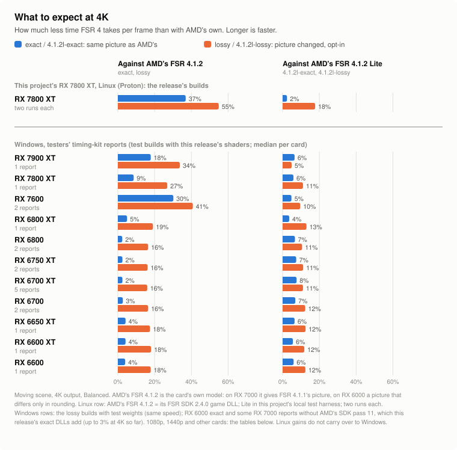

# fsr4-shader-performance-overrides

Makes AMD FSR 4.1.1 upscaling faster on Radeon graphics cards, on Windows and Linux, by replacing
FSR 4's slowest shaders with faster ones. One file to swap, nothing else in the game changes.

## Quick start

> [!WARNING]
> **Never use this in online games or in any game with anti-cheat.** These are modified game files. Anti-cheat
> software can treat a changed DLL or changed shaders as tampering, and that can get an account banned. Use it in
> single-player games only.

**1. Download the zip for your graphics card.**

| Your graphics card | Download |
|---|---|
| A Radeon **RX 7000 or RX 6000** graphics card: the name has "RX" and a four-digit number, such as RX 7800 XT or RX 6700 XT. This includes gaming laptops with their own RX chip (RX 7700S, RX 6700M and the like) | **[fsr4.1.1-cyboman.zip](https://github.com/zgauthier2000/fsr4-shader-performance-overrides/releases/latest/download/fsr4.1.1-cyboman.zip)** |
| **Graphics built into the processor:** most laptops, mini PCs and handhelds. The name is "Radeon Graphics" or "Radeon" with a three-digit number, such as Radeon 780M or 890M; also the Steam Deck | **[fsr4.1.1-igpu-cyboman.zip](https://github.com/zgauthier2000/fsr4-shader-performance-overrides/releases/latest/download/fsr4.1.1-igpu-cyboman.zip)** |
| Radeon RX 9000 | not for these cards: they run a different FSR 4. Do not install it there. |

Not sure which you have? In Windows, open Task Manager, go to Performance and look at the GPU's name; on a
laptop with two, the RX one is the one games use.

**2. Choose a version.** Each zip holds two folders with one file each:

| Folder | Speed | Picture |
|---|---|---|
| `exact` | faster than AMD's | **the same as AMD's, byte for byte** |
| `lossy` | faster again | very close to AMD's, but not the same. Read `WARNING.txt` in that folder first |

If you are not sure, take `exact`.

**3. Put the file in the game's folder.** The game must already run FSR 4.1.1, for example through
[OptiScaler](https://github.com/optiscaler/OptiScaler).

1. Find `amd_fidelityfx_upscaler_dx12.dll` in the game's folder (often next to OptiScaler) and
   rename it to `amd_fidelityfx_upscaler_dx12.dll.orig`. It must be version 4.1.1.2740.
2. Copy the `amd_fidelityfx_upscaler_dx12.dll` from the folder you chose into its place.

This works on Windows and, under Proton, on Linux. Linux users can instead use
[one launch option](#linux-a-launch-option-instead-of-the-dll) and leave the DLL alone.

**4. Check that it worked.** Open OptiScaler's overlay in the game. The FSR version reads
`4.1.1-cyboman` (or `4.1.1-lossy-cyboman`; with the other zip `4.1.1-igpu-cyboman` or
`4.1.1-igpu-lossy-cyboman`), and the upscaler time is lower than before.

**To undo it,** delete the file and rename the `.orig` file back.

## What to expect

<picture>
  <source media="(prefers-color-scheme: dark)" srcset="docs/img/quickstart-dark.svg">
  
</picture>

- **The gain depends on the output resolution.** It is largest at 4K. At 1440p and 1080p the exact
  DLL's gain depends on the card: some keep most of it (an RX 7900 XT 30% at 1440p, an RX 6600 XT 24% at 1080p),
  others show little or nothing (the RX 7800 XT and an RX 7900 XTX at 1080p). The lossy DLL helps at every size,
  because it skips work instead of only doing the same work faster.
- **It depends on your graphics chip, too.** FSR 4 time saved at 4K, from testers' timing-kit runs and game reports
  so far:

  | Graphics chip | Exact DLL | Lossy DLL |
  |---|---|---|
  | Radeon RX 7000 | 15 to 35% in most reports; about 2% in two RX 7800 XT reports | 29 to 49% |
  | Radeon RX 6000 | from nothing to about 30% | 23 to 48% |
  | Integrated graphics and handhelds | from a few percent slower to 6% faster | 23 to 35% |
  | Intel Arc B580 (one report) | 6 to 8% | 31% |
  | GeForce RTX 3060 Ti (one report) | none | 34% |

  We do not yet know what decides where a card falls in its range. Most rows rest on a handful of single runs.
  [Results by graphics chip](docs/results.md#by-gpu-type), [timing kit results](timing-kit/RESULTS.md).
- **It only shows when the graphics card is the limit.** If the processor limits your frame rate,
  the frame rate does not change.
- **The exact DLL cannot change the picture.** Its output was compared with AMD's byte for byte at
  720p, 1080p, 1440p, 4K and 5K, in still and moving scenes. One intended exception: on RX 6000 cards under
  Windows, AMD's own file shows ghosting, and the exact DLL carries the fix, so its picture differs from AMD's there.
- **The lossy DLL trades a little accuracy for speed.** It runs FSR 4's neural network on every
  other frame and carries its result along with the picture's motion in between. Measured
  differences and comparison crops: [exact and lossy compared](docs/exact-vs-lossy.md). What the
  alternating cost means for frame caps and V-Sync: [frame pacing](docs/frame-pacing.md).

One card, one game, as an example of the best case: a Radeon RX 7800 XT, Shadow of the Tomb Raider's benchmark, 4K
output, FSR 4.1.1 Balanced. Your card and your game will give other numbers:

| | FSR 4 time per frame | Frame rate | Picture |
|---|---|---|---|
| AMD's shaders | 4.16 ms | 97 FPS | the reference |
| Exact | 2.99 ms (−28%) | 109 FPS (+12%) | identical |
| Lossy | 2.15 ms (−48%) | 120 FPS (+24%) | still picture within 0.2 dB of AMD's |

More games and resolutions: [all results](docs/results.md).

> [!NOTE]
> **Two settings where you will see little or no gain:**
> - **FSR's debug view (the overlay that draws FSR's watermark and debug panels).** The faster shaders do not cover the
>   debug versions of FSR's last pass, so AMD's own slow one runs and most of the gain is gone. Switch the debug view off
>   to measure or to play.
> - **Ultra Performance mode.** The lossy DLL does not skip frames there, so it is no faster than the exact DLL. The
>   exact DLL's own gain still applies.

## New in this release

> [!TIP]
> **The lossy DLL: slowly swaying foliage is closer to AMD's.**
> - **New in this release:** leaves that move slowly without motion vectors lag less. In the test rig the lossy DLL
>   closes about half of its gap to AMD's shaders there.
>   [Details below](#slowly-swaying-foliage-release-dll-2026-10-12).
> - **What it does not fix:** leaves that move fast, leaves during a camera pan, and low frame rates. The cause was
>   found for this release: the network's own memory of the frame before, which a skipped frame cannot refresh.
> - **The price:** film grain flickers more than in the last releases. If foliage did not bother you and your games use
>   film grain, there is no need to update.
> - **[The lossy DLL beside FSR 3.1, HelixSR and XeSS](docs/upscaler-comparison.md):** the same test scenes and the same
>   timing for all five, with one chart per upscaler and side-by-side crops. It was made with the build of
>   `dll-2026-10-11.7`; this release differs from it in the foliage and grain figures given below.

<picture>
  <source media="(prefers-color-scheme: dark)" srcset="docs/img/cmp5-radar2-dark.svg">
  
</picture>

Made-up test scenes on one graphics card; [the comparison page](docs/upscaler-comparison.md) has the same chart for FSR 3.1, HelixSR and XeSS, the figures, and the scenes the lossy DLL does worst in.

> ### Help test it: the timing kit
> **[Download the Windows timing kit](https://github.com/zgauthier2000/fsr4-shader-performance-overrides/releases/download/timing-kit-2026-10-12.3/fsr4-timing-kit-windows.zip)** (experimental, 190 MB, version 2026-10-12.3): unpack, double-click
> `fsr4time.exe`, wait 15 to 20 minutes. It times FSR 4 with AMD's shaders and with these DLLs on
> your graphics card, shows which DLLs give the same picture on your machine, and offers to send
> the result. **Reports from Windows are in from eleven graphics chips so far; every further
> card helps.**
> - **Both kits were updated on 2026-10-12; if you ran an earlier one, please download and run again.**
>   - **New in the Windows kit 2026-10-12.3:** every DLL should give the same picture in both of its runs. Where one does
>     not, the summary now says how different the two are: how many 16x16-pixel blocks, where, and by how much. Two
>     reports from one RX 7800 XT showed such a difference for the lossy DLL at 4K, and this is there to find out what it is.
>   - **Both kits carry the lossy build of the release before this one** (`dll-2026-10-11.7`).
>   - **The Windows kit (2026-10-12.2) now shows which part of the exact DLL saves time on your card.** It carries two more
>     DLLs: AMD's shaders with only the rewritten last shader, and AMD's shaders with every other rewrite. On some cards
>     under Windows the exact DLL gains a lot and on others almost nothing, and this is how we find out why.
>   - **It times every DLL twice,** in opposite order, and shows both figures where they disagree, so a disturbed
>     reading can be told from a real difference. That makes the run longer than before (seven minutes); the 15 to
>     20 minutes are an estimate. `fsr4time.exe --once` gives the short run.
>   - **It times any FSR 4 DLL you put into a new folder under `dlls`,** not only 4.1.1, and every FSR 4 version that
>     DLL offers.
>   - **The Linux kit (2026-10-12.2; shorter since 2026-10-12.1):** 16 minutes for the full run on an RX 7800 XT, since three tests whose
>     question is settled are gone. It also reports how the card is connected (PCIe link), and when the card is busy
>     it asks you to close what is using it before it starts.
> - The Windows kit compares the moving picture as well as the still one.
> - **New: be named on the [thank-you page](docs/thanks.md).** When you send your result, the kit asks for a name or nickname to list. It is optional.
> - **RX 6000 owners:** AMD's own shaders show ghosting on these cards under Windows. The kit has two
>   extra reference DLLs and prints a fingerprint of each picture, so your run tells us whether the
>   exact DLL gives the corrected picture there.
> - **Not only Radeon:** the DLLs should run on any graphics chip whose driver supports DirectX 12 with
>   Shader Model 6.6, which includes GeForce and Intel Arc.
> - **Linux and the Steam Deck:** [the Linux kit](timing-kit), updated the same day. It now times the lossy
>   build's one changed model pass, and its check that the model passes give AMD's output, blind in kits before
>   2026-10-10, is fixed.
>
> [What the kits do](timing-kit#windows-experimental)

**The technical pages behind this release:**

- [Foliage and the network's memory](research/frame-skip#foliage-and-the-networks-memory-release-dll-2026-10-12): why moving leaves lag when the network runs on every other frame, what was tried, and the rule for the slow case
- [Rain and other thin streaks](research/frame-skip#rain-and-other-thin-streaks-release-dll-2026-10-117): why a line passed the rule against single bright pixels, the rule that replaced it, and what it costs thin wires
- [Sparkling on glossy surfaces, and a shader that held too much](research/frame-skip#sparkling-on-glossy-surfaces-and-a-shader-that-held-too-much-release-dll-2026-10-116): single over-bright pixels taken for sparks, the test scene, and why a rule that cost nothing in the timing kit cost frames in a game
- [Shimmer with auto exposure on](research/frame-skip#shimmer-with-auto-exposure-on-the-history-store-release-dll-2026-10-115): the exposure value's wobble, the store that drops bits, why rounding everything was the wrong fix, and the narrow one that shipped
- [The exact files beside a "steady" test build](docs/steady-test.md): an unreleased experiment with the dead band of release `dll-2026-10-11.4` on the exact files, without frame skip
- [Why folding steadied the picture, and what replaced it](research/frame-skip#why-folding-steadied-the-picture-and-what-replaced-it-release-dll-2026-10-114): the network's weight for the new frame, the one-step flicker, the price in lag, and the dead band
- [Bright dots in foliage](research/frame-skip#bright-dots-in-foliage-release-dll-2026-10-113): why sky seen through leaves was shown as sparks, and the settings that were compared
- [A still object over fast ground](research/frame-skip#a-still-object-over-fast-ground-release-dll-2026-10-112): why release `dll-2026-10-11` left a ghost there, and the two fixes that were tried
- [Thin wires, particles and light folds](research/frame-skip#thin-wires-particles-and-light-folds-release-dll-2026-10-11): what erased the wires, the network's own verdict as a signal, and which further layers were folded
- [The lossy DLL beside FSR 3.1, HelixSR and XeSS](docs/upscaler-comparison.md): five upscalers on the same scenes and the same timing, with charts and crops
- [Exact and lossy compared](docs/exact-vs-lossy.md): every measurement of the lossy DLL against AMD's, with comparison pictures, and its limits (moving foliage, wires under a slow pan)
- [Weight folding](research/lossy): the earlier experiment the light folds come from
- [The timing kits](timing-kit): what the Linux and Windows kits measure, and how to read their summaries

### Slowly swaying foliage (release `dll-2026-10-12`)

One change to the lossy DLL's picture. **The exact DLL is unchanged.**

- **What was wrong:** moving foliage is the lossy DLL's weakest case. Leaves that sway without motion vectors lag and come
  out softer than with AMD's shaders.
- **The cause, found for this release:** FSR 4's network keeps a small memory image from the frame before and needs it to
  recognize things that move without motion vectors. With AMD's shaders it gives swaying leaves about half of the new
  frame. In the lossy DLL the network runs on every other frame, so that memory is two frames old:
  - **leaves that move slowly** still get the network's verdict, but the skipped frames did not use it;
  - **leaves that move fast** lose it: the network's weight for the new frame falls from 50% to under 10%, and the leaves
    lag. AMD's own shaders do the same when the leaves move twice as fast.
- **The fix, for the slow case only:** a skipped frame now uses the network's verdict where it gave a middle weight, which
  is what slowly moving leaves get.

| Measured in the test rig at 4K, camera still: error on the leaves, of 255 (frames that ran the network / skipped frames) | AMD's shaders | `dll-2026-10-11.7` | This release |
|---|---|---|---|
| Leaves swaying at half the rig's usual speed | 10.2 / 10.2 | 11.9 / 13.5 | 11.0 / 11.9 |
| At two thirds of it | 10.7 / 10.8 | 13.0 / 15.0 | 12.1 / 13.1 |
| At the usual speed (the network's verdict is lost) | 12.1 / 12.1 | 18.0 / 18.6 | 18.1 / 18.7 |
| Half speed, camera panning | 9.7 / 9.7 | 12.3 / 13.3 | 12.3 / 13.3 |

| The price: film grain, change per frame | AMD's shaders | `dll-2026-10-11.7` | This release |
|---|---|---|---|
| Grain of 6 in 255 | 0.785 | 0.342 | 0.489 |
| Grain of 10 | 1.724 | 1.056 | 1.292 |
| Grain of 15 | 2.549 | 1.932 | 2.222 |
| Grain of 6, auto exposure on | 0.552 | 0.359 | 0.400 |
| Grain of 10, auto exposure on | 0.357 | 0.370 | 0.447 |
| Grain of 15, auto exposure on | 0.484 | 0.514 | 0.514 |

- **What got worse:**
  - Film grain flickers more than in the last releases: the network gives some grain the same middle weights as leaves.
    Without auto exposure it stays steadier than with AMD's shaders. With auto exposure on, grain of 10 in 255 is now
    25% less steady than AMD's (it was 4%).
  - Flat areas and thin detail at rest change slightly more per frame: a flat area 0.053 to 0.058 (with auto exposure
    0.093 to 0.104), thin vertical detail 0.305 to 0.316, a railing behind moving objects 0.623 to 0.659 (AMD's 0.655).
- **What it does not fix:**
  - Leaves that move fast, as in the third row. No rule in the last shader can: the network's memory cannot be made
    on a frame that skips the network.
  - Leaves while the camera pans: the rule applies only where the picture is at rest.
  - Low frame rates. At 30 FPS a leaf moves twice as far per frame as at 60, so more of the foliage is in the fast case.
    There the exact DLL remains the better choice.
- **Unchanged:** everything in motion (the moving scene at 1080p, 1440p, 4K and 5K, 30 to 120 FPS, ghost and plate
  scenes, pan start), particles, wires, rain, single over-bright pixels. Slow fades are followed slightly sooner.
- **Speed:** the last shader holds as few values as before (16 copies side by side on a Radeon RX 7800 XT under Linux)
  and has 37 more instructions of 8,991. Timed alone at 4K: 0.675 to 0.693 ms on a frame that runs the network, 0.005
  to 0.01 ms more on a skipped one. Shadow of the Tomb Raider's benchmark at 4K Balanced, one run with this release's
  Linux files: 18,689 frames, 120 FPS. The release before was not run there, so that is not a comparison.
- **Not checked:**
  - Games, beyond one impression: in Shadow of the Tomb Raider the author found foliage a little better than with the
    releases before. That game never showed foliage as bad as the report from Alan Wake 2, which was not tried, so
    whether the reported case improves is for testers to say. The rig's leaves are made up.
  - The whole upscaler in the timing kit.
  - Windows drivers, and other graphics chips than the RX 7800 XT.
- These are single runs on made-up scenes.
  [How the cause was found](research/frame-skip#foliage-and-the-networks-memory-release-dll-2026-10-12).

Earlier releases, including `dll-2026-10-11.7` (rain no longer shown as white dashes), `dll-2026-10-11.6` (no sparkling on glossy surfaces, a speed loss stopped), `dll-2026-10-11.5` (shimmer in bright flat areas with auto exposure on), `dll-2026-10-11.3` (fewer bright dots in foliage), `dll-2026-10-11.2` (a ghost behind bright objects over fast ground), `dll-2026-10-11` (white beads on thin wires, particles closer to AMD's), `dll-2026-10-10` (less shimmer on grain and flat areas) and `dll-2026-10-09` (particles on skipped frames, two downloads instead of eight): [changelog](docs/changelog.md).

## Will it work for me?

| Graphics card | Which zip | Status |
|---|---|---|
| RX 7900, 7800, 7700, 7600 (desktop RDNA3) | `fsr4.1.1-cyboman.zip` | measured here on an RX 7800 XT; testers report large gains on Windows |
| RX 6000 (RDNA2) | `fsr4.1.1-cyboman.zip` | runs, and includes the fix for the shimmering these cards show with AMD's file; at 4K, reports with the exact DLL range from a few percent to about 30%, and we do not yet know what decides it; a few percent at 1440p and below (tester reports) |
| Radeon 780M, 890M and other integrated graphics, Steam Deck | `fsr4.1.1-igpu-cyboman.zip` | experimental: few reports, small gains |
| RX 9000 (RDNA4) | none | no: a different FSR 4 runs there ([open for someone to pick up](docs/rdna4.md)) |
| Any other graphics chip: Nvidia GeForce, Intel Arc and Intel integrated graphics, older Radeon | `fsr4.1.1-cyboman.zip`; for a chip built into the processor try `fsr4.1.1-igpu-cyboman.zip` first | **should run, untested.** FSR 4.1.1's shaders are ordinary DirectX 12 compute shaders: they need Shader Model 6.6 with 8-bit integer dot products, 16-bit types and wave operations, which current drivers from all three makers provide. Users report the DLLs running on a GeForce laptop and on an Arc A770. Nothing has been measured there: the rewrites were made for Radeon chips, so they may or may not be faster than AMD's shaders, and "same picture" has only been verified on Radeon. A [timing-kit](timing-kit#windows-experimental) result tells both |

You also need a DirectX 12 game in which FSR 4.1.1 already runs, with
`amd_fidelityfx_upscaler_dx12.dll` version 4.1.1.2740.

Both DLLs have AMD's graphics-card check lifted (AMD's own file offers this FSR 4 only on desktop
RX 7000 cards), so they start on any card whose driver can run the shaders: DirectX 12 with Shader
Model 6.6. That is also why they must not go on an RX 9000 card, where a different FSR 4 would
then start as well.

If the first zip is slower than AMD's file on a small RX 6000 card, try the second one: it differs
only in one shader that is built smaller. Details: [GPU support](docs/gpu-support.md).

## Linux: a launch option instead of the DLL

On Linux you can leave AMD's DLL in place and give the game the replacement shaders directly.

1. Download or clone this repository.
2. In Steam, add this to the game's launch options (keep anything already there in front of
   `%command%`):

   ```
   VKD3D_SHADER_OVERRIDE='Z:/path/to/fsr4-shader-performance-overrides/prebuilt' %command%
   ```

   `Z:` is how Proton sees your Linux root, so `Z:/home/you/...` is `/home/you/...`. For the lossy
   version use the folder `prebuilt-lossy` instead, after reading the `WARNING.txt` in it.

- **The game must be using AMD's original DLL.** The launch option does nothing while a DLL from
  this project is installed, because the files are matched to AMD's shaders.
- **The version name does not change** with the launch option; OptiScaler shows plain `4.1.1`.
  The upscaler time is how you tell it applied.
- **The prebuilt files do not fit every setup.** They were made on an RX 7000 desktop card. On
  one tester's RX 6900 XT, Proton laid the same shaders out differently and the picture came out
  darker. If the picture looks wrong, build your own files:
  [Linux guide](docs/linux.md#building-your-own). `./tools/check_prebuilt.sh <dump folder>` tells you
  whether the prebuilt files fit.

If it does not get faster: [Linux guide](docs/linux.md).

## More about the files

Each DLL is AMD's own file with the rewritten shaders swapped in and the version name changed.
How that is done, and how to build it yourself: [`dll/`](dll). There is also a ReShade add-on
that does the same without touching the DLL: [`windows/`](windows).

The scripts that rewrite the Linux shaders and build the files in `prebuilt/` are in [`tools/`](tools)
(they were in the top folder until release `dll-2026-10-11.3`; commands in older posts need `tools/` in front).

**In some games OptiScaler's upscaler time is only reliable with the frame rate uncapped.** If
nothing changes at all, check that the game really runs FSR 4.1.1 with AMD's DLL version
4.1.1.2740; other versions have different shaders. See [shader variants](docs/variants.md).

## Good to know

- **Nothing else changes.** No game files are edited, and the output was compared byte for byte
  with AMD's at 4K, 1440p and 1080p.
- **Game and OptiScaler updates** can put the original DLL back; the launch option keeps working.
- **Never in online games or games with anti-cheat.** This changes the shaders the game renders with, and anti-cheat
  software can treat that as tampering. Single-player games only.
- **Linux:** do not set `RADV_PERFTEST=cswave32` for a game that runs FSR 4; it adds about 1.1 ms.

## More

| Page | What is in it |
|---|---|
| [All results](docs/results.md) | every game measured, benchmark pages with screenshots |
| [Linux guide](docs/linux.md) | requirements, building your own files, troubleshooting |
| [Making a shader dump](docs/shader-dump.md) | step by step, for reporting a wrong image or a missing speedup on Linux |
| [Timing kit](timing-kit) | a download for Linux and the Steam Deck that times every FSR 4 pass on your GPU, no game needed (new; five GPUs so far) |
| [GPU support](docs/gpu-support.md) | which download fits which GPU, integrated GPUs, RX 6000 cards and their shimmering fix |
| [Shader variants](docs/variants.md) | which versions of FSR 4's shaders are covered, and what to do if your game's is not |
| [How it works](docs/how-it-works.md) | what the rewrites do, where the time goes, what else was tried |
| [Exact and lossy compared](docs/exact-vs-lossy.md) | what the lossy DLL changes in the picture, with measurements and crops |
| [Lossy beside FSR 3.1, HelixSR and XeSS](docs/upscaler-comparison.md) | five upscalers on the same test scenes and timing, for comparison |
| [Frame pacing with the lossy builds](docs/frame-pacing.md) | what the alternating upscaler time means for frame caps, V-Sync, latency and overlay readings |
| [RDNA4](docs/rdna4.md) | what is known about the FP8 model on RX 9000 cards; open for anyone who can test on one |
| [Earlier releases](docs/changelog.md) | what each release changed, newest first |
| [Research](research) | the probes, data and scripts behind all of it |


## Star History

<a href="https://www.star-history.com/?repos=zgauthier2000%2Ffsr4-shader-performance-overrides&type=date&legend=top-left">
 <picture>
   <source media="(prefers-color-scheme: dark)" srcset="https://api.star-history.com/chart?repos=zgauthier2000/fsr4-shader-performance-overrides&type=date&theme=dark&legend=top-left" />
   <source media="(prefers-color-scheme: light)" srcset="https://api.star-history.com/chart?repos=zgauthier2000/fsr4-shader-performance-overrides&type=date&legend=top-left" />
   
 </picture>
</a>

## Credits and license

The postpass rewrite is adapted from `tools/fsr4cap/postpass_lds.py` in
[bbport](https://github.com/deadinside28/bloodborne_pc), a native Linux port of Bloodborne whose
author found the slow store pattern and wrote the original rewrite for that project's own FSR 4.1.1
runtime. This repository ports it to the shaders vkd3d-proton generates, so it works in ordinary
games.

The scripts are licensed under the GNU GPL v2 or later, like the project they derive from. See
[LICENSE](LICENSE). The prebuilt shaders are modified versions of AMD's, distributed under the same
license together with AMD's notice; see [`prebuilt/NOTICE.md`](prebuilt/NOTICE.md). Not affiliated
with or endorsed by AMD.

Testers who have asked to be named are listed on the [thank-you page](docs/thanks.md).

This repository is maintained independently. If this project has provided value to you, and you want to help support the author, consider formalizing your support with a voluntary micro-donation:

<a href="https://www.buymeacoffee.com/cyboman" target="_blank"></a>
