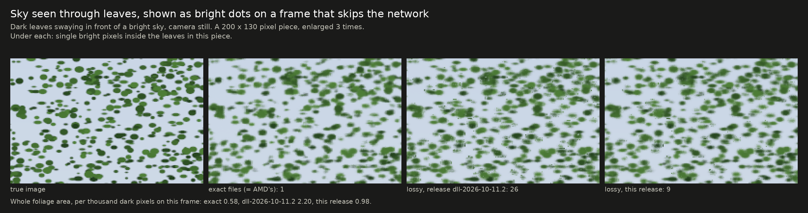
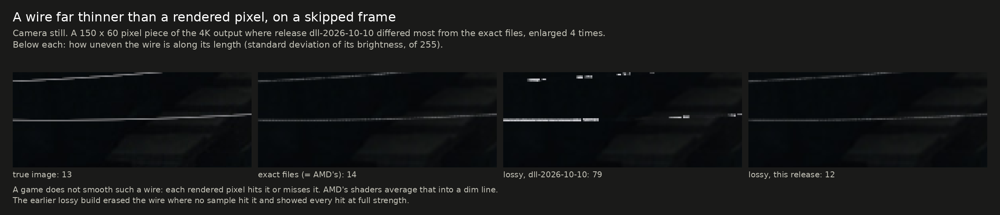
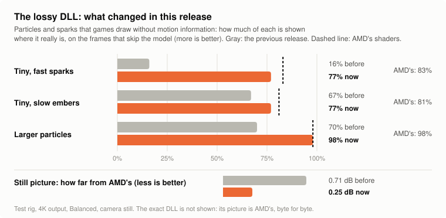
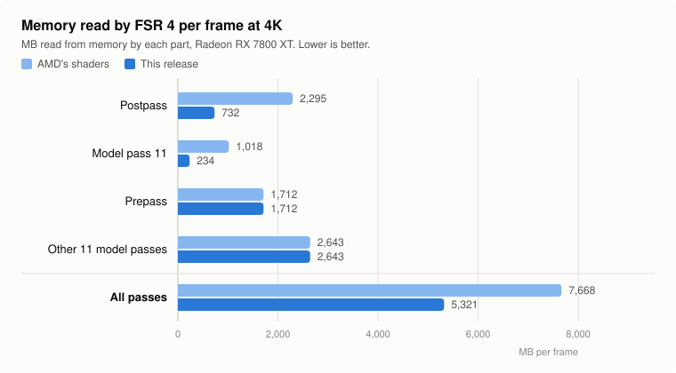

# Earlier releases

[Back to the front page](../README.md)

What each release up to `dll-2026-10-12.2` changed, newest first, as it was written at the time. The file names and build names in these entries are those of that release;
the current downloads are on the front page.

## 2026-10-12 ([release `dll-2026-10-12.2`](https://github.com/zgauthier2000/fsr4-shader-performance-overrides/releases/tag/dll-2026-10-12.2))

### Cheaper skipped frames, steadier grain

*Written for `dll-2026-10-12.2`: "this release" below means that one.*

Two changes to the lossy DLL. **The exact DLL is unchanged.**

- **The first shader, in two copies.** The lossy DLL runs FSR 4's network on every other frame. On the frames in
  between, the first shader (the "prepass", which prepares the network's input) still did all of its work and then
  threw most of it away. It now holds its work twice: AMD's code unchanged for the frames that run the network, and a
  short copy for the frames that skip it, which only records the picture's motion for the last shader.
- **A fold in the last shader.** The last shader (the "postpass") starts with a small network layer of its own. In each
  of its 16 outputs the three smallest of 36 groups of weights are merged into their neighbors ("folding"). This does
  not save time. It makes the last shader lean slightly more on the previous picture where the picture is noisy.
- **Found on the way:** since `dll-2026-10-06.6` the lossy first shader also wrote the motion record on the frames that
  run the network, and that extra code made the graphics driver's compiler round a few of the shader's other values
  differently. At some render sizes (seen at 1506x846 and 3012x1694, not at 2260x1272 or 1280x720) those frames
  therefore did not get exactly AMD's first-shader result: with everything else AMD's, the final picture differed by
  0.0001 on average. With two copies they do get it, at all four sizes.

| Whole upscaler, ms per frame: Windows timing kit under Proton, Radeon RX 7800 XT, one run | AMD's shaders | `dll-2026-10-12` | This release |
|---|---|---|---|
| 4K output: average | 4.90 | 2.36 | 2.22 |
| 4K: frame that runs the network / skipped frame | | 3.25 / 1.46 | 3.20 / 1.23 |
| 1440p output: average | 2.18 | 1.09 | 1.02 |
| 1440p: frame that runs the network / skipped frame | | 1.50 / 0.66 | 1.48 / 0.54 |
| 1080p output: average | 1.04 | 0.66 | 0.64 |
| 1080p: frame that runs the network / skipped frame | | 0.92 / 0.35 | 0.92 / 0.31 |

| Film grain on a still picture at 4K, change per frame | AMD's shaders | `dll-2026-10-11.7` | `dll-2026-10-12` | This release |
|---|---|---|---|---|
| Grain of 6 in 255 | 0.785 | 0.342 | 0.460 | 0.330 |
| Grain of 10 | 1.724 | 1.056 | 1.291 | 1.028 |
| Grain of 15 | 2.549 | 1.932 | 2.124 | 1.608 |
| Grain of 6, auto exposure on | 0.552 | 0.359 | 0.381 | 0.295 |
| Grain of 10, auto exposure on | 0.357 | 0.370 | 0.383 | 0.331 |
| Grain of 15, auto exposure on | 0.484 | 0.514 | 0.513 | 0.516 |

- **In a game:** Shadow of the Tomb Raider's benchmark at 4K Balanced, one run each on the same day: 18,682 frames and
  120 FPS with `dll-2026-10-12`'s Linux files, 18,879 frames and 122 FPS with the two-copy first shader (1% more
  frames). The overlay's average upscaler time read 2.14 and 2.00 ms. The fold was not in that run; it does not change
  the amount of work.
- **What got worse** (all from the fold; `dll-2026-10-12` to this release):
  - A flat area at rest changes slightly more per frame: 0.053 to 0.058, and 0.097 to 0.100 with auto exposure on.
    With AMD's shaders the first figure is 0.126.
  - A thin wire in a slow camera pan is less steady: change per frame 10.34 to 11.04 (AMD's 7.16); with auto exposure
    on 7.84 to 8.05.
  - Thin vertical detail at rest with auto exposure on: change per frame 0.344 to 0.372.
  - In the scene with glints on a glossy surface, the single brightest stray pixel is 185 levels too bright instead
    of 91 (AMD's 100). The number of stray pixels there went slightly down (1,462 to 1,419 per million over 20 levels;
    AMD's 1,460), and with auto exposure on the brightest one reads 142 against 148 before.
  - In the firefly scene, 434 instead of 417 pixels per million are more than 10 levels too bright (AMD's 370).
- **What got better besides grain:** grain is also closer to the true picture (0.3 to 0.9 dB); a slow brightening
  shows in a mid-gray flat area 1.20 instead of 1.31 frames late (AMD's 0.89); still foliage has slightly fewer isolated bright
  dots (1.68 against 1.79 per thousand dark pixels).
- **Unchanged or within a few percent:** the moving scene at 1080p, 1440p and 4K, 30 to 120 FPS, the ghost and plate
  scenes, particles, rain, swaying foliage, the still picture's accuracy.
- **Why three, and why it is not a dial:** two words do almost nothing for grain, three give most of the gain, four a
  little more at a higher price for the wire, five and six are worse than four again. We measured that and cannot
  explain it. The result repeats to the third digit over three random grain patterns.
- **Not checked:**
  - The fold in a game: the benchmark run above had the first change only.
  - Windows drivers, and other graphics chips than the RX 7800 XT. The timings above are from Proton.
  - The quality checks with the HDR option set (the DLLs were compared with the Linux files with it).
- These are single runs on made-up scenes.
  [Where a skipped frame's time went, the rounding difference, and the fold's sweep](../research/frame-skip/README.md#a-prepass-in-two-copies-and-a-fold-in-the-last-shader-release-dll-2026-10-122).

## 2026-10-12 ([release `dll-2026-10-12`](https://github.com/zgauthier2000/fsr4-shader-performance-overrides/releases/tag/dll-2026-10-12))

### Slowly swaying foliage

*Written for `dll-2026-10-12`: "this release" below means that one.*

Two changes to the lossy DLL's picture. **The exact DLL is unchanged.**

- **What was wrong:** moving foliage is the lossy DLL's weakest case. Leaves that sway without motion vectors lag and come
  out softer than with AMD's shaders.
- **The cause, found for this release:** FSR 4's network keeps a small memory image from the frame before and needs it to
  recognize things that move without motion vectors. With AMD's shaders it gives swaying leaves about half of the new
  frame. In the lossy DLL the network runs on every other frame, so that memory is two frames old:
  - **leaves that move slowly** still get the network's verdict, but the skipped frames did not use it;
  - **leaves that move fast** lose it: the network's weight for the new frame falls from 50% to under 10%, and the leaves
    lag. AMD's own shaders do the same when the leaves move twice as fast.
- **The fix, for the slow case only:** a skipped frame now uses the network's verdict where it gave a middle weight, which
  is what slowly moving leaves get.
- **The second change, against the fix's price:** the network gives some film grain the same middle weights, so grain
  flickers more with the fix. To win part of that back, a few of the smallest weights in the network's first layer are
  merged into their neighbors ("folding", which makes the network lean a little more on the previous picture). It is done
  in three quarters of that layer's outputs: folding the last quarter as well steadied grain more, but made glints on
  glossy surfaces and slow fades worse.

| Measured in the test rig at 4K, camera still: error on the leaves, of 255 (frames that ran the network / skipped frames) | AMD's shaders | `dll-2026-10-11.7` | This release |
|---|---|---|---|
| Leaves swaying at half the rig's usual speed | 10.2 / 10.2 | 11.9 / 13.5 | 11.1 / 12.0 |
| At two thirds of it | 10.7 / 10.8 | 13.0 / 15.0 | 12.2 / 13.2 |
| At the usual speed (the network's verdict is lost) | 12.1 / 12.1 | 18.0 / 18.6 | 18.2 / 18.7 |
| Half speed, camera panning | 9.7 / 9.7 | 12.3 / 13.3 | 12.2 / 13.3 |

| The price: film grain, change per frame | AMD's shaders | `dll-2026-10-11.7` | The fix alone | This release (fix and fold) |
|---|---|---|---|---|
| Grain of 6 in 255 | 0.785 | 0.342 | 0.489 | 0.460 |
| Grain of 10 | 1.724 | 1.056 | 1.292 | 1.291 |
| Grain of 15 | 2.549 | 1.932 | 2.222 | 2.124 |
| Grain of 6, auto exposure on | 0.552 | 0.359 | 0.400 | 0.381 |
| Grain of 10, auto exposure on | 0.357 | 0.370 | 0.447 | 0.383 |
| Grain of 15, auto exposure on | 0.484 | 0.514 | 0.514 | 0.513 |

- **What got worse:**
  - Film grain flickers more than in the last releases: the network gives some grain the same middle weights as leaves.
    Without auto exposure it stays steadier than with AMD's shaders. With auto exposure on, grain of 10 in 255 is now
    7% less steady than AMD's (it was 4%; with the fix alone it would be 25%).
  - Thin detail at rest changes slightly more per frame: thin vertical detail 0.305 to 0.316, a railing behind moving
    objects 0.623 to 0.665 (AMD's 0.655). With auto exposure on, a flat area goes from 0.093 to 0.097; without it
    it stays at 0.053.
  - A thin wire in a slow camera pan is less steady: change per frame 9.60 to 10.34 (AMD's 7.16). This comes from the
    fold.
  - Slow fades show slightly later in bright flat areas: 0.78 to 0.85 frames behind when darkening, 0.83 to 0.91 when
    brightening (AMD's 0.62 and 0.46). This also comes from the fold.
- **What it does not fix:**
  - Leaves that move fast, as in the third row. No rule in the last shader can: the network's memory cannot be made
    on a frame that skips the network.
  - Leaves while the camera pans: the rule applies only where the picture is at rest.
  - Low frame rates. At 30 FPS a leaf moves twice as far per frame as at 60, so more of the foliage is in the fast case.
    There the exact DLL remains the better choice.
- **Unchanged or within the last digit:** everything in motion (the moving scene at 1080p, 1440p, 4K and 5K, 30 to
  120 FPS, ghost and plate scenes, pan start), particles, wires with the camera still or panning fast, rain, single
  over-bright pixels and glints.
- **Speed:** the last shader holds as few values as before (16 copies side by side on a Radeon RX 7800 XT under Linux)
  and has 37 more instructions of 8,991. Timed alone at 4K: 0.675 to 0.693 ms on a frame that runs the network, 0.005
  to 0.01 ms more on a skipped one. The fold changes weights, not the amount of work. Shadow of the Tomb Raider's
  benchmark at 4K Balanced, one run with this release's Linux files: 18,685 frames, 120 FPS (18,689 with the fix
  alone). The release before was not run there, so that is not a comparison.
- **Not checked:**
  - Games, beyond one impression: in Shadow of the Tomb Raider the author found foliage a little better than with the
    releases before (seen with the fix alone; this release's build looked good to them there too). That game never
    showed foliage as bad as the report from Alan Wake 2, which was not tried, so whether the reported case improves
    is for testers to say. The rig's leaves are made up.
  - The whole upscaler in the timing kit.
  - Windows drivers, and other graphics chips than the RX 7800 XT.
- These are single runs on made-up scenes.
  [How the cause was found, and how the fold was chosen](../research/frame-skip/README.md#foliage-and-the-networks-memory-release-dll-2026-10-12).

## 2026-10-11 ([release `dll-2026-10-11.7`](https://github.com/zgauthier2000/fsr4-shader-performance-overrides/releases/tag/dll-2026-10-11.7))

### Rain shown as white dashes

*Written for `dll-2026-10-11.7`: "this release" below means that one.*

One change to the lossy DLL's picture. **The exact DLL is unchanged.**

- **What was wrong:** a tester sent a video of Alan Wake 2 with the lossy DLL: white dashes and specks in a window with
  rain falling outside. In a still stretch of the video they come and go with every other frame of the game, which is
  the rhythm of the lossy DLL's skipped frames.
- **The cause:** the rule that keeps particles visible on skipped frames (a spark has no motion vectors, so it has to be
  recognized by its brightness). A rain streak is a thin bright line without motion vectors, and the rule showed each
  one at full strength. The rule of `dll-2026-10-11.6` did not stop it: that one asks for a second bright sample beside
  the first, and a line always has one, along itself.
- **The fix:** a bright sample now counts as a spark only as far as it has a bright neighbor in both directions,
  sideways and above or below. A particle is a spot; a line one pixel wide in the game's frame is not.

| Measured in the test rig at 4K: output pixels more than 20 levels too bright, per million | AMD's shaders | `dll-2026-10-11.6` | This release |
|---|---|---|---|
| Rain: faint streaks one pixel wide, falling fast | 0 to 1 | 19,242 to 21,130 | 0 |
| Rain, four times as bright and slower | 1,258 to 1,314 | 68,189 to 73,960 | 450 to 489 |
| Rain with the HDR option and auto exposure | 2 | 17,512 to 19,350 | 0 |
| Single over-bright pixels, new places every frame | 25 | 73 | 14 |
| Single over-bright pixels, dimmer and three times as many | 0 | 459 | 0 |
| Fixed glints that the camera jitter hits now and then | 1,460 | 1,446 | 1,411 |

| Measured in the test rig at 4K, on skipped frames | AMD's shaders | `dll-2026-10-11.6` | This release |
|---|---|---|---|
| Large particles: share shown | 98% | 98.1% | 98.2% |
| Tiny fast embers: share shown | 83% | 75.0% | 73.7% |
| Thin wires, slow pan: brightness (true value 111) | 100 | 58.7 | 52.6 |
| Thin wires, slow pan: change per frame | 7.16 | 14.38 | 9.60 |
| Thin wires, fast pan: brightness (true value 111) | 97 | 62.5 | 58.1 |
| Thin wires, camera still: brightness (true value 111) | 67.4 | 67.1 | 65.8 |
| Still picture | 44.33 dB | 44.24 dB | 44.24 dB |

- **What got worse:**
  - Thin wires are dimmer while the camera pans (the table's wire rows). A wire is a line one pixel wide too, and the
    rule that removes the rain takes some of the wire with it. They also flicker less than before.
  - Tiny fast embers are shown a little less on skipped frames.
  - Rain two pixels wide in the game's frame would still pass; that was not measured.
- **Unchanged:** everything else that was measured: the moving scene at 1080p, 1440p and 4K, rest, ghost and
  uncovered-area measures, foliage, film grain, 30 to 120 FPS, pan start. The last shader holds as few values as before
  (16 copies side by side on a Radeon RX 7800 XT under Linux, as files and as DLL) and takes the same time: 0.67 ms
  against 0.67 ms at 4K, timed alone.
- **Not checked:**
  - The game the report came from. The fault was rebuilt as a made-up scene; whether the dashes there are gone is for
    the tester to say. AMD's shaders make the rig's rain almost invisible, which real rain in a game is not.
  - The whole upscaler in the timing kit, and a game benchmark.
  - Windows drivers.
- These are single runs on made-up scenes.
  [How the cause was found](../research/frame-skip/README.md#rain-and-other-thin-streaks-release-dll-2026-10-117).

## 2026-10-11 ([release `dll-2026-10-11.6`](https://github.com/zgauthier2000/fsr4-shader-performance-overrides/releases/tag/dll-2026-10-11.6))

### Sparkling on glossy surfaces

*Written for `dll-2026-10-11.6`: "this release" below means that one.*

One change to the lossy DLL's picture and one to its speed. **The exact DLL is unchanged.**

- **What was wrong:** a tester sent a video of Gears of War: E-Day with the lossy DLL: small bright points sparkling on a
  glossy panel that shows traced reflections. Such surfaces hand the upscaler single over-bright pixels that change
  from frame to frame, and FSR is meant to average them away.
- **The cause:** two of the lossy DLL's own rules for skipped frames. The rule that keeps particles visible (a spark has no
  motion vectors, so it has to be recognized by its brightness) took each over-bright pixel for a spark and showed it.
  And since `dll-2026-10-11`, which stopped erasing thin wires from the stored picture at rest, nothing removed it again.
- **The fix:** a bright sample now counts as a spark only as far as a second sample beside it bears it out. A particle
  covers more than one pixel of the game's frame; this kind of noise does not.
- **Where else it should help:** the rule does not know about ray tracing, only about lone bright pixels. Small highlights
  on wet, metal or finely bumped surfaces, noisy screen-space reflections and glints on water reach the upscaler the
  same way. The table's second row is that case (glints that stay in place and are hit only on some frames) and is back
  at AMD's figure. No game was checked for it.

| Measured in the test rig at 4K: a dark surface with single over-bright pixels in the game's frame | AMD's shaders | `dll-2026-10-11.5` | This release |
|---|---|---|---|
| New places every frame: output pixels more than 20 levels too bright, per million | 25 | 7,786 | 73 |
| Fixed glints that the camera jitter hits now and then | 1,460 | 4,721 | 1,446 |
| With the HDR option and brighter pixels | 220 | 8,767 | 323 |
| Dimmer and three times as many | 0 | 16,070 | 459 |
| Large particles: share shown on skipped frames | 98% | 98.1% | 98.1% |
| Tiny fast embers: share shown on skipped frames | 83% | 75.3% | 75.0% |
| Still picture | 44.33 dB | 44.25 dB | 44.24 dB |
| Film grain of 15 in 255: accuracy | 34.84 dB | 33.44 dB | 33.66 dB |

- **Speed: a loss that had crept in is stopped.** Each rule added since `dll-2026-10-07` made the last shader hold more
  values at once, and a graphics chip runs fewer copies of a shader side by side the more it holds: 16 at a time then, 12
  since `dll-2026-10-10`, and the first form of this fix would have made it 8. The timing kit hardly shows this; a game
  does. The shader is now laid out to hold as few as in `dll-2026-10-07` (16 at a time again on a Radeon RX 7800 XT under
  Linux, as files and as DLL).

| Shadow of the Tomb Raider benchmark, 4K, Balanced, RX 7800 XT, Linux, one run each | Frames rendered | Frame rate |
|---|---|---|
| `dll-2026-10-11.5` | 18,616 | 120 FPS |
| The fix in its first form (not released) | 18,342 | 118 FPS |
| This release | 18,632 | 120 FPS |

- **What got worse:** where two over-bright pixels happen to lie side by side they still pass (the table's last firefly row).
- **Unchanged:** everything else that was measured: the moving scene at 1080p, 1440p and 4K, rest, thin wires, ghost and
  uncovered-area measures, foliage, 30 to 120 FPS. The whole upscaler in the timing kit: 2.37 ms against 2.37 ms at 4K.
- **Not checked:**
  - The game the report came from. The fault was rebuilt as a made-up scene; whether the sparkle there is gone is for
    the tester to say.
  - Windows drivers. How many copies of the shader run side by side is the driver's compiler's doing, and it was
    measured under Linux only.
- These are single runs on made-up scenes.
  [How the cause was found, and what held the shader back](../research/frame-skip/README.md#sparkling-on-glossy-surfaces-and-a-shader-that-held-too-much-release-dll-2026-10-116).

## 2026-10-11 ([release `dll-2026-10-11.5`](https://github.com/zgauthier2000/fsr4-shader-performance-overrides/releases/tag/dll-2026-10-11.5))

### Bright flat areas at rest with auto exposure on

*Written for `dll-2026-10-11.5`: "this release" below means that one.*

One change to the lossy DLL, for games that run FSR with its auto-exposure option on. **The exact DLL is unchanged.**

- **What was wrong:** after the last release we found that its steadiness at rest held only with auto exposure off. With it
  on, bright flat areas (sky, walls) shimmered more with the lossy DLL than with AMD's shaders.
- **The cause:** with auto exposure on, FSR re-scales its stored picture every frame to the current exposure value. That
  value wobbles by less than a tenth of a percent from frame to frame even when nothing moves. The stored picture is kept
  in 16-bit numbers, and on the driver tested the store drops what does not fit. So the smallest downward wobble lowered
  every stored value by a whole step at once, and the picture then climbed back pixel by pixel. AMD's own shaders do the
  same; the lossy DLL's rules for steadying the picture held those corrections back, which made it worse.
- **The fix:** in the lossy DLL the re-scaling now changes the stored picture only by whole steps. A wobble below half a
  step changes nothing; a real change of exposure passes.

| Measured in the test rig at 4K, auto exposure on | AMD's shaders | `dll-2026-10-11.4` | This release |
|---|---|---|---|
| Change per frame at rest, worst flat piece | 0.213 | 0.276 | 0.093 |
| Change per frame at rest, bright flat areas | 0.186 | 0.310 | 0.051 |
| Change per frame at rest, fine detail | 0.125 | 0.102 | 0.097 |
| Still picture | 44.44 dB | 44.40 dB | 44.42 dB |
| Moving scene: background | 49.26 dB | 48.83 dB | 49.01 dB |
| Swaying foliage, camera panning: error | 6.57 | 8.16 | 7.35 |
| A slow darkening fade with nothing moving: frames behind, bright flat areas | 0.72 | 0.69 | 1.05 |
| A slow brightening fade: frames behind, bright flat areas | 0.46 | 0.64 | 0.87 |
| A sudden brightening by 20%: share still missing after 8 frames, mid-tone flat areas | 7% | 6% | 7% |

With auto exposure off, every figure of the last release holds to within a few thousandths (worst flat piece 0.053 against
0.056 then, and 0.126 for AMD's shaders).

- **Speed:** unchanged at 4K (2.36 ms against 2.36 ms for the whole upscaler, timing kit, RX 7800 XT under Proton); at 1080p
  output 0.70 against 0.69 ms.
- **What got worse:** with auto exposure on, slow fades show in bright flat areas about a third of a frame later than with
  AMD's shaders or the last release (the table's two fade rows). A sudden change of brightness is followed as before.
- **Unchanged:** everything that moves (moving scenes at 1080p, 1440p, 4K and 5K output, particles, wires, the ghost and
  uncovered-area measures, film grain). With auto exposure on, strong film grain is still passed on more than by AMD's
  shaders (0.40 against 0.36 and 0.57 against 0.48 change per frame for grain of 10 and 15 of 255).
- **Not checked:**
  - Windows drivers. Which way a store rounds is the driver's choice, and this was found and measured on Linux (RADV). Under
    Windows the fault may not exist; the change is built so that it does no harm there, but that is not measured.
  - Games. This was measured in the test rig only, on one graphics card.
  - Which games run FSR with auto exposure on.
- These are single runs on made-up scenes.
  [How the cause was found, and the wider fix that was tried and dropped](../research/frame-skip/README.md#shimmer-with-auto-exposure-on-the-history-store-release-dll-2026-10-115).

> [!NOTE]
> **An experiment that came out of this: the same rule on the exact files.** The new rule does not need frame skip. Added to the
> exact files it gives, in the test rig with auto exposure off, AMD's picture at the exact DLL's speed with less than half the shimmer at rest, a still
> picture 0.09 dB closer to the true image, and everything that moves the same as AMD's to within small fractions of a decibel.
> It would no longer be AMD's picture byte for byte, so it is not in the exact DLL and **not in any download yet**; it is an
> unreleased test. [The exact files beside the "steady" test build](steady-test.md), with pictures and a chart that places it
> among FSR 4.1.1, the lossy DLL, FSR 3.1, HelixSR and XeSS.

## 2026-10-11 ([release `dll-2026-10-11.4`](https://github.com/zgauthier2000/fsr4-shader-performance-overrides/releases/tag/dll-2026-10-11.4))

### A steadier, more accurate picture at rest in the lossy DLL

*Written for `dll-2026-10-11.4`: "this release" below means that one. The cause named as unknown in the note on auto exposure was found for `dll-2026-10-11.5`; see the front page.*

One change to how the lossy DLL keeps the picture steady at rest, after finding out why the earlier way worked.
**The exact DLL is unchanged.**

- **What we found:** shimmer in flat areas at rest is the picture moving by a single step of its own number format
  from frame to frame. AMD's network keeps asking for corrections of about that size even when nothing moves, and
  whether each one survives the rounding decides whether the pixel flickers.
- **What the earlier releases did:** they merged a few tiny weights in three of the network's layers ("folding").
  That turned out to steady the picture by making the network trust the previous picture more in flat areas. It worked,
  but for the same reason those areas followed slow changes of brightness late, and the still picture lost a little accuracy.
- **What this release does:** it leaves the network almost as AMD made it and adds one rule to the last step: a
  correction smaller than about two of those steps is skipped. Real changes are far larger and pass straight through.
  The folds in the first and last layers are gone; the one in the tenth stays, because it steadies fine detail at no
  cost in lag.

| Measured in the test rig at 4K | AMD's shaders | `dll-2026-10-11.3` | This release |
|---|---|---|---|
| Change per frame at rest, worst flat piece | 0.126 | 0.094 | 0.056 |
| Change per frame at rest, bright flat areas | 0.078 | 0.075 | 0.011 |
| Change per frame at rest, fine detail | 0.110 | 0.092 | 0.086 |
| Still picture | 44.33 dB | 44.15 dB | 44.31 dB |
| Moving scene: background | 49.27 dB | 48.72 dB | 49.07 dB |
| A slow fade with nothing moving: frames behind, bright / dark flat areas | 0.6 / 3.0 | 1.3 / 4.1 | 0.8 / 2.7 |
| Large glowing particles on skipped frames: error | 0.66 | 1.47 | 1.36 |
| Thin wire, slow pan: change per frame along it | 7.2 | 16.0 | 14.6 |
| Change per frame with grain of 6 / 10 / 15 of 255 | 0.79 / 1.72 / 2.55 | 0.29 / 0.98 / 1.86 | 0.34 / 1.08 / 1.99 |
| Just uncovered by a moving object, camera still | 32.62 dB | 32.03 dB | 31.64 dB |

How much each pixel changes from frame to frame with nothing moving:

- **Speed:** 2.36 ms against 2.35 ms for the whole upscaler at 4K (timing kit, RX 7800 XT under Proton): the new rule costs about half a percent.
- **What got worse:**
  - Film grain is passed on 7 to 17% more than in the last release (still well below AMD's): the fold that is gone was what held moderate grain back.
  - Areas a moving object has just uncovered are a little less accurate where the lossy DLL was already behind AMD's: 31.64 against 32.03 dB with a
    still camera (AMD's 32.62), and 0.1 to 0.3 dB lower at 1440p and 1080p output, where it stays above AMD's.
  - A second outline measure with a still camera rose from 4.42 to 4.66 (AMD's 4.01).
- **Unchanged:** fast sparks and embers, the bright dots in foliage, the softness of moving foliage, the ghost behind bright objects over fast ground.
- **Found after release (2026-10-11): this holds without auto exposure only.** Everything above was measured with FSR's
  auto-exposure option off. With it on, as many games run it, the same still scene reads differently: in the worst flat piece
  the lossy DLL changes 0.276 per frame against 0.213 for AMD's shaders, about 30% more, while the whole frame (0.034 against
  0.041) and fine detail (0.102 against 0.125) are still steadier than AMD's. The previous release reads 0.290 there, so this
  release is not a step back, but "less than half of AMD's shimmer" is true only with auto exposure off. The cause is not yet known. Film grain also reads differently with it on: AMD's shaders hold strong grain back far better there, and the lossy DLL is then less steady than AMD's on grain of 10 and 15 of 255 (0.40 against 0.36, and 0.57 against 0.48) and 1.5 to 2.9 dB less accurate.
  Ghosting, particles, wires, foliage and fades read much as with it off.
- **Not checked:** games. This was measured in the test rig only, on one graphics card.
- These are single runs on made-up scenes.
  [How the cause was found, and the three ways of using it that were compared](../research/frame-skip/README.md#why-folding-steadied-the-picture-and-what-replaced-it-release-dll-2026-10-114).

## 2026-10-11 ([release `dll-2026-10-11.3`](https://github.com/zgauthier2000/fsr4-shader-performance-overrides/releases/tag/dll-2026-10-11.3))

### Bright dots in foliage in the lossy DLL

*Written for `dll-2026-10-11.3`: "this release" below means that one. The picture is redrawn with each release and now shows the current lossy build as "this release". A tester later reported that this change did not alter what they saw in their game; the rig's defect was real, but it was not shown to be theirs.*

One change to the lossy DLL, from a tester's video: trees against a bright sky, camera still, with single bright
pixels flickering inside the dark foliage. **The exact DLL is unchanged.**

- **The cause:** on the frames that skip the neural network, one rule lets sparks through: a new sample far brighter
  than everything the previous picture has around it is shown at once. Sky seen through a gap between leaves looks
  exactly like that to the rule, so it was shown as a dot.
- **The fix:** the rule now asks for twice the distance before it calls a sample a spark. Most of the dots are gone,
  and real sparks lose about one point in a hundred of their brightness.
- **How it was found:** the test rig could not show it until its scenes were sampled the way a game renders them,
  one unsmoothed sample per pixel. That option is now in the rig's tools.

| Measured in the test rig at 4K | AMD's shaders | `dll-2026-10-11.2` | This release |
|---|---|---|---|
| Bright dots in swaying foliage, camera still (per thousand dark pixels) | 0.57 | 2.40 | 0.97 |
| The same while the camera pans | 0.33 | 0.70 | 0.37 |
| Change per frame with grain of 10 / 15 of 255 | 1.72 / 2.55 | 1.05 / 2.00 | 0.98 / 1.86 |
| Thin wire, camera still: change per frame along it | 2.9 | 3.3 | 2.9 |
| Thin wire, slow pan: change per frame along it | 7.2 | 17.9 | 16.0 |
| Tiny fast sparks shown on skipped frames, camera still / pan | 83% / 83% | 76% / 79% | 75% / 78% |
| Large glowing particles on skipped frames: error, camera still / pan | 0.66 / 0.73 | 1.38 / 1.54 | 1.47 / 1.74 |
| Still bright object over fast ground: error where its old image lands | 1.62 | 2.57 | 2.67 |

A piece of the foliage scene on a frame that skips the network, enlarged:

- **Unchanged:** the still picture and thin detail, shimmer at rest, the moving scene, slow embers, ghost scenes, and
  speed (2.35 ms for the whole upscaler at 4K, the same as the `dll-2026-10-11.2` lossy DLL in the same run; timing kit, RX 7800 XT under Proton).
- **What got worse:** particles, a little. Fast sparks are shown one point dimmer, and large glowing particles while
  the camera pans are 13% further from the true image (1.74 against 1.54; AMD's 0.73). The ghost behind a bright object
  over fast ground, fixed in the last release, gives back a small part (2.67 against 2.57; it was 6.06 before that fix).
- **Still open:** moving foliage is still softer than with AMD's shaders. This release removes most of the dots, not
  the softness. With a lot of moving vegetation the exact DLL remains the better choice.
- **Not checked:** the game the video came from was not run here, and the tester has not yet tried this build.
- These are single runs on made-up scenes.
  [How the cause was found, and the settings that were compared](../research/frame-skip/README.md#bright-dots-in-foliage-release-dll-2026-10-113).

## 2026-10-11 ([release `dll-2026-10-11.2`](https://github.com/zgauthier2000/fsr4-shader-performance-overrides/releases/tag/dll-2026-10-11.2))

### A ghost behind still objects over fast-moving ground in the lossy DLL

*Written for `dll-2026-10-11.2`: "this release" below means that one. The picture is redrawn with each release and now shows the current lossy build as "this release".*

One change to the lossy DLL, from a tester's video of a racing game played with frame generation. **The exact DLL
is unchanged.** This is a test release: the fix is measured in the test rig and not yet confirmed in the game.

- **What was seen:** the car's white license plate left a patch of bright streaks on the road behind it, on and
  off from frame to frame. The exact DLL did not show it.
- **The cause:** the last release relaxed, while the camera moves, the rule that keeps the previous picture in line
  with the new frame, so that thin wires would survive. Where a still object sits over ground that moves fast and
  the depths give no sign of which is in front, that rule was the only thing keeping the object's old image off the
  ground that had just come out from behind it.
- **The fix:** the rule applies in full again wherever something beside the pixel, or what now sits where its content
  was, moves differently from it. Elsewhere the last release's behavior stays, and with it the wire fix.

| Measured in the test rig at 4K | AMD's shaders | `dll-2026-10-10` | `dll-2026-10-11` | This release |
|---|---|---|---|---|
| Still bright object over fast ground: error where its old image lands | 1.62 | 2.51 | 6.06 | 2.57 |
| The same over slow ground | 5.79 | not measured | 5.76 | 4.95 |
| Areas a moving object has just uncovered | 34.48 dB | 36.45 dB | 36.12 dB | 36.34 dB |
| The same at 120 FPS, against AMD's | | +2.9 dB | +1.7 dB | +2.8 dB |
| Ghost measure on thin bars, fast pan | 0.33 | 0.38 | 0.47 | 0.43 |
| Thin wire, camera still: change per frame along it | 2.9 | 40.5 | 3.3 | 3.3 |
| Thin wire, slow pan: change per frame along it | 7.2 | 58.6 | 16.9 | 17.9 |
| Thin wire, fast pan: unevenness along it | +9 | +50 | +11 | +13 |

The test scene on a frame that skips the network, enlarged:

- **Unchanged:** the still picture (the same frames, bit for bit, at 1080p, 1440p and 4K), shimmer at rest, particles,
  grain, foliage, and speed (2.36 ms against 2.35 ms for the whole upscaler at 4K; timing kit, RX 7800 XT under Proton).
- **What got worse:** a thin wire under a pan gives back a little of the last release's gain where it passes
  something that moves differently (6% more flicker in a slow pan, unevenness +13 against +11 in a fast one).
- **Not checked:** frame generation cannot be run in the test rig, and the game was not run here. The rig shows the
  ghost when the object and the ground have the same depth; whether that is what happens in the game is not known.
  A faint trace remains above AMD's level (2.57 against 1.62), as in `dll-2026-10-10`.
- These are single runs on made-up scenes.
  [How the cause was found](../research/frame-skip/README.md#a-still-object-over-fast-ground-release-dll-2026-10-112).

## 2026-10-11 ([release `dll-2026-10-11`](https://github.com/zgauthier2000/fsr4-shader-performance-overrides/releases/tag/dll-2026-10-11))

### Wires, particles and steadier detail in the lossy DLL

*Written for `dll-2026-10-11`: "this release" below means that one. The picture is redrawn with each release and now shows the current lossy build as "this release".*

Three changes to the lossy DLL, all from tester reports. **The exact DLL is unchanged.**

- **White beads on distant power lines are fixed.** Thin things far away, such as power lines, showed bright
  dots that crawled along them. On the frames that skip the neural network, a rule that keeps the previous
  picture in line with the new frame was erasing anything thinner than a rendered pixel, and each time a new
  sample hit the wire again it was shown as a spark. That rule no longer applies where the picture is at rest,
  and while the camera moves it applies only where the network had already given up on the previous picture.
- **Large glows and slow embers are close to AMD's now.** Where the network itself asked for the new frame
  on the frame before, a skipped frame now takes it.
- **Fine detail and flat areas at rest are a little steadier.** A few of the smallest weights are merged in
  two more of the network's layers, the same light touch as in the first layer since the last release.

| Measured in the test rig at 4K | AMD's shaders | `dll-2026-10-10` | This release |
|---|---|---|---|
| Thin wire, camera still: change per frame along it | 2.9 | 40.5 | 3.3 |
| Thin wire, slow pan: change per frame along it | 7.2 | 58.6 | 16.9 |
| Thin wire, fast pan: unevenness along it | +9 | +50 | +11 |
| Large glowing particles on skipped frames: error | 0.66 | 2.79 | 1.38 |
| Slow embers shown on skipped frames | 81% | 74% | 81% |
| Thin vertical detail in a still picture | 27.09 dB | 26.29 dB | 26.64 dB |
| Change per frame at rest, fine detail | 0.110 | 0.101 | 0.092 |
| Change per frame at rest, worst flat piece | 0.126 | 0.109 | 0.094 |

One wire on a frame that skips the network, camera still, enlarged:

- **Speed is unchanged:** 2.34 ms against 2.36 ms for the whole upscaler at 4K (timing kit, RX 7800 XT under Proton).
- **What got worse:**
  - Areas a moving object has just uncovered keep less of their lead over AMD's: 36.1 dB against 36.5 in the
    moving test scene (AMD's 34.5), and 0.5 dB worse than before at 30 FPS.
  - Strong film grain is passed on 11 to 14% more than in the last release (still well below AMD's).
- **Still open:** a thin wire under a slow pan flickers about twice as much as with AMD's shaders, fast sparks are
  shown at 76% against AMD's 83%, and [moving foliage](exact-vs-lossy.md#limits-of-the-lossy-builds) is
  softer than with AMD's.
- These are single runs on made-up scenes; in games it was looked at on one machine.
  [How each cause was found](../research/frame-skip/README.md#thin-wires-particles-and-light-folds-release-dll-2026-10-11).

## 2026-10-10 ([release `dll-2026-10-10`](https://github.com/zgauthier2000/fsr4-shader-performance-overrides/releases/tag/dll-2026-10-10))

### Less shimmer in the lossy DLL

*Written for `dll-2026-10-10`: "this release" below means that one. The two pictures are redrawn with each release and now show the current lossy build as "this release".*

Testers of the previous release reported more shimmer than before. Two causes were found in the
test rig, and both are fixed in the lossy DLL. **The exact DLL is unchanged.**

- **Film grain and noisy surfaces.** The test that lets sparks through on skipped frames also let
  grain through. It is now less sensitive.
- **Bright, flat areas at rest** (sky, walls). With the neural network back to AMD's arithmetic,
  frame skip made such areas move more than with AMD's shaders. Merging a few of the smallest
  weights in the network's first layer brings that back to AMD's level.

| Measured in the test rig at 4K, lower is steadier | AMD's shaders | `dll-2026-10-07` | `dll-2026-10-09` | This release |
|---|---|---|---|---|
| Change per frame at rest, worst piece of the picture | 0.126 | 0.111 | 0.157 | 0.109 |
| Change per frame at rest, fine detail | 0.110 | 0.109 | 0.109 | 0.101 |
| Change per frame with grain in the picture | 0.785 | 0.249 | 0.550 | 0.316 |
| Fine stripes on a moving object, change per frame | 2.039 | 0.953 | 0.784 | 0.778 |
| Tiny fast sparks shown on skipped frames | 83% | 16% | 77% | 76% |
| Still picture against the true image | 44.33 dB | 43.68 dB | 44.12 dB | 44.06 dB |

How much each pixel changes from frame to frame when nothing moves, in the piece of the test
picture where the previous release was worst (black is steady):

The same with grain in every frame, in the piece where this release gained most:

- **Speed is unchanged:** 2.37 ms against 2.38 ms for the whole upscaler at 4K (timing kit, RX 7800 XT under Proton).
- **What got worse:** large, soft glowing particles show more of a seam on skipped frames
  (error around them 2.8 against 1.7 in the rig; AMD's shaders 0.7), and the still picture is
  0.06 dB further from AMD's.
- **An unexpected find:** merging a few of the smallest weights in the network's first layer makes flat areas as steady as with AMD's shaders, at a cost of about 0.05 dB in a still picture and no measurable change in speed. Why it works is not yet understood.
  [How the two causes were found](../research/frame-skip/README.md#shimmer-reported-after-release-dll-2026-10-09-two-causes).

## 2026-10-09 ([release `dll-2026-10-09`](https://github.com/zgauthier2000/fsr4-shader-performance-overrides/releases/tag/dll-2026-10-09))

### The lossy DLL shows particles properly, and is closer to AMD's picture

*Written for `dll-2026-10-09`: "this release" below means that one. The particle picture is redrawn with each release and now shows the current lossy build, whose large particles have stronger seams.*

<picture>
  <source media="(prefers-color-scheme: dark)" srcset="img/lossy-improved-dark.svg">
  
</picture>

- **Particles, sparks and embers no longer flicker or move at half the frame rate.** Games draw
  them without telling FSR that they move, and the previous lossy DLL kept them where they had
  been, or dimmed them, on every other frame. Seen and fixed in Elden Ring and in the menu of
  Mafia: The Old Country.
- **The still picture is closer to AMD's.** The lossy DLL no longer simplifies the neural
  network's arithmetic; it only skips it on every other frame.
- **It costs about 2% of the previous lossy DLL's speed** (Shadow of the Tomb Raider, 4K: 120 FPS
  against 122; the exact DLL gives 109, AMD's shaders 97).

The same skipped frame with the previous release and with this one, enlarged five times:

Enlarged like this, this release's particles are a little blocky and have thin seams; at normal
size and in motion that was not visible in the games it was checked in. More comparisons, and
what the lossy DLL still does worse than AMD's: [exact and lossy compared](exact-vs-lossy.md).

### A possible speed-up on Windows, and how to help find out

Two things changed inside both DLLs, with the same picture as before:

- **The last pass writes all three of its images in ordered rows.** The previous DLL did that for
  two of them and left the third to AMD's scattered writes, the slow part of AMD's own shader.
- **The code our rewrites replaced is gone from the file.** The previous DLL left it in for the
  graphics driver to discard.

Both can make the DLLs faster on Windows, where AMD's own driver compiles these shaders. How much
depends on what that driver did with the leftover code and the scattered writes. The first
reports from Windows are in and differ a lot from card to card; more are needed. **That is what the [Windows timing kit](https://github.com/zgauthier2000/fsr4-shader-performance-overrides/releases/download/timing-kit-2026-10-05/fsr4-timing-kit-windows.zip) is for:** it times the DLLs on
your graphics card, and the previous release's too if you put its file into a folder of its own
under `dlls`.

What is known so far, from one RX 7800 XT on Linux with Proton:

| | Result |
|---|---|
| The last pass, timed alone | faster: 0.42 → 0.30 ms at 1440p; at 4K steady at 0.66 ms where it varied between 0.69 and 0.90 |
| The whole upscaler through the DLL, as a game runs it | the same as the previous DLL: 3.16 ms at 4K, 1.46 against 1.43 ms at 1440p |
| On Windows, any graphics card | not measured yet |

Proton's driver was already discarding the leftover code, so that machine cannot show what
Windows will do.

**Two downloads instead of eight.** One zip for Radeon RX 7000 and RX 6000 graphics cards, one for
graphics built into the processor; each holds the exact and the lossy DLL. The separate RX 6000
builds are gone: their fix is in both DLLs now. It cost nothing measurable here; on Windows with
an RX 7000 card that has not been measured either.

The technical pages behind that release:

- [Particles, sparks and embers on skipped frames](../research/frame-skip/README.md#content-without-motion-vectors-particles-sparks-embers-release-dll-2026-10-09): what went wrong, the three tests that fix it, what was tried and rejected, what it costs
- [Why weight folding was taken out](../research/lossy): the record of the experiment the lossy DLL no longer uses
- [The Windows DLL's last pass, and code left in the files](../research/postpass-and-prepass/README.md#the-windows-dlls-last-pass-and-code-left-in-the-files-release-dll-2026-10-09): what changed inside the DLLs, how it compiles for each chip, timed alone and as a whole upscaler
- [Which download for which graphics chip](gpu-support.md#which-download-dll-2026-10-09-and-later): how four builds became two, and the RX 6000 fix that is now in both
- [Frame pacing with the lossy DLL](frame-pacing.md): what the alternating frame cost means for frame caps, V-Sync and latency

## 2026-10-07 ([release `dll-2026-10-07`](https://github.com/zgauthier2000/fsr4-shader-performance-overrides/releases/tag/dll-2026-10-07))

- **The main files are a little faster, with the same image.** The prepass and the postpass
  were rewritten again:
  - **Prepass:** each of a quad's four threads now finishes one of the four words of the model's
    input, which takes 12 exchanges between threads instead of AMD's 32.
  - **Postpass:** its small network gets the integer rounding and clamping the model passes
    already had, and reads its nine neighbor cells without branches.

  | 4K, RX 7800 XT | AMD's shaders | Before | Now |
  |---|---|---|---|
  | Prepass | 0.494 ms | 0.447 ms | 0.434 ms |
  | Postpass | 2.20 ms | 0.667 ms | 0.644 ms |
  | Shadow of the Tomb Raider, 4K Balanced: upscaler time | 4.16 ms | 3.05 ms | 2.99 ms |

  Image quality is 100% of AMD's, not close to it but the same picture. The output is still AMD's, byte for byte: 28 of 28 comparisons with the Linux files and 44 of
  44 with the DLLs (run under Proton), over four output-size classes, render sizes from
  Ultra Performance to native, several option settings and a moving scene. Both ideas came from
  a community member's shader set and were rebuilt here from AMD's shaders
  ([details](../research/postpass-and-prepass/README.md#two-ideas-from-a-community-set-rebuilt-here-2026-10-07)).
  The timings are from Linux; what the DLLs gain on Windows has not been measured.
- **A ghost beside moving characters is fixed, in the lossy test builds.** With the camera turning
  fast around a third-person character, release 6 could show a second, broken outline of the
  character's edge, or of something thin like a rifle, a little way off in the background. The
  skipped frames' test for "this pixel was hidden a frame ago" looked for the object where the
  pixel's content used to be, and missed it when the object had itself moved. The prepass now
  records which surface was at each spot a frame ago, and the postpass looks it up.

  | Error where the object's old image would land, skipped frames, 8-bit steps | AMD's shaders | Release 6 | This release |
  |---|---|---|---|
  | Camera 40, object 6 pixels per frame: outline band | 0.50 | 1.44 | 0.48 |
  | Same: thin bars' old image | 0.33 | 1.32 | 0.38 |
  | Camera still, object 20 pixels per frame: thin bars' old image | 0.65 | 4.34 | 0.73 |

  The author no longer sees it in the game it was reported and reproduced in.
  [Details](../research/frame-skip/README.md#who-was-here-a-frame-ago-release-dll-2026-10-07).
- **If you use a lossy build of release 6 at 1080p output or below, update.** There the per-block
  motion was stored in overlapping places, and motion was less steady than in release 5
  (background frame-to-frame change 0.146 against AMD's 0.089; now 0.072). Larger outputs were
  not affected.
- **The lossy test builds no longer shimmer more than AMD's at rest.** On the frames that skip the
  model, where the picture is not moving, nothing is taken from the new frame. The small share
  that used to be mixed in was what made fine detail shimmer; the weight folding was not the
  cause.

  | Test rig, 4K Balanced | AMD's shaders | Release 6 | This release | This release, against AMD's |
  |---|---|---|---|---|
  | Shimmer at rest on fine detail (lower is steadier) | 0.110 | 0.119 | 0.109 | within 1% (release 6: 8% more) |
  | Still picture against the true image | 44.31 dB | 43.74 dB | 43.60 dB | within 1.6%; 9% more error |
  | Panning scene: thin railing | 41.82 dB | 40.73 dB | 41.12 dB | within 1.7%; 8% more error |
  | Panning scene: just-uncovered areas | 34.48 dB | 33.96 dB | 36.56 dB | 6% above; 21% less error |
  | Still camera, moving objects: thin railing | 42.20 dB | 40.60 dB | 40.99 dB | within 2.9%; 15% more error |
  | Still camera, moving objects: just-uncovered areas | 32.62 dB | 30.77 dB | 30.93 dB | within 5.2%; 21% more error |

  "Within x%" compares the quality scores (PSNR, in dB). dB is a logarithmic scale, so the last
  column also gives the same gap as error: how much further the picture is from the true image
  than AMD's is.

  Speed is unchanged: 2.05 ms and 18879 frames in Shadow of the Tomb Raider's benchmark (4K
  Balanced, RX 7800 XT, Linux files, one run each), against 2.06 ms and 18893 with release 6;
  122 FPS both. In
  that benchmark the author could see the difference: patterns that used to show on stairs were
  gone. One person's impression in one game.
  [How it was found](../research/frame-skip/README.md#nothing-from-the-new-frame-at-rest-release-dll-2026-10-07).
  Overview: [exact and lossy builds compared](exact-vs-lossy.md).

  > **WARNING: the lossy builds change the image.** They are not the same as the main files or
  > AMD's DLL. The picture is slightly softer, and frame times alternate between a shorter and a
  > longer frame.
- **What it costs:** 0.14 dB on the still picture, and something that changes without moving (a
  light, an animated surface with no motion vectors) updates on every other frame where nothing
  around it moves.
- **How it was checked:** the four lossy DLLs give byte-identical output to the Linux files in the
  test rig, in moving and still scenes. The DLLs were run under Proton only, and their speed on
  Windows has not been measured.
- **Files:** every file is replaced: the main DLL, the test builds, the lossy builds and the
  Linux prebuilt folder. Names in OptiScaler stay the same, so say which release you used. The
  lossy builds carry the new prepass and postpass too.
- **`test-rdna2-hybrid.zip` is gone.** The RDNA2 build that kept AMD's postpass at 1080p output
  did not prove useful (a tester found it no faster than the alternatives) and is no longer
  built. `test-rdna2.zip` and `test-rdna2-compact.zip` remain.

## 2026-10-06: release 6 (`dll-2026-10-06.6`)

- **The lossy test builds are steadier and sharper in motion, and slightly faster.** Three changes,
  all on the frames that skip the model:
  - the reused model result now follows the picture's motion, to the pixel, instead of staying
    where it was a frame ago. This is what steadies thin lines while the camera moves;
  - pixels that a moving object has just uncovered take the new frame alone;
  - the last layers of the network, which sit in the postpass, are no longer rerun: the frame
    that runs the model saves their result and the skipped frame reads it back. That pays for the
    two changes above and a little more.

  | Moving test scene, 4K Balanced | AMD's shaders | Release 5 | Release 6 |
  |---|---|---|---|
  | Background against the true image | 49.27 dB | 47.68 dB | 48.60 dB |
  | Thin railing against the true image | 41.82 dB | 39.84 dB | 40.73 dB |
  | Areas a moving object has just uncovered | 34.48 dB | 32.04 dB | 33.96 dB |
  | Fine stripes on a moving block, frame-to-frame change (lower is steadier) | 2.04 | 1.66 | 0.95 |
  | Thin railing, frame-to-frame change against AMD's, as if at 30 / 60 / 90 / 120 FPS | 1 | 2.32 / 1.55 / 1.73 / 1.64 times | 1.16 / 1.04 / 0.99 / 1.14 times |

  One figure is worse: in the first scene release 5 happened to hold the railing steadier than
  AMD's (0.66 against 0.91), and release 6 is back near AMD's (1.02). Nothing changes at rest:
  still scenes are byte-identical to release 5.

  Speed, Shadow of the Tomb Raider's benchmark (4K Balanced, RX 7800 XT, Linux files, one run
  each): 2.06 ms and 18893 frames, against 2.11 ms and 18850 with release 5; 122 FPS both.
  [How it works](../research/frame-skip/README.md#following-the-pictures-motion-release-dll-2026-10-066).
  Overview: [exact and lossy builds compared](exact-vs-lossy.md).

  > **WARNING: the lossy builds change the image.** They are not the same as the main files or
  > AMD's DLL. The picture is slightly softer, and frame times alternate between a shorter and a
  > longer frame.
- **How it was checked:** the four lossy DLLs give byte-identical output to the Linux files in the
  test rig, in moving and still scenes. The DLLs were run under Proton only, and their speed on
  Windows has not been measured.
- **Files:** the five `test-lossy…` files are replaced (the DLLs are about 6 MB larger); names in
  OptiScaler stay the same, so say which release you used. The main DLL and the other test builds
  are unchanged.

## 2026-10-06: release 5 (`dll-2026-10-06.5`)

- **The lossy test builds shimmer much less, at the same speed.** With frame skip, a skipped frame
  used to mix the new frame in with a weight the model had chosen one frame earlier. It now leans
  on the reprojected history instead and takes very little from the new frame, except where the
  model had asked for it.

  | Test scene, 4K Balanced | AMD's shaders | Release 4 | Release 5 |
  |---|---|---|---|
  | Flicker at rest on fine detail (lower is steadier) | 0.110 | 0.146 (+33%) | 0.119 (+8%) |
  | Fine stripes in motion, frame-to-frame change | 2.04 | 2.16 | 1.66 |
  | Still picture against the true image | 44.31 dB | 43.98 dB | 43.74 dB |
  | Areas a moving object has just uncovered | 34.48 dB | 33.13 dB | 32.04 dB |

  Speed is unchanged: 122 FPS and 2.11 ms in Shadow of the Tomb Raider's benchmark (4K Balanced,
  RX 7800 XT), against 122 FPS and 2.09 ms.
  [How it works, and what else was tried](../research/frame-skip/README.md#leaning-on-the-history-on-skipped-frames-release-dll-2026-10-065).
  Overview: [exact and lossy builds compared](exact-vs-lossy.md).

  > **WARNING: the lossy builds change the image.** They are not the same as the main files or
  > AMD's DLL. The picture is slightly softer, the edge behind a moving object is one frame
  > behind, and frame times alternate between a shorter and a longer frame.
- **Files:** the five `test-lossy…` files are replaced; names in OptiScaler stay the same, so say
  which release you used. The main DLL and the other test builds are unchanged.

## 2026-10-06: release 4 (`dll-2026-10-06.4`)

- **The lossy test builds smear much less behind moving objects.** With frame skip, a skipped
  frame reuses a model result that still says "keep the history" where something has just been
  uncovered. On those frames the history is now limited to the color range of the new frame's
  samples around each pixel.

  | Moving test scene, 4K Balanced: just-uncovered areas against AMD's shaders | Release 3 | Release 4 |
  |---|---|---|
  | as if at 30 FPS | −12.4 dB | −4.9 dB |
  | as if at 60 FPS | −5.7 dB | −0.9 dB |
  | as if at 120 FPS | −2.8 dB | +1.0 dB |

  Flicker at rest and the still picture are unchanged, and so is speed: all the skipped-frame
  work now sits in a branch that frames running the model do not take.
  [How it works and what was measured](../research/frame-skip/README.md#history-clamp-on-skipped-frames-release-dll-2026-10-064).
  New page: [exact and lossy builds compared](exact-vs-lossy.md).

  > **WARNING: the lossy builds change the image.** They are not the same as the main files or
  > AMD's DLL. With frame skip, fine detail such as distant objects still shimmers more than
  > with AMD's DLL (about 30% more frame-to-frame change at rest in tests), and frame times
  > alternate between a shorter and a longer frame.
- **Files:** the five `test-lossy…` files are replaced; names in OptiScaler stay the same, so say
  which release you used. The main DLL and the other test builds are unchanged.

## 2026-10-06: release 3 (`dll-2026-10-06.3`)

- **Fixed in the lossy test builds: dark bands at the screen edge.** A tester saw black bars flash
  at the edges while turning the camera in Final Fantasy VII Rebirth. With frame skip, when the
  camera started to turn on a skipped frame, the strip that scrolled in was shown at about a
  tenth of its brightness for that one frame. The lossy builds of releases `dll-2026-10-06` and
  `.2` have this; if you use one, update. In the test scene the strip is now at full brightness,
  and nothing else changes. [How it was found and fixed](../research/frame-skip/README.md#dark-bands-at-the-screen-edge-fixed-in-release-dll-2026-10-063).
- **Files:** the five `test-lossy…` files are replaced; names in OptiScaler stay the same. The main
  DLL and the other test builds, which give AMD's image, never had the problem and are unchanged.

## 2026-10-06: release 2 (`dll-2026-10-06.2`)

- **Less shimmer in the lossy test builds.** A tester reported shimmer on distant objects with
  frame skip, and measurement confirmed it: at rest, fine detail changed about 55% more from frame
  to frame than with AMD's shaders. The cause is that a skipped frame reuses a model result worked
  out for the previous frame's camera jitter. The builds now carry the previous jitter over and
  lower the new frame's weight where its nearest sample has moved away.

  | Test scene, 4K Balanced (lossy build) | AMD's shaders | Before | Now |
  |---|---|---|---|
  | Frame-to-frame change at rest, fine detail (lower is steadier) | 0.110 | 0.172 (+56%) | 0.145 (+32%) |
  | Still picture against the true image | 44.31 dB | 43.75 dB | 44.04 dB |
  | Moving scene, areas just uncovered | 34.48 dB | 30.09 dB | 29.17 dB |

  About half of the extra flicker is gone, not all of it. Speed is unchanged (2.09 ms, 122 FPS
  in the benchmark below). [What was tried and how it works](../research/frame-skip/README.md#reducing-the-shimmer).

  > **WARNING: the lossy builds change the image.** They are not the same as the main files or
  > AMD's DLL. With frame skip, fine detail such as distant objects still shimmers more than
  > with AMD's DLL (about 30% more frame-to-frame change at rest in tests); where the picture
  > has just changed the upscaler is one frame behind; and frame times alternate between a
  > shorter and a longer frame.
- **Files:** the five `test-lossy…` files are replaced; the names shown in OptiScaler stay the
  same, so say which release you used. The main DLL and the other test builds are carried over
  unchanged.

## 2026-10-06: release `dll-2026-10-06`

- **The lossy test builds now skip the model on every other frame.** FSR 4's model is about 60%
  of its time. The lossy builds now run it on alternate frames and reuse its last result in
  between. In Shadow of the Tomb Raider's benchmark at 4K Balanced on an RX 7800 XT:

  | | Upscaler time | Average FPS |
  |---|---|---|
  | AMD's shaders | 4.16 ms | 97 |
  | Main files (AMD's image, byte for byte) | 3.05 ms | 109 |
  | Lossy test build, as it was | 2.91 ms | 111 |
  | Lossy test build, with frame skip | 2.09 ms | 122 |

  It turns itself off in Ultra Performance. The main files are unchanged.
  [How it works, what it costs, and the frame-time caveat](../research/frame-skip).
- **Files:** `test-lossy.zip` (desktop RX 7000), `test-lossy-rdna2.zip`, `test-lossy-rdna2-compact.zip`,
  `test-lossy-igpu.zip` and `test-lossy-linux.zip` are replaced; the names shown in OptiScaler stay
  the same. The other files are carried over unchanged from release `dll-2026-10-05.4`.

## 2026-10-05, release `dll-2026-10-05.4`

- **New names in OptiScaler, same shaders.** The GPU tag now comes before "cyboman", so it is
  readable in OptiScaler's closed dropdown and in screenshots:

  | Build | Shows as | Before |
  |---|---|---|
  | main DLL (desktop RX 7000) | `4.1.1-r3-cyboman` | `4.1.1-cyboman-r3` |
  | `test-rdna2.zip` | `4.1.1-r2-cyboman` | `4.1.1-cyboman-r2` |
  | `test-rdna2-compact.zip` | `4.1.1-r2c-cyboman` | `4.1.1-cyboman-r2c` |
  | `test-igpu.zip` | `4.1.1-ig-cyboman` | `4.1.1-cyboman-ig` |
  | `test-lossy.zip` | `4.1.1-r3-lossy-cyboman` | `4.1.1-cyboman-lossy` |
  | `test-lossy-rdna2.zip` | `4.1.1-r2-lossy-cyboman` | `4.1.1-cyboman-r2-lossy` |
  | `test-lossy-rdna2-compact.zip` | `4.1.1-r2c-lossy-cyboman` | `4.1.1-cyboman-r2c-lossy` |
  | `test-lossy-igpu.zip` | `4.1.1-ig-lossy-cyboman` | `4.1.1-cyboman-ig-lossy` |

  Only the name differs from release `dll-2026-10-05.3`: the exact builds still give AMD's image
  byte for byte and the lossy ones the same output as before. If you are sending screenshots,
  please use these builds.
- **A new RDNA2 test build for 1080p: `test-rdna2-hybrid.zip`** (`4.1.1-r2h-cyboman`). The first
  timing-kit result from an RX 6000-series card showed this project's postpass 35% faster than
  AMD's at 4K but 15% slower at 1080p. The hybrid build keeps AMD's postpass at 1080p output and
  below and uses the rewrite above that. RX 6000 owners at 1080p: please compare it with
  `test-rdna2.zip`. [Details](gpu-support.md#test-build-rdna2-hybrid-2026-10-05-withdrawn-2026-10-07).

## 2026-10-05 (release `dll-2026-10-05.3`): lossy test builds and the timing kit

- **An opt-in test build that is NOT bit-exact: `test-lossy.zip` (Windows DLL) and
  `test-lossy-linux.zip` (Linux override folder).**

  > **WARNING: this build changes the image.** It is not the same as the main DLL or the prebuilt
  > folder, and not the same as AMD's DLL. Everything else in this repository produces AMD's image
  > byte for byte; this does not. Use it only if you want to try it, and use the main files if you
  > want AMD's image.

  It removes part of the arithmetic in nine of FSR 4's model passes. On an RX 7800 XT in Shadow
  of the Tomb Raider's benchmark at 4K Balanced the upscaler time goes from 3.05 ms (main files)
  to 2.91 ms, and 109 to 111 FPS; no difference was visible there. In the test scenes it costs
  0.3 to 0.7 dB of accuracy at every output size, and fine repeating patterns are 17 to 31% less
  steady in motion at 1440p output. For desktop RX 7000 cards; shows as `4.1.1-r3-lossy-cyboman`.
  [Measurements, tools and what to watch for](../research/lossy/README.md#the-opt-in-test-build-2026-10-05).
- **Lossy builds for other GPUs too:** `test-lossy-rdna2.zip` (RX 6000),
  `test-lossy-rdna2-compact.zip` (RDNA2 and Steam Deck) and `test-lossy-igpu.zip` (RDNA3
  integrated GPUs). Each is the exact build for that GPU with the same lossy model passes, and
  **the same warning applies: they change the image.** None has been run on the hardware it is
  for yet; please report the upscaler time against the exact build for your GPU, and what you see.
- **A timing kit for testers (new, barely tested):** a 9 MB download that times every FSR 4 pass
  on your GPU under Linux or on a Steam Deck in desktop mode, with AMD's shaders and ours side by
  side. No game is needed. It has run on an RX 7800 XT, a Steam Machine and an RX 6700M so far ([results](../timing-kit/RESULTS.md)); reports from RX 6000 cards,
  integrated GPUs and the Deck are what it is for. [Instructions](../timing-kit).
- **`test-rdna2-taps.zip` is withdrawn.** Testers saw no improvement from it on RDNA2.
  `test-rdna2.zip` remains the build for RX 6000 cards.

## 2026-10-05, 17:05 EDT (release `dll-2026-10-05.3`)

- **The prepass is rewritten too, with AMD's image still byte for byte.** The prepass prepares
  the model's input in blocks of four pixels. In AMD's shader the four threads of a block each
  compute partial sums, exchange them 32 times, and then one of them rounds and stores everything
  while three wait. Now each thread fetches the other three pixels' inputs once and computes a
  quarter of the result on its own. The prepass takes 10% less time: 0.50 ms down to 0.45 ms at 4K
  on an RX 7800 XT, about 1.7% of FSR 4's time.
- **In the DLLs now:** all 90 versions of the prepass (it varies with a game's depth, motion-vector
  and color options). The DLLs replace 183 shaders. The main DLL was checked in 24 combinations
  covering all output-size classes and six option sets; every one is identical to AMD's.
- **On Linux:** the prebuilt folder has all 90 prepass versions as well since 19:05 EDT (189 files
  in all), checked in 48 combinations of output size and options, every one identical to AMD's.
  Download the folder again to get them. `build_override.sh` also rewrites the prepass of whatever
  game you dump.

## 2026-10-05, 14:10 EDT (release `dll-2026-10-05.2`)

- **The other model passes get a small exact speedup too.** Until now two shaders were rewritten
  (the postpass and model pass 11). Two more rewrites now apply to the rest of the model: the
  rounding and clamping between layers is done with the clamp first, and each pass's
  floating-point output scaling is done in integers. Both give exactly the same numbers. On Linux
  that is 0.05 ms less at 4K (about 1.6% of FSR 4's time on an RX 7800 XT); the DLL gets the
  second rewrite only, about half of that.
- **Still byte for byte AMD's image.** Checked in all 48 combinations with the Linux files and in
  all six size and model classes with each DLL.
- **More files:** `prebuilt/` has 99 (48 postpass, 6 pass 11, 45 other model passes); the DLLs
  replace 93 shaders. Update by downloading again; nothing else changes.

## 2026-10-05, 10:16 EDT ([release `dll-2026-10-05.3`](https://github.com/zgauthier2000/fsr4-shader-performance-overrides/releases/tag/dll-2026-10-05.3))

- **A test build for RDNA2 and the Steam Deck: `test-rdna2-compact.zip`.** It is the RDNA2 build
  with a much smaller model pass 11 (4.7 KB of code on those chips instead of 21.4 KB), the same
  one the integrated-GPU build uses. The Steam Deck is both RDNA2 and integrated, so this is the
  build to try there, and it is untested on a Deck so far: please compare it with `test-rdna2.zip`
  and report the upscaler time of each. On a desktop RX 6750 XT it is 2% slower than
  `test-rdna2.zip` (2.14 ms against 2.10 ms at 1440p), so desktop RX 6000 cards should keep using
  `test-rdna2.zip`. [Details](gpu-support.md#test-build-rdna2-with-the-compact-pass-11-2026-10-05).
- **A second RDNA2 test build, `test-rdna2-taps.zip`,** was added at 12:40 EDT and has since been
  withdrawn: testers saw no improvement from it.
  [Details](gpu-support.md#withdrawn-rdna2-with-the-postpasss-reads-unbranched-2026-10-05).
- **The DLLs now say what they are.** OptiScaler shows `4.1.1-r3-cyboman` (RX 7000),
  `4.1.1-ig-cyboman` (integrated), `4.1.1-r2-cyboman` (RX 6000) or `4.1.1-r2c-cyboman` (the new
  test build) instead of `4.1.1` (in releases before `dll-2026-10-05.4` the tag came last, as in
  `4.1.1-cyboman-r3`), so you can
  see that the patched DLL is the one loaded. Every build except the `test-lossy` ones produces AMD's image byte for byte. All of them have AMD's GPU check lifted; none is for
  RX 9000 cards.
- **Results from testers on RX 6000 cards** (ten reports, five cards). The gain follows the output
  size: about 30% less upscaler time at 4K (RX 6900 XT: 3.79 ms to 2.57 ms in Ready or Not, 3.79 ms
  to 2.70 ms in Final Fantasy VII Rebirth), 19% at 3440x1440, and 1 to 11% at 1440p and 1080p.
  Radeon 780M with the integrated-GPU build: 5.15 ms to 5.04 ms.
  [All reports](gpu-support.md#rdna2-needs-one-more-change-the-dot-products).
- **Linux: the prebuilt files do not fit every setup.** On one RX 6900 XT they give a darker image,
  while files built from that user's own shader dump are correct. `./check_prebuilt.sh` now tells
  you whether they fit yours, and [Making a shader dump](shader-dump.md) walks through it. On
  RDNA2 the DLL is the simpler route and just as fast.
- **New research:** a [motion test](../research/pruning/README.md#motion-test) that measures shimmer, and a
  measured look at a [community shader set](../research/community-lossy-set) that trades image
  quality for more speed.

The main DLL for RX 7000 cards and the Linux files are unchanged since 2026-10-04.

## RDNA2 (RX 6000): shimmering in motion fixed (2026-10-04, 15:43 EDT)

FSR 4.1.1's INT8 model can be made to run on RDNA2, but there it shimmers in motion. A test build
from this repository fixes that: **`test-rdna2.zip`** in the [release `dll-2026-10-07`](https://github.com/zgauthier2000/fsr4-shader-performance-overrides/releases/tag/dll-2026-10-07)
(Windows DLL).

- **The cause is one instruction form in the postpass.** AMD's postpass adds each int8 dot
  product onto a running total inside the instruction. RDNA2's driver gets that form wrong. The
  build computes each product alone and adds it afterwards (960 places per shader). The number is
  the same, so on RDNA3 the image is still byte-for-byte AMD's.
- **Where the idea comes from:** the [fsr4xyz](https://github.com/the3rdparty1917/fsr4xyz)
  project's 4.1.1b DLL, which found this fix. The build here is an independent implementation of
  it on top of this repository's faster postpass and pass 11, in all 54 shader versions.
- **What else is in it:** AMD's GPU check is lifted (AMD's DLL offers this model only on desktop
  RDNA3).
- **What did not work:** keeping the postpass's history weight at 0.8 or more, a change that was
  suggested against the shimmering. It looks bad in motion, and its test
  builds have been removed from the release.

Speed reports from testers on five RX 6000 cards: about 30% less upscaler time at 4K output
(RX 6900 XT, 3.79 ms down to 2.57 and 2.70 ms in two games), 19% at 3440x1440, and 1 to 11% at
1440p and 1080p. Details:
[GPU support](gpu-support.md#rdna2-needs-one-more-change-the-dot-products).

## 2026-10-04, 14:55 EDT (commit `9298321`)

Three changes today. The image is still byte-for-byte the same.

- **Every version of the two shaders is now covered, on Linux and Windows** (the DLL and add-on
  at 14:44 EDT, commit `c5bb214`; the Linux files at 14:55 EDT, commit `9298321`). AMD's DLL contains 48 versions of the postpass and 6 of pass 11, and which one
  a game uses depends on its output size, preset, exposure and color-space setup. Until now only
  the 10 most common were replaced, so some games got no speedup. All 54 are replaced now, checked
  in all 48 combinations that select a different one. See [shader variants](variants.md).
- **Model pass 11 writes its output in whole rows** (11:41 EDT, commit `ef57cf2`). It used to
  store one word at a time, the same sparse pattern that made AMD's postpass slow.
- **The postpass writes its images in solid 8x8 blocks** (12:58 EDT, commit `18e3ddd`) instead of
  two rows of 32 pixels at a time, which reads a little less again.

Together with the "phased" postpass from 2026-10-03, FSR 4 now reads about 30% less memory per
frame than with AMD's shaders.

<picture>
  <source media="(prefers-color-scheme: dark)" srcset="img/memory-traffic-dark.svg">
  
</picture>

Measured again on 2026-10-05 with everything the repository now ships (the prepass and the other
model-pass rewrites included). Those later rewrites save time by doing less arithmetic, and the
memory they read is unchanged, so the total is where it was (7,668 to 5,321 MB the day before).

| Memory read per frame at 4K | AMD's shaders | This release |
|---|---|---|
| Postpass | 2,291 MB | 732 MB |
| Model pass 11 | 984 MB | 233 MB |
| Prepass | 1,715 MB | 1,707 MB |
| Other 11 model passes | 2,649 MB | 2,645 MB |
| **All passes** | **7,639 MB** | **5,317 MB (−30%)** |

- **Frame rate on an RX 7800 XT is the same as with the 2026-10-03 version** (108 FPS and about
  3.1 ms of upscaler time in Shadow of the Tomb Raider's benchmark, with or without today's
  changes): on that card this memory traffic was not what limited the passes. The changes are
  never slower, and they may help GPUs with less memory bandwidth, where they have not been
  measured yet.
- **To get it:** download the files again, or run `build_override.sh` again if you built your own.
  The patched DLL is in the [release `dll-2026-10-07`](https://github.com/zgauthier2000/fsr4-shader-performance-overrides/releases/tag/dll-2026-10-07).
- **Integrated GPUs:** still not recommended, but there is an experimental build to test; see
  [GPU support](gpu-support.md#integrated-gpus-radeon-780m-and-similar).
- The figures are read requests between the GPU's cache and memory, counted in a standalone
  benchmark of each pass; each one includes about 200 MB that belongs to the measurement itself.
  Details: [research](../research/postpass-and-prepass/README.md#memory-traffic-of-every-pass-and-pass-11s-stores).
  Earlier change: [the phased postpass](../results/phased-postpass), 2026-10-03.
