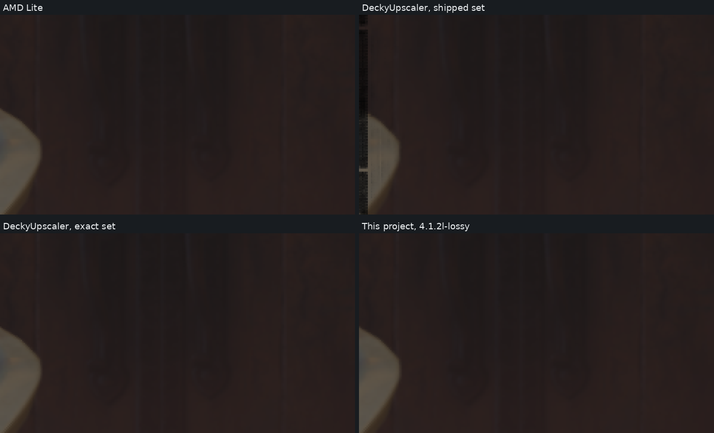

# DeckyUpscaler: what we found, and what each project could use

[DeckyUpscaler](https://github.com/doodlum/DeckyUpscaler) is a Decky Loader plugin by another developer. It runs AMD's FSR 4.1.2 Lite on the Steam Deck under Proton, through AMD's FSR SDK 2.4.0 Vulkan DLL, with its own faster shaders. Its author invited this project to look at the work and use what helps. This page is a first look, written to be useful to both projects. It is not a contest, and nothing here is a verdict on the Steam Deck.

Last updated: 2026-11-02. Timing kit and picture tables: DeckyUpscaler release v0.2.1, except the RX 7800 XT speed table (commit `0137747`).

**In short:** on the first Steam Deck report, under Proton, DeckyUpscaler's shipped set is the fastest build at 1080p, faster than this project's frame-skipping `4.1.2l-lossy`, and with a picture much closer to AMD's. Most RDNA 2 reports show the same, but not all: one RX 6800 family report goes the other way. Above 1080p, where its shaders do not apply, `4.1.2l-lossy` is clearly faster. On RDNA 3, three chips so far, this project's builds are faster at every size tested.

**The limit:** these are a few reports per chip and one local card. Its shaders run only under Proton, so none of this says anything about Windows.

## The two projects at a glance

| | DeckyUpscaler | This project |
|---|---|---|
| Aim | Lite on the Steam Deck, picture changes kept small | Faster FSR 4 and Lite builds for many graphics cards |
| Networks | Lite | Full FSR 4 and Lite |
| Frame skipping | Ruled out on purpose | Used in the lossy builds |
| How it runs | AMD's SDK Vulkan DLL on the game's own Vulkan device; Proton only | Patched DirectX 12 DLLs through OptiScaler; Windows and Proton |
| Replacing shaders | SPIR-V modules swapped by hash | DXIL shaders patched into the DLL |
| Sizes its shaders cover | Up to 1080p output | Every size class |

DeckyUpscaler's sets tested here:

| Set | What it is |
|---|---|
| No pack | AMD's Lite through the SDK Vulkan DLL, with DeckyUpscaler's memory fix |
| Exact set | Rewritten shaders; same picture as no pack (`repl_exact`) |
| Shipped | `fsr4_shaders.bin` + `fsr4_shaders_dot2.bin`: more rewrites, small picture changes. Picture figures are from release v0.2.1 |

## Speed on a Steam Deck

From the [Linux and Steam Deck timing kit](../timing-kit/README.md#linux-and-steam-deck-experimental), one report (device ID 1435, which the kit lists as a Steam Deck OLED), under Proton, moving scene, ms. "AMD Lite" here is AMD's FSR 4.1.2 Lite network and DirectX 12 shaders, run in this project's local test harness, not AMD's own runtime. Lower is faster.

| Build | 1080p | 1440p | 4K |
|---|---|---|---|
| AMD Lite | 6.775 | 12.458 | 26.074 |
| DeckyUpscaler, no pack | 7.135 | 12.327 | 27.695 |
| DeckyUpscaler, its same-picture changes | 5.917 | 12.154 | 28.113 |
| **DeckyUpscaler, shipped** | **5.521** | 11.967 | 27.692 |
| This project, `lt30-test` (`4.1.2l-exact`) | 6.282 | 11.431 | 23.925 |
| This project, `lt34-test` (`4.1.2l-lossy`) | 5.992 | **10.249** | **21.968** |

- **At 1080p** the shipped set is 19% faster than AMD Lite and 8% faster than `4.1.2l-lossy`, without skipping frames.
- **Its same-picture changes alone** are 6% faster than `4.1.2l-exact` at 1080p, and level with `4.1.2l-lossy`.
- **At 1440p and 4K** `4.1.2l-lossy` is 14% and 21% faster than the shipped set, because the shaders only apply up to 1080p.

The split of that gain, on this Deck and other chips, is under [Where its gain comes from](#where-its-gain-comes-from).

## Speed on other chips

From the same kit, one row per report, all under Proton, moving scene, ms at 1080p / 1440p / 4K. "AMD Lite" here is AMD's FSR 4.1.2 Lite network and DirectX 12 shaders, run in this project's local test harness, not AMD's own runtime. `lt30-test` is `4.1.2l-exact`, `lt34-test` is `4.1.2l-lossy`.

| Chip | AMD Lite | DeckyUpscaler, no pack | DeckyUpscaler, shipped | `lt30-test` | `lt34-test` |
|---|---|---|---|---|---|
| RX 6800 family, report 1 | 0.467 / 0.899 / 2.170 | 0.471 / 0.887 / 2.184 | **0.366** / 0.863 / 2.121 | 0.442 / 0.844 / 2.077 | 0.420 / **0.761** / **1.834** |
| RX 6800 family, report 2 | 0.668 / 1.262 / 2.753 | 0.915 / 1.260 / 2.725 | 0.687 / 1.327 / 2.699 | 0.633 / 1.167 / 2.534 | **0.602** / **1.053** / **2.386** |
| RX 6700 XT | 0.855 / 1.596 / 3.287 | 0.871 / 1.534 / 3.371 | **0.651** / 1.504 / 3.318 | 0.804 / 1.494 / 3.103 | 0.752 / **1.367** / **2.951** |
| RX 6600 XT, report 1 | 1.067 / 2.057 / 4.327 | 1.108 / 2.033 / 4.645 | **0.836** / 1.989 / 4.553 | 0.998 / 1.875 / 4.053 | 0.934 / **1.706** / **3.672** |
| RX 6600 XT, report 2 | 1.159 / 2.216 / 4.577 | 1.195 / 2.110 / 4.788 | **0.906** / 2.044 / 4.659 | 1.077 / 2.055 / 4.283 | 0.999 / **1.857** / **4.015** |
| Steam Machine (RDNA 3) | 1.458 / 2.737 / 5.420 | 1.918 / 3.284 / 7.048 | 1.586 / 3.263 / 6.916 | 1.320 / 2.483 / 4.943 | **1.187** / **2.158** / **4.446** |
| Radeon 780M (RDNA 3) | 2.948 / 5.646 / 12.042 | 3.787 / 6.798 / 15.332 | 3.226 / 6.479 / 14.849 | 2.807 / 5.378 / 11.359 | **2.640** / **4.901** / **10.777** |

- **RDNA 2 at 1080p:** on four of the five reports the shipped set is the fastest build, 9-13% ahead of `4.1.2l-lossy`, without skipping frames. On RX 6800 family report 2 it is 14% behind. That report's card is slower overall, so it may be another model in that family; the kit reports one device ID for them.
- **Above 1080p** `4.1.2l-lossy` is the fastest on every report, since the shipped set is about the same as no pack there.
- **The no-pack route:** level with AMD Lite on most RDNA 2 reports (RX 6800 family report 2 is the exception, at 1080p only), and 20-37% slower on the RDNA 3 chips here and below.
- **RDNA 3:** this project's builds are faster at every size, `4.1.2l-exact` included.

## Where its gain comes from

1080p, % against no pack, one report per chip, under Proton. All sets here use its generators; the sets without "shipped" keep AMD's picture.

| Set | Steam Deck | Steam Machine | RX 6800, report 2 | RX 6700 XT | RX 6600 XT, report 2 |
|---|---|---|---|---|---|
| Prepass changes only | -5.8 | -5.1 | -7.4 | -7.8 | -6.4 |
| Network pass changes only | -6.2 | -6.0 | -6.6 | -6.7 | -7.7 |
| Postpass changes only | -5.6 | -5.5 | -6.1 | -6.4 | -9.8 |
| Same-picture set, no named options | -13.9 | -13.8 | -14.3 | not run | dropped (slow outlier) |
| Same-picture set | -17.1 | -14.4 | -18.1 | -19.2 | -18.5 |
| Shipped without `dot2` | -20.3 | -16.1 | -23.0 | -23.8 | -22.6 |
| Shipped | -22.6 | -17.3 | -24.9 | -25.3 | -24.2 |

**Most of the gain needs none of the named options:** about -14 on the three chips with a clean figure. The three parts add up to about the whole.

Each option left out of the same-picture set, % slower at 1080p (a minus means faster without it):

| Option left out | Steam Deck | Steam Machine | RX 6800, report 2 | RX 6600 XT, report 2 |
|---|---|---|---|---|
| `q4b`, prepass layout | +2.6 | +1.9 | +2.1 | -3.5 |
| `csan2`, color clean-up in the readers | +1.9 | +2.0 | +0.1 | +2.0 |
| Options entry (skip the clean-up, drop border dispatches) | +1.5 | +2.5 | +3.2 | +3.0 |
| `ring`, border work folded into passes | +0.3 | +1.6 | +1.9 | -0.2 |
| `tstore` | +0.2 | +0.6 | +0.1 | dropped (slow outlier) |
| `recloop` | +0.0 | +1.2 | +0.0 | +0.2 |
| `pdead` | -0.2 | -0.2 | -0.3 | -0.2 |

Outliers dropped by hand: the RX 6600 XT report's `no named options` (+27.9) and `tstore` left out (+49.6), both far slower than every related set in that report.

## Speed on the RX 7800 XT

Timing kit under Proton, moving scene, mean of 5 rounds, one session. "AMD Lite" here is AMD's FSR 4.1.2 Lite network and DirectX 12 shaders, run in this project's local test harness, not AMD's own runtime. Lower is faster.

| Build | 1080p ms | 1440p ms | 4K ms | 1080p vs AMD Lite |
|---|---|---|---|---|
| AMD Lite | 0.623 | 1.019 | 2.024 | baseline |
| DeckyUpscaler, no pack | 0.817 | 1.279 | 2.768 | +31% |
| DeckyUpscaler, exact set | 0.743 | 1.278 | 2.770 | +19% |
| DeckyUpscaler, shipped | 0.689 | 1.261 | 2.734 | +11% |
| This project, `4.1.2l-exact-r3` | 0.586 | 0.949 | 1.922 | -6% |
| This project, `4.1.2l-lossy-r3` | 0.532 | 0.827 | 1.658 | -15% |

- The shipped set in this table is from before the fix described below. One short run of release v0.2.1 gave about the same: 0.689 ms at 1080p, 2.728 ms at 4K.
- On this card DeckyUpscaler's shipped set saves 16% at 1080p against its own no-pack route. The no-pack route starts 31% slower than the DirectX 12 shaders. Why is not known; it does not happen on most RDNA 2 reports above.
- `4.1.2l-lossy` gets its speed by skipping frames, and pays for it in picture (below). The fair comparison for DeckyUpscaler's shipped set depends on how much picture change you accept.

DeckyUpscaler's own figures on a Steam Deck, not checked here: at 1280x785 on Vulkan, AMD's shaders 3.00 ms, its exact set 2.56 ms, its shipped set about 2.25 ms. For scale only: this project's `4.1.2l-exact` was 16% faster than plain Lite on one Steam Deck report at 1080p, on Windows. Different system, size and scene, so these cannot be set side by side.

## Picture

DeckyUpscaler's shaders only apply up to 1080p, so these are four game clips reduced locally to 1080p output: render size halved, about 1130x635 (armor 1280x720). A halved clip approximates a game rendering at that size. Scored on the last 8 frames, using this project's display mapping `x / (1 + x)`, not a game's tone mapping.

Clips: Stellar Blade demo (armor), a foliage clip, Black Myth: Wukong Benchmark Tool, Shadow of the Tomb Raider.

**Distance from AMD Lite**, dB (higher is closer), with the share of pixels off by more than 8 of 255 in brackets:

| Build | Armor | Foliage | Wukong | Tomb Raider |
|---|---|---|---|---|
| `4.1.2l-exact` | identical | identical | identical | identical |
| DeckyUpscaler, no pack and exact set | 56.2 (0.03%) | 53.6 (0.02%) | 53.6 (0.02%) | 57.2 (0.02%) |
| DeckyUpscaler, shipped | 56.2 (0.03%) | 53.6 (0.02%) | 53.6 (0.01%) | 57.1 (0.03%) |
| `4.1.2l-lossy` | 45.2 (0.73%) | 43.5 (1.00%) | 42.0 (1.49%) | 50.6 (0.23%) |

**Distance from AMD's full FSR 4.1.1**, dB:

| Build | Armor | Foliage | Wukong | Tomb Raider |
|---|---|---|---|---|
| AMD Lite | 47.1 | 44.8 | 43.8 | 51.6 |
| DeckyUpscaler, shipped | 47.1 | 44.7 | 43.8 | 51.7 |
| `4.1.2l-lossy` | 43.6 | 41.7 | 40.5 | 48.4 |

- DeckyUpscaler's shipped set stays closer to AMD Lite than `4.1.2l-lossy` on all four clips, about as close as with no pack. That is expected: it does not skip frames.
- These figures measure closeness to AMD's picture, not which picture looks better. They do not cover flicker or how a build looks in motion.
- The scores are not comparable with DeckyUpscaler's published 70-72 dB, which uses another scene set and scoring method.

*Shadow of the Tomb Raider, last frame of the clip, left edge at 3x, with DeckyUpscaler's release v0.2.1. 1080p output from a clip halved here to 1129x635 render size, RX 7800 XT under Proton. The display mapping is this project's, not the game's tone mapping; no UI or post-processing.*

## Findings that may help DeckyUpscaler

Mostly measured on one RX 7800 XT, offered in case they are useful:

- **Fixed by its author:** a first test here found a dark strip at the frame's left edge at 1080p with the shipped set, and pictures that differed between runs. The author traced both to the prepass writing past the end of each row at 1920-wide output, reproduced them on a Deck and fixed them the same day. On release v0.2.1 both are gone here: two runs are identical on all four clips.
- **The Vulkan route's picture differs a little from the DirectX 12 route's** at 51-57 dB on the 4K clips, about the same distance from full FSR 4.1.1.
- **The packs change nothing above 1080p:** the larger size classes use other shader modules. This matters for a Deck on an external display or for other chips.
- **Its route is slower on RDNA 3, so far:** no pack is 20-37% slower than the DirectX 12 shaders on the RX 7800 XT, a Radeon 780M and the Steam Machine, and mostly level on RDNA 2. A chip it was not tuned for may be worth a look if it ever targets them.
- **An independent test bed:** DeckyUpscaler's drop-in DLL runs in this project's [Linux and Steam Deck timing kit](../timing-kit/README.md#linux-and-steam-deck-experimental), included with its author's permission, so a run on a Deck times both projects on the same scene.

## What this project may try from DeckyUpscaler

Results so far, on a test build of `4.1.2l-lossy`, % against the same build unchanged at 1080p / 1440p / 4K, one report per card. Picture figures are distance from AMD Lite on four 4K clips.

| Idea from its notes | RX 6800 XT (Windows) | RX 6900 XT (Windows) | Radeon 780M (Proton) | Picture |
|---|---|---|---|---|
| Halves round up in the network | -0.6 / -0.3 / -0.5 | -0.2 / -0.1 / -0.3 | -0.2 / +0.0 / -0.1 | no measurable change |
| One bilinear history fetch instead of 9 | -2.4 / -2.5 / -1.0 | -2.1 / -1.6 / +0.3 | -1.8 / -2.1 / -1.7 | 0.2-2.6 dB further, softer |

Neither is in a release. Other ideas from its notes:

| Idea | Status here |
|---|---|
| Convolution weights held per wave in scalar registers | Largely here already: a test build of the first network pass gains about 0.5% on RX 6000, and the prepass already loads its weights from fixed addresses |
| A constant loop count in the last network pass | Already here |
| Prepass with 64-lane groups and 8x4 pixel blocks (`q4b`) | DXIL version built, same picture as the builds it replaces (48 of 48 comparisons). DirectX 12 has no barrier limited to one wave, so it keeps a workgroup barrier. On the RX 7800 XT under Proton it is slower: +0.9 / +1.8 / +2.4% at 1080p / 1440p / 4K on `4.1.2l-exact`, 8-12 runs, one session. Not yet tried on RDNA 2 |
| Color clean-up folded into the readers (`csan2`) | Does not apply: it removes a clean-up pass in DeckyUpscaler's own proxy, and this project's route has no such pass |
| Options entry: skip the clean-up, drop some small border dispatches | The clean-up part does not apply. Whether the border part can save anything here is being checked, since this project's Lite builds already handle borders differently |
| f16 products summed in f32 in the prepass | Not tried; changes the picture slightly |

Which of its changes bring its gain is now partly answered: see [Where its gain comes from](#where-its-gain-comes-from). Nothing from that split is in a release here.

Two cautions from its notes also apply here:

- **Uncached memory:** AMD's SDK Vulkan DLL takes its weights and tensors from uncached memory on RADV, which took Lite from 3.0 to 7.3 ms on a Deck. Any Vulkan build from this project needs that fix.
- **Timing builds that write garbage:** garbage output compresses worse, and the extra memory traffic can hide what was saved. This project's own timing kit builds with nonsense pictures should be read with that in mind.

## What would settle more

- **More Steam Deck runs** of the [Linux and Steam Deck timing kit](../timing-kit/README.md#linux-and-steam-deck-experimental): the comparison above rests on one report.
- **Looking at the pictures in motion,** on clips where both projects' builds apply.
- **More RX 6800 family reports under Proton,** with the exact model named, since two reports disagree.

## Ways this project can help

Open offers to DeckyUpscaler's author.

| Offer | What you would get |
|---|---|
| **Test new shader sets on an RX 7800 XT** | Speed, picture and run-to-run results for a new set, against AMD Lite and earlier sets. A run takes about half an hour. |
| **Send the evidence behind a finding** | Output frames, slider pages and the steps to reproduce the left-edge strip or anything else on this page. Output pictures only: raw game captures stay local. |
| **Run more picture checks** | Game clips, plus this project's synthetic scenes for flicker, rain specks, fine detail and ghosting, at sizes where the shaders apply. |
| **Share what did not work** | Which ideas were already tried here, on which cards, and what they measured, to save you repeating them. This project's documents are public, and questions about them are welcome. |

## What would help this project

DeckyUpscaler's author has a Steam Deck and tools this project lacks, and a few measurements from them could replace whole rounds of timing kits. None of this is expected, and any part of it helps. Figures from a Deck carry most weight.

| Data | How | What it would save or settle |
|---|---|---|
| **More [Linux timing kit](../timing-kit/README.md#linux-and-steam-deck-experimental) runs on a Deck** | `bash run.sh`, plugged in, Desktop Mode | One Deck report exists; a second would show how far it can be trusted. |
| **Per-pass times on a Deck for no pack, its exact set and its shipped set** | `DU_FSR4_VK_PROFILE`, at 1280x800 and 1920x1080 | Per-pass times to check the split measured by the kit. This project times its own passes only indirectly, by running each twice |
| **Gain of each option alone on a Deck, for the current sets** | Its generators with `DU_GEN_OPTS` | Which ideas are worth porting to DirectX 12, so fewer test builds go into kits. Its notes record this across rounds; a single current table would be easiest to compare |
| **Compiler figures for its passes on Van Gogh** | `RADV_DEBUG=shaders,shaderstats` | Registers, waves and instruction counts on RDNA 2 under RADV, to set beside AMD's Windows compiler figures this project already has. Windows and RADV appear to differ here, and this could show why |
| **Which of its changes depend on the RADV compiler** | Its judgment | Which ones are unlikely to carry over to Windows, so they can be skipped without a test |
| **This project's `4.1.2l-lossy` on its replay and motion tests** | Its replay and pan tests, using the DLL from a release | A second picture measure on its captured frames, with the same scoring as its published figures, since the figures on this page use different scenes and scoring |
| **How it keeps Deck timings steady** | Clock settings, windows, what it discards | Lower noise in this project's handheld figures, so fewer reports are needed to see a small change |

Results can go wherever is easiest. This project's raw game captures stay local, but it can run the same steps on its side if the steps are shared.

## Licenses

DeckyUpscaler is MIT, and its shaders derive from AMD's SDK under the license in its `shaders/LICENSE-AMD.md`. This project's scripts are GPL v2 or later. DeckyUpscaler's notes say it uses only this project's written documents and has read none of its code. This page shares results and ideas, not code.
