# Exact and lossy builds: how they differ

[Back to the README](../README.md)

> [!NOTE]
> **This page describes release `dll-2026-10-29`.** Its `lossy` DLL is the trained build earlier releases called `lossy2`, trained further.
> Every figure and picture here was made again with it, beside the old, untrained lossy build that `dll-2026-10-22` was the last release to
> include. The page as it was for the old build is in this file's history. This release's Lite builds (`4.1.2l-exact`, `4.1.2l-lossy`) are
> on [their own page](lite-builds.md).

## In short

- **Exact:** the same picture as AMD's, byte for byte, in less time. Nothing to weigh up; it is the default.
- **Lossy:** faster again. It runs FSR 4's neural network on every other frame only, and six of the network's twelve layers carry
  weights trained on this machine to match AMD's picture through that frame loop. The picture is close to AMD's but not the same.
- **What you might notice with lossy:**
  - when part of the picture gets brighter (a light switching on, stepping from shade into sun), it catches up a few frames later than with AMD's;
  - fine detail is slightly softer in a still view;
  - very thin wires are dimmer while the camera pans;
  - edges of fast-moving things can be a little rougher on alternate frames.
  - On the other hand, it is steadier than AMD's at rest and in film grain, and it has fewer fireflies.
- **Which to pick:** exact if you are unsure or use frame generation at a low frame rate; lossy if you run at a high frame
  rate and want more.

<picture>
  <source media="(prefers-color-scheme: dark)" srcset="img/explain-skip-dark.svg">
  
</picture>

## The two kinds in detail

This project ships two kinds of faster FSR 4 shaders. They get their speed in different ways, and only one of them keeps AMD's picture.

- **The exact files** (the `exact` DLL in each download and the `prebuilt` Linux folder) do the same arithmetic as AMD's shaders,
  organized so the GPU gets through it faster.
  - The output is AMD's image, byte for byte. The RX 6000 and Steam Deck / older built-in graphics DLLs give the image of AMD's own FSR 4.1.2
    for RX 6000, which differs from 4.1.1's only in rounding: [AMD's 4.1.1 and 4.1.2](amd-411-vs-412.md).
  - The RX 7000 and RX 6000 exact DLLs also use AMD's own version of the network's eleventh shader, taken from the game DLL of AMD's
    FSR SDK 2.4.0 (MIT license; same picture).
- **The lossy files** (the `lossy` DLL in each download) are the exact files plus two things that change the picture:
  - they run FSR 4's network on every other frame only;
  - six of the network's twelve layers (passes 1, 2, 4, 5, 10 and 12) carry new weights, trained on this machine to match AMD's picture
    through that whole frame loop.

  Their eleventh shader is this project's own version, not AMD's.

> **The lossy builds change the image.** They are opt-in, not the same as the exact files and not the same as AMD's DLL.

All figures on this page are for the Balanced preset's size, 4K output. In Ultra Performance the lossy build runs the network on two frames in three,
with the untrained weights; its figures there are not representative of the other modes, and those here not of Ultra Performance.

<picture>
  <source media="(prefers-color-scheme: dark)" srcset="img/exact-vs-lossy-dark.svg">
  
</picture>

The figure is made by [`img/make_exact_vs_lossy.py`](img/make_exact_vs_lossy.py).

## What the difference looks like

These are pieces of the test rig's 4K output, each with four panels: the true image, the exact DLL, the old lossy build (`dll-2026-10-22`)
and this release's lossy build. The exact DLL gives the same bytes as AMD's shaders, so its panels are also AMD's picture.

**Each piece is the place where this release's lossy differs most from the exact DLL,** enlarged. So the pictures show its largest
differences, not a typical part of the frame. The figure under each picture is its mean error against the true image in that piece;
the [table below](#what-the-lossy-build-costs-measured) has the whole-scene figures. The places are picked by the script from the data, not by hand:
[`img/make_exact_vs_lossy_crops.py`](img/make_exact_vs_lossy_crops.py). Scenes in motion show a frame on which the lossy builds skip the network.

**Dark specks in foliage, in a game.** This was the old builds' most visible fault in games: thin dark branches against a bright sky
left dark specks between them on the frames without the network. In a recorded Black Myth: Wukong clip this release's lossy shows about
460 per frame, against 3,824 with the lossy2 of `dll-2026-10-22`. Where the depth changes sharply (foliage against a distant background) the
fix is held back, so that it does not leave colored outlines behind moving lights, and some specks remain there. In the matching test scene
(thin dark branches against a bright sky, camera panning) it shows 28 per frame where the old lossy shows 2,198 (counted against AMD's own
output, so AMD's is 0 by definition).

*Black Myth: Wukong Benchmark Tool, recorded game frames, 4K output (Balanced), 2x zoom; this project's display mapping, not the game's tone mapping.*

**At rest.** The largest difference in a still frame is on thin structures, which come out slightly softer. Over the whole frame this release
is 0.4 dB less accurate than AMD's (43.89 against 44.33 dB; the old lossy 44.23).

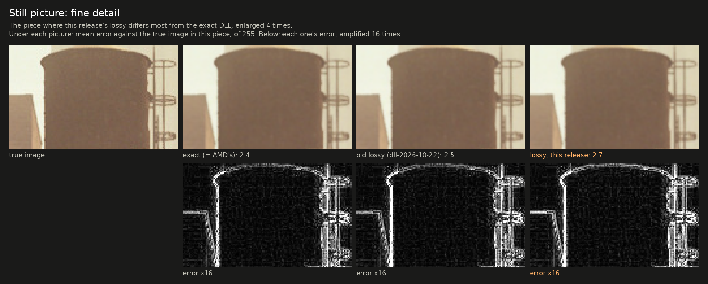

**Shimmer at rest.** This is how much each pixel changes between consecutive frames when nothing moves. This release's lossy is the
steadiest of the three: in the worst flat piece of the scene it changes 0.045 of 255 per frame, against 0.078 for the old lossy and 0.126 for AMD's.

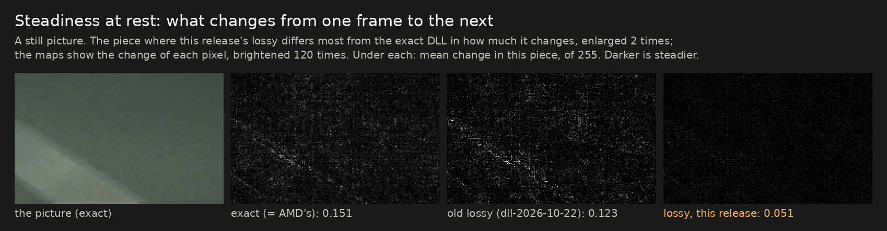

**Grain in the picture.** This is the same still scene with random grain added to every input frame, as a game with film grain or noisy
reflections gives FSR. AMD's shaders pass the grain on, so their picture changes most. Both lossy builds hold the picture steadier on the
frames they skip, and this release more so (0.208 of 255 per frame over the whole frame, against 0.321 for the old lossy and 0.785 for AMD's).
Strong grain gets through more, and with auto exposure on it gets through more than with AMD's (the table below).

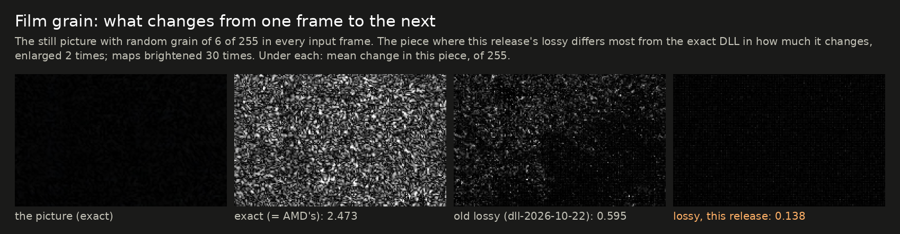

**In motion, on a skipped frame.** The camera pans as if at 60 FPS, and a thin railing moves the other way. Thin bars in front of a moving
background are where frame skip is weakest: in the lossy panels the bars are a little rougher. Over the whole railing this release is
40.97 dB against AMD's 41.82 (the old lossy 41.39).

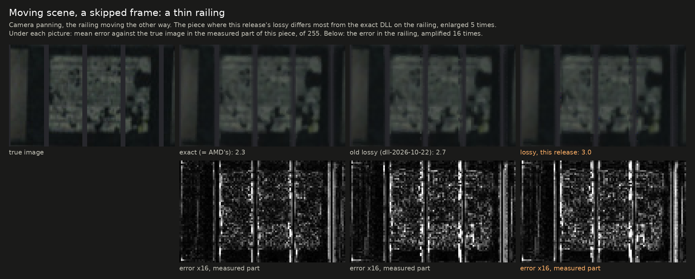

**Just uncovered, with the camera still and the objects moving.** In the panning scene both lossy builds are ahead of AMD's in areas a moving
object has just uncovered (this release 37.09 dB against 34.48). With the camera still this release is level with AMD's (33.13 against 32.62 dB;
the old lossy 31.85).

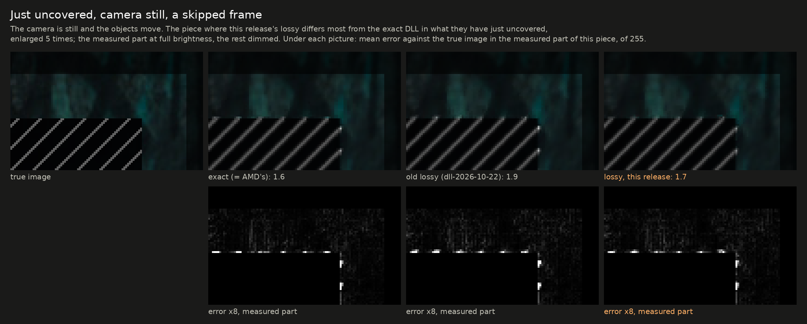

**Old image beside a moving object.** A ghost is an object's image of a frame ago showing through where the object no longer is. With frame
skip the risk is on skipped frames: the history there still shows the object, and it has to be thrown away. The lossy builds look up which
surface was at each spot a frame ago (the prepass records it). In two of six test cases this release is level with AMD's; in the others it
leaves 7 to 37% more (the table below).

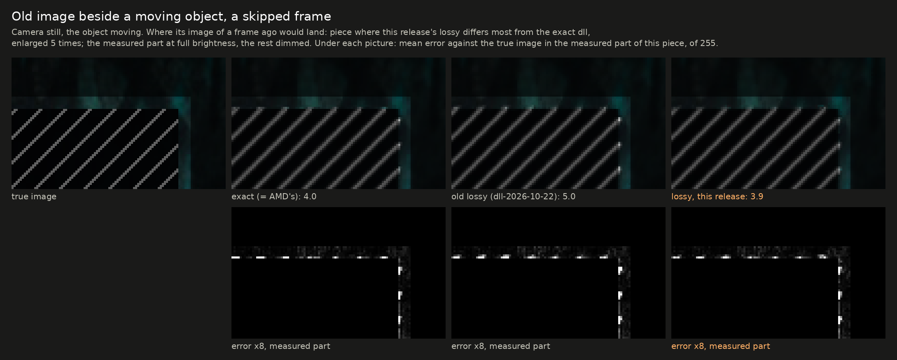

**Thin bars fixed on screen in front of a moving background.** The edge of a weapon or a railing that stays in place while the scene moves
can keep a faint copy of itself beside it on skipped frames.

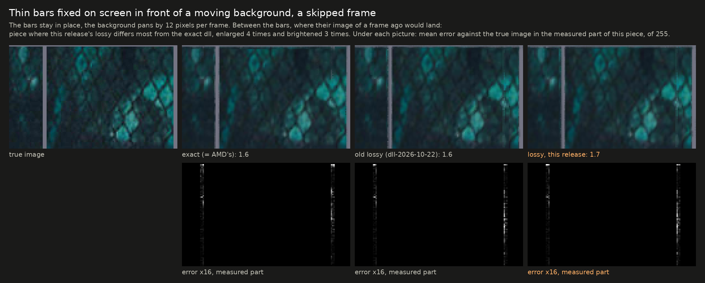

**A still bright object over ground that moves fast** (a car's license plate over the road, as a tester's racing-game video once showed).
This release leaves more of a trace below it than the old lossy (2.99 against 2.26 where its old image lands; AMD's 1.62).

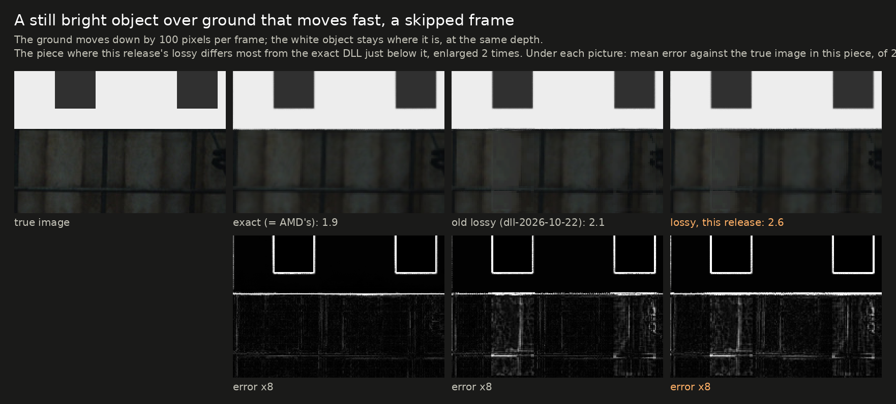

**Particles without motion vectors, on a skipped frame.** Games draw sparks and embers into the picture without telling FSR that they move.
On skipped frames the lossy builds take such content from the new frame where it differs clearly from the previous picture. Fast sparks are
still shown dimmer than with AMD's (72% of their brightness against 83%), and large particles have about twice AMD's error around them.

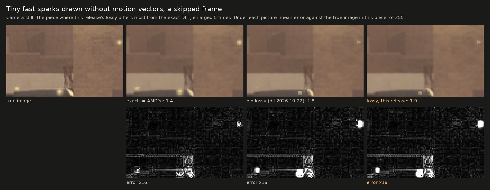

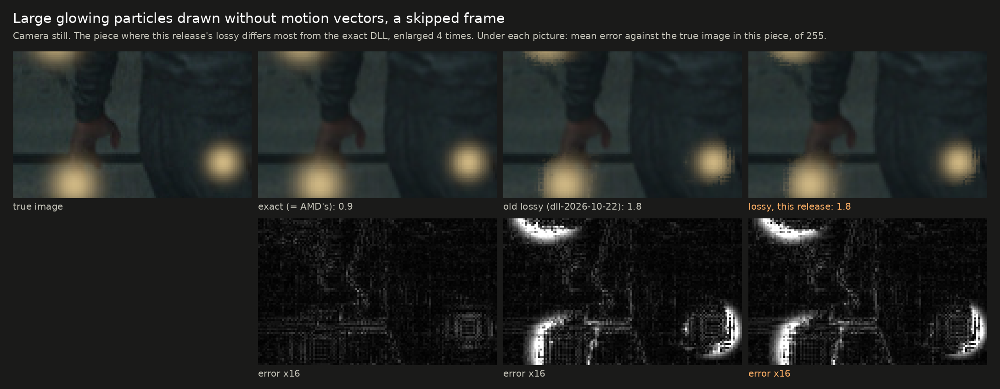

**A wire far thinner than a rendered pixel.** Distant power lines and fences: each rendered pixel either hits the wire or misses it, and the
upscaler has to average that into a line. In a slow camera pan both lossy builds draw it about a quarter dimmer than AMD's (this release
79 of a true 111, AMD's 100), and steadier (4.7 change per frame against AMD's 7.2).

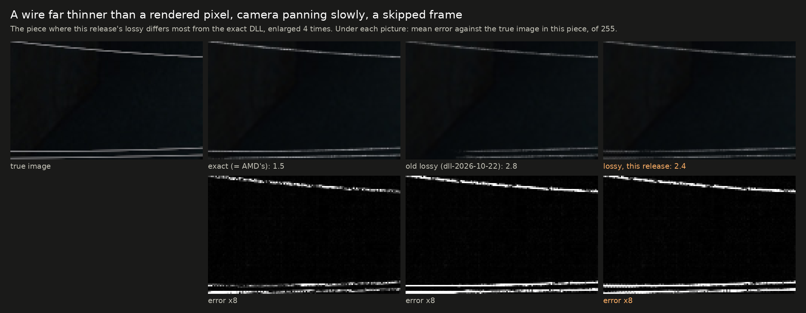

**Leaves swaying without motion vectors.** This was the old lossy's weakest case, and it is where this release gained most: with the camera
still the error against the true image is 13.6 of 255 against the old lossy's 18.5 (AMD's 12.1).

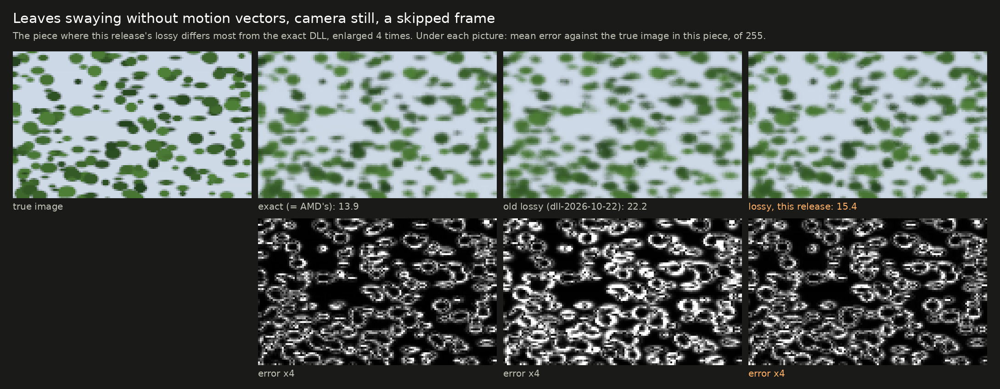

**Slow and sudden brightening.** This is what this release does clearly worse. When part of the picture gets brighter without moving (a
light switching on, a muzzle flash, stepping from shade into sun), it takes about 3.7 frames to catch up with auto exposure off and 2.7 with
it on. AMD's takes 0.5, and the old lossy 0.6 / 0.7. At 60 FPS that is about 60 ms. Darkening lags less (1.7 frames in bright flat areas,
AMD's 0.6), but after a sudden 20% dimming it misses 41% of the change on the first frame (AMD's 4%).

## At a glance

| | Exact files | Lossy |
|---|---|---|
| Image | AMD's, byte for byte | close to AMD's, not the same |
| How the time is saved | same work, done more efficiently | less work: the network on every other frame |
| FSR 4's time per frame, 4K Balanced, RX 7800 XT, Linux test rig (AMD's: 4.83 ms) | 3.14 ms | 2.25 ms |
| Frame times | even | alternate between a shorter and a longer frame |
| Checked how | output compared with AMD's, byte for byte | measured against the true image and against AMD's output; recorded game clips |
| Tested on | several GPUs and games ([results](results.md)) | one RX 7800 XT on Linux (test scenes, recorded game clips); not yet on Windows |
| Files | `exact/` in each archive, `prebuilt/` | `lossy/` in each archive |

## How the exact files get faster

Nothing is removed. Each rewrite computes exactly the values AMD's shader computes and changes only how the work is laid out for the GPU.

| Part of FSR 4 | What changes | Why it is faster |
|---|---|---|
| Postpass | each thread's pixels are collected and written out in contiguous blocks, one image at a time; its small network rounds and clamps in integers and reads its neighbor cells without branches | AMD's version writes single pixels scattered over three images, which is slow on these GPUs; the rest is fewer instructions per thread |
| Model pass 11 | RX 7000 and RX 6000 builds: AMD's own newer version from FSR SDK 2.4.0, which reads the weights in wider blocks. Built-in graphics builds: constants made visible to the compiler, each row's results stored together | AMD's newer version: up to 3% faster in Windows reports so far. This project's version: fewer registers per thread, so more threads run at once, and far fewer separate writes |
| Other model passes | the final scaling and clamping done in integers where that gives the same result | fewer instructions per thread |
| Prepass | each of a quad's four threads finishes one of the four output words | 12 exchanges between threads instead of 32, and the rounding and storing spread over four threads |

Every rewrite is verified by running the whole upscaler and comparing its output with AMD's, byte for byte, across output sizes, presets and
option combinations. A rewrite that differs in a single byte is not shipped as exact. Details: [how it works](how-it-works.md).

The limit of this approach is the model itself. Its twelve passes are about 60% of FSR 4's time and are almost pure arithmetic, already running
near what the hardware can do. With the work unchanged there is little left to gain there.

## How the lossy build gets faster

It contains everything the exact files do (with this project's own eleventh shader), plus frame skip and trained weights.

### The model runs on every other frame (frame skip)

On alternate frames the twelve model passes return immediately, and the postpass reuses the model's result from the frame before, which is still
in memory. The last layers of the network sit in the postpass; their result is saved by the frame that runs the model and read back on the
skipped frame, so they are not rerun either.

- **What it saves:** a skipped frame takes about 1.3 ms at 4K on the RX 7800 XT, a normal one about 3.2 ms.
- **What it costs:** the reused result is one frame old, so a skipped frame cannot be trusted to mix the new frame in properly. What it does
  instead is described next.

Details: [frame skip](../research/frame-skip).

### Trained weights in six layers

Up to `dll-2026-10-22` the lossy build ran AMD's network with a few weights merged (folded) for steadiness. This release's lossy carries new
weights in six of the twelve layers (passes 1, 2, 4, 5, 10 and 12). They were trained to match AMD's picture through the whole lossy frame
loop: with the network on every other frame, the skipped frames' rules, and AMD's other six layers unchanged. Its gains and losses against
the old lossy in the table below are the combined effect of that training and of this release's rules for skipped frames. The weights were trained on 4K Balanced material; other sizes were checked at 1080p and 5K. In Ultra Performance it runs the untrained
weights. How the weights are rebuilt: [lossy2](../research/lossy2/README.md).

### What a skipped frame does instead, and the repairs

All of this acts on skipped frames only. Frames that run the model are not touched.

A skipped frame leans on the history: it shows the previous picture moved along with the scene, and takes very little from the new frame (the
new frame's weight is squared, so a typical 7% becomes about 0.5%), except where the model had asked for the new frame.

- **The reused result follows the picture.** The prepass stores the motion and the nearest depth of each 4x4 block of output pixels. The
  postpass takes the model's result for each pixel from where that pixel's content was a frame ago.
- **Where the picture is at rest, nothing is taken from the new frame.** "At rest" means the motion stored for the pixel's block is zero and
  nothing looked at around it moves differently. The small share of the new frame that skipped frames would otherwise mix in made fine detail
  shimmer more than with AMD's shaders while nothing moved.
- **Content that changes without motion vectors is taken from the new frame.** Games draw particles, sparks and embers without telling FSR
  that they move. A sample is one point of the scene, so for unchanged content it lies within the range of the previous picture's pixels
  right around it, however fine the detail; a spark that was not there a frame ago does not. A bright sample counts only if it has a bright
  neighbor both sideways and above or below, so a single over-bright pixel (the noise of traced reflections) and a line one pixel wide (rain) do not.
- **Dark specks in foliage** (new in this release): thin dark branches against the sky left dark specks between them. This release has a new
  rule for skipped frames against them and was trained further against them, on the frames that run the network too. The rule is held back where
  the depth changes sharply, so that it does not leave colored outlines behind moving lights.

Further repairs keep the rest honest:

| Problem with a reused result | Repair in the build |
|---|---|
| **Shimmer on fine detail.** The reused result was worked out for the previous frame's camera jitter, so it gives too much weight to the new frame in pixels whose nearest sample has moved away. | The previous jitter is carried over to the skipped frame, and the new frame's weight is lowered where its nearest sample is now farther from the pixel. |
| **A dark band at the screen edge** for one frame when the camera starts to turn. The strip that scrolls in has no history, and the reused result still says "mostly history". | Where the history is far darker than the new frame, the new frame is used alone. |
| **A smear behind moving objects.** Where something has just been uncovered, the reused result keeps a history that is out of date. | The history is limited to the color range of the new frame's samples around the pixel, beside anything that moves differently. |
| **What is left of that smear.** The color limit cannot tell an outdated history from a valid one of a similar color. | A pixel whose content was hidden a frame ago behind something nearer that moves differently takes the new frame alone, looked up from the prepass's record of which surface was at each spot a frame ago. |

The history of each rule, release by release: [frame skip](../research/frame-skip).

## What the lossy build costs, measured

Test scenes at 4K Balanced, one run each on a Radeon RX 7800 XT under Linux. "Old lossy" is the untrained lossy build of `dll-2026-10-22`. Where
a row gives two figures, they are with the game's auto exposure off / on. The scenes in motion are measured on the frames the lossy builds
skip the network for (where it matters, the frames that run it are similar or better).

| Test | AMD's (= exact files) | Old lossy | **Lossy, this release** |
|---|---|---|---|
| **Accuracy against the true image (dB, higher is better)** | | | |
| Still picture | 44.33 | 44.23 | **43.89** |
| Thin vertical / horizontal detail in the still picture | 27.09 / 28.23 | 26.76 / 28.17 | **26.30 / 28.00** |
| Moving scene: background | 49.27 | 48.92 | **48.46** |
| Moving scene: thin railing | 41.82 | 41.39 | **40.97** |
| Moving scene: areas a moving object has just uncovered | 34.48 | 36.00 | **37.09** |
| Still camera, objects moving: just-uncovered areas | 32.62 | 31.85 | **33.13** |
| **Steadiness (change per frame, of 255; lower is steadier)** | | | |
| Fine detail at rest | 0.110 / 0.125 | 0.090 / 0.103 | **0.080 / 0.090** |
| Worst flat piece of the still scene | 0.126 / 0.213 | 0.078 / 0.118 | **0.045 / 0.085** |
| Film grain of 6 of 255 | 0.785 / 0.552 | 0.321 / 0.309 | **0.208 / 0.312** |
| Film grain of 10 of 255 | 1.724 / 0.357 | 1.085 / 0.337 | **0.927 / 0.638** (worse than AMD's with auto exposure on) |
| Film grain of 15 of 255 | 2.549 / 0.484 | 1.830 / 0.523 | **1.998 / 0.918** (worse than AMD's with auto exposure on) |
| A wire half a pixel wide, camera still | 2.9 | 2.8 | **2.7** |
| The same wire under a slow pan | 7.2 | 5.3 | **4.7** |
| **Crawling on fine diagonal patterns in motion (lower is better)** | | | |
| Stairs | 16.4 / 30.4 | 42.5 / 41.9 | **32.3 / 29.8** |
| Vents | 5.2 / 5.3 | 14.7 / 14.9 | **9.2 / 9.3** |
| Zone plate | 2.9 / 2.6 | 16.4 / 15.8 | **8.2 / 8.0** |
| **Specks and over-bright pixels (lower is better)** | | | |
| Dark specks in thin branches against the sky, per frame (counted against AMD's output) | 0 / 0 | 2,198 / 1,113 | **28 / 67** |
| Fireflies (single over-bright pixels) | 370 / 137 | 425 / 182 | **332 / 110** |
| Single bright pixels in swaying foliage against sky, per thousand dark pixels | 0.57 | 0.97 | **0.32** |
| Bright rain specks: faint streaks one rendered pixel wide, per million pixels | 0 to 1 | 0 | **0** |
| Bright rain specks: brighter, slower streaks, per million pixels | 1,314 / 3,764 | 437 / 412 | **505 / 475** |
| **Changes without motion (frames behind; lower is better)** | | | |
| A region brightening by 1% per frame, bright flat areas | 0.46 / 0.46 | 0.64 / 0.71 | **3.66 / 2.67** (worse) |
| A region dimming by 1% per frame, bright flat areas | 0.62 / 0.72 | 0.68 / 0.81 | **1.72 / 1.91** (worse) |
| A sudden 20% dimming: share missed on the first frame | 0.04 / 0.04 | 0.04 / 0.04 | **0.41 / 0.30** (worse) |
| **Things without motion vectors (skipped frames)** | | | |
| Leaves swaying, camera still: error of 255 | 12.1 | 18.5 | **13.6** |
| Leaves swaying, camera panning | 10.7 | 18.2 | **14.5** |
| Leaves swaying at two thirds / half that speed, camera still | 10.8 / 10.2 | 13.1 / 11.9 | **11.8 / 11.3** |
| Still leaves, camera panning | 6.2 | 7.7 | **8.2** (worse) |
| Large glowing particles, camera still / panning: error | 0.66 / 0.73 | 1.21 / 1.83 | **1.16 / 2.15** |
| Tiny fast sparks: share of their brightness shown | 83% | 74% | **72%** |
| Tiny slow embers: share shown | 81% | 81% | **80%** |
| Moving water (texture that moves without motion vectors), blurred: accuracy, dB | 60.71 | 59.29 | **55.81** (worse) |
| **Old image beside moving things (error where it would land, of 255)** | | | |
| A still bright object over fast ground at the same depth | 1.62 | 2.26 | **2.99** (worse) |
| Camera 12,6 / object −6,6 (pixels per frame) | 0.85 | 0.87 | **0.86** |
| Camera 12,6 / object 6,−6 | 1.07 | 1.09 | **1.06** |
| Still camera / object 8,0 | 1.07 | 1.15 | **1.24** |
| Still camera / object 6,−6 | 1.74 | 1.88 | **2.13** |
| Still camera / object −6,6 | 4.01 | 4.61 | **4.29** |
| Camera −16,4 / object 8,0 (fast pan against the object's motion) | 3.11 | 3.80 | **4.26** (worse) |
| Thin bars fixed on screen, background panning 12,0 (mean of both kinds of frame) | 0.73 | 0.77 | **0.81** |
| **Thin wires in a pan** | | | |
| A wire half a pixel wide, slow pan: brightness (true 111) | 100 | 77 | **79** |
| The same, fast pan (true 111) | 97 | 70 | **70** |

- **Better than the old lossy:** foliage (swaying and dark specks), crawling on fine patterns, steadiness at rest and in moderate grain,
  fireflies, just-uncovered areas.
- **Worse than the old lossy:** brightening and dimming without motion (by far the largest change), the first frame after a sudden change,
  strong grain with auto exposure on, moving water, a still object over fast ground, still leaves in a pan, and two of the old-image cases.
- **Where it beats AMD's:** steadiness at rest, grain without auto exposure, fireflies, just-uncovered areas, single bright pixels in foliage,
  and the wire's steadiness in a pan.

The figures come from synthetic test scenes, which are good at isolating one thing and bad at predicting how a game looks. Recorded game clips
of this release's builds are on the [comparison site](https://zgauthier2000.github.io/fsr4-upscaler-compare/).
The same scenes with other upscalers: [the upscaler comparison](upscaler-comparison.md).

## Speed side by side

FSR 4's time per frame on a Radeon RX 7800 XT under Linux (Proton), Balanced, moving scene, the test rig's timing program, one run:

| Output | AMD's FSR 4.1.1 file | Exact | Lossy |
|---|---|---|---|
| 1920x1080 | 1.07 ms | 0.90 ms (−16%) | 0.69 ms (−36%) |
| 2560x1440 | 2.19 ms | 1.46 ms (−33%) | 1.07 ms (−51%) |
| 3840x2160 | 4.83 ms | 3.14 ms (−35%) | 2.25 ms (−53%) |

- **Lossy's two kinds of frame:** at 4K, 3.22 ms when the network runs and 1.25 ms when it is skipped.
- **Windows:** the exact DLL's gains are smaller on most cards (on this RX 7800 XT 7 to 9% against AMD's file, in testers' timing-kit reports)
  and larger on some ([all cards](releases/dll-2026-10-29.md#speed)). Linux's driver runs two of AMD's shaders in a slower mode, which leaves more
  to save there. This release's lossy has not been timed on Windows yet.
- **Games:** this release's builds have not been run through a game benchmark here yet. Earlier figures in Shadow of the Tomb Raider (4K Balanced,
  this card, Linux, single runs): AMD's 4.16 ms and 97 FPS, an earlier exact build 2.99 ms and 109 FPS, the old lossy of `dll-2026-10-15` 2.06 ms
  and 121 FPS.

## Limits of the lossy builds

- **Frame skip depends on the game's camera jitter.** With the usual sequence, frames alternate strictly. A game with an unusual sequence may
  skip unevenly, and a game that passes no jitter never skips.
- **Frame skip is off on frames the game marks as a reset.** In Ultra Performance it runs the network on two frames in three, with the untrained weights.
  **Ultra Performance only, not representative of other modes:** its costs there are larger.
- **Frame skip costs more at some real frame rates than others,** and the alternation is at half the real frame rate, so it is slower and
  easier to see (that part is reasoning, not a measurement). With frame generation on top of a low base rate, the exact build is the safer
  choice. [What frame pacing means in practice](frame-pacing.md).
- **Changes in brightness without motion lag behind** (the table above). A light switching on, a muzzle flash or stepping from shade into sun
  catches up about three frames later than with AMD's.
- **A skipped frame trusts the game's motion vectors more than AMD's shaders do.** Where they are wrong or missing (moving lights, water), the
  reused result is taken from the wrong place. Something that changes slowly and faintly without moving can still update on every other frame
  only.
- **Thin things that stay in place on screen while the scene moves** (the edge of a weapon, a railing) can keep a faint copy of themselves
  beside them on skipped frames.
- **Strong film grain with auto exposure on changes more from frame to frame than with AMD's file** (0.92 against 0.48 at 15 of 255).
- **Little testing.** This build was run on one RX 7800 XT on Linux, in test scenes and recorded game clips. Its Windows DLLs were only
  compared with the Linux files in the test rig, under Proton. Nobody has run it on Windows, on RDNA2 or on integrated graphics yet.
- **Trained on 4K Balanced material.** Other sizes and modes were checked at 1080p and 5K (Balanced), not in every combination.

## Which to use

- **Use the exact files** if you want AMD's picture, if you use frame generation at a low base frame rate, or if you are unsure. They are the
  main files of this project.
- **Try the lossy build** if you run at a high real frame rate, want the extra speed, and accept a picture that is not AMD's. Look at lights
  switching on, distant fine detail while standing still and the edges of moving objects; if any of it bothers you, go back to the exact build.

## Where to read more

- [This project's lossy DLLs beside FSR 4.1.2 Lite, FSR 3.1, HelixSR and XeSS](upscaler-comparison.md): the same scenes and timing for eight upscalers
- [The Lite builds](lite-builds.md): `4.1.2l-exact` and `4.1.2l-lossy`, on AMD's smaller FSR 4.1.2 Lite network
- [The release page](releases/dll-2026-10-29.md): what this release changes against `dll-2026-10-22`
- [How the exact rewrites work](how-it-works.md) and [all results](results.md)
- [The lossy track](../research/lossy): folding, rounding, what was tried and rejected
- [Frame skip](../research/frame-skip): the mechanism, each repair, results by frame rate, and what was tried and not shipped
- [GPU support](gpu-support.md): which build is for which GPU
