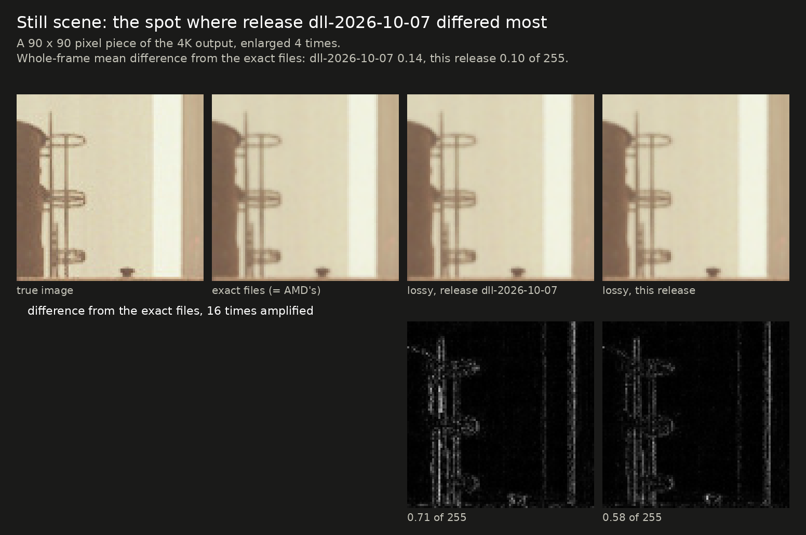
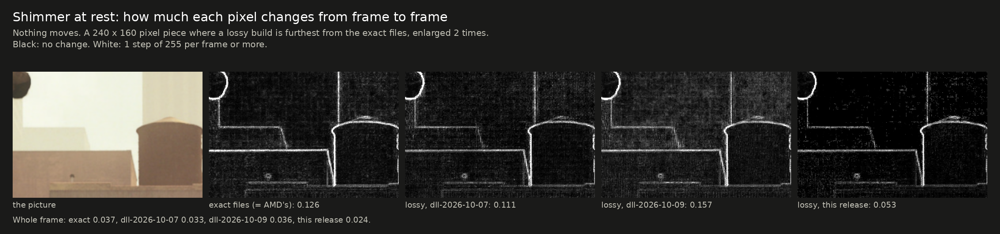
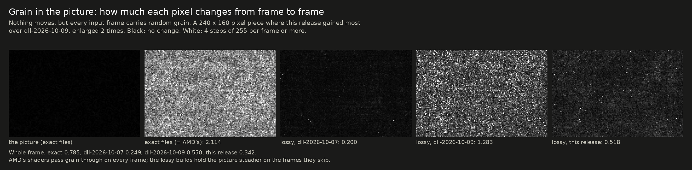
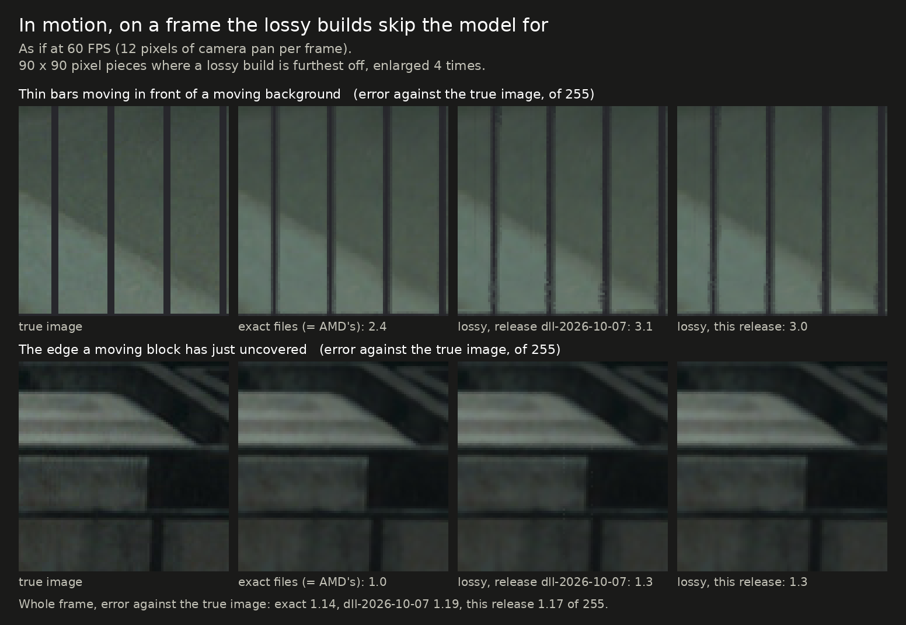
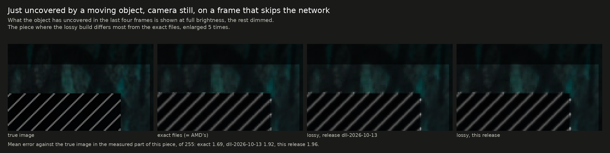
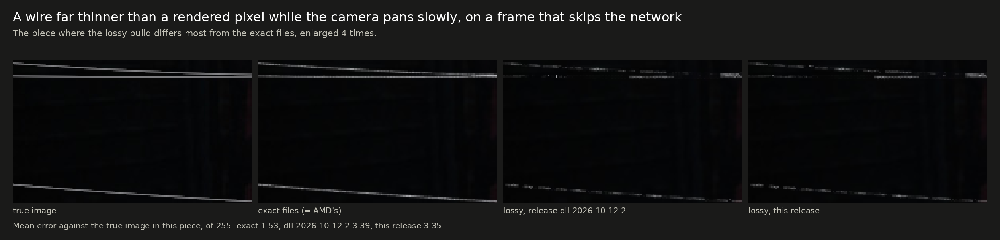
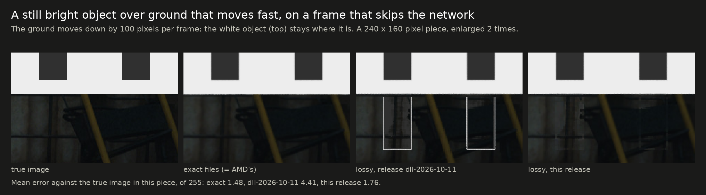
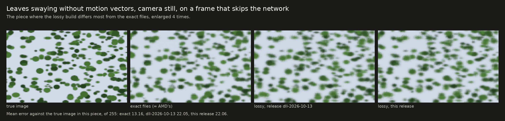
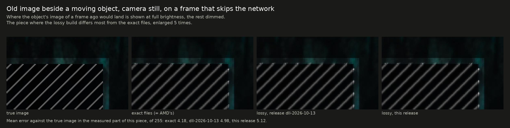
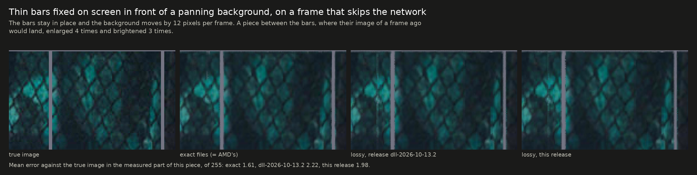

# Exact and lossy builds: how they differ

[Back to the README](../README.md)

## In short

- **Exact:** the same picture as AMD's, byte for byte, in less time. Nothing to weigh up; it is the default.
- **Lossy:** faster again, because it runs FSR 4's neural network on every other frame only. The picture is very close to
  AMD's but not the same.
- **What you would notice with lossy, if anything:** slightly softer fine detail in a still view, and edges of fast-moving
  things a little rougher for a frame; very thin wires are dimmer while the camera pans. Sparks and embers, which releases before `dll-2026-10-09` got wrong, are handled now.
- **Which to pick:** exact if you are unsure or use frame generation at a low frame rate; lossy if you run at a high frame
  rate and want more.

<picture>
  <source media="(prefers-color-scheme: dark)" srcset="img/explain-skip-dark.svg">
  
</picture>

## The two kinds in detail

This project ships two kinds of faster FSR 4.1.1 shaders. They get their speed in different ways,
and only one of them keeps AMD's picture.

- **The exact files** (the `exact` DLL in each download and the `prebuilt` Linux folder) do the
  same arithmetic as AMD's shaders, organized so the GPU gets through it faster. The output is
  AMD's image, byte for byte.
- **The lossy files** (the `lossy` DLL in each download and the `prebuilt-lossy` Linux folder)
  are the exact files plus one thing: they run FSR 4's model on every other frame only.

> **The lossy builds change the image.** They are opt-in experiments, not the same as the main
> files and not the same as AMD's DLL.

This page describes the builds of release `dll-2026-10-13`: every figure in the "Lossy" columns and every picture was made again with
its lossy build. Up to release `dll-2026-10-07` the lossy
builds also simplified the model's arithmetic in several layers (weight folding). They no longer do,
except for a light form of it in one layer, which keeps fine detail steady; flat areas are kept steady by a rule in the last step instead. The history of
the skipped-frame handling is on the [frame-skip page](../research/frame-skip).

<picture>
  <source media="(prefers-color-scheme: dark)" srcset="img/exact-vs-lossy-dark.svg">
  
</picture>

The figure is made by [`img/make_exact_vs_lossy.py`](img/make_exact_vs_lossy.py).

## What the difference looks like

Pieces of the test rig's 4K output with three builds side by side: the exact files, the lossy
build of release `dll-2026-10-07` and this release's lossy build (`dll-2026-10-13`); the two shimmer
pictures also show release `dll-2026-10-09`, the wire picture release `dll-2026-10-10`, the plate picture release `dll-2026-10-11`, the foliage-dots picture release `dll-2026-10-11.2`, and the rain picture release `dll-2026-10-11.6`. The exact files
give the same bytes as AMD's shaders, so their panels are also AMD's picture. **These are the
places where the builds differ most, enlarged;** over a whole frame the differences are far
smaller, and each caption gives the whole-frame figure. The places are picked by the script from
the data, not by hand: [`img/make_comparison_crops.py`](img/make_comparison_crops.py).

**At rest.** The largest difference in a still frame is on thin structures. Over the whole frame
this release differs from the exact files by 0.10 of 255 on average, release `dll-2026-10-07` by 0.14;
at the spot where that release was furthest off, 0.58 against 0.71.

**Shimmer at rest.** How much each pixel changes between consecutive frames when nothing moves.
The piece shown is the one where a lossy build is furthest above the exact files. Release
`dll-2026-10-09` read 0.157 of 255 per frame there, against 0.126 for the exact files: with frame
skip on AMD's unchanged network, bright flat areas (the wall and sky in this piece) moved more
from a skipped frame to the next full one. This release reads 0.058, less than half of the exact files' figure and of
release `dll-2026-10-07`'s (0.111): in the last step, corrections too small to matter are skipped. Over the whole frame:
exact 0.037, `dll-2026-10-07` 0.033, `dll-2026-10-09` 0.036, this release 0.024.

**Grain in the picture.** The same still scene with random grain added to every input frame, as a
game with film grain or noisy reflections gives FSR. AMD's shaders pass the grain on, so their
picture changes most. The lossy builds hold the picture steadier on the frames they skip, but in
release `dll-2026-10-09` the test that lets sparks through also let grain through, and the picture
changed more than twice as much as in the release before (0.550 of 255 per frame over the whole
frame, against 0.249). This release reads 0.330. Release `dll-2026-10-12` had given up some steadiness so that skipped frames can follow slowly swaying leaves, which the network marks the way it marks some grain (0.460 there, 0.342 in `dll-2026-10-11.7`, 0.292 in `dll-2026-10-11.3`); a light fold in the last shader's own network layer wins it back since `dll-2026-10-12.2` ([the sweep](../research/frame-skip/README.md#a-prepass-in-two-copies-and-a-fold-in-the-last-shader-release-dll-2026-10-122)). The piece shown is the one where it gained most.
The grain is synthetic and of moderate strength (6 of 255). Strong grain gets through more: at 10 of 255
this release reads 1.03 against 0.94 for release `dll-2026-10-10`, 1.29 for `dll-2026-10-12` and 1.72 for AMD's shaders.

**In motion, on a skipped frame.** Camera panning as if at 60 FPS. Thin bars in front of a moving
background are where frame skip is weakest: in both lossy panels the bars are a little rougher
(error 3.0 of 255 in this release, 3.1 in release `dll-2026-10-07`, 2.4 with the exact files). The edge a
moving block has just uncovered is about the same in both lossy builds (1.3 and 1.4 against 1.1). Whole frame,
the error against the true image is 1.16 of 255 in this release, 1.19 in release `dll-2026-10-07`, and
1.14 with the exact files.

**The same, with the camera still and the objects moving.** Here the lossy build is behind AMD's in just-uncovered areas (31.77 against 32.62 dB over the frame), where in the panning scene it is ahead.
The piece below is the one where the two differ most.

**Particles without motion vectors, on a skipped frame.** This is where the lossy builds before
and since release `dll-2026-10-09` differ most. Games draw sparks and embers into the picture without telling FSR that they move.
Release `dll-2026-10-07` kept them where they had been a frame ago, or showed them dimmed, on every
other frame; since `dll-2026-10-09` they are taken from the new frame, and since `dll-2026-10-11` also
wherever the network itself had asked for the new frame on the frame before.

- **In place, and nearly clean.** In this release's panels the sparks and the larger particles sit where they
  should, and the seams that crossed large particles in the two releases before are gone; their edges are slightly
  rough. Over the whole scene the error around large particles is 1.4 against 0.7 for AMD's shaders (2.8 in release
  `dll-2026-10-10`). Fast sparks are still shown dimmer than with AMD's (74% against 83%).
- The numbers behind this, for more kinds of particle and with the camera moving, are in
  [the table below](#what-the-lossy-builds-cost-measured).

**A wire far thinner than a rendered pixel.** Distant power lines and fences. A game does not smooth such
a wire: each rendered pixel either hits it or misses it, so the samples flicker between the wire and what is behind
it, and the upscaler has to average that into a line. AMD's shaders do. The lossy builds up to `dll-2026-10-10` did
not: on skipped frames a rule that limits the previous picture to the range of the new samples erased the wire wherever
no sample hit it, and since `dll-2026-10-09` every sample that did hit was shown at full strength as if it were a
spark. The result was bright dashes crawling along the wire. Since `dll-2026-10-11` that limit is dropped where the picture is at
rest and, in motion, applied only where the network had already given up on the previous picture or, since `dll-2026-10-11.2`, beside something that moves differently.

- With the camera still the wire is as steady as with AMD's shaders (change per frame along it 2.8 against 2.9; 40.5 in
  release `dll-2026-10-10`) and nearly as bright (66 against 67 of a true 111).
- **In a camera pan it is about half as bright as with AMD's** (53 against 100 of a true 111 in a slow pan, 58 against 97 in a fast
  one; 59 and 63 in the releases up to `dll-2026-10-11.6`). A wire is a line one pixel wide, and the rule that keeps rain from being
  shown as white dashes (below) takes the part of the wire that used to be shown as sparks.
- **Under a slow pan it flickers over 40% more than with AMD's** (10.2 against 7.2 change per frame; 11.0 in `dll-2026-10-12.2`, before a storage fault in the motion record was fixed; 10.3 in `dll-2026-10-12`, before the fold in the last shader; 9.6 in `dll-2026-10-11.7`, before the first pass was folded again; 14.6 up to `dll-2026-10-11.6`, 16.9 in
  `dll-2026-10-11`, 58.6 in `dll-2026-10-10`), and the bright beads along it are gone (+6 against AMD's +19, where it was +42). Going
  further would cost the lossy build its lead in just-uncovered areas
  ([the trade](../research/frame-skip/README.md#thin-wires-what-the-history-clamp-did-to-them)).

**Rain.** A tester's video of a game with rain outside a window showed white dashes and specks in the glass with the lossy DLL
of release `dll-2026-10-11.6`. Games draw rain as thin bright streaks without motion vectors. To the rule that keeps sparks visible
on skipped frames, each streak was a spark, and it was shown at full strength where AMD's shaders blend it into the picture.
Since this release a bright sample counts as a spark only if it has a bright neighbor both sideways and above or below.

- In the test scene (faint streaks one rendered pixel wide, falling fast, camera still) output pixels more than 20 of 255
  brighter than the surface number 0 per million against about 20,000 in `dll-2026-10-11.6` and 0 to 1 with AMD's shaders. With
  streaks four times as bright and slower: 450 to 490 against about 70,000; AMD's 1,260 to 1,310.
- Single over-bright pixels, as traced reflections give them, are held back as well: 14 per million against 73 in
  `dll-2026-10-11.6` and 7,786 in `dll-2026-10-11.5`; AMD's 25.
- **The cost** is the wire in a pan, above, and about a point and a half on fast sparks.
- **Not confirmed in the game,** and streaks two rendered pixels wide would still pass; that was not measured.
  [How it was found](../research/frame-skip/README.md#rain-and-other-thin-streaks-release-dll-2026-10-117).

**Ghosting beside moving objects.** A ghost is an object's image of a frame ago showing through
where the object no longer is. With frame skip the risk is on skipped frames, in the area an
object has just uncovered: the history there still shows the object, and it has to be thrown away.
The lossy build does that by looking up which surface was at each spot a frame ago.

The table below was made with the lossy build of release `dll-2026-10-07`, which introduced this
lookup. This release's lossy build shows no second outline and no extra bars in that scene either.
Cases measured with this release, including two that are not at AMD's level, are in [the section below](#what-the-lossy-builds-cost-measured).

The table gives the error against the true image, on skipped frames, exactly where an object's
old image would land if the history were shown unchanged. "Outline" is the object's edge,
"thin bars" the 3-pixel bars of the railing. 8-bit steps; lower is better.

| Camera / objects (pixels per frame at 4K) | Area | AMD's (= exact files) | Lossy | Lossy, against AMD's |
|---|---|---|---|---|
| 40,0 / 6,0 (fast pan, object drifting) | outline | 0.50 | 0.48 | level |
| 40,0 / 6,0 | thin bars | 0.33 | 0.38 | 15% more |
| 40,0 / 14,0 | outline | 0.75 | 0.77 | 3% more |
| 40,0 / 14,0 | thin bars | 0.55 | 0.67 | 22% more |
| 40,0 / −10,4 | thin bars | 0.57 | 0.66 | 16% more |
| 30,12 / 3,−5 (diagonal pan) | outline | 0.54 | 0.53 | level |
| 30,12 / 3,−5 | thin bars | 0.54 | 0.58 | 7% more |
| still camera / 20,0 (fast object) | outline | 1.39 | 1.34 | level |
| still camera / 20,0 | thin bars | 0.65 | 0.73 | 12% more |
| 12,6 / −6,6 (the standard moving scene) | thin bars | 0.77 | 0.86 | 12% more |

- **No second image in these ten cases.** The lossy build is within 0.12 of an 8-bit step of
  AMD's shaders. These are errors of well under one step of 255: nothing to see.
- **For comparison, release `dll-2026-10-06.6`** scored 1.1 to 3.8 on the outlines and 1.3 to
  4.3 on the thin bars in the same cases, two to seven times AMD's, and that was visible: a
  broken second outline beside a character while the camera turned fast around them. It guessed
  where the object was instead of looking it up.
- **Limits.** The record works in blocks of 4x4 output pixels and whole pixels of motion, and it
  relies on the game's motion vectors and depth. Where a game gives none for an object (some
  particles and transparent things), nothing is recorded for it. Some prepass versions have no
  depth search; there the lookup is off. One synthetic scene at six motion settings; the author
  also no longer sees the ghost in the game it was reported and recorded in.

**A still bright object over ground that moves fast.** A tester's video of a racing game with frame generation showed
the car's white license plate leaving bright streaks on the road behind it with the lossy DLL of release `dll-2026-10-11`,
and not with the exact DLL. The lookup above needs depth to tell which surface was in front. Where it has none to go by
(some prepass versions have no depth search, and a plate just above the road is nearly at the road's depth), the limit on
the previous picture described under the wire above was the only guard, and `dll-2026-10-11` had relaxed it in motion.
Since release `dll-2026-10-11.2` it is applied in full again beside anything that moves differently.

- In the test scene (the object and the ground at the same depth, the ground moving 100 pixels per frame) the error
  where the object's old image lands is 2.64 against 6.06 in `dll-2026-10-11` and 2.51 in `dll-2026-10-10`; AMD's is 1.62
  (2.57 in `dll-2026-10-11.2`; the stricter spark rule since `dll-2026-10-11.3` gave a little back).
  With the ground moving 20 pixels per frame it is 4.74 against AMD's 5.79.
- With distinct depths every build was already at AMD's level (1.42 against 1.58).
- **Not confirmed in the game:** frame generation cannot be run in the test rig, and whether equal depth is what
  happens in that game is not known. A faint trace remains above AMD's level.

**Slow changes with nothing moving.** How steady a picture is at rest and how quickly it follows a change that comes
without motion, such as a light dimming on a wall, pull against each other. The lossy builds up to `dll-2026-10-11.3` were steady
at rest because their folded network trusted the previous picture more in flat areas, and for the same reason they followed such a
change late: in a test scene where a region dims by 1% per frame, 1.3 frames behind in bright flat areas and 4.1 in dark ones,
against 0.6 and 3.0 for AMD's shaders. Since release `dll-2026-10-11.4` flat areas are kept steady another way (corrections too small to matter are
skipped in the last step), and this release reads 0.8 and 2.6. After a sudden change of 20% it has caught up to within 3% on the first frame,
like AMD's. [How this was found](../research/frame-skip/README.md#why-folding-steadied-the-picture-and-what-replaced-it-release-dll-2026-10-114).

**Bright dots in foliage.** A tester's video showed trees against a bright sky, camera still, with single bright pixels
flickering inside the dark foliage, with the lossy DLL of release `dll-2026-10-11.2`. A game does not smooth what it renders: each rendered pixel is one sample of the scene,
and between leaves a sample now and then lands on the sky. On skipped frames the rule that lets sparks through took such a
sample for a spark, because it is far brighter than everything the previous picture has around it, and showed it at once.
Since release `dll-2026-10-11.3` that rule asks for twice the distance. The test rig only showed the dots once its inputs were sampled as
a game samples them, unsmoothed.

- In the test scene (dense dark leaves swaying in front of a bright sky, hard-sampled inputs) single bright pixels in the
  leaves number 1.00 per thousand dark pixels on skipped frames, against 2.40 in `dll-2026-10-11.2` and 0.57 with AMD's
  shaders. While the camera pans: 0.35 against 0.70; AMD's 0.33.
- With leaves that do not move the count is close to AMD's (1.68 against 1.72; it was 1.72 before release `dll-2026-10-12` and 1.79 in it).
- **The cost:** fast sparks are shown about one point in a hundred dimmer, and large glowing particles under a pan are
  13% further from the true image. A stricter setting still would have removed the dots down to AMD's level and cost
  three times as much in particles ([the settings compared](../research/frame-skip/README.md#bright-dots-in-foliage-release-dll-2026-10-113)).
- **Not confirmed in the game.** And the softness of moving foliage, below, is unchanged by this.

## At a glance

| | Exact files | Lossy test builds |
|---|---|---|
| Image | AMD's, byte for byte | close to AMD's, not the same |
| How the time is saved | same work, done more efficiently | less work |
| Upscaler time, Shadow of the Tomb Raider, 4K Balanced (AMD's: 4.16 ms) | 2.99 ms | 2.01 ms |
| Upscaler time, Rise of the Tomb Raider, 4K Balanced (AMD's: 4.29 ms) | 2.97 ms (the previous exact files) | 2.05 ms (an earlier lossy release) |
| Frame times | even | alternate between a shorter and a longer frame |
| Checked how | output compared with AMD's, byte for byte | measured against the true image and against AMD's output |
| Tested on | several GPUs and games ([results](results.md)) | one RDNA3 card by the author, on Linux: the benchmark above, Elden Ring and the menu of Mafia: The Old Country; testers with earlier releases |
| Files | `exact/` in each zip, `prebuilt/` | `lossy/` in each zip, `prebuilt-lossy/` |

All timings on this page are from a Radeon RX 7800 XT on Linux.

## How the exact files get faster

Nothing is removed. Each rewrite computes exactly the values AMD's shader computes and changes
only how the work is laid out for the GPU.

| Part of FSR 4 | What changes | Why it is faster |
|---|---|---|
| Postpass | each thread's pixels are collected and written out in contiguous blocks, one image at a time; its small network rounds and clamps in integers and reads its neighbor cells without branches | AMD's version writes single pixels scattered over three images, which is slow on these GPUs; the rest is fewer instructions per thread |
| Model pass 11 | constants made visible to the compiler; each row's results stored together | fewer registers per thread, so more threads run at once; far fewer separate writes |
| Other model passes | the final scaling and clamping done in integers where that gives the same result | fewer instructions per thread |
| Prepass | each of a quad's four threads finishes one of the four output words | 12 exchanges between threads instead of 32, and the rounding and storing spread over four threads |

Every rewrite is verified by running the whole upscaler and comparing its output with AMD's, byte
for byte, across output sizes, presets and option combinations. A rewrite that differs in a
single byte is not shipped as exact. Details: [how it works](how-it-works.md).

The limit of this approach is the model itself. Its twelve passes are about 60% of FSR 4's time
and are almost pure arithmetic, already running near what the hardware can do. With the work
unchanged there is little left to gain there.

## How the lossy builds get faster

They contain everything the exact files do, plus one change that gives up exactness.

### Mostly gone: less arithmetic in the model (weight folding)

Up to release `dll-2026-10-07` the lossy builds also dropped the smallest weights in four model
passes and rounded more simply in five. With the model running on every other frame only, that
saved about 0.07 ms per frame on average (1% of the frame rate in the benchmark above) and cost
about 0.35 dB in a still picture and nearly all of the loss on a moving background. It was taken
out in release `dll-2026-10-09`. Release `dll-2026-10-10` put a small part back, for another reason: with 2 of the
first pass's 36 weight groups merged into their neighbors, bright flat areas at rest are as steady as with
AMD's shaders, where without it frame skip made them move more
([how that was found](../research/frame-skip/README.md#shimmer-reported-after-release-dll-2026-10-09-two-causes)). It costs about
0.05 dB in a still picture. Release `dll-2026-10-11` did the same, as lightly,
in two more passes (10 and 12)
([details](../research/frame-skip/README.md#two-more-light-folds)).

Release `dll-2026-10-11.4` found out why that works and replaced most of it. Folding makes the network trust the previous
picture more in flat areas, so the one-step flicker there freezes; for the same reason those areas followed slow changes of
brightness late. The folds of passes 1 and 12 are gone. What keeps flat areas steady now is a rule in the last step that skips
corrections of less than about two steps of the picture's number format, and the fold of pass 10 stays because it steadies fine
detail without that cost ([how it was found](../research/frame-skip/README.md#why-folding-steadied-the-picture-and-what-replaced-it-release-dll-2026-10-114)).

Release `dll-2026-10-12` folds the first pass again, differently: 3 of 36 weight groups, in three quarters of the pass's outputs. Its
rule for slowly swaying foliage made film grain less steady, and this fold wins part of that back. The last quarter of the outputs
is left as AMD's because folding it made glints on glossy surfaces worse and brought most of the old lag on slow fades back; what
remains of that lag is 0.85 against 0.78 frames behind in bright flat areas, and a thin wire in a slow pan flickers more (10.3
against 9.6 change per frame; 11.0 with the fold in the last shader of release `dll-2026-10-12.2`, 10.2 since `dll-2026-10-13`)
([how it was chosen](../research/frame-skip/README.md#winning-back-grain-a-partial-fold-of-pass-1)). The record of the folding experiment:
[the lossy track](../research/lossy).

### The model runs on every other frame (frame skip)

On alternate frames the twelve model passes return immediately, and the postpass reuses the
model's result from the frame before, which is still in memory. The last layers of the network
sit in the postpass; their result is saved by the frame that runs the model and read back on the
skipped frame, so they are not rerun either.

- **What it saves:** about 1.0 ms on average. A skipped frame takes about
  1.1 ms, a normal one about 2.9 ms.
- **What it costs:** the reused result is one frame old, so a skipped frame cannot be trusted to
  mix the new frame in properly. What it does instead is described next.

Details: [frame skip](../research/frame-skip).

### What a skipped frame does instead, and five repairs

All of this acts on skipped frames only. Frames that run the model are not touched.

A skipped frame leans on the history: it shows the previous picture moved along with the scene,
and takes very little from the new frame (the new frame's weight is squared, so a typical 7%
becomes about 0.5%), except where the model had asked for the new frame.

**The reused result follows the picture** (new in release `dll-2026-10-06.6`). The prepass stores
the motion and the nearest depth of each 4x4 block of output pixels. The postpass takes the
model's result for each pixel from where that pixel's content was a frame ago, to the pixel.
Earlier releases reused the result where it was, which made thin things shimmer while the camera
moved.

**Where the picture is at rest, nothing is taken from the new frame** (new in release
`dll-2026-10-07`). "At rest" means the motion stored for the pixel's block is zero and nothing
looked at around it (3 and 8 cells to each side) moves differently. The small share of the new
frame that skipped frames used to mix in was what made fine detail shimmer more than with AMD's
shaders while nothing moved.

**Content that changes without motion vectors is taken from the new frame** (new in release
`dll-2026-10-09`). Games draw particles, sparks and embers without telling FSR that they move.
The rest rule froze them on every skipped frame, and the reused result, worked out when that
spot was empty, told the postpass to keep the old picture. Three tests now find such pixels, at
rest and in motion; the one that matters most compares the nearest sample of the new frame with
the previous picture's pixels right around it. A sample is one point of the scene, so for
unchanged content it lies within their range however fine the detail, and a spark that was not
there a frame ago does not. Two later rules keep things that are not sparks out: since release `dll-2026-10-11.6` a bright sample
counts only as far as a second one beside it bears it out, and since `dll-2026-10-11.7` only as far as it has a bright neighbor both
sideways and above or below. A single over-bright pixel (the noise of traced reflections) and a line one pixel wide (rain) fail that;
a particle, which is a spot, passes.

Five repairs keep the rest honest (the fifth is the one just described):

| Problem with a reused result | Repair in the builds |
|---|---|
| **Shimmer on fine detail.** The reused result was worked out for the previous frame's camera jitter, so it gives too much weight to the new frame in pixels whose nearest sample has moved away. | The previous jitter is carried over to the skipped frame, and the new frame's weight is lowered where its nearest sample is now farther from the pixel. |
| **A dark band at the screen edge** for one frame when the camera starts to turn. The strip that scrolls in has no history, and the reused result still says "mostly history". | Where the history is far darker than the new frame, the new frame is used alone. The band is gone in the test scene. |
| **A smear behind moving objects.** Where something has just been uncovered, the reused result keeps a history that is out of date. | The history is limited to the color range of the new frame's samples around the pixel. |
| **What is left of that smear.** The color limit cannot tell an outdated history from a valid one of a similar color. | A pixel whose content was hidden a frame ago behind something nearer that moves differently takes the new frame alone. Since release `dll-2026-10-07` this is looked up exactly: the prepass records which surface was at each spot a frame ago. Release `dll-2026-10-06.6` guessed where the object was, and left a second outline beside characters when the camera turned fast around them. |

## What the lossy builds cost, measured

> **Updated for release `dll-2026-10-13`.** Every figure in the "Lossy" columns and every picture was made again with this release's build. Against the build this page
> showed before (`dll-2026-10-12.2`): areas a moving object has just uncovered are less accurate in the panning scene (36.45 to 35.90 dB; AMD's 34.48); the outline of
> objects moving sideways in front of a still camera is stronger (1.07 to 1.31); the outline of an object against a fast pan is weaker (5.13 to 4.01); a thin wire in a
> slow pan is steadier (11.0 to 10.2 change per frame). The scenes at rest are unchanged. What the release is mainly about, a thin thing fixed on screen in front of a
> moving scene, is not among this page's scenes: [the figures](../research/frame-skip/README.md#finer-motion-for-the-rules-a-memory-rule-and-two-cleared-diagonals-release-dll-2026-10-13).
>
> **Before that, for release `dll-2026-10-12.2`,** against `dll-2026-10-12`: film grain is steadier (0.460 to 0.330 change per frame for grain of 6 of 255, 1.29 to 1.03 for 10, 2.12 to 1.61 for 15); a flat area
> at rest changes slightly more per frame (0.053 to 0.058); a thin wire in a slow pan flickers more (10.3 to 11.0); with auto exposure on, thin vertical detail at rest
> changes more per frame (0.344 to 0.372). The moving scenes stay within 0.1 dB. The lossy DLL is also faster (2.36 to 2.22 ms at 4K), which this page's figures do not show.
> [A prepass in two copies, and a fold in the last shader](../research/frame-skip/README.md#a-prepass-in-two-copies-and-a-fold-in-the-last-shader-release-dll-2026-10-122).
>
> **For release `dll-2026-10-12`**, against the build before it (`dll-2026-10-11.7`): slowly swaying foliage is closer to AMD's (the table under "Moving foliage" below); film grain is less steady; thin vertical detail
> at rest changes slightly more per frame (0.305 to 0.316); a thin wire in a slow pan flickers more (9.6 to 10.3); slow fades show slightly later in bright flat areas
> (0.78 to 0.85 frames behind). The moving scenes stay within 0.1 dB.
> [Foliage and the network's memory](../research/frame-skip/README.md#foliage-and-the-networks-memory-release-dll-2026-10-12).
>
> **For release `dll-2026-10-11.7`**, against the build before it (`dll-2026-10-11.4`): rain and single over-bright
> pixels are no longer shown as sparks; thin wires in a camera pan are dimmer and steadier; fast sparks are shown a point or two
> dimmer; with auto exposure on, bright flat areas no longer shimmer. Everything else moved in the last digit or not at all.
> [The rain rule](../research/frame-skip/README.md#rain-and-other-thin-streaks-release-dll-2026-10-117).

Test scene at 4K Balanced. "Lossy" is the release build: frame skip on AMD's model with two of its passes lightly folded, motion following, the rest rule, the repairs and the dead band.
"Release `dll-2026-10-07`" is an earlier lossy build, which folded weights in six of the model's layers, and far more strongly.

| | AMD's (= exact files) | Release `dll-2026-10-07` | Lossy | Lossy, against AMD's |
|---|---|---|---|---|
| Still picture against the true image | 44.33 dB | 43.60 dB | 44.26 dB | within 0.2%; 1.6% more error |
| Thin vertical / horizontal detail in the still picture | 27.09 / 28.23 dB | 25.89 / 27.64 dB | 26.76 / 28.20 dB | 0.34 / 0.05 dB below |
| Flicker at rest on fine detail (lower is steadier) | 0.110 | 0.109 | 0.087 | 21% less |
| Flicker at rest, worst flat piece of the scene | 0.126 | 0.111 | 0.058 | 54% less |
| Frame-to-frame change on thin vertical detail at rest | 0.364 | 0.380 | 0.310 | 15% less |
| Moving scene: background | 49.27 dB | 48.61 dB | 48.98 dB | within 0.6%; 7% more error |
| Moving scene: thin railing | 41.82 dB | 41.12 dB | 41.34 dB | within 1.1%; 12% more error |
| Moving scene: areas a moving object has just uncovered | 34.48 dB | 36.56 dB | 35.90 dB | 4% above; 28% less error |
| Still camera, objects moving: thin railing | 42.20 dB | 40.99 dB | 41.33 dB | within 2.1%; 22% more error |
| Still camera, objects moving: just-uncovered areas | 32.62 dB | 30.93 dB | 31.77 dB | within 2.6%; 22% more error |
| A wire half a pixel wide, camera still: change per frame along it | 2.9 | 15.7 | 2.8 | level |
| The same wire under a slow pan: change per frame | 7.2 | not measured | 10.2 | 1.4 times |
| The same wire under a slow pan: brightness (true value 111) | 100 | not measured | 53 | about half |
| A still bright object over fast ground at the same depth: error where its old image lands | 1.62 | 7.51 | 2.64 | 63% more |
| Single bright pixels in swaying foliage against sky, camera still (per thousand dark pixels) | 0.57 | not measured | 1.00 | 1.8 times |
| The same while the camera pans | 0.33 | not measured | 0.35 | 6% more |
| Rain, faint streaks one rendered pixel wide: output pixels more than 20 of 255 too bright, per million | 0 to 1 | 5 to 114 | 0 | level |
| Single over-bright pixels in the game's frame: the same count | 25 | not measured | 15 | level |
| A region dimming by 1% per frame, nothing moving: frames behind, bright / dark flat areas | 0.6 / 3.0 | not measured | 0.82 / 2.8 | 0.2 more / 0.2 less |
| Large particles without motion vectors, skipped frames: error | 0.66 | not measured | 1.40 | 2.1 times |
| Slow embers / fast sparks shown on skipped frames | 81% / 83% | not measured / 16% | 81% / 74% | level / 9 points below |
| Revealed strip when a pan starts on a skipped frame | 100% of true brightness | 100% | 99 to 100% | the same |

The pan-start row was measured on the build without the particle tests; they do not act on that strip's test.

"Within x%" compares the quality scores (PSNR, in dB). dB is a logarithmic scale, so the last
column also gives the same gap as error: how much further the picture is from the true image than
AMD's is. The exact files are 100% of AMD's in every row: the same bytes.

- **The figures at rest are for auto exposure off.** With FSR's auto-exposure option on, the build of release
  `dll-2026-10-11.4` shimmered more than AMD's shaders in bright flat areas. Release `dll-2026-10-11.5` removed the cause
  ([how](../research/frame-skip/README.md#shimmer-with-auto-exposure-on-the-history-store-release-dll-2026-10-115)): with it on, the worst flat
  piece of the still scene changes 0.100 per frame against 0.213 with AMD's shaders, bright flat areas 0.052 against 0.186,
  the whole frame 0.030 against 0.041 and fine detail 0.099 against 0.125. Two things remain behind AMD's with it on: slow
  fades show in bright flat areas almost half a frame later (1.10 against 0.72 frames behind when darkening, 0.90 against
  0.46 when brightening), and strong film grain is passed on slightly more (0.52 against 0.48 change per frame for grain of 15 of 255). Grain of 10 of 255 is steadier than
  with AMD's shaders since release `dll-2026-10-12.2` (0.33 against 0.36; 0.38 before). Found and measured on Linux; not measured under Windows.
- **Fine detail at rest shimmers less than with AMD's shaders** (0.087 against 0.110), and so
  does thin vertical detail alone (15% less; it was 4% more in release `dll-2026-10-09`).
- **The still picture is within 0.02 dB of AMD's** (0.7 dB below in release `dll-2026-10-07`, 0.15 to 0.2 dB below up to
  `dll-2026-10-11.3`). Most of that last gap was the folds, not frame skip.
- **Just-uncovered areas score above AMD's in the panning scene** (35.90 against 34.48 dB; 36.45 up to
  release `dll-2026-10-12.2`: half a decibel went to the finer motion for the skipped-frame rules in `dll-2026-10-13`) and about 1.0 dB below with the camera still and objects moving
  (0.6 dB below in `dll-2026-10-11.3`).
- **Thin wires in a camera pan are about half as bright as with AMD's shaders** (53 against 100 of a true 111 in a slow pan, 58 against
  97 in a fast one), and flicker over 40% more in the slow pan. See the wire picture above.
- **Beside moving objects, most cases are at AMD's level; two are not.** On the measure of what
  is left where an object's previous image would land (8-bit steps, skipped frames):

  | Camera / objects (pixels per frame at 4K) | AMD's | Lossy | |
  |---|---|---|---|
  | 12,6 / −6,6 | 0.85 | 0.87 | level |
  | 12,6 / 6,−6 | 1.07 | 1.09 | level |
  | still camera / 8,0 | 1.07 | 1.31 | 22% more (level up to `dll-2026-10-12.2`) |
  | still camera / 6,−6 | 1.74 | 1.89 | 9% more |
  | still camera / −6,6 | 4.01 | 4.66 | 16% more: a sliver one or two pixels wide beside the trailing edge |
  | −16,4 / 8,0 (fast pan against the object's motion) | 3.11 | 4.01 | 29% more (65% more in `dll-2026-10-12.2`) |

  In the last case nothing is left behind: the strip is recognized and shown from the new frame,
  which alone is less accurate there than AMD's model output (a build that shows only the new
  frame on skipped frames scores 5.24). In the still-camera cases the motion that moves the network's result is stored once per
  4x4 pixels, and a pixel in a cell whose corner is on the object takes the object's motion. Since `dll-2026-10-13` the rules of a
  skipped frame read a finer motion, one value per 2x2 pixels; that helped the last case and cost the sideways one.
  See the [frame-skip page](../research/frame-skip/README.md#who-was-here-a-frame-ago-release-dll-2026-10-07).

  

  

  The bars are the case release `dll-2026-10-13` was made for. At this size (4K output from 2260x1272) the fault was small before it and is a little smaller now; at 1440p output rendered at 1440p it was much larger
  ([the figures](../research/frame-skip/README.md#finer-motion-for-the-rules-a-memory-rule-and-two-cleared-diagonals-release-dll-2026-10-13)).
- **Particles without motion vectors** (bright dots drawn into the picture only; share of each
  one shown where it truly is, on skipped frames; frames that run the model show 82 to 98%):

  | | AMD's | Release `dll-2026-10-07` behavior | Lossy |
  |---|---|---|---|
  | Tiny and fast, camera still | 83% | 16% | 74% |
  | Tiny and fast, slow pan (2,1 pixels per frame) | 83% | 34% | 73% |
  | Tiny and fast, fast pan (12,6) | 83% | 9% | 75% |
  | Tiny and slow, camera still | 81% | 67% | 81% |
  | Large and fast, camera still | 98% | 70% | 98% |

  The middle column is an earlier build with the three tests switched off; it was not measured again. Fast sparks stay eight to
  ten points dimmer on skipped frames than with AMD's shaders; slow ones are level.
- **The moving background is about 0.2 dB less accurate.**
- **Frame times alternate.** With a frame cap or normal V-Sync the average is what counts. With
  low-latency modes or unbuffered V-Sync the longer frames can miss.
  [What that means in practice](frame-pacing.md).

## Speed side by side

| Benchmark, 4K Balanced, RX 7800 XT | AMD's shaders | Exact files | Lossy |
|---|---|---|---|
| Shadow of the Tomb Raider: upscaler time | 4.16 ms | 2.99 ms (−28%) | 2.01 ms (−52%) |
| Shadow of the Tomb Raider: average FPS | 97 | 109 | 122 |
| Rise of the Tomb Raider: upscaler time | 4.29 ms | 2.97 ms (−31%) | 2.05 ms (−52%) * |
| Rise of the Tomb Raider: overall score | 97.67 FPS | 109.61 FPS | 122.34 FPS * |

\* The Rise of the Tomb Raider lossy run used the lossy build of release `dll-2026-10-06.3`, which
also folded weights; it has not been repeated. In Shadow of the Tomb Raider the lossy figure has moved with the releases (single runs): 2.05 ms and 122 FPS
with an early release that folded more weights; taking that folding out cost about 0.07 ms and the particle tests about 0.03 ms: 2.15 ms and
120 FPS up to `dll-2026-10-12`; 2.00 ms and 122 FPS since the first shader got a short copy for skipped frames in `dll-2026-10-12.2`. The Rise of the Tomb Raider exact figure is from before the
prepass and postpass rewrites of release `dll-2026-10-07`.

The Shadow of the Tomb Raider lossy run was made with release `dll-2026-10-13` on 2026-10-13 (18,916 frames). AMD's and the exact figure are from earlier runs.

The lossy figures are from the Linux files. The Windows DLLs carry
the same shaders (their output is byte-identical to the Linux files' in the test rig, under
Proton); their speed on Windows has not been measured.

Frame skip has not been timed on RDNA2 or on integrated graphics.

## Limits of the lossy builds

- **Frame skip depends on the game's camera jitter.** With the usual sequence, frames alternate
  strictly. A game with an unusual sequence may skip unevenly, and a game that passes no jitter
  never skips.
- **Frame skip is off in Ultra Performance** and on frames the game marks as a reset. In Ultra
  Performance the lossy build is the exact build.
- **Frame skip costs more at some real frame rates than others.** In the moving test scene at a
  fixed on-screen speed, just-uncovered areas are above AMD's at 60 and 120 FPS and about 1 dB
  below at 30 and 90, and thin structures 0.9 to 1.3 dB below at every rate
  ([by frame rate](../research/frame-skip/README.md#by-frame-rate)). The shimmer also
  alternates at half the real frame rate, so it is slower and easier to see (that part is
  reasoning, not a measurement). With frame generation on top of a low base rate, the exact
  build is the safer choice.
- **Thin free-standing things in motion are still the least accurate part** (0.9 to 1.3 dB below
  AMD's, see the image above), but no longer the least steady: bars moving against a different
  background change 1.0 to 1.2 times as much from frame to frame as with AMD's shaders, where
  release 5 was at 1.5 to 2.3 times.
- **A skipped frame trusts the game's motion vectors more than AMD's shaders do.** Where they are
  wrong, the reused result is taken from the wrong place. Where they are missing, the particle
  tests catch content that differs clearly from the previous picture; something that changes
  slowly and faintly without moving (a dim light fading, a subtle animated surface) can still
  update on every other frame.
- **A very thin wire in a camera pan is about half as bright as with AMD's shaders,** and under a slow pan it flickers over 40%
  more (see the wire picture above). With the camera still it is at AMD's level.
- **Strong film grain is passed on more than moderate grain.** At 6 of 255 the lossy build's picture changes 0.33 per
  frame (AMD's 0.79); at 10 of 255, 1.03 (AMD's 1.72); at 15 of 255, 1.61 (AMD's 2.55). With auto exposure on: 0.30 (AMD's 0.55), 0.33 (AMD's 0.36) and 0.51 (AMD's 0.48).
  Release `dll-2026-10-12` gave up some steadiness here for the foliage rule (0.46, 1.29, 2.12; before it 0.34, 1.06, 1.93), and
  release `dll-2026-10-12.2` won it back with a light fold in the last shader.
- **Moving foliage is the lossy build's weakest case.** Leaves that sway without motion vectors, as wind-animated foliage
  often does in games, come out softer than with AMD's shaders. It is a time lag, not an artifact: in swaying foliage FSR 4's
  network deliberately keeps much of the previous picture, and with the network running on every other frame the picture
  ends up averaged over about three frames where AMD's is averaged over two. In a rig scene of dense leaves against sky
  (a worst case: every leaf moves, none has a motion vector), error against the true image in steps of 255:

  | | AMD's shaders | Lossy | Release `dll-2026-10-07` |
  |---|---|---|---|
  | Leaves swaying, camera still | 12.1 | 18.0 to 18.7 | 16.8 to 17.8 |
  | Leaves swaying at two thirds of that speed, camera still | 10.7 | 11.9 to 13.0 | not measured |
  | Leaves swaying at half that speed, camera still | 10.2 | 11.1 to 11.9 | not measured |
  | Leaves swaying at half that speed, camera panning | 9.7 | 12.3 to 13.3 | not measured |
  | Leaves swaying, camera panning | 10.7 | 17.7 to 18.0 | 16.3 to 17.3 |
  | The same, change of the error per frame | 17.3 | 28.1 | 26.6 |
  | Still leaves, camera panning | 6.2 | 7.5 | 7.8 |
  | Still leaves, camera still | 7.9 | 7.4 | 7.7 |

  The cause is the network's memory of the frame before, which it needs to recognize motion without vectors and which is two
  frames old when the network runs on every other frame; above a certain speed its verdict is lost
  ([how that was found](../research/frame-skip/README.md#foliage-and-the-networks-memory-release-dll-2026-10-12)). Since release `dll-2026-10-12`
  skipped frames use the verdict where it survives, which is what the slower rows show (before: 13.0 to 15.0 and 11.9 to 13.5).
  Enlarged side by side the lossy leaves are a little softer and fatter; there is no tearing or second outline. Three
  attempts to find such pixels and give them the new frame did nothing for it (nothing about a single pixel tells a
  slightly older leaf from still detail under camera jitter), and the particle handling plays no part in it. In a game
  with a lot of moving vegetation, the exact build is the better choice. The scene and its measure are
  [`motion_scene.py`](../research/pruning/motion_scene.py) (`SCENE_FOLIAGE`) and [`foliage.py`](../research/pruning/foliage.py).
- **Little testing.** The current build was run by the author in three games on one RDNA3 card,
  on Linux. Its Windows DLLs were only compared with the Linux files in the test rig, under
  Proton (identical output at 4K, 1440p and 1080p, moving scenes and particles). Nobody has
  run it on Windows, on RDNA2 or on integrated graphics yet.
- **Not tested above 4K output.** Outputs larger than 4K use a third set of shaders, in which the lossy build keeps its
  extra data at other positions. The exact files are verified there (5K); the lossy ones were checked in motion at 1080p,
  1440p and 4K only.

## Which to use

- **Use the exact files** if you want AMD's picture, if you use frame generation at a low base
  frame rate, or if you are unsure. They are the main files of this project.
- **Try a lossy build** if you run at a high real frame rate, want the extra speed, and accept
  a picture that is not AMD's. Look at distant fine detail while standing still and at the edges
  of moving objects; if either bothers you, go back to the exact build.

## Where to read more

- [The lossy DLL beside FSR 3.1, HelixSR and XeSS](upscaler-comparison.md): the same scenes and timing for five upscalers
- [How the exact rewrites work](how-it-works.md) and [all results](results.md)
- [The lossy track](../research/lossy): folding, rounding, what was tried and rejected
- [The exact files beside a "steady" test build](steady-test.md): an unreleased test of the dead band on the exact files, without frame skip
- [Frame skip](../research/frame-skip): the mechanism, each repair, results by frame rate, and what was tried and not shipped
- [GPU support](gpu-support.md): which build is for which GPU
