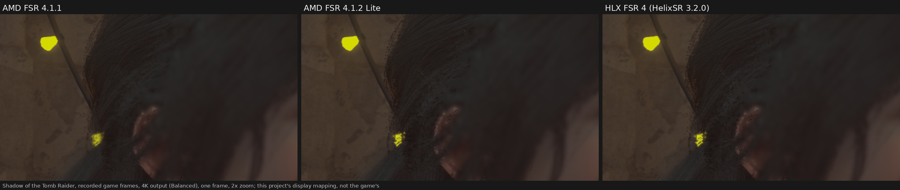

# What HLX FSR 4 runs: our measurements

HelixSR's **HLX FSR 4** is described by its author as "AMD's FSR 4 network on HelixSR's own fast pipeline". Many users take it
to be a much faster full FSR 4. We ran it through this project's test rig to find out which FSR 4 network it runs and how fast it is.
This page lists what we measured, how, and what we did not check.

## In short

- **On an RX 7800 XT, HLX FSR 4 runs AMD's smaller FSR 4.1.2 Lite network, not the full FSR 4 network.** Its picture scores the same as
  AMD's FSR 4.1.2 Lite on all seven game clips and on every synthetic test, and its speed matches Lite's.
- That is AMD's own network, and HelixSR runs it well: its output is close to AMD's Lite (51 to 54 dB from it on game clips; not
  identical, since HelixSR uses its own shader code). But it is not full FSR 4. Its speed over FSR 4.1.1 is the speed of the smaller network.
- AMD calls this smaller network "a new, highly optimized ML model that is less than half the size of the original INT8 model", made for
  some Ryzen processors with built-in graphics (FSR SDK 2.4.0 release notes, 2026-10-28). HelixSR's documentation does not say Lite.

## Versions tested

- **HelixSR 3.1.0** (2026-10-28), built with its own setup script in a sandbox (no network) from the same AMD driver file its setup uses.
  Our build's shaders match the checksums HelixSR publishes for its tested build.
- **HelixSR 3.2.0** (pre-release, 2026-10-29) ships HLX FSR 4 already built. Its DLL holds exactly the same 1,370 shaders as our 3.1.0 build
  (compared by checksum), and on the test rig it gives 3.1.0's frames exactly (7 game clips, 112 of 112 frames) at the same speed.
- **HLX DLSS** (HelixSR 3.2.0's other upscaler, run through its bundled OptiScaler build) gives exactly the same picture as **HelixSR 2.0**
  on the test rig: the same frames byte for byte at 1080p, 1440p and 4K and on every synthetic test. It is HelixSR's own existing network,
  not a new one and not FSR 4. Under Proton it ran about 13% slower than 2.0 at 4K (2.07 vs 1.83 ms, one run each; this run went through
  OptiScaler, which 2.0's did not).

## Picture

Game clips recorded in Shadow of the Tomb Raider, the Black Myth: Wukong benchmark tool and the Stellar Blade demo, upscaled to 4K
(Balanced) by each upscaler. The score is the PSNR against AMD's FSR 4.1.1 on the same clip, 16 frames each (higher = closer to full FSR 4).
Pictures use our own display mapping, not the games' tone mapping.

| Clip | HLX FSR 4 | AMD FSR 4.1.2 Lite | HelixSR 2.0 |
|---|---|---|---|
| SOTTR, stairs | 48.94 dB | 48.95 dB | 44.87 dB |
| SOTTR, Lara | 56.85 dB | 56.83 dB | 51.87 dB |
| Wukong, bamboo bridge | 40.93 dB | 40.88 dB | 34.78 dB |
| Wukong, foliage | 46.43 dB | 46.44 dB | 41.87 dB |
| Stellar Blade, shield | 42.81 dB | 42.81 dB | 40.17 dB |
| Stellar Blade, armor | 46.99 dB | 47.08 dB | 45.35 dB |
| Stellar Blade, pods | 48.29 dB | 48.27 dB | 45.16 dB |

*Shadow of the Tomb Raider, recorded game frames, 4K output (Balanced), one frame, a 480x270 area of hair at 2x zoom. Pictures
use this project's display mapping, not the game's tone mapping. AMD's FSR 4.1.2 Lite ran in this project's local test harness.*

On every clip HLX FSR 4 lands within 0.1 dB of Lite. Measured directly against Lite, HLX FSR 4 is 51 to 54 dB away; against full FSR 4,
both are 40 to 57 dB away. The synthetic tests (still and moving scenes, wires, particles, grain, foliage) show the same: HLX FSR 4 behaves
like Lite on each.

## Speed

Upscaler time per frame, moving scene, Balanced, RX 7800 XT, **under Proton on Linux (not Windows)**, each build run twice:

| | 1080p | 1440p | 4K |
|---|---|---|---|
| AMD FSR 4.1.1 | 1.066 ms | 2.177 ms | 4.782 ms |
| AMD FSR 4.1.2 Lite | 0.645 ms (-39%) | 1.026 ms (-53%) | 2.042 ms (-57%) |
| HLX FSR 4 | 0.633 ms (-41%) | 0.983 ms (-55%) | 2.068 ms (-57%) |

HLX FSR 4 and Lite run at the same speed (within 2 to 4%, either way).

## Not checked

- **Other graphics cards.** HLX FSR 4 picks one of several versions per graphics card (on this card, its log names an INT8 version).
  We only measured an RX 7800 XT; on other cards it picks other versions (32-bit and 16-bit ones for older cards, by its release notes),
  and we have not checked which network those run.
- **Windows.** All runs were under Proton. Speed on Windows can differ.
- **Ultra Performance and native (DLAA-like) modes.**
