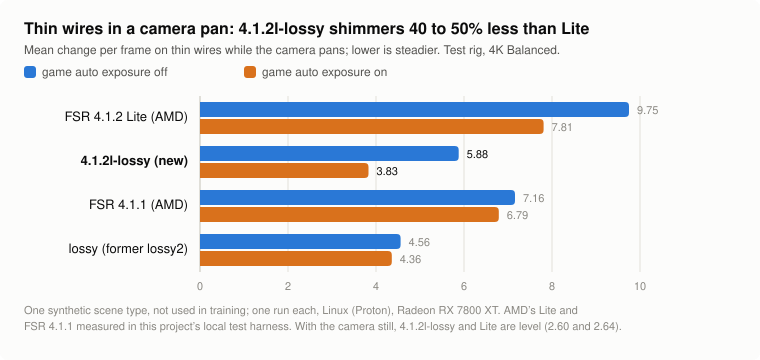

# The Lite builds: 4.1.2l-exact and 4.1.2l-lossy

Since release `dll-2026-10-29` every archive also holds two builds based on **FSR 4.1.2 Lite**, the smaller FSR 4 network that AMD's
driver most likely uses for graphics built into the processor ([what AMD's 4.1.2 changes](amd-411-vs-412.md)):

| Folder | Version name in OptiScaler | Picture | Speed against AMD's Lite (Linux, RX 7800 XT) |
|---|---|---|---|
| `4.1.2l-exact` | `4.1.2l-exact-<flavor>-cyboman` | **AMD's Lite picture, byte for byte** (exact to AMD's Lite, not to full FSR 4) | 2 to 3% faster |
| `4.1.2l-lossy` | `4.1.2l-lossy-<flavor>-cyboman` | close to Lite's, not the same: read its `WARNING.txt` | about 13 to 18% faster |

`<flavor>` is `r3`, `r2`, `igpu-r3` or `igpu-r2`, after the archive. 4.1.2l-exact is the same file in all four archives; only the name
differs. 4.1.2l-lossy comes in two forms with the same picture: the RX 6000 and Steam Deck / older built-in graphics archives keep some
finished results in the chip's shared memory instead of its registers, so that RX 6000 chips under Windows can run 8 groups of work at
once instead of 7 ([below](#rx-6000-8-groups-of-work-instead-of-7)).

> [!WARNING]
> **4.1.2l-lossy changes the picture.** It is neither AMD's FSR 4.1.1 nor AMD's FSR 4.1.2 Lite. Never use any of these builds in
> online games or games with anti-cheat. Not for Radeon RX 9000 cards.

## Which one?

- **Lite or full FSR 4?** Lite is a smaller network: a little less accurate on a still picture than full FSR 4.1.1 (43.9 against
  44.3 dB on the test scenes), better on some motion (swaying foliage, thin detail), worse on others (old image beside moving objects,
  fades). How it compares with full FSR 4.1.1 and other upscalers, with recorded game clips: [upscaler comparison](upscaler-comparison.md)
  and the [comparison site](https://zgauthier2000.github.io/fsr4-upscaler-compare/).
- **4.1.2l-exact** gives Lite's picture unchanged and saves a little time.
- **4.1.2l-lossy** is the faster of the two. It runs the network on every other frame, like `lossy`, with weights retrained
  for that frame loop.

## Speed

FSR 4's time per frame, milliseconds, moving scene, Balanced, **under Linux (Proton) on one Radeon RX 7800 XT**, two runs each.
Windows and other cards are not measured yet; timing-kit reports will follow.

| Output | FSR 4.1.2 Lite (AMD) | 4.1.2l-exact | 4.1.2l-lossy | 4.1.2l-lossy, RX 6000 / RDNA2 form (on this RX 7000 card) |
|---|---|---|---|---|
| 1080p | 0.640 | 0.623 (−2.7%) | 0.557 (−13.0%) | 0.575 (−10.2%) |
| 1440p | 1.023 | 0.993 (−2.9%) | 0.834 (−18.5%) | 0.860 (−15.9%) |
| 4K | 2.017 | 1.968 (−2.4%) | 1.660 (−17.7%) | 1.705 (−15.5%) |

- **4.1.2l-exact** has its first shader (the one that prepares the network's input) rewritten, with the same output. The time it saves
  is close to the spread between runs.
- **4.1.2l-lossy** alternates two kinds of frame: at 4K about 2.05 ms on a frame that runs the network and 1.26 ms on one that skips it.
  What an uneven cost means for frame caps and V-Sync: [frame pacing](frame-pacing.md).

## Picture

**4.1.2l-exact:** its output equals the Lite network's byte for byte (test rig: 1080p, 1440p, 4K and 5K, game auto exposure off and on,
still and moving scenes; and two recorded game clips, Black Myth: Wukong and Shadow of the Tomb Raider).

**4.1.2l-lossy:** the test rig's full check. 4K Balanced, synthetic test scenes, Linux (Proton), one run each. Each cell gives the
game's auto exposure off / on. `*` marks scene types not used in training. FSR 4.1.1 and Lite were measured in this project's local test
harness, not in AMD's own runtime. The last column is this release's `lossy` (full FSR 4, retrained), for comparison.

<picture>
  <source media="(prefers-color-scheme: dark)" srcset="img/rel-lite-wires-dark.svg">
  
</picture>

| Test (4K Balanced; lower is better unless noted) | FSR 4.1.1 (AMD) | FSR 4.1.2 Lite (AMD) | **4.1.2l-lossy** | lossy |
|---|---|---|---|---|
| Flat areas at rest: change per frame * | 0.126 / 0.213 | 0.11 / 0.207 | **0.078 / 0.119** | 0.045 / 0.085 |
| Fine detail at rest: change per frame * | 0.11 / 0.125 | 0.094 / 0.117 | **0.092 / 0.107** | 0.08 / 0.09 |
| Thin detail, vertical motion: change per frame * | 0.364 / 0.422 | 0.31 / 0.379 | **0.334 / 0.368** | 0.279 / 0.303 |
| Background in motion: change per frame | 0.079 / 0.072 | 0.08 / 0.071 | **0.08 / 0.071** | 0.028 / 0.035 |
| Light film grain: change per frame | 0.785 / 0.552 | 0.416 / 0.592 | **0.319 / 0.36** | 0.208 / 0.312 |
| Heavy film grain: change per frame | 2.549 / 0.484 | 2.313 / 0.413 | **1.234 / 0.748** | 1.998 / 0.918 |
| Thin wires, still camera: change per frame | 2.91 / 2.82 | 2.64 / 2.54 | **2.64 / 2.48** | 2.71 / 2.58 |
| Thin wires, camera pan: change per frame * | 7.16 / 6.79 | 9.75 / 7.81 | **7.5 / 4.62** | 4.72 / 4.7 |
| Rain: specks brighter than 20 levels * | 0 / 2 | 0 / 254 | **0 / 0** | 0 / 0 |
| Bright rain: specks brighter than 20 levels | 1,314 / 3,764 | 78 / 1,592 | **303 / 361** | 505 / 475 |
| Fireflies (single over-bright pixels) * | 370 / 137 | 259 / 321 | **280 / 68** | 332 / 110 |
| Dim, dense fireflies | 34 / 10 | 37 / 31 | **40 / 10** | 35 / 9 |
| Foliage at rest: flicker * | 0.32 / 0.38 | 0.32 / 0.37 | **0.32 / 0.33** | 0.33 / 0.34 |
| Still picture accuracy, dB (higher is better) * | 44.33 / 44.44 | 43.92 / 44.03 | **43.85 / 43.94** | 43.89 / 43.93 |
| Just-uncovered areas, dB (higher is better) | 34.48 / 34.71 | 34.44 / 34.69 | **34.44 / 34.69** | 37.14 / 37.4 |
| Old image beside a moving object, scene A * | 4.01 / 3.77 | 6.01 / 5.44 | **6.09 / 5.65** | 4.29 / 4.13 |
| Old image beside a moving object, scene B * | 3.11 / 2.9 | 4.35 / 4.35 | **2.67 / 2.52** | 4.0 / 5.0 |
| Large particles: error | 0.66 / 0.66 | 0.71 / 0.71 | **0.89 / 0.88** | 1.16 / 1.16 |
| Small, slow bright details: error | 2.52 / 2.52 | 2.68 / 2.66 | **3.1 / 3.03** | 2.69 / 2.73 |
| Swaying foliage: error | 12.09 / 12.08 | 10.37 / 10.39 | **12.08 / 12.19** | 12.33 / 12.38 |
| Fade: frames behind * | 0.91 / 0.9 | 1.69 / 1.53 | **1.29 / 1.11** | 1.01 / 0.94 |
| Brightening: frames behind * | 0.46 / 0.46 | 1.03 / 0.86 | **1.01 / 1.03** | 3.66 / 2.67 |
| Brightness step: share missed on the first frame * | 0.04 / 0.04 | 0 / 0.01 | **0 / 0** | 0.41 / 0.3 |
| Moving water, dB (higher is better) * | 45.31 / 45.25 | 45.62 / 45.63 | **44.97 / 44.98** | 44.77 / 44.72 |
| Stairs: crawl in motion * | 16.43 / 30.44 | 42.15 / 42.19 | **38.59 / 40.78** | 32.25 / 29.79 |
| Vents: crawl in motion * | 5.15 / 5.34 | 2.65 / 2.5 | **11.74 / 10.83** | 9.19 / 9.29 |
| Zone plate: crawl in motion * | 2.9 / 2.63 | 18.04 / 18.86 | **22.92 / 22.49** | 8.22 / 7.95 |

**Better than AMD's Lite:**

- Thin wires while the camera pans shimmer less (7.5 / 4.6 against 9.8 / 7.8; FSR 4.1.1: 7.2 / 6.8).
- Steadier in flat areas at rest and, with auto exposure off, in film grain.
- With auto exposure on: no rain specks above 20 levels where Lite has 254, far fewer fireflies (68 against 321) and fewer bright rain
  specks (361 against 1,592).
- Old image beside a moving object (scene B): 2.7 / 2.5 against 4.4 / 4.4. Fades catch up sooner (1.3 / 1.1 frames against 1.7 / 1.5).
  Stairs crawl a little less.

**Worse than AMD's Lite:**

- **Small, slowly moving bright details** (sparks, distant lights): error 3.1 / 3.0 against Lite's 2.7 / 2.7 and FSR 4.1.1's 2.5.
- Large particles: error 0.89 against 0.71. Swaying foliage: 12.1 / 12.2 against 10.4 (FSR 4.1.1: 12.1).
- More crawling on some fine patterns in motion: vents 11.7 / 10.8 against 2.7 / 2.5, zone plate 22.9 / 22.5 against 18.0 / 18.9.
- Moving water a little less accurate (45.0 against 45.6 dB).
- Bright rain with auto exposure off: 303 bright specks against 78. With auto exposure on, heavy film grain changes more from frame to
  frame (0.75 against 0.41) and brightening catches up a little more slowly (1.03 against 0.86 frames).
- Where the depth changes sharply (foliage against a distant background) some dark specks appear on the frames it skips: in that test
  scene about 250 per frame with auto exposure off.

## RX 6000: 8 groups of work instead of 7

On the frames it skips, 4.1.2l-lossy works out four output pixels per thread and writes them at the end. AMD's Windows compiler keeps
the first pixels' finished values in registers while the last one is worked out, and needs 142 to 144 registers for that on RX 6000
chips, which lets a chip run 7 groups of work at once. The RX 6000 and Steam Deck / older built-in graphics archives keep the first two
pixels' values in the chip's shared memory instead (22.5 KB per group) and read them back at the end: 128 registers, 8 groups, the same
picture byte for byte (AMD's Windows compiler for RX 6800 / 6900, RX 6700 and RX 6600 chips, all 32 changed shader versions, no spills).
How much faster that is on Windows is not measured yet; the timing kit's next version times both forms on every card. On an RX 7000
card, which has room for enough groups either way, it costs about 3% under Linux, so the RX 7000 and RDNA 3 archives do not use it.

## Ultra Performance and above 4K

**Ultra Performance only: not representative of the other modes.** 4.1.2l-lossy skips frames in Ultra Performance too. It uses AMD's own
Lite weights for that mode (the retrained weights are for the other modes). This release's build was not measured there separately; an
earlier build with the same Ultra Performance setup was about 12 to 14% faster than Lite, with a picture close to Lite's (steadier thin
wires in a camera pan, more rain specks and dim fireflies with auto exposure off, foliage and large particles a little less accurate).

Above 4K output 4.1.2l-lossy runs the network on every frame with Lite's weights: close to Lite's picture (speed not measured there).
4.1.2l-exact gives Lite's picture byte for byte in every mode and at every size, including Ultra Performance and 5K, and with the flags
games set (inverted depth, display-size motion vectors, jitter cancellation).

## Not checked yet

- Windows: the DLLs only ran under Proton on Linux. Speed on other cards.
- Playing games: the figures come from synthetic test scenes; the comparison site shows recorded game clips.
- Training is not fully repeatable: the same training with other random seeds gave copies that differ somewhat; the best of three is
  shipped.

## How the DLLs were checked

- **4.1.2l-lossy:** the DLL's frames equal those of the build the full check above measured, byte for byte (48 comparisons: four output
  sizes, still and moving scenes, auto exposure off and on), also on two recorded game clips; the RX 6000 / RDNA2 form gives the same
  frames as the other form, on the rig and on the game clips.
- **4.1.2l-exact:** the DLL's frames equal those of the Lite network without its changes, byte for byte (the same 48 comparisons and
  two game clips).
- The copies of each form differ only in the version name.
