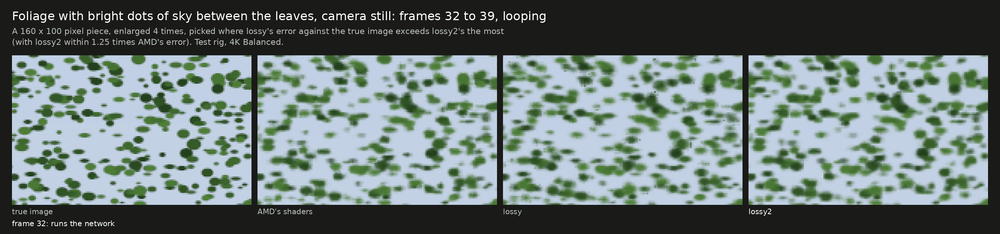
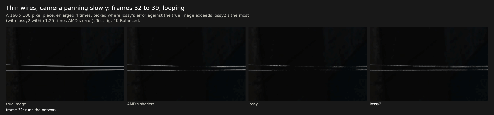
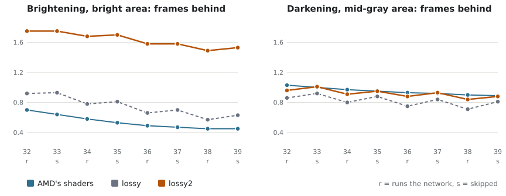

# Release `dll-2026-10-19` against `dll-2026-10-15`

> [!CAUTION]
> **Superseded by [`dll-2026-10-22`](https://github.com/zgauthier2000/fsr4-shader-performance-overrides/releases/tag/dll-2026-10-22)** ([what it changes](dll-2026-10-22.md)):
> four builds, one for each kind of graphics (up to about 3% faster on RX 7000 cards, less on others), with the same pictures.
> Download the latest release: [RX 7000](https://github.com/zgauthier2000/fsr4-shader-performance-overrides/releases/download/dll-2026-10-22/fsr4.1.1-cyboman-rx7000-2026-10-22.7z), [RX 6000](https://github.com/zgauthier2000/fsr4-shader-performance-overrides/releases/download/dll-2026-10-22/fsr4.1.1-cyboman-rx6000-2026-10-22.7z),
> [integrated RDNA 3, GeForce, Arc and other cards](https://github.com/zgauthier2000/fsr4-shader-performance-overrides/releases/download/dll-2026-10-22/fsr4.1.1-igpu-cyboman-rdna3-2026-10-22.7z), [Steam Deck and integrated RDNA2](https://github.com/zgauthier2000/fsr4-shader-performance-overrides/releases/download/dll-2026-10-22/fsr4.1.1-igpu-cyboman-rdna2-2026-10-22.7z)
> (each also as a `.zip`). The newest release is always on [the latest release's page](https://github.com/zgauthier2000/fsr4-shader-performance-overrides/releases/latest).

## What's new

- **New: lossy2, a third DLL next to exact and lossy.** It is the lossy DLL with new weights in six of the network's twelve layers,
  trained to match AMD's picture through lossy's whole frame loop. Swaying foliage comes out much closer to AMD's picture (error 12.2
  against lossy's 17.9; AMD's own file 12.1), areas a moving object has
  just uncovered about 1 dB better, and 16 to 30% fewer fireflies in the fireflies scene.
  **The price:** it follows brightening 2 to 2.5 times as slowly as lossy (1.5 frames behind against 0.6 on a bright area), a still picture
  is 0.3 to 0.4 dB less accurate, and heavy film grain is less steady when the game uses FSR's auto exposure. Same speed as lossy. lossy2 is meant to
  replace lossy once it has been trained further; until then both are included, so you can compare them. **lossy2 does not support
  Ultra Performance yet:** in that mode it runs lossy's network unchanged, so it looks and performs exactly like lossy there. It was
  made with the tools of Durandal, the project's unreleased smaller network, and is one step on that longer path.
- **Lossy DLL:** the register cut of `dll-2026-10-15` is removed again. The Windows timing kit has shown that this should lower the
  lossy DLL's upscaler time against `dll-2026-10-15` by about 1.3 to 1.8% on RX 6000 cards, about 3% on the RX 7600, about 1% on the Radeon 890M and the Intel Arc B580, and about
  0.5 to 0.8% on the RX 7800 XT and the GeForce RTX 3090 (4K).
  On Linux the lossy DLL's picture and speed are exactly as before.
- **Exact DLL:** unchanged (the same file as `dll-2026-10-15`). Linux's exact launch-option folder is about 0.02 ms per frame faster,
  with the same picture.
- **Downloads:** each zip now holds three DLLs, and each comes as a much smaller `.7z` too (5.6 MB instead of 82 MB).

What this release changes, in figures and pictures, against the release before it.

## Downloads

| | Radeon RX 7000 / RX 6000 | Graphics built into the processor | Notes and all files |
|---|---|---|---|
| `dll-2026-10-19` (superseded), this page | [fsr4.1.1-cyboman-2026-10-19.7z](https://github.com/zgauthier2000/fsr4-shader-performance-overrides/releases/download/dll-2026-10-19/fsr4.1.1-cyboman-2026-10-19.7z) (5.6 MB) or [.zip](https://github.com/zgauthier2000/fsr4-shader-performance-overrides/releases/download/dll-2026-10-19/fsr4.1.1-cyboman-2026-10-19.zip) (82 MB) | [fsr4.1.1-igpu-cyboman-2026-10-19.7z](https://github.com/zgauthier2000/fsr4-shader-performance-overrides/releases/download/dll-2026-10-19/fsr4.1.1-igpu-cyboman-2026-10-19.7z) (5.6 MB) or [.zip](https://github.com/zgauthier2000/fsr4-shader-performance-overrides/releases/download/dll-2026-10-19/fsr4.1.1-igpu-cyboman-2026-10-19.zip) (82 MB) | [release `dll-2026-10-19`](https://github.com/zgauthier2000/fsr4-shader-performance-overrides/releases/tag/dll-2026-10-19) |

The `.7z` and the `.zip` hold the same files. Windows 11 (version 23H2 or later) opens a `.7z` itself; on Windows 10 use
[7-Zip](https://www.7-zip.org/) or take the `.zip`.

Each archive holds three folders: `exact` (AMD's picture, byte for byte), `lossy` and `lossy2`. Both lossy DLLs change the picture:
read the `WARNING.txt` in each folder first. Never use any of them in online games or games with anti-cheat.

If a game crashes with the `exact` DLL from the RX 7000 / RX 6000 archive, try the `exact` DLL from the integrated-graphics archive
(`fsr4.1.1-igpu-cyboman`) instead: the same picture, byte for byte, with one shader built differently. In timing-kit reports on
Windows it is about 1 to 1.5% slower on RX 6000 cards and no slower on RX 7000 cards (medians).

> [!NOTE]
> **In a game:** Shadow of the Tomb Raider's benchmark at 4K Balanced on a Radeon RX 7800 XT under Linux: lossy2 rendered 18,784
> frames, 121 FPS (one run); the lossy DLL 18,773 to 18,828 frames, 121 FPS (two runs, `dll-2026-10-15`). The same speed.

## In short

| | exact | lossy | lossy2 (new) |
|---|---|---|---|
| Picture | AMD's, byte for byte | as `dll-2026-10-15` on Linux; on Windows as before `dll-2026-10-15` | trained weights: see below |
| Speed | as `dll-2026-10-15` | on Windows about 0.5 to 3% faster than `dll-2026-10-15`'s, depending on the card (timing kit, see below); on Linux the same | as lossy (one game run, Linux) |
| Ultra Performance | as `dll-2026-10-15` | as `dll-2026-10-15` | **not supported yet:** runs lossy's network unchanged |
| Version name in OptiScaler | `4.1.1-cyboman` | `4.1.1-lossy-cyboman` | `4.1.1-lossy2-cyboman` |

The iGPU zip's names carry `igpu` (`4.1.1-igpu-lossy2-cyboman` and so on).

## lossy2: what the new weights change

> [!WARNING]
> **lossy2 does not support Ultra Performance yet.** It has no trained weights for that mode: in Ultra Performance it runs
> the lossy DLL's network unchanged, so its picture and speed there are exactly lossy's. Everything on this page about lossy2 applies
> to Quality, Balanced and Performance.

lossy2 runs everything the lossy DLL runs: the network on every other frame and, on the frames in between, its last result moved
along with the picture's motion. Six of the network's twelve layers (passes 1, 2, 4, 5, 10 and 12) carry new weights. They were
trained on the test rig's scenes to make lossy's whole frame loop match AMD's picture, starting from lossy's own weights; part of the
training starts each scene fresh, as games do after a cut, which keeps rain and fireflies from turning into lasting bright specks.
The other six layers, the steps before and after the network, and Ultra Performance are lossy's.

lossy2's weights were trained by knowledge distillation: lossy's network learned to reproduce AMD's own output, frame skip included.

<picture>
  <source media="(prefers-color-scheme: dark)" srcset="../img/lossy2-inside-dark.svg">
  
</picture>

lossy2 is one step on a longer path. Its weights were trained with the tools built for Durandal, the project's unreleased
work on a smaller network trained to imitate AMD's and run on every frame.
lossy2 applies them to the lossy DLL's own network; Durandal itself is still in development.

The figures below come from the test rig's synthetic scenes (Linux, Proton), 4K Balanced unless noted.

### Swaying foliage: much closer to AMD's picture

Eight frames in a loop, at a quarter of a second each, of the foliage scene with bright dots of sky between the leaves: lossy's leaves
are softer and shimmer from frame to frame, lossy2's follow AMD's. Over these frames the piece's mean error against the true image is
12.8 with AMD's shaders, 18.3 with lossy and 13.9 with lossy2 (12.9 to 13.7 on frames that run the network, 14.0 to 14.9 on skipped
ones).

On the whole foliage scene the error falls from lossy's 17.9 to 12.2 (AMD's own file 12.1); with the camera moving as well, from
17.6 to 13.1 (AMD's 10.7). The foliage scenes ran at 4K only.

### Thin wires in a slow pan: they stay whole

Lossy breaks thin wires into dotted fragments that change from frame to frame; lossy2 keeps them continuous, close to AMD's. Across
the whole wires scene the change per frame falls from lossy's 5.29 to 4.56 (AMD's own file 7.16). Over these eight frames the piece's
mean error against the true image is 1.20 with AMD's shaders, 2.14 with lossy and 1.79 with lossy2: the wires are a few pixels of
a dark piece, so the averages move less than the picture does.

### Brightening: 2 to 2.5 times as slow as lossy

<picture>
  <source media="(prefers-color-scheme: dark)" srcset="../img/rel-2026-10-19-fades-dark.svg">
  
</picture>

When a bright part of the picture gets brighter, lossy2 lags 1.5 frames behind the true brightness, against lossy's 0.6 and AMD's
0.5; on mid-gray areas 2.3 frames against 0.9 (AMD 0.9), on dark areas 6.3 against 3.9 (AMD 5.0). Darkening is about as before
(mid-gray areas 0.9 against lossy's 0.8 and AMD's 0.9). The lag sits in the trained network itself: with every frame
running the network it is still there.

### Every measure

| Measure (4K Balanced) | AMD's shaders | lossy | lossy2 |
|---|---|---|---|
| Swaying foliage, error (lower is better) | 12.1 | 17.9 | **12.2** |
| Just uncovered by a moving object (dB, higher is better) | 34.5 | 36.0 | **37.0** |
| Fireflies (over-bright pixels, lower is better) | 370 | 425 | **356** |
| Fireflies with auto exposure on | 137 | 182 | **128** |
| Ghost outline beside a moving object (lower is better) | 4.0 | 4.6 | **4.1** |
| Thin wires during a pan, change per frame (lower is steadier) | 7.16 | 5.29 | **4.56** |
| Rain: pixels more than 20 levels too bright | 0 | 0 | 0 |
| Bright rain: same | 1,314 | **437** | 464 |
| Still picture (dB) | 44.3 | **44.2** | 43.9 |
| Still foliage, no sway, error | 7.9 | **7.6** | 8.3 |
| Brightening, bright area: frames behind | 0.46 | **0.64** | 1.54 |
| Brightening, mid-gray area: frames behind | 0.89 | **0.91** | 2.27 |
| Darkening, mid-gray area: frames behind | 0.91 | **0.78** | 0.88 |
| Sudden step brighter: share missing on the first frame | 0.14 | **0.12** | 0.29 |
| Sudden step darker: share missing on the first frame | 0.04 | **0.03** | 0.09 |
| Heavy grain, change per frame, auto exposure off | 2.55 | **1.83** | 2.13 |
| Heavy grain, change per frame, auto exposure on | 0.48 | **0.52** | 1.41 |

Bold marks the better of the two lossy DLLs. At 1080p, 1440p and 5K (moving scene, Balanced) lossy2 shows the same pattern: areas just
uncovered 0.7 to 1 dB better, fine detail a little steadier, background and still areas 0.3 to 0.5 dB less accurate. With auto
exposure on, the 4K rows move the same way.

## The register cut is gone

`dll-2026-10-15` gave the lossy DLL's last shader a form that needs fewer registers, meant for graphics chips with a small register
file. This release removes it from both lossy DLLs. The Windows timing kit, which timed the lossy DLL with and without it, has shown
that this should lower the upscaler time against `dll-2026-10-15`:

| Graphics chip (Windows, 4K) | Upscaler time, against `dll-2026-10-15` | Reports |
|---|---|---|
| RX 6600, 6600 XT, 6650 XT, 6700, 6700 XT, 6750 XT, 6800, 6900 XT | about −1.3 to −1.8% | 17 |
| RX 7600 | about −2.8% | 2 |
| Radeon 890M | about −1.2% | 1 |
| Intel Arc B580 | about −1% | 1 |
| RX 7800 XT | about −0.7% | 6 |
| GeForce RTX 3090 | about −0.5 to −0.8% | 2 |

Medians per card, each report timing both forms side by side; the Radeon 890M with the iGPU archive's DLL, the others with the first.
These are timings of the two forms, not of this release's DLL itself. On Linux the cut had changed neither speed nor picture; there
the lossy DLL gives exactly the frames of `dll-2026-10-15`.

## What got worse

- **lossy2** against lossy: brightening lags 2 to 2.5 times as long; a still picture is 0.3 to 0.4 dB less accurate (0.3 to
  0.5 dB at 1080p, 1440p and 5K); foliage that does not sway is a little less accurate (error 8.3 against 7.6, AMD's 7.9);
  heavy film grain changes about 2.7 times as much per frame when the game uses FSR's auto exposure (more than with AMD's file); after a sudden step brighter, about twice lossy's share of it is still missing eight frames later (a step darker
  catches up within two frames, as lossy's); darkening lags a little more.
- **lossy2** was trained on 4K Balanced only. At 1080p, 1440p and 5K it was checked in Balanced; Quality, Performance and other
  sizes run the same weights unchecked.
- **lossy:** nothing on Linux. On Windows its picture goes back to what it was before `dll-2026-10-15`.

## Checks

- **lossy2 Windows DLLs against the Linux lossy2 folder:** byte for byte on every frame of 48 of 48 comparisons (four sizes; still,
  fade, grain, foliage, fireflies and rain scenes; auto exposure off and on; the HDR option; both flavors).
- **lossy Windows DLLs against the Linux lossy folder:** 48 of 48 the same. **The Linux lossy folder against `dll-2026-10-15`'s:** 30
  of 30 the same (every frame).
- **lossy2's shaders at every size:** with lossy's own weights the generated shaders give lossy's frames byte for byte at 1080p,
  1440p, 4K and 5K (30 of 30).
- **Exact:** the Linux folder against AMD's shaders, 48 of 48 the same; the exact DLLs are `dll-2026-10-15`'s.
- **Rebuilding:** [`research/lossy2`](../../research/lossy2/README.md) rebuilds the Linux lossy2 folder file for file and both lossy2
  DLLs byte for byte from AMD's DLL and this release's lossy DLL.
- **Full test-rig check** of lossy2 (every lossy release check, auto exposure off and on): the table above.
