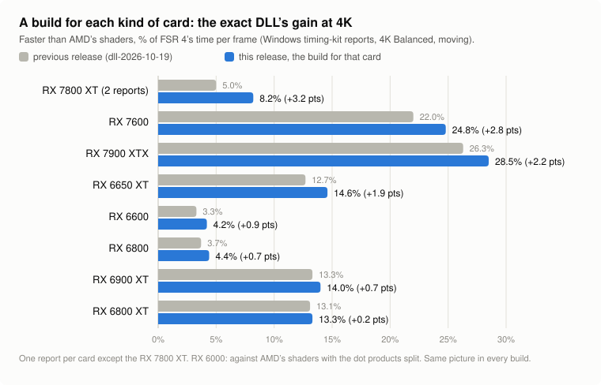

# Release `dll-2026-10-22` against `dll-2026-10-19`

> [!CAUTION]
> **Superseded by [`dll-2026-10-29`](https://github.com/zgauthier2000/fsr4-shader-performance-overrides/releases/tag/dll-2026-10-29)** ([what it changes](dll-2026-10-29.md)):
> faster exact builds (on RX 6000 the picture of AMD's own FSR 4.1.2 for RX 6000), the retrained lossy (the former lossy2), and two new builds on
> AMD's FSR 4.1.2 Lite. Download the latest release: [RX 7000](https://github.com/zgauthier2000/fsr4-shader-performance-overrides/releases/download/dll-2026-10-29/fsr4.1.2-cyboman-rx7000-2026-10-29.7z), [RX 6000](https://github.com/zgauthier2000/fsr4-shader-performance-overrides/releases/download/dll-2026-10-29/fsr4.1.2-cyboman-rx6000-2026-10-29.7z),
> [integrated RDNA 3, GeForce, Arc and other cards](https://github.com/zgauthier2000/fsr4-shader-performance-overrides/releases/download/dll-2026-10-29/fsr4.1.2-igpu-cyboman-rdna3-2026-10-29.7z), [Steam Deck and integrated RDNA2](https://github.com/zgauthier2000/fsr4-shader-performance-overrides/releases/download/dll-2026-10-29/fsr4.1.2-igpu-cyboman-rdna2-2026-10-29.7z)
> (each also as a `.zip`). The newest release is always on [the latest release's page](https://github.com/zgauthier2000/fsr4-shader-performance-overrides/releases/latest).

## What's new

- **Four builds instead of two, one for each kind of graphics card.** Each carries only the changes that help its kind of chip, so the
  exact DLL is up to about 3 percentage points faster on RX 7000 cards and 1 to 2 points on some RX 6000 cards, with the same picture.
  The Radeon 890M gets 3 to 5% and Intel Arc 0.4 to 3% better performance than with the previous builds.
- **Pictures unchanged:** every exact DLL gives AMD's picture byte for byte, and the lossy and lossy2 DLLs give the same frames as in
  `dll-2026-10-19`.
- **Version names** now say which build runs, for example `4.1.1-exact-r3-cyboman` or `4.1.1-lossy2-igpu-r2-cyboman`.
- **Other cards improve less:** the bigger RX 6000 cards gain up to about 1 point, and some of their readings are up to 0.7% slower
  than the previous release's, within the spread between runs. The Steam Deck / Radeon 680M build is the previous integrated-graphics
  build under a new name. GeForce cards are now pointed at the archive for newer built-in graphics; it has not been timed on a GeForce yet.
- **Linux:** unchanged.

What this release changes, in figures, against the release before it.

## Downloads

| Archive | For | Download |
|---|---|---|
| RX 7000 | Radeon RX 7000 cards, including laptops with their own RX 7000 chip | [fsr4.1.1-cyboman-rx7000-2026-10-22.7z](https://github.com/zgauthier2000/fsr4-shader-performance-overrides/releases/download/dll-2026-10-22/fsr4.1.1-cyboman-rx7000-2026-10-22.7z) (5.4 MB) or [.zip](https://github.com/zgauthier2000/fsr4-shader-performance-overrides/releases/download/dll-2026-10-22/fsr4.1.1-cyboman-rx7000-2026-10-22.zip) (78.9 MB) |
| RX 6000 | Radeon RX 6000 cards, including laptops with their own RX 6000 chip | [fsr4.1.1-cyboman-rx6000-2026-10-22.7z](https://github.com/zgauthier2000/fsr4-shader-performance-overrides/releases/download/dll-2026-10-22/fsr4.1.1-cyboman-rx6000-2026-10-22.7z) (5.4 MB) or [.zip](https://github.com/zgauthier2000/fsr4-shader-performance-overrides/releases/download/dll-2026-10-22/fsr4.1.1-cyboman-rx6000-2026-10-22.zip) (77.0 MB) |
| Integrated RDNA 3 | Radeon 780M, 760M, 880M, 890M and other RDNA 3 / 3.5 graphics built into the processor; GeForce, Intel Arc and any other card | [fsr4.1.1-igpu-cyboman-rdna3-2026-10-22.7z](https://github.com/zgauthier2000/fsr4-shader-performance-overrides/releases/download/dll-2026-10-22/fsr4.1.1-igpu-cyboman-rdna3-2026-10-22.7z) (5.4 MB) or [.zip](https://github.com/zgauthier2000/fsr4-shader-performance-overrides/releases/download/dll-2026-10-22/fsr4.1.1-igpu-cyboman-rdna3-2026-10-22.zip) (78.9 MB) |
| Integrated RDNA2 | Steam Deck, Radeon 680M, 660M, 610M and the graphics of Ryzen 7000 and 9000 desktop processors | [fsr4.1.1-igpu-cyboman-rdna2-2026-10-22.7z](https://github.com/zgauthier2000/fsr4-shader-performance-overrides/releases/download/dll-2026-10-22/fsr4.1.1-igpu-cyboman-rdna2-2026-10-22.7z) (5.6 MB) or [.zip](https://github.com/zgauthier2000/fsr4-shader-performance-overrides/releases/download/dll-2026-10-22/fsr4.1.1-igpu-cyboman-rdna2-2026-10-22.zip) (81.4 MB) |

All files and checksums: [release `dll-2026-10-22`](https://github.com/zgauthier2000/fsr4-shader-performance-overrides/releases/tag/dll-2026-10-22).
The previous release, `dll-2026-10-19`, stays available: [its page](dll-2026-10-19.md).

The `.7z` and the `.zip` hold the same files. Windows 11 (version 23H2 or later) opens a `.7z` itself; on Windows 10 use
[7-Zip](https://www.7-zip.org/) or take the `.zip`. Each archive holds three folders: `exact` (AMD's picture, byte for byte), `lossy`
and `lossy2`. Both lossy DLLs change the picture: read the `WARNING.txt` in each folder first. Never use any of them in online games
or games with anti-cheat. Not for Radeon RX 9000 cards.

Every archive works on every card that runs FSR 4.1.1 through OptiScaler; the one for your card is the fastest there. If a game crashes
with one archive's `exact` DLL, try the `exact` DLL of an integrated-graphics archive: the same picture, with network pass 11 built
smaller.

## In short

| Archive | What its builds carry | Version names in OptiScaler |
|---|---|---|
| RX 7000 | all of the exact DLL's shader changes except the split dot products in the last shader, which RX 7000 cards do not need and which cost them about 3 to 4% (timing kit) | `4.1.1-exact-r3-cyboman`, `4.1.1-lossy-r3-cyboman`, `4.1.1-lossy2-r3-cyboman` |
| RX 6000 | the split dot products (the fix for the picture difference RX 6000 cards show with AMD's file under Windows), without the change to the first shader (the prepass), which cost most RX 6000 cards up to about 2% | `4.1.1-exact-r2-cyboman`, `4.1.1-lossy-r2-cyboman`, `4.1.1-lossy2-r2-cyboman` |
| Integrated RDNA 3 | the previous integrated-graphics build (network pass 11 built smaller) without the split dot products | `4.1.1-exact-igpu-r3-cyboman`, ... |
| Integrated RDNA2 | the previous integrated-graphics build, unchanged | `4.1.1-exact-igpu-r2-cyboman`, ... |

The previous release had two archives: one for RX 7000 and RX 6000 cards (the split dot products and the prepass change in every
build) and one for integrated graphics.

## Speed

The exact DLL, percent faster than AMD's shaders, from Windows timing-kit reports (4K and 1440p output, Balanced, moving scene). The
"this release" figures are the timing kit's study builds with the same change as the release build (RX 7000: without the split dot
products; RX 6000: without the prepass change), timed in the same report as the previous release's DLL. On RX 6000 cards both are
compared with AMD's shaders with the dot products split, since AMD's own form gives a different picture on them under Windows.

<picture>
  <source media="(prefers-color-scheme: dark)" srcset="../img/rel-2026-10-22-gain-dark.svg">
  
</picture>

| Card | Reports | 4K: previous, this release | 1440p: previous, this release |
|---|---|---|---|
| RX 7800 XT | 2 | 5.0%, **8.2%** | 2.8%, **6.0%** |
| RX 7600 | 1 | 22.0%, **24.8%** | 16.3%, **19.6%** |
| RX 7900 XTX | 1 | 26.3%, **28.5%** | 19.9%, **22.1%** |
| RX 6650 XT | 1 | 12.7%, **14.6%** | 11.4%, **13.0%** |
| RX 6600 | 1 | 3.3%, **4.2%** | 7.2%, **8.1%** |
| RX 6800 | 1 | 3.7%, **4.4%** | 3.7%, **3.7%** |
| RX 6900 XT | 1 | 13.3%, **14.0%** | 3.7%, **4.3%** |
| RX 6800 XT | 1 | 13.1%, **13.3%** | 4.8%, **5.1%** |

- **The largest gains** are on RX 7000 cards: 2 to 3 percentage points at 4K and 1440p.
- **Other cards improve less.** On the RX 6600, 6800, 6800 XT and 6900 XT the gain is up to about 1 point, and across all sizes and
  still / moving readings the new build ranges from 1.0% faster to 0.7% slower than the previous one on the 6800, 6800 XT and 6900 XT:
  within the spread between runs.
- **Built-in graphics:** on the Radeon 890M the split dot products cost 3.3 to 5.3% in the timing kit's study runs (two reports), and on
  Intel Arc 0.4 to 2.9% (B580, 140V), with the same picture; the integrated RDNA 3 build leaves them out. The Steam Deck / 680M build is
  unchanged.
- **Not measured:** GeForce cards with the integrated RDNA 3 build (they used the RX 7000 / RX 6000 archive before); the lossy and lossy2
  DLLs of the new builds on their own (they carry the same change in their last shader as their exact DLL); Linux, which is unchanged.

The figures come from test builds made the same way as the release DLLs, mostly one report per card. The new
[timing kit](../../timing-kit/README.md) times the release DLLs themselves on every PC, so later reports will fill in this table.

## Checked

- Every new build's DLL gives the frames of its Linux files byte for byte on the test rig (48 of 48 comparisons each): the exact
  DLLs AMD's frames, lossy and lossy2 those of `dll-2026-10-19`'s Linux lossy and lossy2 files.
- The repository's tools rebuild the four exact DLLs byte for byte.
- Under Proton the new timing kit runs all twelve DLLs, and every exact DLL gives AMD's picture there.
- Windows itself was not tested: the DLLs ran under Proton. The version names keep `4.1.1` first because OptiScaler reads the
  FSR version from the name.
