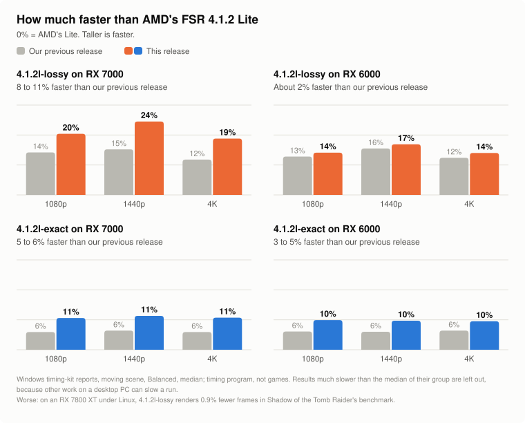

# Release `dll-2026-11-01` against `dll-2026-10-29`

> [!CAUTION]
> **Superseded by [`dll-2026-11-04`](https://github.com/zgauthier2000/fsr4-shader-performance-overrides/releases/tag/dll-2026-11-04)** ([what it changes](dll-2026-11-04.md)): faster `4.1.2l-exact` and `4.1.2l-lossy`, most of all at 1440p and on the Steam Deck, with the same pictures; `exact` and `lossy` unchanged.

**Compare for yourself:** [exact and lossy](../exact-vs-lossy.md) · [eight upscalers in test scenes](../upscaler-comparison.md) ·
[recorded game clips, side by side](https://zgauthier2000.github.io/fsr4-upscaler-compare/)

## What's new

Only the two Lite builds change. **`exact` and `lossy` are the same files as in `dll-2026-10-29`, byte for byte.** There is no picture to show: the gain is speed.

- **`4.1.2l-lossy` is faster on Windows, most of all on RX 7000 cards:** 8% / 11% / 9% less time per frame at 1080p / 1440p / 4K on RX 7000 and about 2% on RX 6000
  (timing-kit reports, below). It reads and converts each input color once into the chip's shared memory, instead of again for every pixel that uses it. It keeps its network and weights.
- **`4.1.2l-exact` is faster:** 5% / 6% / 5% on RX 7000, 5% / 4% / 3% on RX 6000 (same reports), and still AMD's Lite picture byte for byte. It shares color samples between pixels. The Steam Deck / older built-in graphics archive
  uses the shared-memory form instead, because the shared samples were 5 to 8% slower on a Vega and an RX 5700 XT report.
- **Both also get** integer arithmetic at the end of the network's shaders, a separate small shader for clearing the tensors' borders, and fewer memory writes.
- **The RDNA 3 / other cards archive's `4.1.2l-lossy` changes form:** it now uses the form with finished results in shared memory, like the RX 6000 archive, with the same picture.

**What got worse:**

- **On an RX 7800 XT under Linux, `4.1.2l-lossy` is slightly slower.** Shadow of the Tomb Raider's benchmark, 4K Balanced, Proton: 19,887 frames against 20,070 (−0.9%; four runs in mirrored order, two per build). The Windows gains above do not appear under Linux here.
- **The built-in graphics reports disagree.** `4.1.2l-lossy` against `dll-2026-10-29`'s form: a Radeon 890M report 4% to 5% faster, a Ryzen Z1 Extreme report under Proton about 0.7% slower.

## Picture

| Build | Against | Result (test rig, Linux) |
|---|---|---|
| `4.1.2l-exact`, both forms | AMD's Lite network, in this project's local test harness | Identical: 1080p, 1440p, 4K and 5K, game auto exposure off and on, still and moving (48 of 48 comparisons); five recorded game clips; six context flag sets |
| `4.1.2l-lossy`, all forms | `dll-2026-10-29`'s `4.1.2l-lossy` | Identical except the 1440p moving scene (44 of 48 comparisons); identical on five recorded game clips |

The 1440p difference is in the top-right corner of the moving scene, about 50,000 pixels, at most 0.01 in linear light: it comes from the new border shader.

## Downloads

| Archive | For | Download |
|---|---|---|
| RX 7000 | Radeon RX 7000 cards, including laptops with their own RX 7000 chip | [fsr4.1.2-cyboman-rx7000-2026-11-01.7z](https://github.com/zgauthier2000/fsr4-shader-performance-overrides/releases/download/dll-2026-11-01/fsr4.1.2-cyboman-rx7000-2026-11-01.7z) |
| RX 6000 | Radeon RX 6000 cards, including laptops with their own RX 6000 chip | [fsr4.1.2-cyboman-rx6000-2026-11-01.7z](https://github.com/zgauthier2000/fsr4-shader-performance-overrides/releases/download/dll-2026-11-01/fsr4.1.2-cyboman-rx6000-2026-11-01.7z) |
| Integrated RDNA 3 | Radeon 780M, 760M, 880M, 890M and other RDNA 3 / 3.5 graphics built into the processor; GeForce, Intel Arc and any other card | [fsr4.1.2-igpu-cyboman-rdna3-2026-11-01.7z](https://github.com/zgauthier2000/fsr4-shader-performance-overrides/releases/download/dll-2026-11-01/fsr4.1.2-igpu-cyboman-rdna3-2026-11-01.7z) |
| Integrated RDNA2 | Steam Deck, Radeon 680M, 660M, 610M and the graphics of Ryzen 7000 and 9000 desktop processors | [fsr4.1.2-igpu-cyboman-rdna2-2026-11-01.7z](https://github.com/zgauthier2000/fsr4-shader-performance-overrides/releases/download/dll-2026-11-01/fsr4.1.2-igpu-cyboman-rdna2-2026-11-01.7z) |

All files and checksums: [release `dll-2026-11-01`](https://github.com/zgauthier2000/fsr4-shader-performance-overrides/releases/tag/dll-2026-11-01). The previous release, `dll-2026-10-29`, stays available: [its page](dll-2026-10-29.md).

Each archive holds `exact`, `lossy`, `4.1.2l-exact`, `4.1.2l-lossy` and `WHICH-SHOULD-I-CHOOSE.txt`. Never use any of them in online games or games with anti-cheat. Not for Radeon RX 9000 cards.
The `.7z` and the `.zip` hold the same files; Windows 11 (23H2 or later) opens a `.7z` itself, on Windows 10 use [7-Zip](https://www.7-zip.org/) or take the `.zip`.

## Speed

Windows timing-kit reports (kits 2026-10-30.8 to 2026-10-31.2), test slots with this release's shaders and weights against `dll-2026-10-29`'s DLLs in the same report, moving scene, Balanced, median with range, 1080p / 1440p / 4K. Minus is faster.

<picture>
  <source media="(prefers-color-scheme: dark)" srcset="../img/rel-2026-11-01-gain-dark.svg">
  
</picture>

| Build | Graphics | 1080p | 1440p | 4K |
|---|---|---|---|---|
| `4.1.2l-lossy`, RX 7000 form | RX 7000 | −7.8% (−12.8 to −6.7) | −11.0% (−12.6 to −9.3) | −8.5% (−12.5 to −2.4) |
| `4.1.2l-lossy`, RX 6000 form | RX 6000 | −1.6% (−4.2 to +0.4) | −2.3% (−3.8 to +0.7) | −1.9% (−4.1 to +0.3) |
| `4.1.2l-exact`, shared samples | RX 7000 | −5.0% (−5.3 to −3.4) | −5.5% (−6.9 to −3.8) | −4.6% (−11.0 to −2.9) |
| `4.1.2l-exact`, shared samples | RX 6000 | −5.3% (−6.9 to −1.0) | −3.9% (−6.2 to −1.6) | −2.8% (−5.5 to −1.1) |

These are timing-program figures, not games. Results much slower than the median of that row's reports are left out (more than 3 scaled median deviations and more than 3 points), because other work on a desktop PC can slow a run; faster ones are kept. Figures against AMD's own builds per card: [What to expect](../../README.md#what-to-expect).

**Linux (Proton), this project's RX 7800 XT, two runs each:** `4.1.2l-lossy` 0.558 / 0.843 / 1.655 ms, `4.1.2l-exact` 0.611 / 0.957 / 1.911 ms, AMD's Lite in the local test harness 0.659 / 1.032 / 2.020 ms.

## Not checked

- GeForce and Intel Arc cards (no kit reports of these builds in the kits read).
- The Steam Deck's `4.1.2l-exact` (the shared-memory form). Its `4.1.2l-lossy` was measured after this page was written, in 8 timing-kit reports (Windows and Linux, moving scene): about the same time as in `dll-2026-10-29` at 1080p (2% less to 1% more), 3% less at 1440p, 2% less at 4K; 11% / 19% / 16% less than AMD's Lite at 1080p / 1440p / 4K.
- Anything but this project's RX 7800 XT in a real game.
- Stutter and frame pacing: the kit measures mean time only.
