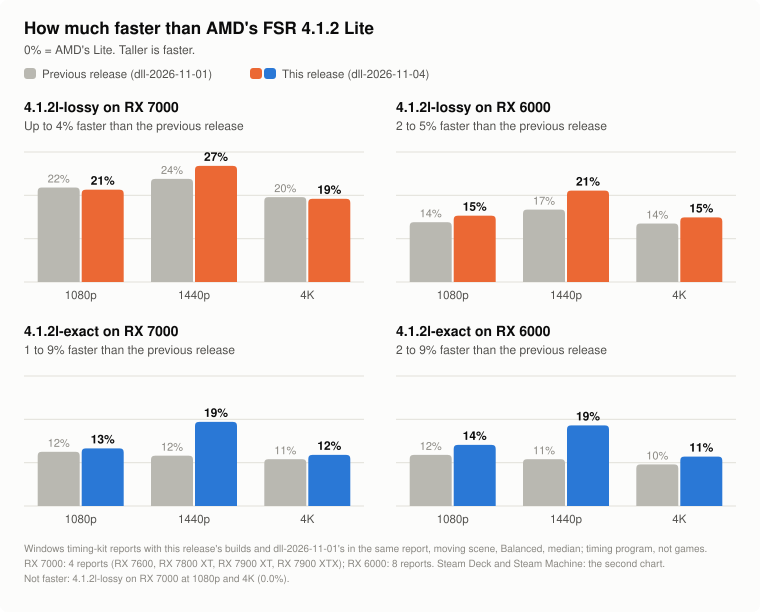
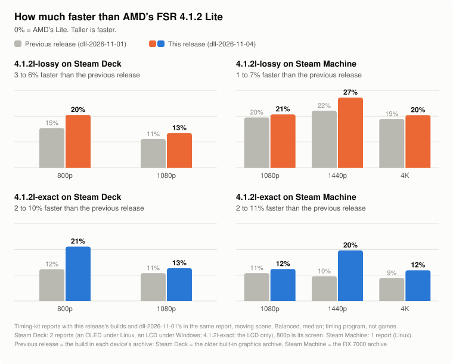

# Release `dll-2026-11-04` against `dll-2026-11-01`

**Compare for yourself:** [exact and lossy](../exact-vs-lossy.md) · [eight upscalers in test scenes](../upscaler-comparison.md) ·
[recorded game clips, side by side](https://zgauthier2000.github.io/fsr4-upscaler-compare/)

## What's new

Only the two Lite builds change. **`exact` and `lossy` are the same files as in `dll-2026-11-01`, byte for byte.** There is no picture to show: the gain is speed.

- **Faster at 1440p and the Steam Deck's 800p:** both Lite builds gain most at these sizes (figures below).
- **A few dispatches less per frame:** passes that do no work for the picture are no longer started. This is the 1 to 3% at 1080p and 4K.
- **One form per build for all four archives.** `4.1.2l-exact` shares color samples between pixels everywhere now, the Steam Deck / older built-in graphics archive
  included: in its own form it is still faster there. `4.1.2l-lossy` is the RX 6000 form (finished results in shared memory) everywhere, the RX 7000 archive included:
  it timed as fast there.

**What got worse:** nothing slower beyond the spread of single runs. `4.1.2l-exact` on a Radeon 780M / Ryzen Z1 at 1080p measured 1.7% slower (two Linux reports), and `4.1.2l-lossy` does not gain on RX 7000 at 1080p and 4K (0.0%).

## Speed

<picture>
  <source media="(prefers-color-scheme: dark)" srcset="../img/rel-2026-11-04-gain-dark.svg">
  
</picture>

<picture>
  <source media="(prefers-color-scheme: dark)" srcset="../img/rel-2026-11-04-valve-dark.svg">
  
</picture>

Less time per frame than the same build in `dll-2026-11-01` (each device's own archive), timing-kit reports with both in the same report, moving scene, Balanced, median:

| Graphics | Reports | `4.1.2l-exact` | `4.1.2l-lossy` |
|---|---|---|---|
| RX 7000, Windows (RX 7600, 7800 XT, 7900 XT, 7900 XTX), 1080p / 1440p / 4K | 4 | 1.1% / 8.6% / 1.1% | 0.0% / 4.5% / 0.0% |
| RX 6000, Windows, 1080p / 1440p / 4K | 9 | 2.4% / 8.7% / 2.0% | 1.9% / 5.2% / 1.7% |
| RX 6000, Windows, 800p (all-nighter runs) | 2 | 9.1% | 5.6% |
| RX 6000, Linux, 1080p / 1440p / 4K | 2 | 3.6% / 10.0% / 2.7% | 3.4% / 6.3% / 2.5% |
| Steam Deck, 800p / 1080p | 2 (`4.1.2l-exact`: 1) | 10.0% / 2.2% | 6.0% / 2.6% |
| Steam Machine, Linux, 1080p / 1440p / 4K | 1 | 1.8% / 11.1% / 3.3% | 1.4% / 6.6% / 1.8% |
| Radeon 780M / Ryzen Z1, Linux, 800p / 1080p / 1440p / 4K | 2 | 7.5% / −1.7% / 8.7% / 1.9% | 3.5% / 2.0% / 5.5% / 1.3% |
| Radeon 680M, Linux, 800p / 1080p / 1440p / 4K | 1 | 9.5% / 3.1% / 6.7% / 2.4% | 7.2% / 4.9% / 8.4% / 1.8% |

These are timing-program figures, not games, and one report is one run. The 780M / Z1 exact figure at 1080p (−1.7%) is within the spread of single runs. Figures against AMD's own builds per card: [What to expect](../../README.md#what-to-expect).

**Linux (Proton), this project's RX 7800 XT, two runs each, 1080p / 1440p / 4K:** `4.1.2l-exact` 0.583 / 0.866 / 1.837 ms, `4.1.2l-lossy` 0.545 / 0.808 / 1.652 ms, AMD's Lite in the local test harness 0.649 / 1.030 / 2.020 ms.

## Picture

| Build | Against | Result (test rig, Linux; 1080p, 1440p, 4K, 5K, auto exposure off and on, still and moving) |
|---|---|---|
| `4.1.2l-exact` | AMD's Lite network, in this project's local test harness | Identical (48 of 48 comparisons) |
| `4.1.2l-exact` | `dll-2026-11-01`'s `4.1.2l-exact`, both forms | Identical (48 of 48 comparisons); Identical (48 of 48 comparisons) |
| `4.1.2l-lossy` | `dll-2026-11-01`'s `4.1.2l-lossy`, RX 6000 / built-in graphics form | Identical (48 of 48 comparisons) |
| `4.1.2l-lossy` | `dll-2026-11-01`'s `4.1.2l-lossy`, RX 7000 form | Identical (48 of 48 comparisons) |

## Downloads

| Archive | For | Download |
|---|---|---|
| RX 7000 | Radeon RX 7000 cards, including laptops with their own RX 7000 chip | [fsr4.1.2-cyboman-rx7000-2026-11-04.7z](https://github.com/zgauthier2000/fsr4-shader-performance-overrides/releases/download/dll-2026-11-04/fsr4.1.2-cyboman-rx7000-2026-11-04.7z) |
| RX 6000 | Radeon RX 6000 cards, including laptops with their own RX 6000 chip | [fsr4.1.2-cyboman-rx6000-2026-11-04.7z](https://github.com/zgauthier2000/fsr4-shader-performance-overrides/releases/download/dll-2026-11-04/fsr4.1.2-cyboman-rx6000-2026-11-04.7z) |
| Integrated RDNA 3 | Radeon 780M, 760M, 880M, 890M and other RDNA 3 / 3.5 graphics built into the processor; GeForce, Intel Arc and any other card | [fsr4.1.2-igpu-cyboman-rdna3-2026-11-04.7z](https://github.com/zgauthier2000/fsr4-shader-performance-overrides/releases/download/dll-2026-11-04/fsr4.1.2-igpu-cyboman-rdna3-2026-11-04.7z) |
| Integrated RDNA2 | Steam Deck, Radeon 680M, 660M, 610M and the graphics of Ryzen 7000 and 9000 desktop processors | [fsr4.1.2-igpu-cyboman-rdna2-2026-11-04.7z](https://github.com/zgauthier2000/fsr4-shader-performance-overrides/releases/download/dll-2026-11-04/fsr4.1.2-igpu-cyboman-rdna2-2026-11-04.7z) |

All files and checksums: [release `dll-2026-11-04`](https://github.com/zgauthier2000/fsr4-shader-performance-overrides/releases/tag/dll-2026-11-04). The previous release, `dll-2026-11-01`, stays available: [its page](dll-2026-11-01.md).

Each archive holds `exact`, `lossy`, `4.1.2l-exact`, `4.1.2l-lossy` and `WHICH-SHOULD-I-CHOOSE.txt`. Never use any of them in online games or games with anti-cheat. Not for Radeon RX 9000 cards.
The `.7z` and the `.zip` hold the same files; Windows 11 (23H2 or later) opens a `.7z` itself, on Windows 10 use [7-Zip](https://www.7-zip.org/) or take the `.zip`.

## Not checked

- GeForce and Intel Arc cards (no timing-kit reports of these builds).
- Anything but this project's RX 7800 XT in a real game.
- Stutter and frame pacing: the kit measures mean time only.
