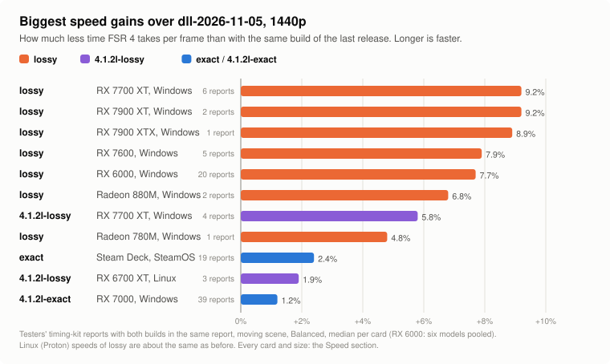
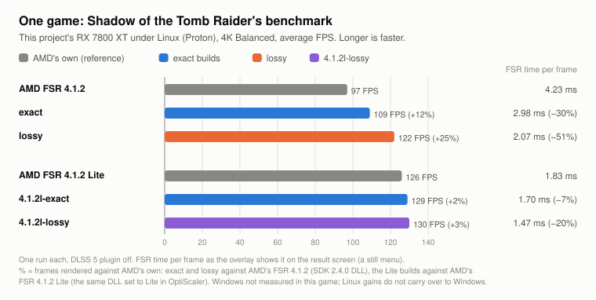
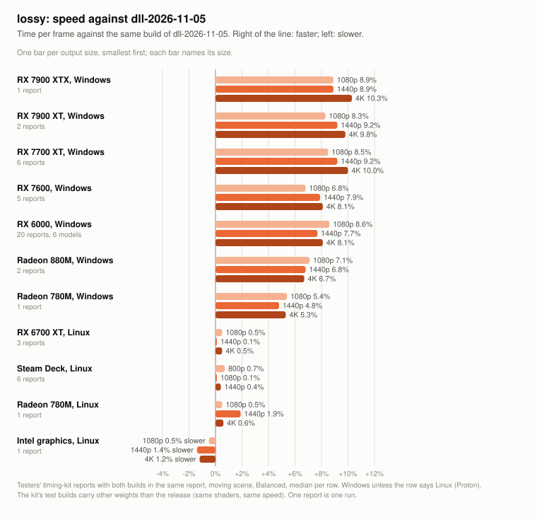
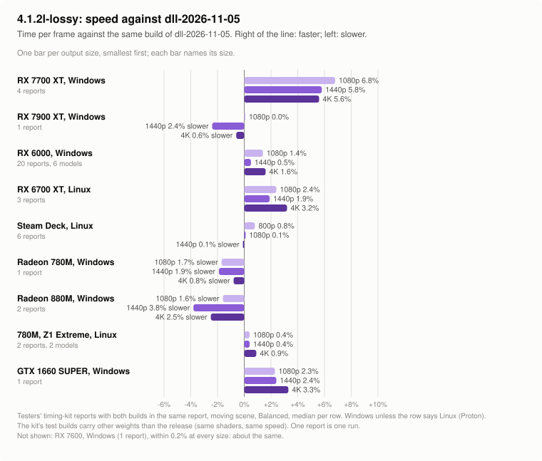
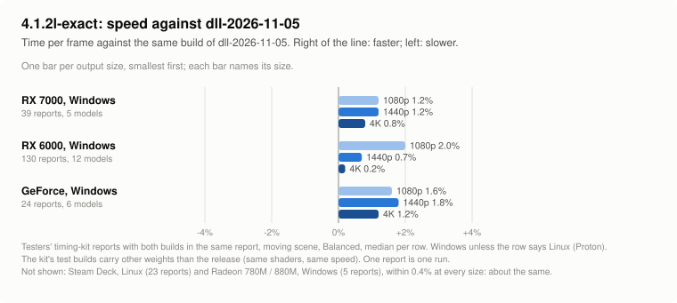
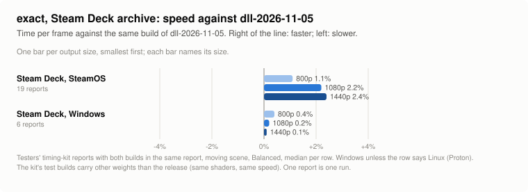
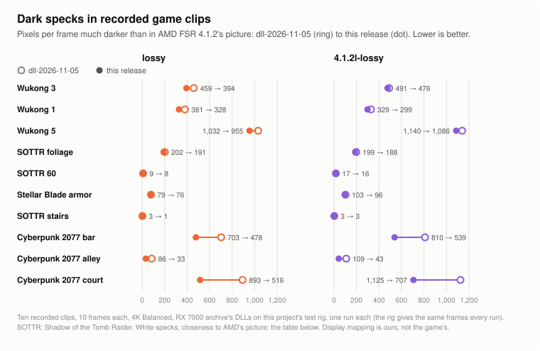
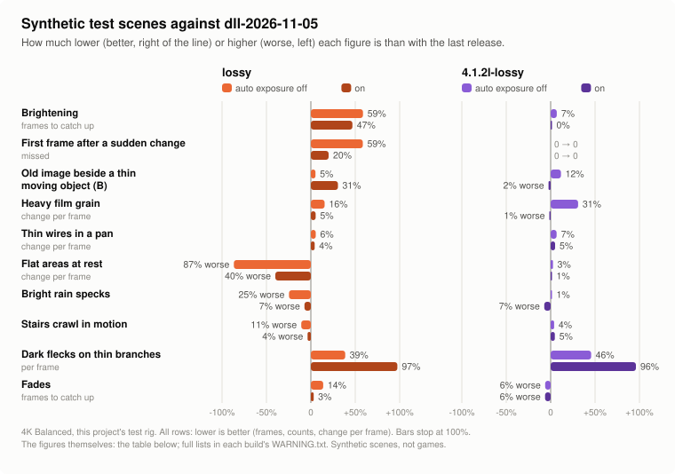

# Release `dll-2026-11-22` against `dll-2026-11-05`

**Compare for yourself:** [exact and lossy](../exact-vs-lossy.md) · [eight upscalers in test scenes](../upscaler-comparison.md) ·
[recorded game clips, side by side](https://zgauthier2000.github.io/fsr4-upscaler-compare/)

## What's new

**Faster on Windows Radeon cards.** `lossy` takes 7 to 10% less time per frame than in `dll-2026-11-05` on RX 7000 and RX 6000 cards,
`4.1.2l-lossy` about 6% less on the RX 7700 XT, and `exact` for the Steam Deck about 2% less under SteamOS. The largest gains, from testers' timing-kit reports:

<picture>
  <source media="(prefers-color-scheme: dark)" srcset="../img/rel-2026-11-22-gains-dark.svg">
  
</picture>

**Fewer dark specks in both lossy builds.** Thin bright detail could pick up dark specks on the frames that skip the network; a new rule stops most of them.
In recorded Cyberpunk 2077 clips both lossy builds leave 30 to 60% fewer. One frame, before and after:

Cyberpunk 2077, recorded clip (the court), frame 114, 4K Balanced, one run: a concrete post under a ledge at 2x. Top: as it is; bottom: every dark speck circled (a pixel clearly darker than both AMD FSR 4.1.2 Lite's picture and its own surroundings). Shown: `4.1.2l-lossy`, against AMD's Lite. Over the whole clip it leaves 925 → 537 dark specks per frame against AMD's Lite, and `lossy` 893 → 516 against AMD's full FSR 4.1.2. Display mapping is this project's, not the game's tone mapping (no game effects or UI).

- **`lossy` is 7 to 10% faster on Windows RX 6000 and RX 7000 cards (5 to 7% on Radeon 780M / 880M) and has a new picture.** New trained weights, a rule for bright particles that move without
  motion vectors (sparks, small lights), and a rule against dark specks in thin bright detail on skipped frames. The network's sums are now added in one
  chain, which AMD's Windows driver turns into less work (under Linux the speed stays as it was). In recorded Cyberpunk 2077 clips it leaves 30 to 60%
  fewer dark specks than `dll-2026-11-05`'s `lossy`.
- **`4.1.2l-lossy` has new weights, the same two rules and three fixes:** the top of the picture could flicker on Windows
  ([issue #45](https://github.com/zgauthier2000/fsr4-shader-performance-overrides/issues/45)); Performance and native-resolution modes now use the trained
  weights too; above 4K output it gives AMD's Lite picture. In the same Cyberpunk 2077 clips 30 to 60% fewer dark specks.
- **`4.1.2l-lossy` in the RX 7000 archive picks its last pass by system:** on Windows a build made for Windows drivers, with a 32-wide copy for the frames
  that skip the network; under Linux (Proton) the build RX 7000 runs fastest there. Same picture both ways on this project's test rig. The four
  archives' `4.1.2l-lossy` are therefore no longer one file: the RX 6000 and both built-in graphics archives carry the same Windows build (only its name
  differs), without the 32-wide copy.
- **`4.1.2l-exact` starts Lite's passes as AMD's own Lite DLL does:** up to 3% faster, and its picture now equals that of AMD's own Lite DLL (FSR SDK 2.4.0)
  at 1440p and 800p too, not only at 1080p and 4K (test rig; testers' timing kits agree: 800p 6 of 6, 1440p 58 of 62 reports).
- **`exact` for the Steam Deck and older built-in graphics** uses AMD's own prepass from AMD's FSR SDK 2.4.0 (RX 6000 model; MIT license, credited in
  `NOTICE.md`): about 2% faster on Steam Decks under SteamOS, same picture. **The other three archives' `exact` are the files of `dll-2026-11-05`, byte for byte.**

**What got worse:**

- **`4.1.2l-lossy` on Windows RDNA 3 built-in graphics (Radeon 780M, 880M):** 1 to 4% slower than `dll-2026-11-05`'s at 1080p to 4K (three reports; up
  to 7% in one 800p run). This archive's build has no 32-wide copy for skipped frames.
- **`lossy` on GeForce and Intel Arc:** this release runs its network faster on Radeon cards; on GeForce it may be a little slower (an earlier version
  was 6 to 10% slower on an RTX 4090, and we have no GeForce reports for this one yet). `4.1.2l-lossy` is not affected and is usually the faster choice on
  GeForce cards.
- **Picture, both lossy builds:** in recorded Shadow of the Tomb Raider clips a little further from AMD's picture (0.1 to 0.2 dB); a few more white specks in
  some clips (figures below). In synthetic test scenes `lossy` changes more from frame to frame in flat areas at rest (still less than AMD's file) and shows
  more bright rain specks.

## Speed

### In a game

Shadow of the Tomb Raider's benchmark on this project's RX 7800 XT under Linux (Proton), 4K Balanced, OptiScaler, one run per build:

<picture>
  <source media="(prefers-color-scheme: dark)" srcset="../img/rel-2026-11-22-game-dark.svg">
  
</picture>

Under Linux this release's builds run at about the speed of `dll-2026-11-05`'s; the Windows gains below
come from AMD's Windows driver.

### Timing kit, every card

Less time per frame than the same build in `dll-2026-11-05` (each card's own archive), timing-kit reports with both builds in the same report, moving scene,
Balanced, median per card or group. The test builds in the kit carried other weights than the release (same shaders, same speed).

<picture>
  <source media="(prefers-color-scheme: dark)" srcset="../img/rel-2026-11-22-lossy-dark.svg">
  
</picture>

<picture>
  <source media="(prefers-color-scheme: dark)" srcset="../img/rel-2026-11-22-llossy-dark.svg">
  
</picture>

Against AMD's Lite (AMD's FSR SDK 2.4.0 DLL in the same reports, Windows), `4.1.2l-lossy` takes 14 to 22% less time on RX 7000, 12 to 16% on RX 6000, 8 to 15% on Radeon 780M / 880M.

<picture>
  <source media="(prefers-color-scheme: dark)" srcset="../img/rel-2026-11-22-lexact-dark.svg">
  
</picture>

<picture>
  <source media="(prefers-color-scheme: dark)" srcset="../img/rel-2026-11-22-exactdeck-dark.svg">
  
</picture>

These are timing-program figures, not games, and one report is one run. Windows is measured by testers' reports only; the picture checks below ran under Linux.

## Picture

### Recorded game clips

Four builds against AMD's FSR 4.1.2 (the reference; its RX 7000 model, the same picture as FSR 4.1.1 there), 10 frames per clip, 4K Balanced (Cyberpunk 2077 clips at 30 FPS), RX 7000 archive's DLLs, this
project's test rig. White / dark specks: pixels per frame much brighter / darker than in AMD's picture. dB: closeness to AMD's picture (higher is closer).
`dll-2026-11-05` → this release:

<picture>
  <source media="(prefers-color-scheme: dark)" srcset="../img/rel-2026-11-22-clips-dark.svg">
  
</picture>

All clip figures, as a table: dark and white specks, closeness to AMD's picture

| Clip | `lossy` dark specks | `lossy` white specks | `lossy` dB | `4.1.2l-lossy` dark | `4.1.2l-lossy` white | `4.1.2l-lossy` dB | AMD's Lite dark / white / dB |
|---|---|---|---|---|---|---|---|
| Black Myth: Wukong 3 | 459 → 394 | 134 → 127 | 37.09 → 36.99 | 491 → 476 | 231 → 239 | 36.62 → 36.82 | 315 / 94 / 39.63 |
| Black Myth: Wukong 1 | 381 → 328 | 224 → 191 | 39.41 → 39.53 | 329 → 299 | 236 → 214 | 39.22 → 39.17 | 63 / 146 / 41.80 |
| Black Myth: Wukong 5 | 1032 → 955 | 609 → 557 | 37.85 → 37.82 | 1140 → 1086 | 752 → 747 | 36.88 → 36.89 | 476 / 527 / 39.75 |
| Shadow of the Tomb Raider foliage | 202 → 191 | 86 → 94 | 42.57 → 42.55 | 199 → 188 | 181 → 178 | 42.16 → 42.15 | 28 / 97 / 45.54 |
| Shadow of the Tomb Raider 60 | 9 → 8 | 20 → 20 | 49.69 → 49.51 | 17 → 16 | 40 → 39 | 48.94 → 48.78 | 8 / 21 / 51.82 |
| Stellar Blade armor | 79 → 76 | 161 → 151 | 44.83 → 45.31 | 103 → 96 | 273 → 274 | 43.82 → 43.80 | 31 / 87 / 47.30 |
| Shadow of the Tomb Raider stairs | 3 → 1 | 1 → 1 | 43.82 → 43.61 | 3 → 3 | 3 → 3 | 43.70 → 43.62 | 4 / 5 / 46.20 |
| Cyberpunk 2077 bar | 703 → 478 | 152 → 170 | 41.47 → 41.57 | 810 → 539 | 488 → 472 | 41.14 → 41.27 | 426 / 351 / 43.74 |
| Cyberpunk 2077 alley | 86 → 33 | 11 → 10 | 44.29 → 44.31 | 109 → 43 | 42 → 44 | 44.33 → 44.27 | 11 / 27 / 46.50 |
| Cyberpunk 2077 court | 893 → 516 | 385 → 388 | 39.83 → 39.93 | 1125 → 707 | 616 → 631 | 38.97 → 39.09 | 207 / 498 / 41.69 |

One run each (the rig gives the same frames every run). The game's own tone mapping, UI and post-processing are not in these frames.

### Synthetic test scenes

4K Balanced, game auto exposure off / on, lower is better unless dB. Full lists: each build's `WARNING.txt`.

<picture>
  <source media="(prefers-color-scheme: dark)" srcset="../img/rel-2026-11-22-synthetic-dark.svg">
  
</picture>

The figures, as a table (with AMD 4.1.2 and AMD's Lite)

| Row | AMD 4.1.2 | `lossy` `dll-2026-11-05` | `lossy` now | AMD's Lite | `4.1.2l-lossy` `dll-2026-11-05` | `4.1.2l-lossy` now |
|---|---|---|---|---|---|---|
| Brightening, frames to catch up | 0.46 / 0.46 | 3.66 / 2.67 | **1.51 / 1.42** | 1.03 / 0.86 | 1.01 / 1.03 | 0.94 / 1.03 |
| First frame after a sudden change, missed | 0.04 / 0.04 | 0.41 / 0.30 | **0.17 / 0.24** | 0 / 0.01 | 0 / 0 | 0 / 0 |
| Old image beside a thin moving object (B) | 3.11 / 2.90 | 4.26 / 6.58 | **4.04 / 4.57** | 4.35 / 4.35 | 2.85 / 2.50 | 2.52 / 2.56 |
| Heavy film grain, change per frame | 2.55 / 0.48 | 2.00 / 0.92 | 1.69 / 0.87 | 2.31 / 0.41 | 1.23 / 0.75 | **0.85** / 0.76 |
| Thin wires in a pan, change per frame | 7.16 / 6.79 | 4.71 / 4.68 | 4.45 / 4.48 | 9.75 / 7.81 | 7.49 / 4.56 | 6.99 / 4.33 |
| Flat areas at rest, change per frame | 0.126 / 0.213 | 0.045 / 0.085 | *0.084 / 0.119* | 0.110 / 0.207 | 0.078 / 0.119 | 0.076 / 0.118 |
| Bright rain specks | 1,314 / 3,764 | 505 / 475 | *629 / 509* | 78 / 1,592 | 303 / 361 | 300 / *387* |
| Stairs crawl in motion | 16.4 / 30.4 | 32.3 / 29.8 | *35.8 / 30.9* | 42.2 / 42.2 | 38.6 / 40.8 | 37.1 / 38.9 |
| Dark flecks on thin branches, per frame | 0 / 0 | 1,999 / 1,074 | **1,225 / 28** | not measured | 2,639 / 1,410 | **1,435 / 57** |
| Fades, frames to catch up | 0.91 / 0.90 | 1.01 / 0.94 | 0.87 / 0.91 | 1.69 / 1.53 | 1.29 / 1.11 | *1.37 / 1.18* |

Bold: the largest gains; italics: worse than `dll-2026-11-05`.

### Checks of the files (test rig, Linux)

- **`exact`, RX 7000, RX 6000 and built-in RDNA 3 archives:** the same files as `dll-2026-11-05`'s.
- **`exact`, Steam Deck / built-in RDNA 2 archive:** the same picture as `dll-2026-11-05`'s `exact` of that archive (48 of 48 comparisons; 800p 8 of 8).
- **`lossy`, all four archives:** the same picture as its Linux build, the one the quality figures above come from (48 of 48 comparisons, and 12 of 12 at 5K and in Ultra Performance).
- **`4.1.2l-exact`:** the same picture as AMD's own Lite DLL, FSR SDK 2.4.0 (48 of 48 comparisons, 1080p to 5K).
- **`4.1.2l-lossy`, RX 7000 archive:** with its Linux build chosen, the same picture as the other RX 7000 build (48 of 48, and 12 of 12 at 5K and in Ultra Performance);
  with its Windows build forced, the same picture as the other archives' `4.1.2l-lossy` (8 of 8 rows, 1080p to 5K, Ultra Performance).
- **`4.1.2l-lossy`, all archives:** the same picture as its Linux build at 1080p and 4K (42 of 48); 1440p and 5K have no Linux build to compare with.

## Downloads

- **RX 7000** (Radeon RX 7000 cards, including laptops with their own RX 7000 chip, and the Steam Machine): [fsr4.1.2-cyboman-rx7000-2026-11-22.7z](https://github.com/zgauthier2000/fsr4-shader-performance-overrides/releases/download/dll-2026-11-22/fsr4.1.2-cyboman-rx7000-2026-11-22.7z)
- **RX 6000** (Radeon RX 6000 cards, including laptops with their own RX 6000 chip): [fsr4.1.2-cyboman-rx6000-2026-11-22.7z](https://github.com/zgauthier2000/fsr4-shader-performance-overrides/releases/download/dll-2026-11-22/fsr4.1.2-cyboman-rx6000-2026-11-22.7z)
- **Integrated RDNA 3** (Radeon 780M, 760M, 880M, 890M and other RDNA 3 / 3.5 graphics built into the processor; GeForce, Intel Arc and any other card): [fsr4.1.2-igpu-cyboman-rdna3-2026-11-22.7z](https://github.com/zgauthier2000/fsr4-shader-performance-overrides/releases/download/dll-2026-11-22/fsr4.1.2-igpu-cyboman-rdna3-2026-11-22.7z)
- **Integrated RDNA 2** (Steam Deck, Radeon 680M, 660M, 610M and the graphics of Ryzen 7000 and 9000 desktop processors): [fsr4.1.2-igpu-cyboman-rdna2-2026-11-22.7z](https://github.com/zgauthier2000/fsr4-shader-performance-overrides/releases/download/dll-2026-11-22/fsr4.1.2-igpu-cyboman-rdna2-2026-11-22.7z)

All files and checksums: [release `dll-2026-11-22`](https://github.com/zgauthier2000/fsr4-shader-performance-overrides/releases/tag/dll-2026-11-22). The previous release, `dll-2026-11-05`, stays available: [its page](dll-2026-11-05.md).

Each archive holds `exact`, `lossy`, `4.1.2l-exact`, `4.1.2l-lossy` and `WHICH-SHOULD-I-CHOOSE.txt`. Never use any of them in online games or games with anti-cheat. Not for Radeon RX 9000 cards.
The `.7z` and the `.zip` hold the same files; Windows 11 (23H2 or later) opens a `.7z` itself, on Windows 10 use [7-Zip](https://www.7-zip.org/) or take the `.zip`.

## Not checked

- `lossy` on GeForce and Intel Arc (no timing-kit reports of this version); `4.1.2l-lossy` on Intel Arc under Windows.
- The pictures on Windows: the picture checks ran under Linux (Proton). The RX 7000 archive's `4.1.2l-lossy` chooses its Windows build only on Windows;
  here it was checked by forcing that choice under Linux.
- Stutter and frame pacing: the kit measures mean time only.
