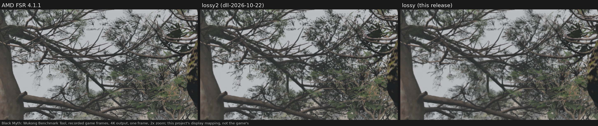

# Release `dll-NEXTVER` against `dll-2026-10-22`

## What's new

*Recorded game frames (Black Myth: Wukong Benchmark Tool, the bamboo bridge, 4K output), one frame, 2x zoom; this
project's display mapping, not the game's tone mapping. The recorded clip runs through each DLL on Linux (Proton).*

- **`lossy` is retrained and has new rules for the frames it skips.** It is the build earlier releases called `lossy2`, trained further.
  **Far fewer dark specks in foliage:** in the recorded Wukong clip about 460 per frame, against 3,824 with `dll-2026-10-22`'s lossy2.
  Fine diagonal patterns crawl less in motion. **What got worse: brightening is clearly slower.** When part of the picture gets brighter
  (a light switching on, a muzzle flash, stepping into sun) it takes about 3.7 frames to catch up with the game's auto exposure off and
  2.7 with it on, against 1.5 / 1.3 before and 0.5 for AMD's file: about 60 ms at 60 FPS. At 1080p it is 2% slower than lossy2.
  The older, untrained lossy build is no longer included; it stays available in [`dll-2026-10-22`](dll-2026-10-22.md).
- **Two new builds based on AMD's FSR 4.1.2 Lite**, the smaller FSR 4 network: **`4.1.2l-exact`** (Lite's picture byte for byte,
  2 to 3% faster than AMD's Lite) and **`4.1.2l-lossy`** (about 18% faster than Lite at 4K, picture changed: read its `WARNING.txt`).
  [The Lite builds](../lite-builds.md).
- **Exact: a faster first shader, and on RX 6000 the picture of AMD's own FSR 4.1.2 for RX 6000.** Every exact build runs the
  network's input shader in the layout AMD's FSR 4.1.2 for RX 6000 uses (written in this project, same output) and converts the network's
  outputs as AMD's FSR 4.1.2 for RX 7000 does (same output). The RX 6000 and Steam Deck / older built-in graphics exact builds now give
  the picture of AMD's FSR 4.1.2 for RX 6000 byte for byte; it differs from FSR 4.1.1's only in rounding, and in recorded game clips no
  difference could be measured. The other exact builds give FSR 4.1.1's picture, which is also the picture of AMD's FSR 4.1.2 for RX 7000.
  [What AMD's 4.1.2 changes against 4.1.1](../amd-411-vs-412.md).
- **RX 6000 and Steam Deck / older built-in graphics:** the fix for the picture difference RX 6000 cards show with AMD's file under Windows
  now puts the constant operand of the last shader's dot products second, as AMD's FSR 4.1.2 does, instead of splitting them (same
  picture; on one Windows RX 6700 report about 2% faster). Their `4.1.2l-lossy` keeps some finished results in the chip's shared memory
  instead of its registers until they are written, so AMD's Windows compiler needs 128 registers instead of 144 and an RX 6000 chip can run
  8 groups of work at once instead of 7 (same picture; the gain on Windows is not measured yet; on an RX 7800 XT under Linux it costs 3%,
  which is why the RX 7000 and RDNA 3 archives do not use it).
- **Version names start with 4.1.2:** `4.1.2-exact-r3-cyboman`, `4.1.2-lossy-r2-cyboman` and so on (they were `4.1.1-...`), and
  `4.1.2l-exact-...` / `4.1.2l-lossy-...` for the Lite builds. The file is still AMD's 4.1.1 game DLL (file version 4.1.1.2740) with this
  project's shaders, not AMD's 4.1.2 game DLL of FSR SDK 2.4.0 (4.1.2.4555). With SDK 2.4.0's newer loader, which games built with that SDK
  ship beside AMD's 4.1.2 DLL, every DLL of this release runs and gives the same frames as with the older loader (test rig, Linux;
  not yet tried in a game). Its exact builds give the pictures AMD's 4.1.2 DLL gives (RX 7000 / RDNA 3 and RX 6000 models; [details](../amd-411-vs-412.md)). Under
  Linux on an RX 7800 XT the RX 7000 exact DLL is 37% faster than AMD's 4.1.2 DLL at 4K (3.13 against 4.98 ms).
- **New in every archive:** `WHICH-SHOULD-I-CHOOSE.txt`, a short guide to the four folders.
- **Linux:** the launch-option files are unchanged; the Lite builds are DLLs only (they run under Proton).

## Downloads

| Archive | For | Download |
|---|---|---|
| RX 7000 | Radeon RX 7000 cards, including laptops with their own RX 7000 chip | [fsr4.1.2-cyboman-rx7000-NEXTVER.7z](https://github.com/zgauthier2000/fsr4-shader-performance-overrides/releases/download/dll-NEXTVER/fsr4.1.2-cyboman-rx7000-NEXTVER.7z) (8.9 MB) or [.zip](https://github.com/zgauthier2000/fsr4-shader-performance-overrides/releases/download/dll-NEXTVER/fsr4.1.2-cyboman-rx7000-NEXTVER.zip) (100 MB) |
| RX 6000 | Radeon RX 6000 cards, including laptops with their own RX 6000 chip | [fsr4.1.2-cyboman-rx6000-NEXTVER.7z](https://github.com/zgauthier2000/fsr4-shader-performance-overrides/releases/download/dll-NEXTVER/fsr4.1.2-cyboman-rx6000-NEXTVER.7z) (8.9 MB) or [.zip](https://github.com/zgauthier2000/fsr4-shader-performance-overrides/releases/download/dll-NEXTVER/fsr4.1.2-cyboman-rx6000-NEXTVER.zip) (100 MB) |
| Integrated RDNA 3 | Radeon 780M, 760M, 880M, 890M and other RDNA 3 / 3.5 graphics built into the processor; GeForce, Intel Arc and any other card | [fsr4.1.2-igpu-cyboman-rdna3-NEXTVER.7z](https://github.com/zgauthier2000/fsr4-shader-performance-overrides/releases/download/dll-NEXTVER/fsr4.1.2-igpu-cyboman-rdna3-NEXTVER.7z) (8.9 MB) or [.zip](https://github.com/zgauthier2000/fsr4-shader-performance-overrides/releases/download/dll-NEXTVER/fsr4.1.2-igpu-cyboman-rdna3-NEXTVER.zip) (100 MB) |
| Integrated RDNA2 | Steam Deck, Radeon 680M, 660M, 610M and the graphics of Ryzen 7000 and 9000 desktop processors | [fsr4.1.2-igpu-cyboman-rdna2-NEXTVER.7z](https://github.com/zgauthier2000/fsr4-shader-performance-overrides/releases/download/dll-NEXTVER/fsr4.1.2-igpu-cyboman-rdna2-NEXTVER.7z) (8.9 MB) or [.zip](https://github.com/zgauthier2000/fsr4-shader-performance-overrides/releases/download/dll-NEXTVER/fsr4.1.2-igpu-cyboman-rdna2-NEXTVER.zip) (100 MB) |

All files and checksums: [release `dll-NEXTVER`](https://github.com/zgauthier2000/fsr4-shader-performance-overrides/releases/tag/dll-NEXTVER).
The previous release, `dll-2026-10-22`, stays available: [its page](dll-2026-10-22.md).

Each archive holds four folders: `exact`, `lossy` (the former `lossy2`, retrained), `4.1.2l-exact` and `4.1.2l-lossy` (new). The `.7z` and
the `.zip` hold the same files; Windows 11 (23H2 or later) opens a `.7z` itself, on Windows 10 use [7-Zip](https://www.7-zip.org/) or take
the `.zip`. Never use any of them in online games or games with anti-cheat. Not for Radeon RX 9000 cards.

## Speed

**Windows, exact, against `dll-2026-10-22`'s exact:** timing-kit reports of the same shaders (kit 2026-10-25 and later), moving scene,
1080p / 1440p / 4K: RX 7600 6% / 6% / 6% faster, RX 7900 XTX 2% / 3% / 3%, RX 7800 XT 2% / 2% / 3%; RX 6000 cards 2 to 4% at most sizes
against the RX 6000 build with the new dot fix (RX 6600, 6700, 6700 XT, 6800, 6950 XT; one RX 6600 XT report 12% at 1440p and none at 4K,
one RX 6700 XT report none at 4K); GeForce RTX 2080 1% / 1% / 2%.

**Windows, exact, against AMD's FSR 4.1.1 file:** timing-kit reports of the same shaders (test builds in kit 2026-10-25 and later; on RX 6000 cards their FSR 4.1.1-picture
twin, which timed within 1% of the release build on Linux), moving scene, against AMD's FSR 4.1.1 file, 1080p / 1440p / 4K. One report per
card, two for the RX 6700 XT and RX 6800:

| Card | Faster than AMD's FSR 4.1.1 file |
|---|---|
| RX 7900 XTX | 7% / 26% / 31% |
| RX 7800 XT | 7% / 8% / 9% |
| RX 7600 | 24% / 25% / 26% |
| RX 6950 XT | 7% / 13% / 24% |
| RX 6800 | 6% / 7 to 9% / 12% |
| RX 6700 XT | 1 to 6% / 9% in one report, 12% slower in the other / 11% in one report, 15% slower in the other |
| RX 6700 | 6% / 10% / 9% |
| RX 6600 XT | 18% / 20% / 13% |
| RX 6600 | 12% / 14% / 7% |
| GeForce RTX 2080 | 2% / 4% / 4% |

How these compare with AMD's own FSR 4.1.2 on each card is what the next timing kit measures. The lossy and Lite builds have not been
timed on Windows yet.

**Linux (Proton), one Radeon RX 7800 XT:** FSR 4's time per frame, ms, Balanced, moving scene, two runs each:

| Build | 1080p | 1440p | 4K |
|---|---|---|---|
| AMD's FSR 4.1.1 file | 1.054 | 2.189 | 4.924 |
| exact, `dll-2026-10-22` | 0.894 | 1.442 | 3.147 |
| **exact, this release** | **0.891** | **1.436** | **3.119** |
| lossy2, `dll-2026-10-22` | 0.676 | 1.063 | 2.240 |
| **lossy, this release** | **0.692 (+2.4%)** | **1.068** | **2.234** |
| AMD's FSR 4.1.2 Lite | 0.640 | 1.023 | 2.017 |
| **4.1.2l-exact** | **0.623 (−2.7%)** | **0.993 (−2.9%)** | **1.968 (−2.4%)** |
| **4.1.2l-lossy** (RX 7000 / RDNA 3 archives) | **0.557 (−13%)** | **0.834 (−18%)** | **1.660 (−18%)** |
| 4.1.2l-lossy of the RX 6000 / RDNA2 archives, on this RX 7000 card | 0.575 (−10%) | 0.860 (−16%) | 1.705 (−15%) |

Linux gains do not carry over to Windows as they are (Linux's driver runs some of AMD's shaders in a slower mode); Lite measured in this
project's local test harness, not AMD's own runtime.

## Picture

**lossy against `dll-2026-10-22`'s lossy2,** synthetic test scenes, 4K Balanced, game auto exposure off / on, one run each (lower is
better unless noted):

| Test | AMD FSR 4.1.1 | lossy2, `dll-2026-10-22` | **lossy, this release** |
|---|---|---|---|
| Stairs crawl (fine diagonal lines in motion) | 16.4 / 30.4 | 37.2 / 34.5 | **32.3 / 29.8** |
| Vents crawl | 5.2 / 5.3 | 20.1 / 20.7 | **9.2 / 9.3** |
| Zone plate crawl | 2.9 / 2.6 | 15.7 / 15.5 | **8.2 / 8.0** |
| Flat areas at rest: change per frame | 0.126 / 0.213 | 0.074 / 0.109 | **0.045 / 0.085** |
| Heavy film grain: change per frame | 2.55 / 0.48 | 2.13 / 1.41 | **2.00 / 0.92** |
| Fireflies (single over-bright pixels) | 370 / 137 | 356 / 128 | **332 / 110** |
| Just-uncovered areas, dB (higher is better) | 34.5 / 34.7 | 37.0 / 37.2 | **37.1 / 37.4** |
| Brightening: frames behind | 0.46 / 0.46 | 1.54 / 1.33 | **3.66 / 2.67** (worse) |
| Brightness step: share missed on the first frame | 0.04 / 0.04 | 0.09 / 0.09 | **0.41 / 0.30** (worse) |
| Old image beside a moving object (scene B) | 3.11 / 2.90 | 3.64 / 4.60 | **4.00 / 5.00** (worse) |
| Bright rain specks | 1,314 / 3,764 | 464 / 438 | **505 / 475** (worse) |

Recorded game clip (Black Myth: Wukong, the picture above): dark specks per frame 3,824 → about 460. Where the depth changes sharply
(foliage against a distant background) the fix for those specks is held back, so it does not leave colored outlines behind moving
lights; some specks remain there. Every row and both builds: `lossy/WARNING.txt`.

**4.1.2l-lossy against AMD's Lite:** [the Lite builds](../lite-builds.md#picture).

## Not checked

Windows (the DLLs ran under Proton only; the exact figures above come from timing-kit reports of the same shaders); the lossy and Lite
builds on other cards; playing games (the picture checks use synthetic scenes and recorded game clips).

## How it was checked

- **exact:** every DLL gives its AMD picture byte for byte on the test rig (AMD's FSR 4.1.1 file, or AMD's FSR 4.1.2 for RX 6000; 1080p,
  1440p, 4K and 5K, auto exposure off and on, still and moving scenes; 48 of 48 comparisons each); the RX 7000 exact also on two recorded
  game clips (Wukong, Shadow of the Tomb Raider, which set the flags games set: inverted depth, full-size motion vectors). The repository's tools rebuild
  their shaders file for file at commit `COMMIT`.
- **lossy and the Lite builds:** each DLL gives the frames of the build the checks above measured, byte for byte (48 of 48 comparisons
  each); the RX 6000 / RDNA2 4.1.2l-lossy gives the same frames as the RX 7000 one (rig and game clips), and AMD's Windows compiler fits
  each of its 32 changed shader versions in 128 registers on RX 6800 / 6900, RX 6700 and RX 6600 chips (no spills).
