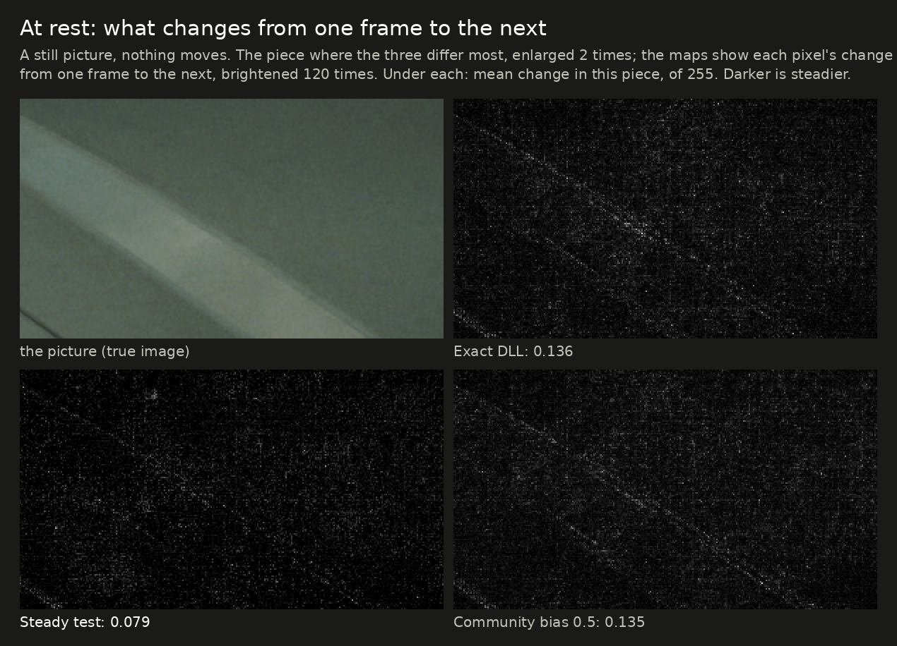
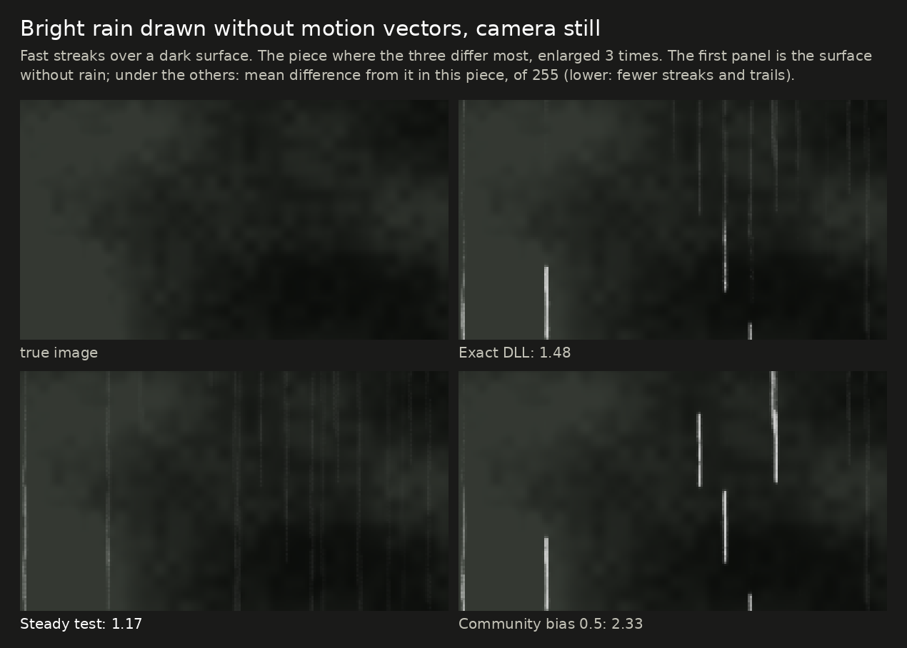
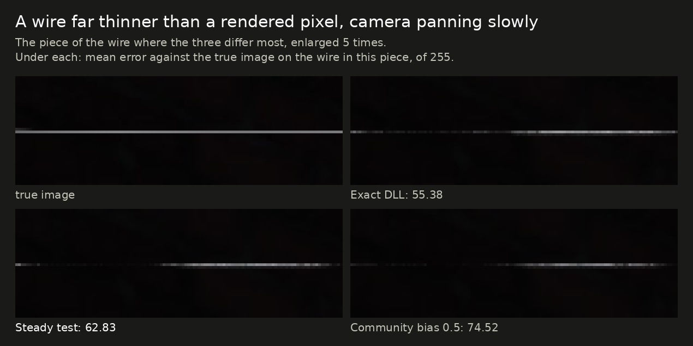

# Less shimmer: the steady test beside a community history-bias DLL

[Back to the front page](../README.md) · [The steady test](steady-test.md) · [The upscaler comparison](upscaler-comparison.md)

> [!IMPORTANT]
> **Research, not a download.** The steady test build on this page is unreleased and is not in any download. The
> community DLL is someone else's work: this project does not distribute it, and it is described here only as a test
> subject. Everything below was measured in the test rig on one card (Radeon RX 7800 XT, under Proton), in single runs.
> Neither build has been tried in a game, on Windows, or on another card.

## What is compared

| | What it does to FSR 4.1.1 | AMD's picture? | Speed |
|---|---|---|---|
| **Exact DLL** (this project, release dll-2026-10-15) | Faster shaders, same arithmetic | Yes, byte for byte | 3.14 ms at 4K |
| **Steady test** (this project, unreleased) | The exact DLL, plus two small rules: (1) in the last pass, a pixel whose colors would each change by less than about two steps of the picture's 16-bit floats keeps its previous value; (2) with auto exposure on, the history is moved to the new exposure in whole steps (the rule the lossy DLL has had since dll-2026-10-11.5) | No | 3.16 ms |
| **Community bias DLL** | AMD's own shaders with a bias added to the last pass's blend between the new frame and the history: the network's blend factor becomes `1 / (1 + exp(-(filter + C)))`, so a larger `C` keeps more of the history. Offered with `C` = 0.25, 0.5, 1.0, 1.5 and 2.0; its notes suggest 0.5 first, which is the one in the charts | No | 4.78 ms (AMD's) |

The two non-exact builds aim at the same complaint, that FSR 4.1.1 shimmers, but at different parts of it. The steady test
targets the flicker of flat areas when nothing moves. The bias DLL makes the whole picture lean on its history, mostly
in motion.

## In short

- **At rest, the steady test is far steadier:** bright flat areas change 0.008 per frame against 0.078 for AMD's picture
  (90% less), and 0.051 against 0.186 with auto exposure on. The bias DLL (0.5) gives 0.068 and 0.185, nearly AMD's.
- **In motion, the bias DLL is steadier:** the thin railing changes 9% less per frame than AMD's, fine stripes 15% less.
  The steady test is level with AMD's there.
- **Accuracy:** the steady test is level with AMD's or a little ahead (still picture +0.09 dB, moving background
  +0.1 to +0.2 dB). The bias DLL is a little behind (still picture −0.07 dB, moving background −0.1 dB at 1440p and
  1080p, −0.2 dB at 5K). It is **ahead on just-uncovered areas with the camera moving** (+0.2 to +0.3 dB) and a
  little behind with the camera still (−0.11 dB).
- **What the bias DLL costs:** thin wires in a pan lose brightness (94.4 of a true 110.7, AMD's 100.2), and bright rain
  without motion vectors leaves longer trails (1,810 pixels far off per frame, AMD's 1,314). A larger bias makes both
  worse and the motion steadier (table below).
- **What the steady test costs:** fades lag a little more (a region dimming 1% per frame is 0.90 frames behind in
  bright flat areas, AMD's 0.62), and one old-image measure is worse (3.36 against 3.11).
- **Speed:** the steady test runs at the exact DLL's speed (+0.01 ms at 4K). The bias DLL runs AMD's shaders, so it
  has AMD's speed, about 50% more time per frame than the other two.

## Where the three differ

Ten measures where the three differ most. On every spoke the best of the three reaches the outer ring, so the shapes
show the trade between them. In the middle and right charts the dashed outline is the exact DLL's shape, for comparison.

## Pictures

Each picture is the piece of one frame where the steady test and the bias DLL differ most from the exact DLL, found by
the script, not by eye. The figure under each panel belongs to that piece only; the tables give the whole-scene figures.

**At rest.** A map of what changes from one frame to the next, brightened 120 times. The exact DLL and the bias DLL
show the same speckle over the flat wall; the steady test removes most of it.

**Bright rain without motion vectors.** The steady test leaves only faint streaks; the bias DLL holds bright streaks
longer than AMD's picture does, so they become long trails.

**A thin wire in a slow pan.** The bias DLL shows the wire with more gaps and dimmer, because it keeps more of the
history in which the wire was in a different place. In this piece the steady test is between the two; over the whole
scene it is level with AMD's (100.6 against 100.2 of a true 110.7).

**Where they look the same.** On the moving railing and just-uncovered areas the three differ by at most 0.17 of 255,
even in the pieces where they differ most: too little to see. Two pictures for completeness:
[the railing](img/bias-motion.png), [just-uncovered areas](img/bias-uncovered.png).

## All bias settings

Auto exposure off. The exact DLL's column is AMD's picture. Lower is better unless marked.

| | Exact | Steady test | Bias 0.25 | Bias 0.5 | Bias 1.0 | Bias 2.0 |
|---|---|---|---|---|---|---|
| Bright flat areas at rest, change per frame | 0.078 | **0.008** | 0.074 | 0.068 | 0.060 | 0.049 |
| Worst flat piece at rest | 0.126 | **0.051** | 0.118 | 0.116 | 0.105 | 0.096 |
| Still picture, dB (higher is better) | 44.33 | **44.42** | 44.29 | 44.26 | 44.16 | 43.96 |
| Moving background, 1440p, dB (higher) | 47.90 | **48.10** | 47.85 | 47.79 | 47.64 | 47.33 |
| Moving background, 5K, dB (higher) | 53.01 | **53.25** | 52.93 | 52.83 | 52.60 | 52.10 |
| Just uncovered, 1080p, dB (higher) | 32.61 | 32.67 | 32.76 | 32.85 | 33.19 | **33.55** |
| Just uncovered, camera still, dB (higher) | **32.62** | 32.58 | 32.55 | 32.51 | 32.34 | 31.98 |
| Railing change, 4K 60 FPS (×AMD's) | 1.00 | 1.00 | 0.96 | 0.92 | 0.84 | **0.69** |
| Background change, 4K 60 FPS (×AMD's) | 1.00 | 0.85 | 0.91 | 0.85 | 0.72 | **0.56** |
| Thin wire in a slow pan, brightness (true 110.7) | 100.2 | **100.6** | 97.3 | 94.4 | 88.8 | 79.0 |
| Bright rain, pixels far off per frame | 1,314 | **403** | 1,478 | 1,810 | 2,804 | 5,384 |
| Old image beside a moving object (one scene) | 3.11 | 3.36 | 3.30 | 3.52 | **2.99** | 4.06 |
| Foliage in a pan, error | 6.17 | **5.96** | 6.26 | 6.34 | 6.53 | 6.90 |
| Film grain 10, change per frame | 1.724 | 1.717 | 1.701 | 1.660 | 1.572 | **1.462** |
| A region dimming 1% per frame, frames behind | **0.62** | 0.90 | 0.63 | 0.68 | 0.73 | 0.89 |

With auto exposure on (the timing kit and many games set it), the bias leaves the shimmer of flat areas at rest where
it is: bright flat areas 0.186 for AMD's picture, 0.185 / 0.185 / 0.188 / 0.211 for bias 0.25 / 0.5 / 1.0 / 2.0, and 0.051
for the steady test. The rest of the pattern is the same as with it off.

## Speed

Windows timing kit under Proton, all in one run, moving picture, ms per frame.

| | 1080p | 1440p | 4K |
|---|---|---|---|
| AMD's FSR 4.1.1 | 1.058 | 2.181 | 4.774 |
| Exact DLL | 0.896 | 1.445 | 3.143 |
| Steady test | 0.903 | 1.452 | 3.159 |
| Community bias 0.5 | 1.057 | 2.181 | 4.775 |
| Community bias 1.0 | 1.060 | 2.181 | 4.787 |

## Why they behave so differently

The last pass of FSR 4.1.1 mixes the new frame into the history with a weight the network chooses per pixel. The two
builds change that mix in different ways (this is our reading of the figures above; the weights themselves were not
logged for these builds):

- **The bias DLL** moves the network's weight toward the history everywhere, in proportion to how unsure the network
  was. Where it was in the middle (moving edges, rain, a wire that jumps between pixels), the history now counts for
  more: steadier, but slower to follow, so thin moving things dim and bright streaks linger. Where the network was
  already sure (flat areas at rest), the weight barely moves, so the shimmer at rest stays.
- **The steady test** leaves the weight alone and only skips corrections smaller than about two steps of the 16-bit
  number format. Those are what make flat areas shimmer at rest
  ([how this was found](../research/frame-skip/README.md#why-folding-steadied-the-picture-and-what-replaced-it-release-dll-2026-10-114)).
  Real changes are larger and pass, which is why it is level with AMD's picture in motion. The exposure rule removes a
  second cause that only shows with auto exposure.

The two could be combined. That has not been tried.

## What was checked, and what was not

- Checked: the full check (about 30 sections, three output sizes plus 5K, auto exposure off and on) for the steady test
  and each bias setting, the comparison rig's moving scene for the chart, and the timing above. The steady test's
  DLL gives its Linux twin's output byte for byte in 30 of 30 comparisons, and with both rules off it rebuilds the
  released exact DLL byte for byte.
- Not checked: any game, Windows drivers, other cards; bias 1.5; the steady test's build for integrated graphics (not
  built). All figures are single runs.

The charts and pictures are made by [`img/make_bias_comparison.py`](img/make_bias_comparison.py).
