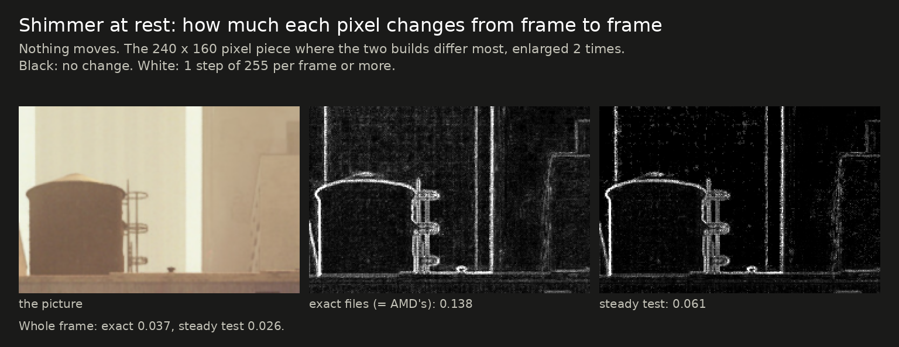
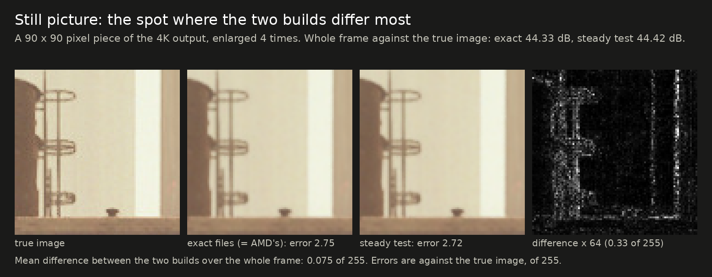
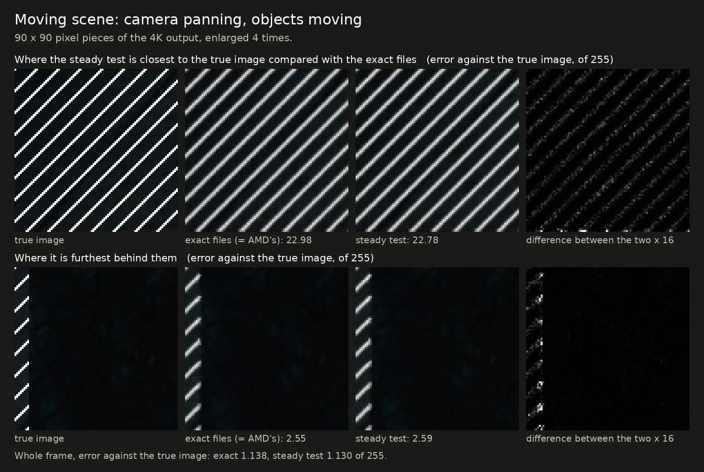

# The exact files beside a "steady" test build

[Back to the front page](../README.md)

> [!IMPORTANT]
> **The steady build is an unreleased test.** It is not in any download. It is described here because it came out of
> the work on the lossy DLL and may become a third, opt-in choice. Nothing on this page was checked in a game, on Windows,
> or on another graphics card than a Radeon RX 7800 XT.

## In short

- **The exact files** give the same picture as AMD's FSR 4.1.1 shaders, byte for byte, and take less time to do it.
- **The steady test build** is the exact files with one rule added to the last step: a pixel whose colors would each
  change by less than about two steps of the picture's number format keeps its previous value.
- It runs the network on every frame, like the exact files, and at the same speed. It does not skip frames and it does
  not touch the network. That is what sets it apart from the [lossy DLL](exact-vs-lossy.md).
- In the test rig it shimmers less than half as much at rest, its still picture is slightly closer to the true image, and
  everything that moves comes out the same as AMD's to within small fractions of a decibel.
- **It is not AMD's picture byte for byte.** That is the one thing the exact files promise, so this could only ever be a
  separate build.

## Why such a rule does anything

With nothing moving, FSR 4's network still asks for a small correction to every pixel on every frame: in bright flat
areas it gives each new frame about 16% weight. The correction that results is about the size of one step of the 16-bit
floats the picture is kept in, so whether it survives the rounding decides whether the pixel changes. That one-step
movement is the shimmer of flat areas at rest. The rule skips corrections of that size; real changes are far larger and
pass through. [How this was found](../research/frame-skip#why-folding-steadied-the-picture-and-what-replaced-it-release-dll-2026-10-114).

## Side by side

Test rig, 4K output from 2260x1272 (Balanced), Radeon RX 7800 XT under Proton, single runs. The exact files' column is also
AMD's: the same bytes.

| At rest (change per frame, steps of 255; lower is steadier) | Exact (= AMD's) | Steady test | |
|---|---|---|---|
| Worst flat piece of the scene | 0.126 | 0.051 | 60% less |
| Bright flat areas | 0.078 | 0.008 | 90% less |
| Dark flat areas | 0.018 | 0.014 | 21% less |
| Fine detail | 0.110 | 0.087 | 21% less |
| Thin vertical / horizontal detail | 0.364 / 0.279 | 0.312 / 0.243 | 14% / 13% less |

| Accuracy against the true image (higher is better) | Exact (= AMD's) | Steady test | |
|---|---|---|---|
| Still picture | 44.33 dB | 44.42 dB | +0.09 dB |
| Thin vertical / horizontal detail, still | 27.09 / 28.23 dB | 27.14 / 28.29 dB | +0.05 / +0.06 dB |
| Moving scene: background, 4K / 1440p / 1080p | 49.27 / 47.90 / 47.69 dB | 49.37 / 48.09 / 47.82 dB | +0.10 / +0.19 / +0.13 dB |
| Moving scene: thin railing, 4K / 1440p / 1080p | 41.82 / 39.23 / 38.62 dB | 41.82 / 39.24 / 38.60 dB | level |
| Moving scene: just-uncovered areas, 4K / 1440p / 1080p | 34.48 / 34.62 / 32.61 dB | 34.38 / 34.47 / 32.64 dB | −0.10 / −0.15 / +0.03 dB |
| Still camera, moving objects: just-uncovered areas | 32.62 dB | 32.64 dB | level |

The two still pictures cannot be told apart by eye: over the whole frame they differ by 0.075 of 255 on average, less
than a tenth of the smallest step a monitor shows.

| In motion (change per frame; lower is steadier) | Exact (= AMD's) | Steady test | |
|---|---|---|---|
| Moving background, 4K / 1440p / 1080p | 0.079 / 0.049 / 0.089 | 0.067 / 0.034 / 0.079 | 15% / 31% / 11% less |
| Fine stripes on a moving object | 2.039 | 2.011 | level |
| Thin railing | 0.913 | 0.904 | level |
| A wire half a pixel wide, camera still / slow pan | 2.91 / 7.16 | 2.91 / 7.17 | level |
| Film grain of 6 / 10 / 15 of 255 in the picture | 0.785 / 1.724 / 2.549 | 0.780 / 1.720 / 2.542 | level |

| Other measures | Exact (= AMD's) | Steady test | |
|---|---|---|---|
| Second outline beside a moving object (lower is better): still camera / pan against the object / fast pan | 4.01 / 3.11 / 0.50 | 4.00 / 3.28 / 0.49 | level / 5% more / level |
| The same beside thin bars: still camera / pan against the object / fast pan | 0.95 / 0.62 / 0.33 | 1.07 / 0.62 / 0.33 | 13% more / level / level |
| Tiny fast sparks shown | 83% | 83% | level |
| A region dimming by 1% per frame, nothing moving: frames behind, bright / mid / dark flat areas | 0.6 / 0.9 / 3.0 | 0.9 / 1.0 / 3.8 | 0.3 / 0.1 / 0.7 more |
| After a sudden change of 20%: share still missing one frame later, bright flat areas | 4% | 4% | level |
| Time per frame at 4K / 1440p / 1080p | 3.18 / 1.46 / 0.91 ms | 3.18 / 1.45 / 0.92 ms | level |

## Among the other upscalers

The same nine measures for the steady test build, AMD's FSR 4.1.1 (whose picture the exact files give), this project's
lossy DLL, FSR 3.1, HelixSR and XeSS. The other five columns are those of [the upscaler comparison](upscaler-comparison.md):
the same scenes, the same settings, one run each.

<picture>
  <source media="(prefers-color-scheme: dark)" srcset="img/steady-quality-dark.svg">
  
</picture>

- **It sits on FSR 4.1.1 in seven of the nine panels,** as it should: it is FSR 4.1.1's network on every frame. Still picture,
  moving background, just-uncovered areas, sparks, foliage, the thin wire and film grain are FSR 4's figures to within a hair.
- **It moves in the two steadiness panels.** At rest it shimmers about as little as the lossy DLL and less than FSR 4 and XeSS;
  FSR 3.1 and HelixSR are steadier still, with a less accurate picture. A moving background is 15% steadier than FSR 4's.
- **What it does not get from the lossy DLL:** that build's lead in just-uncovered areas, its steadier moving background and its
  lower film grain all come with frame skip, and so does its speed. And it does not have the lossy DLL's weak spots either:
  swaying foliage and a thin wire in a slow pan are at FSR 4's level.
- The lossy column is the build of release `dll-2026-10-11.4`.

## What it costs

- **With auto exposure on, it is not steadier in bright flat areas** (found 2026-10-11). Everything on this page was measured
  with FSR's auto-exposure option off. With it on, the worst flat piece of the still scene changes 0.251 per frame against 0.213
  for the exact files, 18% more; the whole frame (0.033 against 0.041) and fine detail (0.103 against 0.125) are still steadier,
  and the still picture still slightly more accurate (44.53 against 44.44 dB). The cause was found later the same day and is
  removed in the lossy DLL of release `dll-2026-10-11.5`
  ([how](../research/frame-skip#shimmer-with-auto-exposure-on-the-history-store-release-dll-2026-10-115)). With the same change this
  test build reads 0.090 against 0.213 in the worst flat piece and 0.051 against 0.186 in bright flat areas with auto exposure
  on (one run, not in any download).

- **A slow change with nothing moving is followed a little later:** a third of a frame in bright areas, up to
  three-quarters of a frame in dark ones. A change that small is skipped until it has added up to more than the band.
- **Areas a moving object has just uncovered are 0.10 to 0.15 dB less accurate** at 4K and 1440p output, and two of six
  second-outline measures are higher (by 5% and 13%).
- **It is no longer the same picture as AMD's.** Nobody can check it by comparing bytes, as they can the exact files.

## What was checked, and what was not

- The DLLs of the test build give the same output as its Linux files, byte for byte, in 9 of 9 rig runs (4K, 1440p and
  1080p output; both flavors).
- Built with the band switched off, the same tools reproduce the exact files byte for byte, so the band is the only
  difference.
- **Not checked:** any game, Windows, any other graphics card, output sizes above 4K. These are single runs on made-up
  scenes.

## Where to read more

- [Exact and lossy compared](exact-vs-lossy.md): the two builds that are released
- [Why folding steadied the picture, and what replaced it](../research/frame-skip#why-folding-steadied-the-picture-and-what-replaced-it-release-dll-2026-10-114): where the rule comes from
- The pictures are made by [`img/make_steady_comparison.py`](img/make_steady_comparison.py)
