# This project's lossy DLLs beside FSR 4.1.2 Lite, FSR 3.1, HelixSR and XeSS

[Back to the front page](../README.md) · [Exact and lossy compared](exact-vs-lossy.md) · [What HLX FSR 4 runs](hlx-fsr4.md)

> [!NOTE]
> **This version (2026-10-29) measures release `dll-2026-10-29`:** its lossy DLL (the former lossy2, trained further) and its new 4.1.2l-lossy DLL.
> It adds HelixSR 3.2.0 (HLX FSR 4 and HLX DLSS). Recorded game clips: the [comparison site](https://zgauthier2000.github.io/fsr4-upscaler-compare/).
> The earlier version (six upscalers, lossy2 of `dll-2026-10-19`, HelixSR 2.0.0) is in this file's history.

> [!WARNING]
> **These are synthetic benchmarks on one machine.** Every figure and picture on this page comes from made-up test scenes, each built to
> isolate one thing, run once on a single Radeon RX 7800 XT under Linux (Proton). They are not game footage, not other graphics cards and
> not repeated runs. A game, another card or Windows can come out differently, and the order of the upscalers on a measure can change.
> FSR 4.1.2 Lite was run in this project's local test harness, not AMD's own runtime.

> [!NOTE]
> **The FSR 4.1.1 column also stands for FSR 4.1.2 on desktop RX 7000 cards, as far as measured.** AMD's FSR 4.1.2 adds Lite for integrated
> graphics and another version for RX 6000 cards. For desktop RX 7000 cards, FSR 4.1.2 gave FSR 4.1.1's picture byte for byte in every test
> in this project's local test harness. What differs per GPU family: [AMD's FSR 4.1.1 and 4.1.2 compared](amd-411-vs-412.md).

People compare this project's DLLs with other upscalers they can run on the same card. This page puts eight of them through the same
test scenes and the same timing, for comparison only. It is not a ranking, and it is not a review of the other projects.

## In short

- **Picture accuracy:** FSR 4.1.1 is the most accurate of the eight. HLX FSR 4, FSR 4.1.2 Lite, this project's lossy and 4.1.2l-lossy come next and
  close together (still picture 44.15, 43.92, 43.89 and 43.85 dB against FSR 4.1.1's 44.33). XeSS, HelixSR 2.0 / HLX DLSS and FSR 3.1 follow
  (42.14, 41.98 and 39.94 dB).
- **HLX FSR 4 measures like FSR 4.1.2 Lite on nearly every row.** It runs Lite's network ([what HLX FSR 4 runs](hlx-fsr4.md)).
  **HLX DLSS gives exactly HelixSR 2.0's picture**, so the two share one column.
- **FSR 4.1.2 Lite** (and HLX FSR 4) is the best of the eight on swaying leaves and on areas a moving object has just uncovered while the camera pans.
  It is behind FSR 4.1.1 and both lossy DLLs on old image beside moving things, on thin bars fixed on screen and on just-uncovered areas with
  the camera still.
- **Lossy** is the best of the eight on just-uncovered areas overall (the mean of the panning and the still camera). It has the steadiest
  thin wire in a pan, and it shares the steadiest moving background with 4.1.2l-lossy. Its weak points: it draws that wire too dim, and large glowing
  particles drawn without motion vectors have more error than with any other FSR 4 relative.
- **4.1.2l-lossy** (Lite's network on every other frame) is the fastest of the FSR 4 family: 1.67 ms at 4K, 17% faster than Lite. Against Lite it
  leaves less old image beside moving things and beside thin bars fixed on screen, and its moving background and thin wire in a pan are steadier.
  It is behind Lite on swaying leaves and on just-uncovered areas in a pan, and it draws the thin wire dimmest of the eight.
- **Rain** drawn without motion vectors is where the eight differ most to the eye. HelixSR 2.0 / HLX DLSS shows the streaks as the game drew
  them, and FSR 3.1 shows part of them. The FSR 4 relatives (HLX FSR 4 included) and XeSS blend faint rain almost entirely into the picture.
- **Speed on this card:** FSR 3.1 is the fastest by a wide margin. 4.1.2l-lossy is next. Then come FSR 4.1.2 Lite, HLX FSR 4, HLX DLSS and lossy, within
  about 0.25 ms of each other, then this project's exact DLL. AMD's FSR 4.1.1 and XeSS are the slowest.
- **Everything here is one graphics card, made-up scenes and single runs.** A game can come out differently.

<picture>
  <source media="(prefers-color-scheme: dark)" srcset="img/cmp8-radar-dark.svg">
  
</picture>

**How to read it.** There is one shape per upscaler, all on the same ten spokes. On each spoke the best of the eight reaches the outer ring and
the others reach in proportion. A spoke at half length means twice the error (or twice the change per frame, or twice the time) of the best one;
for sparks it means half as much of them shown. A bigger shape is better and a dent is a weakness. 4.1.2l-lossy comes first, and the dashed outline in
the other seven panels is its shape, for comparison. The spokes do not weigh the same to the eye in a game, so the area of a shape is not a score.
Several spokes are means over more than one scene, so that none rests on the one scene an upscaler does best or worst in; the tables mark those rows.
The spokes were chosen to follow this project's lossy DLLs from release to release, so they lean toward the faults frame skipping can cause
(old image, thin bars fixed on screen, just-uncovered areas). Other measures, such as large particles drawn without motion vectors, are in the
tables only.

The charts and pictures on this page are made by [`img/make_upscaler_comparison8.py`](img/make_upscaler_comparison8.py) from the measured figures in
[`img/cmp8-data.json`](img/cmp8-data.json). Each crop shows the piece of the picture where the eight differ most from each other, picked by that
script from the data.

### Speed at a glance

<picture>
  <source media="(prefers-color-scheme: dark)" srcset="img/cmp8-speed-dark.svg">
  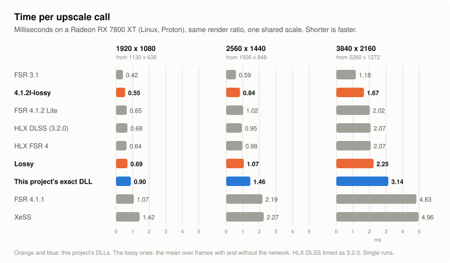
</picture>

The figures and how they were taken are in [the speed section](#speed).

### FSR 4.1.2 Lite against FSR 4.1.1

This is AMD's small model next to its full one, on the main measures of this page. Lite takes 58% less time at 4K. It is ahead on just-uncovered
areas in a pan, on swaying leaves and on steadiness at rest. It has more error on old image, on thin bars fixed on screen and on just-uncovered
areas with the camera still, and it draws a thin wire in a pan much too dim. HLX FSR 4 runs the same network, so the same holds for it.

<picture>
  <source media="(prefers-color-scheme: dark)" srcset="img/cmp8-lite-vs-fsr4-dark.svg">
  
</picture>

**Lossy against FSR 4.1.2 Lite.** The two are close on still accuracy (43.89 and 43.92 dB), and Lite is about 10% faster (2.02 against 2.25 ms at 4K).
Each has things it does better. Below are two cases each way, each in the piece of the scene where the winner is furthest ahead. They show the
difference at its largest, not a typical part of the frame.

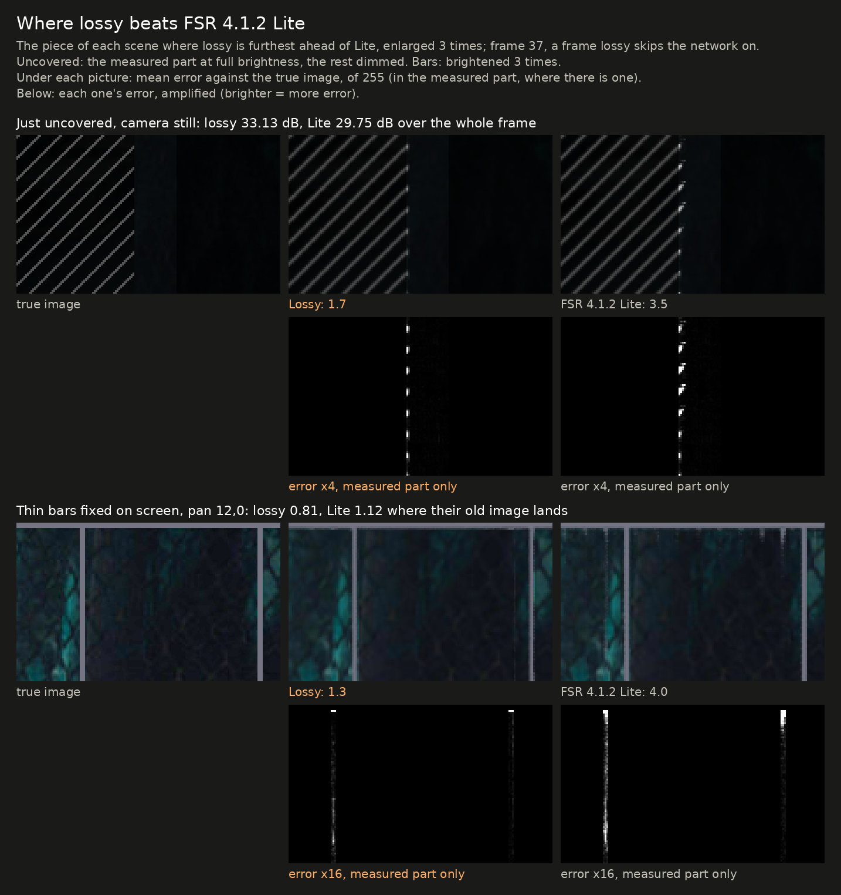

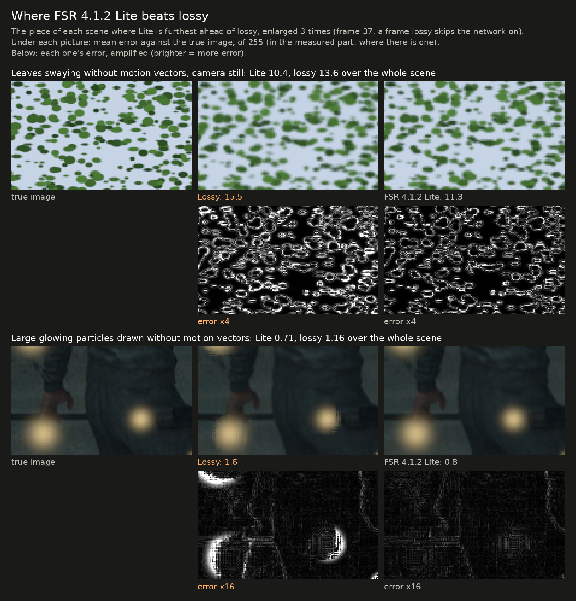

- **Lossy is ahead** where the old picture has to be kept apart from things that moved: just-uncovered areas with the camera still, thin bars
  fixed on screen, and old image beside moving objects. It is also steadier on a moving background and on thin wires in a pan.
- **Lite is ahead** on things drawn without motion vectors (swaying leaves, large glowing particles), on just-uncovered areas while the camera pans,
  and in speed. Lossy's figures here are for the frames on which it skips the network; Lite runs it on every frame.

### Where FSR 4.1.2 Lite beats FSR 4.1.1

Lite is ahead of AMD's full model in two places on this page that a picture can show: swaying leaves, and areas a moving object has just uncovered
while the camera pans. Its other gains, a slightly steadier still picture and its speed, do not show in one frame.

The uncovered example is measured in dB, as the page's figure is. dB weighs the largest errors most, and Lite's lead there comes from having fewer
large errors, not from a lower error everywhere: its mean error over the strip is about the same as FSR 4.1.1's.

### Where FSR 4.1.2 Lite loses to FSR 4.1.1 the most

These are Lite's three largest losses against AMD's full model that a picture can show:

- a thin wire in a slow pan (drawn much too dim);
- thin bars fixed on screen (a faint copy of them is left behind);
- areas a moving object has just uncovered with the camera still.

## What was compared

| Name here | What it is | Version | Settings |
|---|---|---|---|
| FSR 4.1.1 | AMD's FSR 4 (INT8 model) with AMD's own shaders. This project's exact DLL gives the same picture, byte for byte | 4.1.1 | defaults |
| Lossy | this project's lossy DLL (the former lossy2, trained further): FSR 4.1.1's network on every other frame, with trained weights | release `dll-2026-10-29`, RX 7000 flavor, at the Balanced preset's size (auto exposure is off on this page) | defaults |
| 4.1.2l-lossy | this project's 4.1.2l-lossy DLL: FSR 4.1.2 Lite's network on every other frame, with trained weights | release `dll-2026-10-29`, RX 7000 flavor | defaults |
| FSR 4.1.2 Lite | AMD's small FSR 4 model ("Lite": three network passes where FSR 4.1.1 has twelve), made for integrated graphics. Run here in this project's local test harness (see the note below) | 4.1.2 | its normal weight set (the one for every preset but Ultra Performance) |
| FSR 3.1 | AMD's FSR 3.1 upscaler, from the same AMD file as FSR 4.1.1 | 3.1.5 | defaults |
| HLX FSR 4 | HelixSR's HLX FSR 4: AMD's FSR 4.1.2 Lite network on HelixSR's own pipeline ([what HLX FSR 4 runs](hlx-fsr4.md)), in place of AMD's upscaler file | HelixSR 3.2.0 | defaults (the INT8 version it picks on this card) |
| HelixSR 2.0 / HLX DLSS | a community upscaler that runs NVIDIA's DLSS "Model E" network as ordinary compute shaders. HelixSR 3.2.0's HLX DLSS gives HelixSR 2.0's picture (the same frames byte for byte on every test here; on recorded game clips byte for byte on four of six and very close on the other two), so they share this column | 2.0.0 and 3.2.0 | defaults (INT8 network and 32-wide waves on this card, sharpening off); 3.2.0 run through HelixSR's bundled OptiScaler build, taking FSR 3.1 calls |
| XeSS | Intel's XeSS, in the form that runs on any graphics card | 2.0.2 | defaults, no auto exposure |

- **Same inputs for all:** the same rendered frames, camera jitter, motion vectors and depth, from the test rig that the rest of this
  repository uses. Output is 3840x2160 from 2260x1272, the size FSR calls "Balanced" (XeSS calls this ratio "Quality"). There is no sharpening anywhere.
- **Same measurements:** the last 8 of 40 frames, against the true 4K image.
- **The lossy DLLs may look better here than in a game:** their weights were trained partly on made-up scenes from the same generators as this
  page's test scenes (other settings and pictures, but the same kinds of scene). FSR 4.1.1, FSR 4.1.2 Lite and the others were trained by their
  makers on their own material. [Recorded game clips](https://zgauthier2000.github.io/fsr4-upscaler-compare/) are the better guide to how they look in games.
- **One card:** a Radeon RX 7800 XT on Linux, through Proton.
- **Checked before measuring:** that each upscaler receives the inputs the way it expects. For XeSS the sign of the jitter and of the motion
  vectors was tested both ways and the better one used, which is also what Intel's guide describes. FSR 3.1, HLX FSR 4 and HelixSR take the same
  interface as FSR 4.
- **FSR 4.1.2 Lite, the harness:** Lite was run in this project's local test harness. Two faults of the harness (data cleared, or left uncleared,
  where Lite keeps its intermediate results) were corrected for the picture measurements. Uncorrected, the picture differs slightly from run to run
  and scores up to 0.3 dB lower against FSR 4.1.1 on the moving test scene. The speed figures were taken without the corrections (they are a few
  very small steps).
- **Measured again on 2026-10-29 for all eight.** Every picture figure of FSR 4.1.1, FSR 4.1.2 Lite, FSR 3.1 and XeSS repeats the 2026-10-20 version
  of this page exactly, and HLX DLSS repeats HelixSR 2.0's. The timings were taken again and differ from that version by up to 0.04 ms.

## Accuracy

Accuracy is measured against the true image: higher dB is better, and lower error is better.

| Scene | FSR 4.1.1 | Lossy | 4.1.2l-lossy | FSR 4.1.2 Lite | FSR 3.1 | HLX FSR 4 | HelixSR 2.0 / HLX DLSS | XeSS |
|---|---|---|---|---|---|---|---|---|
| Still picture | 44.33 dB | 43.89 dB | 43.85 dB | 43.92 dB | 39.94 dB | 44.15 dB | 41.98 dB | 42.14 dB |
| Moving scene: background | 50.82 dB | 49.49 dB | 49.83 dB | 50.15 dB | 50.09 dB | 50.37 dB | 48.56 dB | 48.94 dB |
| Mean of the two rows above (the chart's accuracy spoke) | 47.58 dB | 46.69 dB | 46.84 dB | 47.03 dB | 45.02 dB | 47.26 dB | 45.27 dB | 45.54 dB |
| Moving scene: thin railing | 41.61 dB | 40.58 dB | 40.53 dB | 40.95 dB | 38.95 dB | 40.94 dB | 39.86 dB | 39.56 dB |
| Moving scene: areas a moving object has just uncovered | 33.21 dB | 36.09 dB | 35.21 dB | 37.30 dB | 30.53 dB | 37.11 dB | 29.65 dB | 33.10 dB |
| The same with the camera still and the objects moving | 32.62 dB | 33.13 dB | 29.48 dB | 29.75 dB | 29.96 dB | 29.63 dB | 29.61 dB | 31.53 dB |
| Mean of the two rows above (the chart's uncovered spoke) | 32.91 dB | 34.61 dB | 32.34 dB | 33.52 dB | 30.25 dB | 33.37 dB | 29.63 dB | 32.31 dB |
| A still bright object over fast ground at the same depth: error where its old image lands, of 255 | 1.62 | 2.54 | 2.26 | 1.73 | 3.09 | 1.73 | 2.23 | 2.15 |
| Leaves swaying without motion vectors, camera still: error of 255 | 12.1 | 13.6 | 13.6 | 10.4 | 16.8 | 10.4 | 15.3 | 15.5 |
| The same, camera panning | 10.7 | 14.5 | 13.8 | 11.0 | 15.4 | 11.0 | 16.6 | 16.8 |
| Leaves swaying at two thirds of that speed, camera still | 10.8 | 11.8 | 11.9 | 9.9 | 16.7 | 9.9 | 14.0 | 14.2 |
| Leaves swaying at half that speed, camera still | 10.2 | 11.3 | 11.3 | 9.7 | 16.6 | 9.6 | 13.4 | 13.1 |
| Mean of the three sway speeds above (the chart's foliage spoke) | 11.0 | 12.2 | 12.3 | 10.0 | 16.7 | 10.0 | 14.2 | 14.3 |
| Still leaves, camera panning | 6.2 | 8.2 | 7.5 | 6.8 | 7.6 | 6.7 | 8.4 | 7.4 |

- **After FSR 4.1.1, five are close together on the still picture:** HLX FSR 4, Lite, lossy and 4.1.2l-lossy (44.15 to 43.85 dB). In motion, Lite and
  HLX FSR 4 are a little ahead of the two lossy DLLs on the background and the railing.
- **Just-uncovered areas split them.** With the camera panning, Lite is the best of the eight (37.30 dB), with HLX FSR 4 and lossy next. With the
  camera still and the objects moving, lossy is the best (33.13 dB), while Lite, HLX FSR 4 and 4.1.2l-lossy are near the bottom (29.48 to 29.75 dB,
  about level with FSR 3.1 and HelixSR).
- **Swaying leaves:** FSR 4.1.2 Lite and HLX FSR 4 are the most accurate at every sway speed with the camera still, ahead of FSR 4.1.1. Lossy and
  4.1.2l-lossy come after FSR 4.1.1, ahead of HelixSR, XeSS and FSR 3.1. The lossy figures are for the frames that skip the network.
- **Behind a still bright object over fast ground,** FSR 4.1.1, Lite and HLX FSR 4 are the best. Lossy is behind all but FSR 3.1 (2.54).

The pictures below are of the scenes behind the chart's accuracy, railing, uncovered and foliage spokes: one piece of one frame from each of the
eight, beside the true image. Each piece is the one where the eight differ most, so it shows the differences at their largest, not a typical part of the frame.

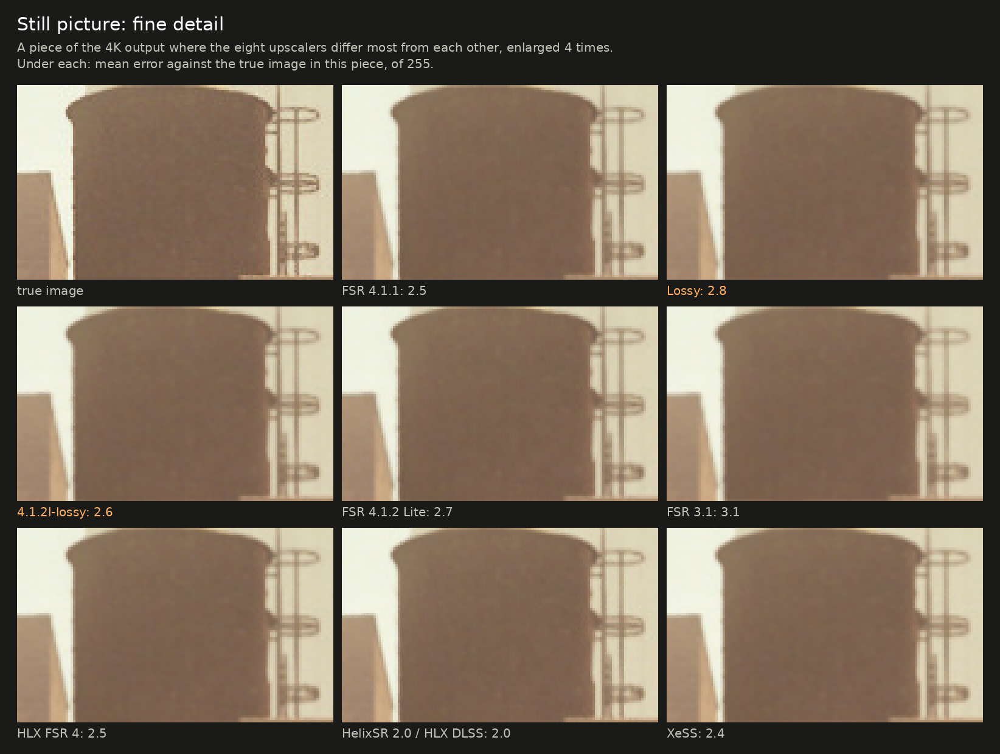

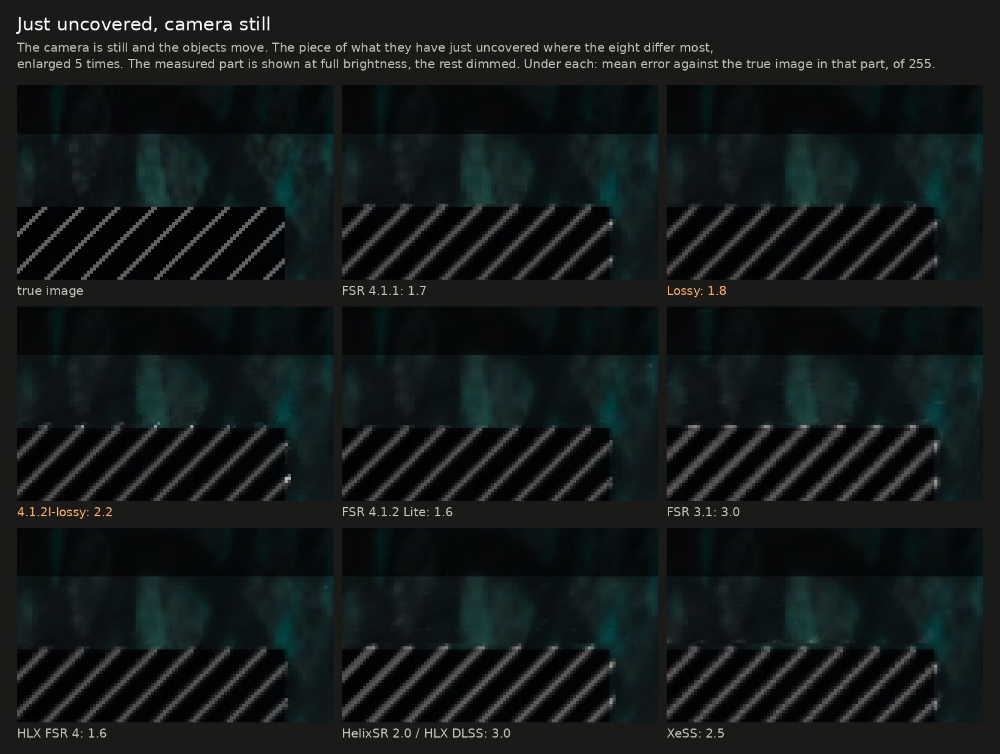

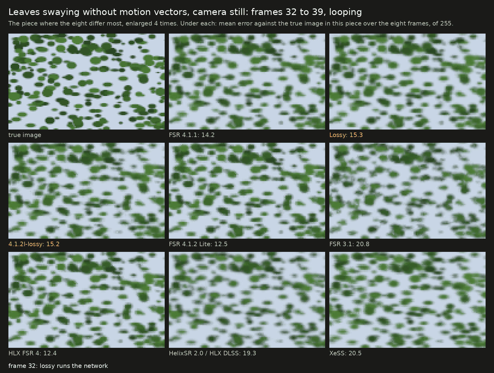

## Things a game draws without motion vectors

These are bright dots drawn into the picture only, as games draw sparks and embers. For the lossy DLLs the figures are for the frames that skip the
network; the same alternate frames are measured for the others.

| Scene | FSR 4.1.1 | Lossy | 4.1.2l-lossy | FSR 4.1.2 Lite | FSR 3.1 | HLX FSR 4 | HelixSR 2.0 / HLX DLSS | XeSS |
|---|---|---|---|---|---|---|---|---|
| Large glowing particles: error of 255 | 0.66 | 1.16 | 0.89 | 0.71 | 3.21 | 0.71 | 0.68 | 1.01 |
| Tiny fast sparks: share of their brightness shown | 83% | 72% | 75% | 76% | 40% | 75% | 79% | 50% |
| Tiny slow embers: share shown | 81% | 80% | 76% | 78% | 53% | 78% | 79% | 69% |

- FSR 4.1.1, HelixSR, FSR 4.1.2 Lite and HLX FSR 4 handle these best.
- The two lossy DLLs are close on embers and behind on large particles and fast sparks; 4.1.2l-lossy is closer to Lite than lossy is to FSR 4.1.1.
- FSR 3.1 loses more than half of the small ones.

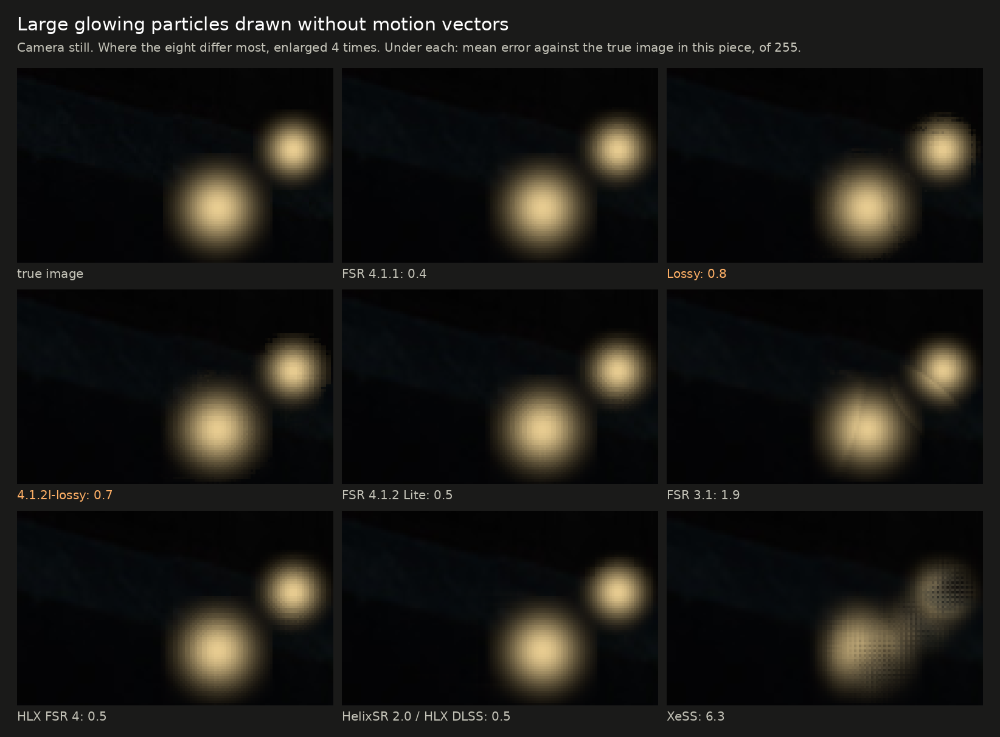

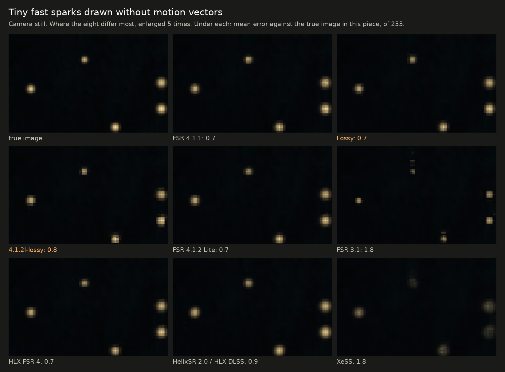

### Rain

This scene has thin bright streaks falling fast, drawn into the picture without motion vectors, over a dark surface with the camera still. The
streaks are faint (about a third of full brightness) and in a new place every frame. There is no fair "true image" to score this against, so the
table counts what is shown: output pixels more than 20 of 255 brighter than the surface, per million, over eight frames. As the game draws it,
about 5,900 per million of its own pixels carry a streak.

|  | FSR 4.1.1 | Lossy | 4.1.2l-lossy | FSR 4.1.2 Lite | FSR 3.1 | HLX FSR 4 | HelixSR 2.0 / HLX DLSS | XeSS |
|---|---|---|---|---|---|---|---|---|
| Pixels standing out, per million | 0 | 0 | 0 | 0 | 1,217 to 1,284 | 0 | 8,409 to 8,429 | 94 to 149 |
| The brightest of them, above the surface (of 255) | 7 | 8 | 9 | 8 | 44 to 45 | 8 | 84 | 18 to 20 |

- **HelixSR 2.0 / HLX DLSS shows the rain as the game drew it.** FSR 3.1 shows part of it, broken into specks. The FSR 4 relatives (HLX FSR 4
  included) and XeSS treat streaks this faint and fast as noise and blend them into the surface.
- **Which is right depends on the game.** Rain is meant to be seen; noise of the same shape is not.

## Old image beside moving things

This is the error against the true image where a thing's image of a frame ago would land if it were left behind, in steps of 255. Lower is better.
The figures are for the frames the lossy DLLs skip the network for.

| A moving object; camera / object, pixels per frame | FSR 4.1.1 | Lossy | 4.1.2l-lossy | FSR 4.1.2 Lite | FSR 3.1 | HLX FSR 4 | HelixSR 2.0 / HLX DLSS | XeSS |
|---|---|---|---|---|---|---|---|---|
| 12,6 / −6,6 | 0.85 | 0.86 | 0.89 | 0.91 | 0.93 | 0.91 | 3.19 | 1.77 |
| 12,6 / 6,−6 | 1.07 | 1.06 | 1.06 | 1.07 | 1.11 | 1.07 | 2.03 | 1.43 |
| still camera / 8,0 | 1.07 | 1.23 | 1.11 | 1.05 | 1.56 | 1.05 | 1.99 | 1.51 |
| still camera / 6,−6 | 1.74 | 2.11 | 2.42 | 2.53 | 3.43 | 2.54 | 3.67 | 2.43 |
| still camera / −6,6 | 4.01 | 4.29 | 6.09 | 6.01 | 6.96 | 6.12 | 7.74 | 6.56 |
| −16,4 / 8,0 (fast pan against the object's motion) | 3.11 | 4.00 | 2.67 | 4.35 | 5.35 | 4.67 | 4.55 | 18.06 |
| A still bright object over fast ground (the row in the table above) | 1.62 | 2.54 | 2.26 | 1.73 | 3.09 | 1.73 | 2.23 | 2.15 |
| Mean of the seven (the chart's old-image spoke) | 1.92 | 2.30 | 2.36 | 2.52 | 3.20 | 2.58 | 3.63 | 4.84 |

| Thin bars fixed on screen, background panning (pixels per frame); frames with the network and without, mean | FSR 4.1.1 | Lossy | 4.1.2l-lossy | FSR 4.1.2 Lite | FSR 3.1 | HLX FSR 4 | HelixSR 2.0 / HLX DLSS | XeSS |
|---|---|---|---|---|---|---|---|---|
| 6,0 | 0.94 | 0.96 | 0.86 | 1.36 | 0.96 | 1.38 | 3.92 | 1.26 |
| 12,0 | 0.73 | 0.81 | 0.73 | 1.12 | 0.96 | 1.13 | 3.08 | 3.73 |
| 30,0 | 0.53 | 0.60 | 0.56 | 0.97 | 0.62 | 0.97 | 1.61 | 7.62 |
| 12,4 | 1.09 | 1.24 | 1.22 | 1.68 | 1.63 | 1.69 | 3.33 | 2.81 |
| Mean of the four (the chart's fixed-bars spoke) | 0.82 | 0.91 | 0.85 | 1.28 | 1.04 | 1.29 | 2.98 | 3.85 |

- **FSR 4.1.1 is the best on both means, with the two lossy DLLs next.** On the fixed bars, 4.1.2l-lossy is nearly level with FSR 4.1.1 (0.85
  against 0.82) and well ahead of Lite (1.28). It is also the best of the eight in the fast pan against the object's motion (2.67).
- **FSR 4.1.2 Lite and HLX FSR 4** leave more of a moving object's old image when the camera is still and the object moves diagonally (6.01 and 6.12
  against FSR 4.1.1's 4.01), and a faint copy of thin bars fixed on screen.

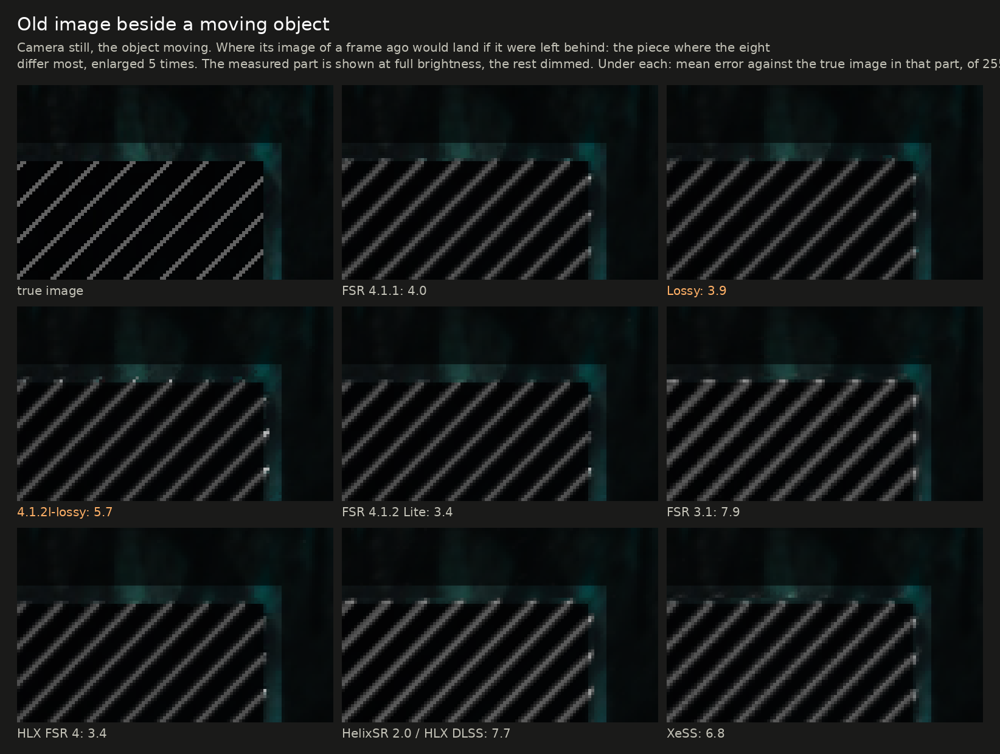

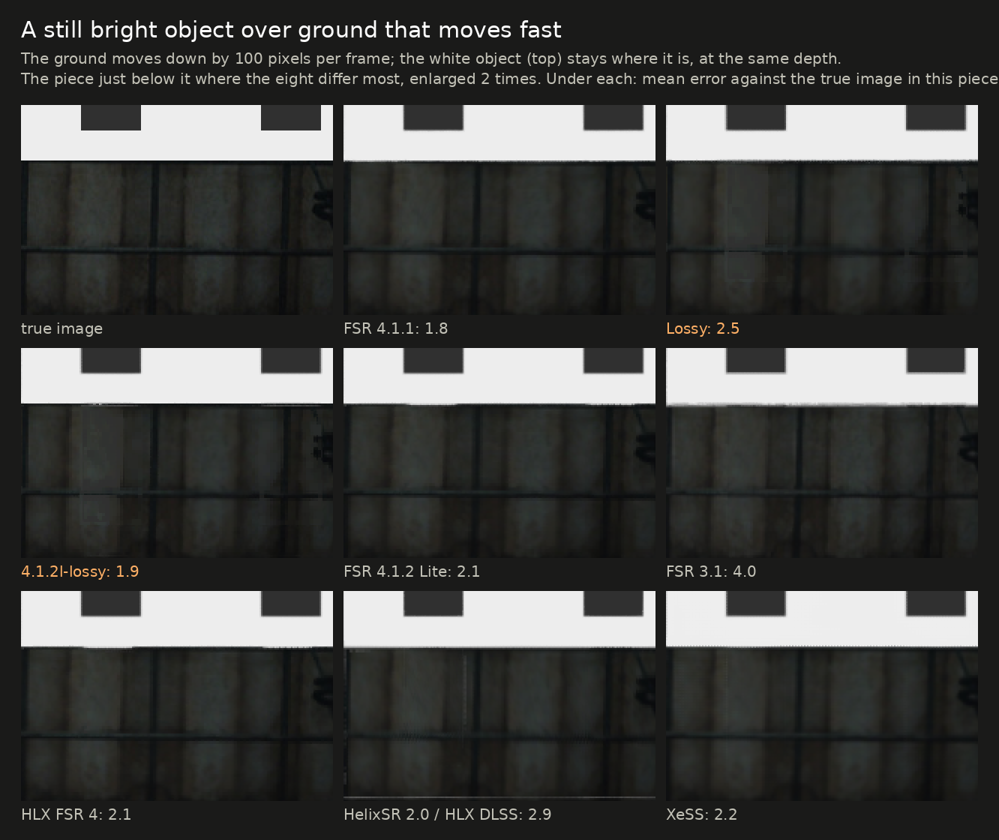

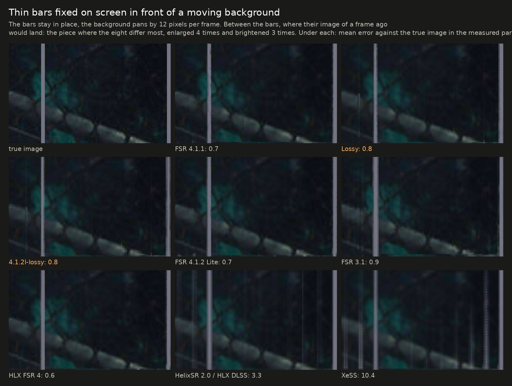

## Steadiness

This is how much the picture changes from one frame to the next where it should not, in steps of 255. Lower is steadier.

| Scene | FSR 4.1.1 | Lossy | 4.1.2l-lossy | FSR 4.1.2 Lite | FSR 3.1 | HLX FSR 4 | HelixSR 2.0 / HLX DLSS | XeSS |
|---|---|---|---|---|---|---|---|---|
| Still picture, whole frame | 0.037 | 0.023 | 0.026 | 0.029 | 0.014 | 0.024 | 0.022 | 0.084 |
| Moving scene: background | 0.080 | 0.028 | 0.028 | 0.100 | 0.083 | 0.098 | 0.207 | 0.092 |
| A wire half a pixel wide, camera still | 2.9 | 2.7 | 2.6 | 2.6 | 2.3 | 2.6 | 2.6 | 4.2 |
| The same wire under a slow pan | 7.2 | 4.7 | 7.5 | 9.8 | 8.2 | 9.8 | 5.7 | 10.1 |
| The same wire under a slow pan: its brightness, of 255 (true: 111) | 100 | 79 | 61 | 69 | 122 | 69 | 133 | 90 |
| ... how close that is to the true brightness (the chart's wire spoke; too bright counts like too dim) | 90.5% | 71.0% | 55.3% | 62.1% | 90.2% | 62.2% | 79.7% | 81.0% |
| Still picture with grain of 6 of 255 | 0.785 | 0.208 | 0.319 | 0.416 | 0.162 | 0.416 | 0.234 | 0.182 |
| Still picture with grain of 10 of 255 | 1.724 | 0.927 | 0.788 | 1.712 | 0.308 | 1.680 | 0.307 | 0.228 |

- **The two lossy DLLs have the steadiest moving background** (0.028 each), and lossy has the steadiest thin wire in a pan.
- **They draw that wire dimmer than the true image:** lossy at 79 of 255 and 4.1.2l-lossy at 61, the dimmest of the eight (true: 111). FSR 4.1.2 Lite
  and HLX FSR 4 draw it at 69, and they are the least steady of the FSR 4 family there (9.8 against FSR 4.1.1's 7.2).
- **Grain:** FSR 4.1.1 passes grain on almost unchanged, and FSR 4.1.2 Lite and HLX FSR 4 do the same at 10 of 255. The lossy DLLs hold some of it
  back on the frames they skip. FSR 3.1, HelixSR and XeSS hold it back much further.
- Steadier is not always more accurate. FSR 3.1 has the steadiest still picture and the least accurate one.

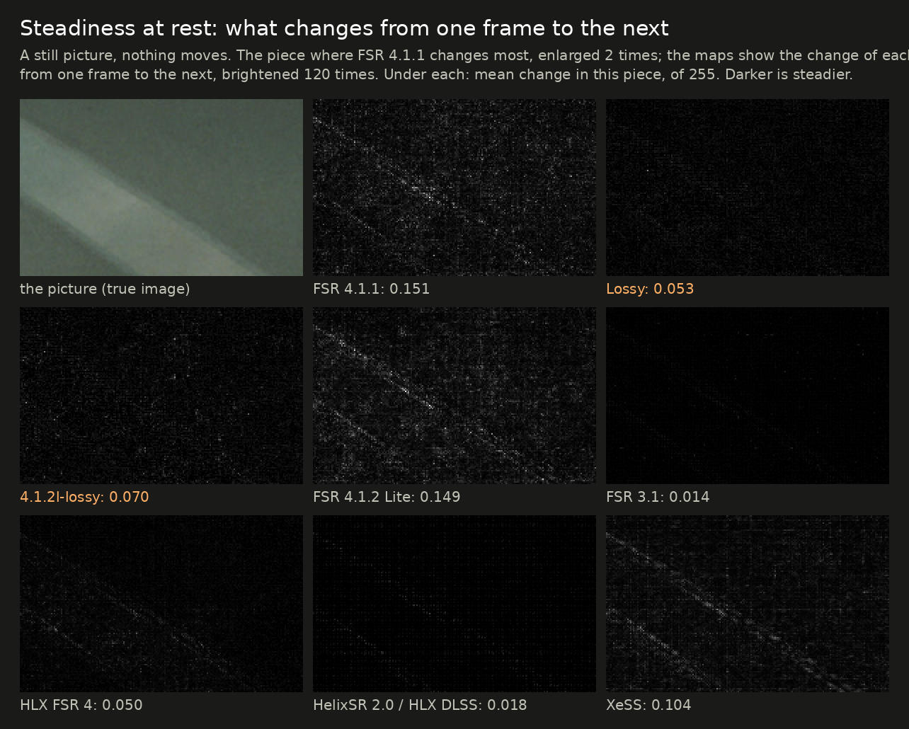

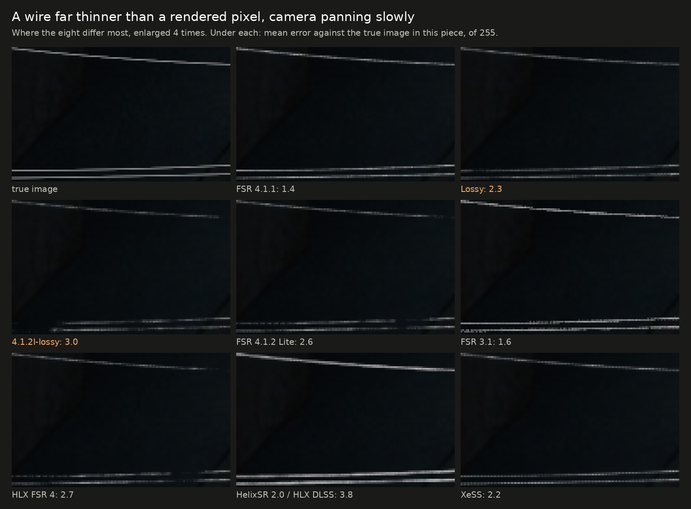

## Speed

This is the graphics-card time for one upscale call, in milliseconds, at the same render ratio, on a moving picture. Lower is faster (the chart is
[near the top](#speed-at-a-glance)).

| Output | FSR 4.1.1 | This project's exact DLL | Lossy | 4.1.2l-lossy | FSR 4.1.2 Lite | FSR 3.1 | HLX FSR 4 | HelixSR 2.0 / HLX DLSS | XeSS |
|---|---|---|---|---|---|---|---|---|---|
| 1920x1080 | 1.07 | 0.90 | 0.69 | 0.55 | 0.65 | 0.42 | 0.64 | 0.68 | 1.42 |
| 2560x1440 | 2.19 | 1.46 | 1.07 | 0.84 | 1.02 | 0.59 | 0.98 | 0.95 | 2.27 |
| 3840x2160 | 4.83 | 3.14 | 2.25 | 1.67 | 2.02 | 1.18 | 2.07 | 2.07 | 4.96 |
| Mean of the three (the chart's speed spoke) | 2.70 | 1.83 | 1.33 | 1.02 | 1.23 | 0.73 | 1.23 | 1.24 | 2.88 |

- **How the timings were taken:**
  - FSR 4.1.1, this project's DLLs (release `dll-2026-10-29`, RX 7000 flavor), FSR 4.1.2 Lite, FSR 3.1, HLX FSR 4 and HLX DLSS were timed by the same program:
    200 calls after 40 to warm up, on 2026-10-29, one run each.
  - XeSS has another interface and was timed by a second program over 32 calls, so its column is not measured in quite the same way.
- **The lossy figures are averages over the two kinds of frame.** At 4K, lossy takes 3.22 ms when the network runs and 1.25 ms when it is skipped;
  4.1.2l-lossy takes 2.06 and 1.26 ms.
- **The HelixSR column's timing is HLX DLSS of 3.2.0,** run through HelixSR's bundled OptiScaler build. HelixSR 2.0 alone timed 1.83 ms at 4K on the
  2026-10-20 version of this page.
- **XeSS:** it runs a different, slower network on cards that are not Intel's than on Intel Arc. These figures say nothing about XeSS on Arc.
- **Lite and HLX FSR 4:** FSR 4.1.2 Lite was made for integrated graphics; this page has it and HLX FSR 4 on a desktop card only.
- **Proton, not Windows:** all of this is under Proton on Linux. On Windows the same card's FSR 4.1.1 timings differ ([what is known](results.md)).

## What this page does not show

- **Games.** These are made-up scenes built to isolate one thing each. They are useful for telling upscalers apart, not for predicting how a
  particular game will look. Recorded game clips are on the [comparison site](https://zgauthier2000.github.io/fsr4-upscaler-compare/).
- **Other cards and systems.** HelixSR's author develops on different hardware; XeSS and FSR 3.1 behave differently across vendors; HLX FSR 4
  picks another version of its network on other cards. One RX 7800 XT on Linux is one data point.
- **FSR 4.1.2 Lite in AMD's own runtime.** Lite was run in this project's local test harness; in AMD's own runtime it may differ.
- **Other settings.**
  - Each upscaler was run at its defaults, and none of the options below was explored.
  - HelixSR can use another network output size and optional sharpening.
  - XeSS has auto exposure. When tried, it raised XeSS's still-picture score here from 42.1 to 42.7 dB.
- **Other render ratios.** Only the 1.7 ratio was measured.
- **Run-to-run spread.** Single runs.

## How to reproduce it

The scenes and measures are in [`research/pruning`](../research/pruning):

- `gen_inputs.py` and `gen_motion.py` write the input frames.
- `metric_motion.py`, `particles.py`, `wires.py` and `foliage.py` measure the output.
- `rain.py` writes and measures the rain scene.
- `fsr4img.c` drives anything that speaks AMD's FidelityFX interface and selects the upscaler by version name: `4.1.1`, `4.1.2` (this project's
  DLLs), `3.1`, `HLX` for HLX FSR 4, and `HelixSR` for HelixSR 2.0. HelixSR 2.0 and HLX FSR 4 are run by putting their DLL in the upscaler's place.
  HLX DLSS is run through HelixSR's bundled OptiScaler build, which takes the FSR 3.1 calls.
- [`xessmot.c`](../research/pruning/xessmot.c) is the same program for XeSS. It needs Intel's XeSS SDK headers to build and `libxess.dll` to run.

None of the other projects' files are in this repository; get them from their own sources.

Corrections are welcome, most of all from the other projects' authors: if a setting here is unfair to one of them, an issue on this repository
will get it rerun.
