# The lossy2 DLL beside FSR 4.1.2 Lite, FSR 3.1, HelixSR and XeSS

[Back to the front page](../README.md) · [Exact and lossy compared](exact-vs-lossy.md)

> [!WARNING]
> **These are synthetic benchmarks on one machine.** Every figure and picture on this page comes from made-up test scenes, each built to
> isolate one thing, run once on a single Radeon RX 7800 XT under Linux (Proton). They are not game footage, not other graphics cards and
> not repeated runs. A game, another card or Windows can come out differently, and the order of the upscalers on a measure can change.
> FSR 4.1.2 Lite was run in this project's own test harness, not through AMD's driver.

> [!NOTE]
> **The FSR 4.1.1 column also stands for FSR 4.1.2 on desktop cards, as far as measured.** AMD's FSR 4.1.2 (graphics driver 26.10.1)
> adds Lite for integrated graphics; for desktop RX 7000 and RX 6000 cards it keeps FSR 4.1.1's network with the same weights. Run in this
> project's local test harness, FSR 4.1.2's network for each of the two kinds of desktop card gave FSR 4.1.1's picture byte for byte in every
> test: 30 each, at 1080p and 4K output, still and moving, with fades, film grain, foliage, fireflies and rain, auto exposure off and on, and
> HDR. Not checked: Ultra Performance, output above 4K, FSR 4.1.2's own steps before and after the network, and AMD's own runtime.

People compare this project's DLLs with other upscalers they can run on the same card. This page puts six of them through
the same test scenes and the same timing, for comparison only. It is not a ranking, and it is not a review of the other
projects. This version (2026-10-20) adds AMD's new FSR 4.1.2 "Lite" model and HelixSR 2.0.0, and shows this project's
lossy2 DLL; the earlier version (five upscalers, the lossy DLL of release `dll-2026-10-15`, HelixSR 1.2.0) is in this file's history.

## In short

- **Picture accuracy:** FSR 4.1.1 is the most accurate of the six. Lossy2 and FSR 4.1.2 Lite are next and close to each other
  (still picture 43.9 dB each against FSR 4's 44.3), ahead of XeSS, HelixSR and FSR 3.1 (42.1, 42.0 and 39.9 dB).
- **FSR 4.1.2 Lite** is best of the six on swaying leaves and on areas a moving object has just uncovered while the camera pans.
  It is behind FSR 4.1.1 and lossy2 on old image beside moving things, on thin bars fixed on screen and on the
  just-uncovered areas with the camera still. It is also the least steady of the FSR 4 family on a thin wire in a pan.
- **Lossy2** is best of the six on just-uncovered areas overall (the mean of the panning and the still camera), and has the steadiest
  moving background and the steadiest thin wire in a pan. Its weak points: it draws that wire dimmer than all but Lite, and film grain is busier
  than with FSR 3.1, HelixSR or XeSS.
- **Rain** drawn without motion vectors is where the six differ most to the eye: HelixSR shows the streaks as the game drew
  them, FSR 3.1 shows part of them, and the three FSR 4 relatives and XeSS blend faint rain almost entirely into the picture.
- **Speed on this card:** FSR 3.1 is the fastest by a wide margin, then HelixSR 2.0, FSR 4.1.2 Lite and lossy2 within about
  0.2 ms of each other, then this project's exact DLL, with AMD's FSR 4.1.1 and XeSS the slowest.
- **Everything here is one graphics card, made-up scenes and single runs.** A game can come out differently.

<picture>
  <source media="(prefers-color-scheme: dark)" srcset="img/cmp7-radar-dark.svg">
  
</picture>

**How to read it.** One shape per upscaler, all on the same ten spokes. On each spoke the best of the six reaches the outer ring; the
others reach in proportion: a spoke at half length means twice the error (or twice the change per frame, or twice the time) of the
best one, and for sparks half as much of them shown. A bigger shape is better and a dent is a weakness. Lossy2 comes first, and the dashed outline in the
other five panels is its shape, for comparison. The spokes do not weigh the same to the eye in a game, so the area of a shape is not a score.
Several spokes are means over more than one scene, so that none rests on the one scene an upscaler does best or worst in; the tables mark those rows.
The spokes were chosen to follow this project's lossy DLLs from release to release, so they lean toward the faults frame skipping can cause (old image,
thin bars fixed on screen, just-uncovered areas); other measures, such as large particles drawn without motion vectors, are in the tables only.

The charts and pictures on this page are made by [`img/make_upscaler_comparison7.py`](img/make_upscaler_comparison7.py) from the measured figures in
[`img/cmp7-data.json`](img/cmp7-data.json); the crops show the piece of the picture where the six differ most from each other, picked by that script from the data.

### Speed at a glance

<picture>
  <source media="(prefers-color-scheme: dark)" srcset="img/cmp7-speed-dark.svg">
  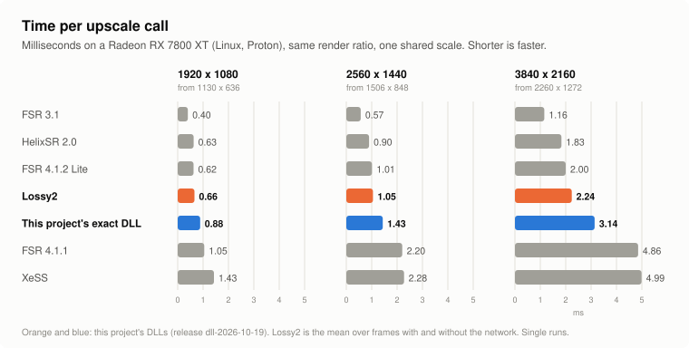
</picture>

The figures and how they were taken are in [the speed section](#speed).

### FSR 4.1.2 Lite against FSR 4.1.1

AMD's new small model next to its full one, on the main measures of this page. Lite takes 59% less time at 4K and is ahead on just-uncovered areas
in a pan, swaying leaves and steadiness at rest; it has more error on old image, thin bars fixed on screen and just-uncovered areas with the camera
still, and draws a thin wire in a pan much too dim.

<picture>
  <source media="(prefers-color-scheme: dark)" srcset="img/cmp7-lite-vs-fsr4-dark.svg">
  
</picture>

**Lossy2 against FSR 4.1.2 Lite.** The two are close on still accuracy (43.91 and 43.92 dB) and at nearly the same speed, but each has things it does better. Below,
two cases each way, in the piece of the scene where the winner is furthest ahead (so they show the difference at its largest, not a typical part of the frame).

- **Lossy2 is ahead** where the old picture has to be kept apart from things that moved: just-uncovered areas with the camera still, thin bars fixed on screen,
  old image beside moving objects. It is also steadier on a moving background and on thin wires in a pan.
- **Lite is ahead** on things drawn without motion vectors (swaying leaves, large glowing particles), on just-uncovered areas while the camera pans,
  and in speed by about 10% (2.00 against 2.24 ms at 4K). Lossy2's figures here are for the frames on which it skips the network; Lite runs it on every frame.

### Where FSR 4.1.2 Lite beats FSR 4.1.1

Lite is ahead of AMD's full model in two places on this page that a picture can show: swaying leaves and areas a moving object has just uncovered while
the camera pans. Its other gains, a slightly steadier still picture and its speed, do not show in one frame.

The uncovered example is measured in dB, as the page's figure is: dB weighs the largest errors most, and Lite's lead there comes from having fewer large ones,
not from a lower error everywhere (its mean error over the strip is about the same as FSR 4.1.1's).

### Where FSR 4.1.2 Lite loses to FSR 4.1.1 the most

Lite's three largest losses against AMD's full model that a picture can show: a thin wire in a slow pan (drawn much too dim), thin bars fixed on
screen (a faint copy of them is left behind), and areas a moving object has just uncovered with the camera still.

## What was compared

| Name here | What it is | Version | Settings |
|---|---|---|---|
| FSR 4.1.1 | AMD's FSR 4 (INT8 model) with AMD's own shaders. This project's exact DLL gives the same picture, byte for byte | 4.1.1 | defaults |
| Lossy2 | this project's lossy2 DLL: FSR 4.1.1's network on every other frame, with trained weights; meant to replace the lossy DLL once it is trained further | release `dll-2026-10-19`, at the Balanced preset's size (auto exposure is off on this page) | defaults |
| FSR 4.1.2 Lite | AMD's small FSR 4 model ("Lite": three network passes where FSR 4.1.1 has twelve), which AMD's graphics driver 26.10.1 brings for integrated graphics. Not available from this project: run here in a local test harness, not AMD's own runtime (see the note below) | 4.1.2 (driver 26.10.1) | its normal weight set (the one for every preset but Ultra Performance) |
| FSR 3.1 | AMD's FSR 3.1 upscaler, from the same AMD file as FSR 4.1.1 | 3.1.5 | defaults |
| HelixSR 2.0 | a community upscaler that runs NVIDIA's DLSS "Model E" network as ordinary compute shaders behind FSR 3.1's interface | 2.0.0 | defaults (INT8 network and 32-wide waves on this card, sharpening off); its frame generation off |
| XeSS | Intel's XeSS, in the form that runs on any graphics card | 2.0.2 | defaults, no auto exposure |

- **Same inputs for all:** the same rendered frames, camera jitter, motion vectors and depth, from the test rig that the
  rest of this repository uses. Output 3840x2160 from 2260x1272, the size FSR calls "Balanced" (XeSS calls this ratio
  "Quality"). No sharpening anywhere.
- **Same measurements:** the last 8 of 40 frames, against the true 4K image.
- **Lossy2 may look better here than in a game:** its weights were trained on made-up scenes from the same generators as this page's test scenes
  (other settings and pictures, but the same kinds of scene). FSR 4.1.1, FSR 4.1.2 Lite and the others were trained by their makers on their own material.
- **One card:** a Radeon RX 7800 XT on Linux, through Proton.
- **Checked before measuring:** that each upscaler receives the inputs the way it expects. For XeSS the sign of the jitter and
  of the motion vectors was tested both ways and the better one used, which is also what Intel's guide describes. FSR 3.1
  and HelixSR take the same interface as FSR 4.
- **FSR 4.1.2 Lite, the harness:** Lite was run in this project's local test harness, not AMD's own runtime. Two faults of the harness (data cleared, or
  left uncleared, where Lite keeps its intermediate results) were corrected for the picture measurements; uncorrected, the picture differs slightly from run
  to run and scores up to 0.3 dB lower against FSR 4.1.1 on the moving test scene. The speed figures were taken without the corrections (they are a few very
  small steps).
- **Measured again on 2026-10-20 for all six,** on the current test rig. Most rows of FSR 4.1.1, FSR 3.1 and XeSS repeat the earlier version of this page exactly;
  the moving scene's rows differ for all of them, because that scene and its measure were revised on 2026-10-13, after the earlier version.

## Accuracy

Against the true image; higher dB is better, lower error is better.

| Scene | FSR 4.1.1 | Lossy2 | FSR 4.1.2 Lite | FSR 3.1 | HelixSR 2.0 | XeSS |
|---|---|---|---|---|---|---|
| Still picture | 44.33 dB | 43.91 dB | 43.92 dB | 39.94 dB | 41.98 dB | 42.14 dB |
| Moving scene: background | 50.82 dB | 49.69 dB | 50.15 dB | 50.09 dB | 48.56 dB | 48.94 dB |
| Mean of the two rows above (the chart's accuracy spoke) | 47.58 dB | 46.80 dB | 47.03 dB | 45.02 dB | 45.27 dB | 45.54 dB |
| Moving scene: thin railing | 41.61 dB | 40.79 dB | 40.95 dB | 38.95 dB | 39.86 dB | 39.56 dB |
| Moving scene: areas a moving object has just uncovered | 33.21 dB | 35.93 dB | 37.30 dB | 30.53 dB | 29.65 dB | 33.10 dB |
| The same with the camera still and the objects moving | 32.62 dB | 33.05 dB | 29.75 dB | 29.96 dB | 29.61 dB | 31.53 dB |
| Mean of the two rows above (the chart's uncovered spoke) | 32.91 dB | 34.49 dB | 33.52 dB | 30.25 dB | 29.63 dB | 32.31 dB |
| A still bright object over fast ground at the same depth: error where its old image lands, of 255 | 1.62 | 2.26 | 1.73 | 3.09 | 2.23 | 2.15 |
| Leaves swaying without motion vectors, camera still: error of 255 | 12.1 | 13.6 | 10.4 | 16.8 | 15.3 | 15.5 |
| The same, camera panning | 10.7 | 14.6 | 11.0 | 15.4 | 16.6 | 16.8 |
| Leaves swaying at two thirds of that speed, camera still | 10.8 | 11.9 | 9.9 | 16.7 | 14.0 | 14.2 |
| Leaves swaying at half that speed, camera still | 10.2 | 11.4 | 9.7 | 16.6 | 13.4 | 13.1 |
| Mean of the three sway speeds above (the chart's foliage spoke) | 11.0 | 12.3 | 10.0 | 16.7 | 14.2 | 14.3 |
| Still leaves, camera panning | 6.2 | 8.2 | 6.8 | 7.6 | 8.4 | 7.4 |

- **Lossy2 and FSR 4.1.2 Lite are level after FSR 4.1.1** on the still picture (43.91 and 43.92 dB); in motion Lite is a little ahead on the background
  and the railing. Both are ahead of FSR 3.1, HelixSR and XeSS on all three of these rows, except FSR 3.1 on the moving background (50.09 dB against
  lossy2's 49.69).
- **Just-uncovered areas split them:** with the camera panning Lite is the best of the six (37.30 dB) and lossy2 second; with the camera still and the
  objects moving lossy2 is the best and Lite is fifth (29.75 dB, about level with FSR 3.1 and HelixSR).
- **Swaying leaves:** FSR 4.1.2 Lite is the most accurate of the six at every sway speed with the camera still, ahead of FSR 4.1.1. Lossy2 is third,
  ahead of HelixSR, XeSS and FSR 3.1. Lossy2's figures are for the frames that skip the network; on the others it reads 12.2, 10.9 and 10.6 at the three speeds.
- **Behind a still bright object over fast ground** FSR 4.1.1 and Lite are best; lossy2 is level with HelixSR (2.26 against 2.23) and behind XeSS.

The pictures below are of the scenes behind the chart's accuracy, railing, uncovered and foliage spokes: one piece of one frame from each of the six, beside the true image.
Each piece is the one where the six differ most, so it shows the differences at their largest, not a typical part of the frame.

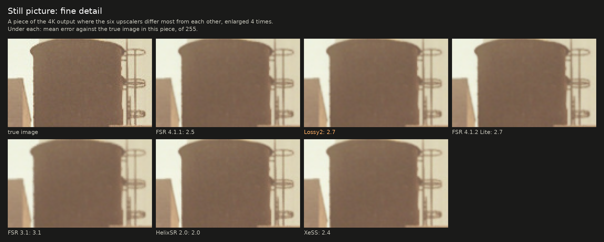

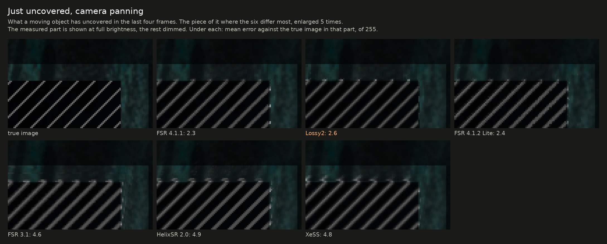

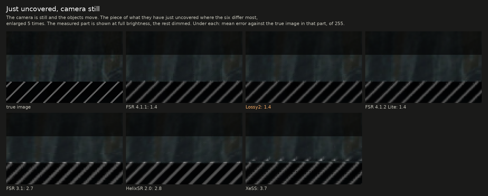

## Things a game draws without motion vectors

Bright dots drawn into the picture only, as games draw sparks and embers. For lossy2 the figures are for the frames
that skip the network; the same alternate frames are measured for the others.

| Scene | FSR 4.1.1 | Lossy2 | FSR 4.1.2 Lite | FSR 3.1 | HelixSR 2.0 | XeSS |
|---|---|---|---|---|---|---|
| Large glowing particles: error of 255 | 0.66 | 1.20 | 0.71 | 3.21 | 0.68 | 1.01 |
| Tiny fast sparks: share of their brightness shown | 83% | 73% | 76% | 40% | 79% | 50% |
| Tiny slow embers: share shown | 81% | 80% | 78% | 53% | 79% | 69% |

FSR 4.1.1, HelixSR and FSR 4.1.2 Lite handle these best. Lossy2 is close on embers and behind on large particles and fast sparks. FSR 3.1
loses more than half of the small ones.

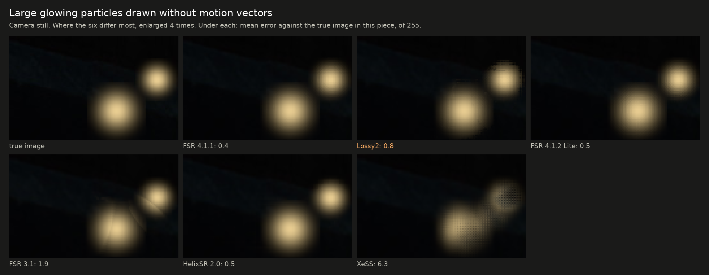

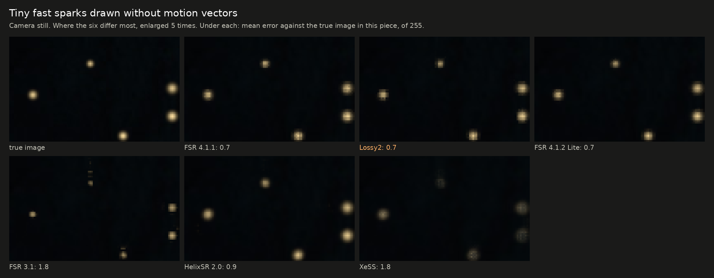

### Rain

Thin bright streaks falling fast, drawn into the picture without motion vectors, over a dark surface with the camera still. The
streaks are faint (about a third of full brightness) and in a new place every frame. There is no fair "true image" to score
this against, so the table counts what is shown: output pixels more than 20 of 255 brighter than the surface, per million, over
eight frames. As the game draws it, about 5,900 per million of its own pixels carry a streak.

|  | FSR 4.1.1 | Lossy2 | FSR 4.1.2 Lite | FSR 3.1 | HelixSR 2.0 | XeSS |
|---|---|---|---|---|---|---|
| Pixels standing out, per million | 0 | 0 | 0 | 1,217 to 1,284 | 8,409 to 8,429 | 94 to 149 |
| The brightest of them, above the surface (of 255) | 7 | 8 | 8 | 44 to 45 | 84 | 18 to 20 |

- **HelixSR shows the rain as the game drew it** (2.0 as 1.2.0 did); FSR 3.1 shows part of it, broken into specks. FSR 4.1.1, lossy2, FSR 4.1.2 Lite and XeSS
  treat streaks this faint and fast as noise and blend them into the surface.
- **Which is right depends on the game.** Rain is meant to be seen; noise of the same shape is not.

## Old image beside moving things

Error against the true image where a thing's image of a frame ago would land if it were left behind, in steps of 255. Lower is better.
The figures are for the frames lossy2 skips the network for.

| A moving object; camera / object, pixels per frame | FSR 4.1.1 | Lossy2 | FSR 4.1.2 Lite | FSR 3.1 | HelixSR 2.0 | XeSS |
|---|---|---|---|---|---|---|
| 12,6 / −6,6 | 0.85 | 0.85 | 0.91 | 0.93 | 3.19 | 1.77 |
| 12,6 / 6,−6 | 1.07 | 1.06 | 1.07 | 1.11 | 2.03 | 1.43 |
| still camera / 8,0 | 1.07 | 1.17 | 1.05 | 1.56 | 1.99 | 1.51 |
| still camera / 6,−6 | 1.74 | 1.91 | 2.53 | 3.43 | 3.67 | 2.43 |
| still camera / −6,6 | 4.01 | 4.13 | 6.01 | 6.96 | 7.74 | 6.56 |
| −16,4 / 8,0 (fast pan against the object's motion) | 3.11 | 3.64 | 4.35 | 5.35 | 4.55 | 18.06 |
| A still bright object over fast ground (the row in the table above) | 1.62 | 2.26 | 1.73 | 3.09 | 2.23 | 2.15 |
| Mean of the seven (the chart's old-image spoke) | 1.92 | 2.15 | 2.52 | 3.20 | 3.63 | 4.84 |

| Thin bars fixed on screen, background panning (pixels per frame); frames with the network and without, mean | FSR 4.1.1 | Lossy2 | FSR 4.1.2 Lite | FSR 3.1 | HelixSR 2.0 | XeSS |
|---|---|---|---|---|---|---|
| 6,0 | 0.94 | 0.92 | 1.36 | 0.96 | 3.92 | 1.26 |
| 12,0 | 0.73 | 0.78 | 1.12 | 0.96 | 3.08 | 3.73 |
| 30,0 | 0.53 | 0.59 | 0.97 | 0.62 | 1.61 | 7.62 |
| 12,4 | 1.09 | 1.17 | 1.68 | 1.63 | 3.33 | 2.81 |
| Mean of the four (the chart's fixed-bars spoke) | 0.82 | 0.87 | 1.28 | 1.04 | 2.98 | 3.85 |

- **Lossy2 is second to FSR 4.1.1 on both means.** Row by row it is level with FSR 4.1.1 or close behind; FSR 4.1.2 Lite is ahead of it in two rows (the still
  camera with the object moving 8,0, and the bright object over fast ground), and HelixSR and XeSS in the second of those.
- **FSR 4.1.2 Lite is third on old image** and behind FSR 3.1 on the fixed bars: it leaves more of a moving object's old image when the camera is still
  and the object moves diagonally (6.01 against FSR 4.1.1's 4.01), and a faint copy of thin bars fixed on screen.

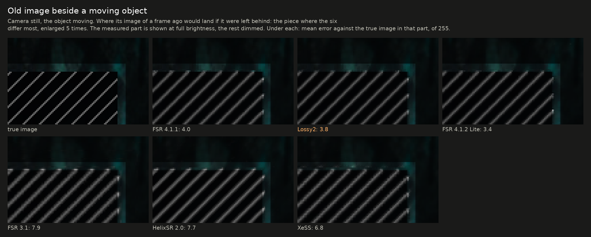

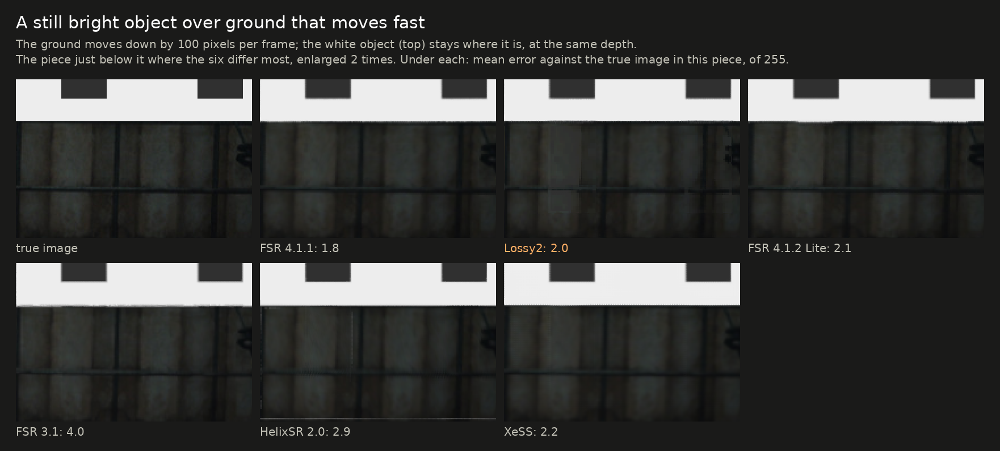

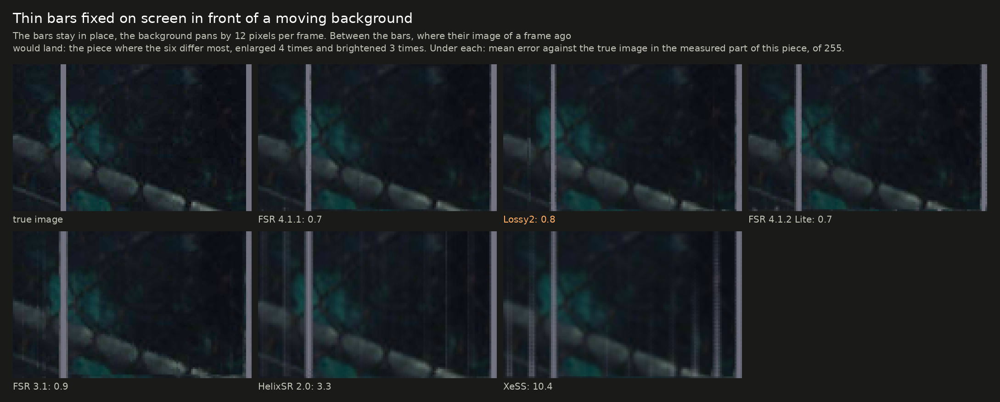

## Steadiness

How much the picture changes from one frame to the next where it should not, in steps of 255. Lower is steadier.

| Scene | FSR 4.1.1 | Lossy2 | FSR 4.1.2 Lite | FSR 3.1 | HelixSR 2.0 | XeSS |
|---|---|---|---|---|---|---|
| Still picture, whole frame | 0.037 | 0.025 | 0.029 | 0.014 | 0.022 | 0.084 |
| Moving scene: background | 0.080 | 0.027 | 0.100 | 0.083 | 0.207 | 0.092 |
| A wire half a pixel wide, camera still | 2.9 | 2.8 | 2.6 | 2.3 | 2.6 | 4.2 |
| The same wire under a slow pan | 7.2 | 4.6 | 9.8 | 8.2 | 5.7 | 10.1 |
| The same wire under a slow pan: its brightness, of 255 (true: 111) | 100 | 74 | 69 | 122 | 133 | 90 |
| ... how close that is to the true brightness (the chart's wire spoke; too bright counts like too dim) | 90.5% | 67.2% | 62.1% | 90.2% | 79.7% | 81.0% |
| Still picture with grain of 6 of 255 | 0.785 | 0.423 | 0.416 | 0.162 | 0.234 | 0.182 |
| Still picture with grain of 10 of 255 | 1.724 | 1.147 | 1.712 | 0.308 | 0.307 | 0.228 |

- **Lossy2 has the steadiest moving background and the steadiest thin wire in a pan** of the six. It draws that wire dimmer than the true image
  (74 of 255 against 111).
- **FSR 4.1.2 Lite draws the wire in a pan dimmest of the six** (69 of 255) and is less steady there than FSR 4.1.1 (9.8 against 7.2); its moving
  background changes a little more per frame than FSR 4.1.1's (0.100 against 0.080).
- **Grain:** FSR 4.1.1 passes grain on almost unchanged, and FSR 4.1.2 Lite does the same at 10 of 255. Lossy2 holds some of it back on the frames it skips;
  FSR 3.1, HelixSR and XeSS hold it back much further.
- Steadier is not always more accurate. FSR 3.1 has the steadiest still picture and the least accurate one.

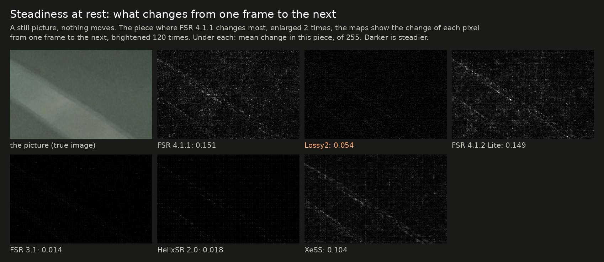

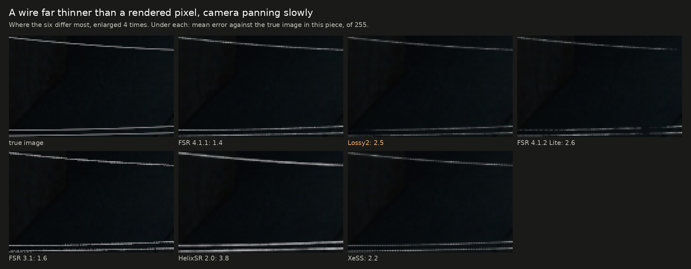

## Speed

Graphics-card time for one upscale call, in milliseconds, at the same render ratio, on a moving picture. Lower is faster (the chart is [near the top](#speed-at-a-glance)).

| Output | FSR 4.1.1 | This project's exact DLL | Lossy2 | FSR 4.1.2 Lite | FSR 3.1 | HelixSR 2.0 | XeSS |
|---|---|---|---|---|---|---|---|
| 1920x1080 | 1.05 | 0.88 | 0.66 | 0.62 | 0.40 | 0.63 | 1.43 |
| 2560x1440 | 2.20 | 1.43 | 1.05 | 1.01 | 0.57 | 0.90 | 2.28 |
| 3840x2160 | 4.86 | 3.14 | 2.24 | 2.00 | 1.16 | 1.83 | 4.99 |
| Mean of the three (the chart's speed spoke) | 2.70 | 1.82 | 1.32 | 1.21 | 0.71 | 1.12 | 2.90 |

- FSR 4.1.1, this project's DLLs (release `dll-2026-10-19`, desktop flavor), FSR 4.1.2 Lite, FSR 3.1 and HelixSR were timed by the same program, 200 calls after 40 to warm
  up, on 2026-10-20, one run each. XeSS has another interface and was timed by a second program over 32 calls, so its column is not measured in quite
  the same way.
- The lossy2 figure is an average over the two kinds of frame: at 4K, 3.25 ms when the network runs and 1.22 ms when it is skipped.
- HelixSR 2.0 is faster than 1.2.0 was on this card (1.83 ms at 4K against 2.00 on the earlier version of this page).
- XeSS runs a different, slower network on cards that are not Intel's than on Intel Arc. These figures say nothing about XeSS on Arc.
- FSR 4.1.2 Lite was made for integrated graphics; this page has it on a desktop card only.
- All of this is under Proton on Linux. On Windows the same card's FSR 4.1.1 timings differ
  ([what is known](results.md)).

## What this page does not show

- **Games.** These are made-up scenes built to isolate one thing each. They are useful for telling upscalers apart, not for
  predicting how a particular game will look.
- **Other cards and systems.** HelixSR's author develops on different hardware; XeSS and FSR 3.1 behave differently across
  vendors. One RX 7800 XT on Linux is one data point.
- **AMD's own FSR 4.1.2 Lite runtime.** Lite was run in this project's harness, not through AMD's driver; AMD's runtime may differ.
- **Other settings.** Each upscaler was run at its defaults. HelixSR can use another network output size and optional sharpening; XeSS has
  auto exposure, which raised its still-picture score here from 42.1 to 42.7 dB when tried; none of that was explored.
- **Other render ratios.** Only the 1.7 ratio was measured.
- **Run-to-run spread.** Single runs.

## How to reproduce it

The scenes and measures are in [`research/pruning`](../research/pruning): `gen_inputs.py` and `gen_motion.py` write the
input frames, `metric_motion.py`, `particles.py`, `wires.py` and `foliage.py` measure the output; `rain.py` writes and measures the rain scene. `fsr4img.c` drives anything
that speaks AMD's FidelityFX interface and selects the upscaler by version name (`4.1.1`, `3.1`, and `HelixSR` for HelixSR 2.0); HelixSR is run by putting its
DLL in the upscaler's place. [`xessmot.c`](../research/pruning/xessmot.c) is the same program for XeSS and needs Intel's
XeSS SDK headers to build and `libxess.dll` to run. None of the other projects' files are in this repository; get them from
their own sources.

Corrections are welcome, most of all from the other projects' authors: if a setting here is unfair to one of them, an issue
on this repository will get it rerun.
