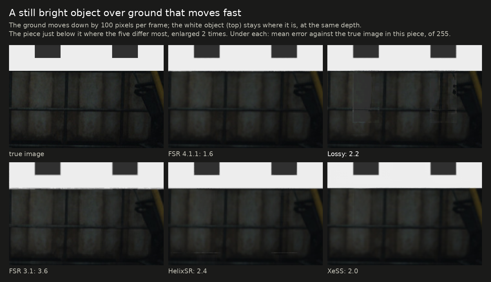
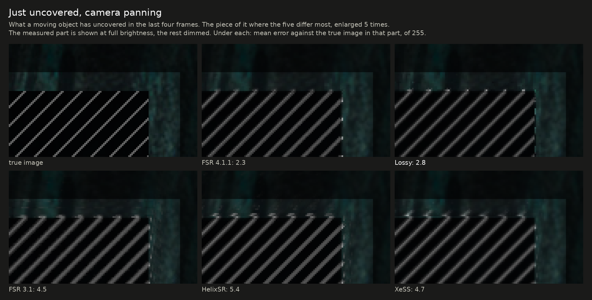
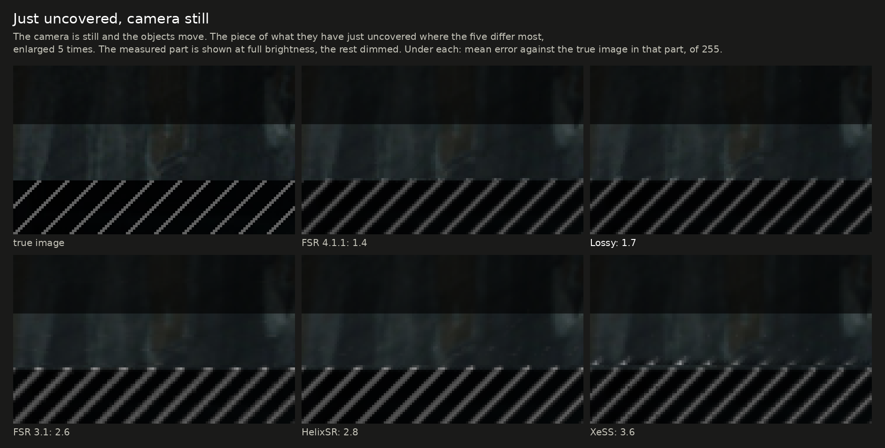
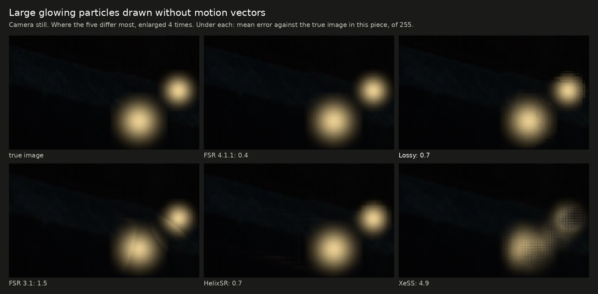
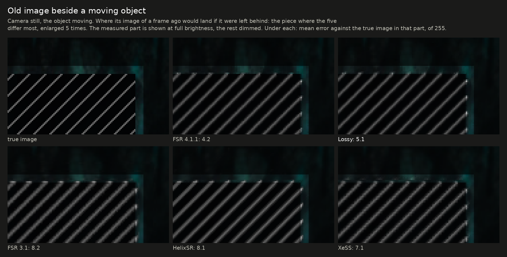
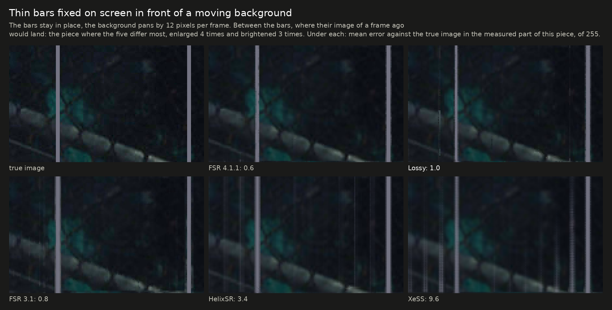
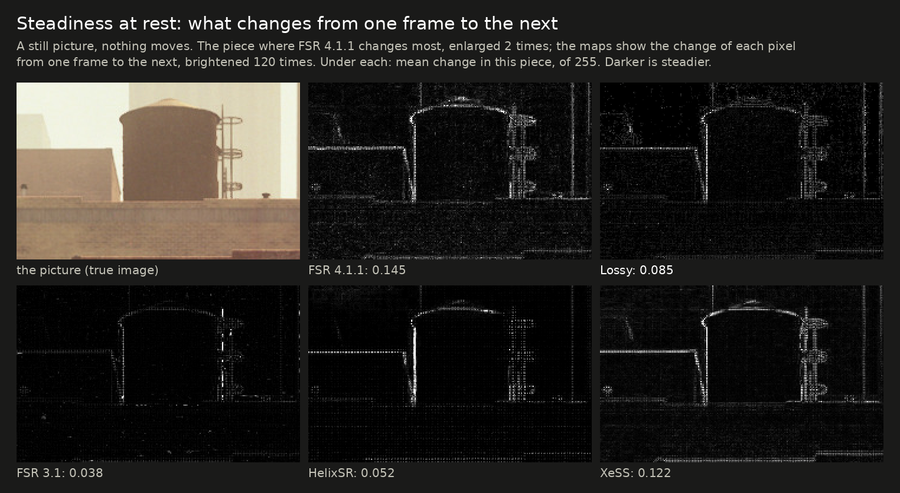

# The lossy DLL beside FSR 3.1, HelixSR and XeSS

[Back to the front page](../README.md) · [Exact and lossy compared](exact-vs-lossy.md)

People compare this project's lossy DLL with other upscalers they can run on the same card. This page puts five of them
through the same test scenes and the same timing, for comparison only. It is not a ranking, and it is not a review of the
other projects.

## In short

- **Picture accuracy:** the lossy DLL stays close to AMD's FSR 4.1.1 and ahead of the other three: within 0.1 dB of FSR 4
  on a still picture, where XeSS, HelixSR and FSR 3.1 are 2 to 4 dB behind.
- **Where the lossy DLL is last of the five:** leaves that sway fast without motion vectors (with slowly swaying leaves it is
  second after FSR 4). A very thin wire in a camera pan it draws dimmer than any of the others, and in a slow pan that wire flickers more than
  with any of them. In film grain it is busier
  than FSR 3.1, HelixSR and XeSS (and steadier than FSR 4).
- **Rain** drawn without motion vectors is where the five differ most to the eye: HelixSR shows the streaks as the game drew
  them, FSR 3.1 shows part of them, and FSR 4, the lossy DLL and XeSS blend faint rain almost entirely into the picture.
- **Speed on this card:** FSR 3.1 is the fastest by a wide margin, then HelixSR and the lossy DLL (the lossy DLL is the faster of the two at 1080p, HelixSR at 4K), then this project's
  exact DLL, with AMD's FSR 4.1.1 and XeSS the slowest.
- **Everything here is one graphics card, made-up scenes and single runs.** A game can come out differently.

<picture>
  <source media="(prefers-color-scheme: dark)" srcset="img/cmp5-radar-dark.svg">
  
</picture>

**How to read it.** One shape per upscaler, all on the same ten spokes. On each spoke the best of the five reaches the outer ring; the
others reach in proportion: a spoke at half length means twice the error (or twice the change per frame, or twice the time) of the
best one, and for sparks half as much of them shown. A bigger shape is better and a dent is a weakness. The dashed outline in each
panel is FSR 4.1.1, for comparison. The spokes do not weigh the same to the eye in a game, so the area of a shape is not a score.
Several spokes are means over more than one scene, so that none rests on the one scene an upscaler does best or worst in; the tables mark those rows.

The charts and pictures on this page are made by [`img/make_upscaler_comparison.py`](img/make_upscaler_comparison.py); the crops show the piece
of the picture where the five differ most from each other, picked by that script from the data.

## What was compared

| Name here | What it is | Version | Settings |
|---|---|---|---|
| FSR 4.1.1 | AMD's FSR 4 (INT8 model) with AMD's own shaders. This project's exact DLL gives the same picture, byte for byte | 4.1.1 | defaults |
| Lossy | this project's lossy DLL: FSR 4.1.1's network on every other frame | release `dll-2026-10-13` (auto exposure is off on this page) | defaults |
| FSR 3.1 | AMD's FSR 3.1 upscaler, from the same AMD file as FSR 4.1.1 | 3.1.5 | defaults |
| HelixSR | a community upscaler that runs NVIDIA's DLSS "Model E" network as ordinary compute shaders behind FSR 3.1's interface | 1.2.0 | defaults (its main network, sharpening off) |
| XeSS | Intel's XeSS, in the form that runs on any graphics card | 2.0.2 | defaults, no auto exposure |

- **Same inputs for all:** the same rendered frames, camera jitter, motion vectors and depth, from the test rig that the
  rest of this repository uses. Output 3840x2160 from 2260x1272, the size FSR calls "Balanced" (XeSS calls this ratio
  "Quality"). No sharpening anywhere.
- **Same measurements:** the last 8 of 40 frames, against the true 4K image.
- **One card:** a Radeon RX 7800 XT on Linux, through Proton.
- **Checked before measuring:** that each upscaler receives the inputs the way it expects. For XeSS the sign of the jitter and
  of the motion vectors was tested both ways and the better one used, which is also what Intel's guide describes. FSR 3.1
  and HelixSR take the same interface as FSR 4.

## Accuracy

Against the true image; higher dB is better, lower error is better.

| Scene | FSR 4.1.1 | Lossy | FSR 3.1 | HelixSR | XeSS |
|---|---|---|---|---|---|
| Still picture | 44.33 dB | 44.26 dB | 39.94 dB | 41.99 dB | 42.14 dB |
| Moving scene: background | 49.27 dB | 48.98 dB | 47.95 dB | 46.92 dB | 47.70 dB |
| Mean of the two rows above (the chart's accuracy spoke) | 46.80 dB | 46.62 dB | 43.95 dB | 44.45 dB | 44.92 dB |
| Moving scene: thin railing | 41.82 dB | 41.34 dB | 38.36 dB | 40.12 dB | 40.86 dB |
| Moving scene: areas a moving object has just uncovered | 34.48 dB | 35.90 dB | 29.22 dB | 27.11 dB | 30.20 dB |
| The same with the camera still and the objects moving | 32.62 dB | 31.77 dB | 29.96 dB | 29.76 dB | 31.53 dB |
| Mean of the two rows above (the chart's uncovered spoke) | 33.55 dB | 33.84 dB | 29.59 dB | 28.44 dB | 30.87 dB |
| A still bright object over fast ground at the same depth: error where its old image lands, of 255 | 1.62 | 2.64 | 3.09 | 2.27 | 2.15 |
| Leaves swaying without motion vectors, camera still: error of 255 | 12.1 | 18.7 | 16.8 | 15.5 | 15.5 |
| The same, camera panning | 10.7 | 18.0 | 15.4 | 16.8 | 16.8 |
| Leaves swaying at two thirds of that speed, camera still | 10.8 | 13.0 | 16.7 | 14.1 | 14.2 |
| Leaves swaying at half that speed, camera still | 10.2 | 11.9 | 16.6 | 13.5 | 13.1 |
| Mean of the three sway speeds above (the chart's foliage spoke) | 11.0 | 14.6 | 16.7 | 14.3 | 14.3 |
| Still leaves, camera panning | 6.2 | 7.5 | 7.6 | 8.2 | 7.4 |

- The lossy DLL is the most accurate after FSR 4 in the still picture, the background and the railing. In just-uncovered areas it is the best of the five
  while the camera pans and second to FSR 4 with the camera still.
- **Behind a still bright object over fast ground it is behind HelixSR and XeSS** and ahead of FSR 3.1; FSR 4 is clearly best there.
  This row came with release `dll-2026-10-11.2`, which fixed a ghost in that case (the release before it scored 6.06).

The lossy DLL is the only one of the five that leaves a visible trace of the object on the ground here, faint as it is. The object
and the ground are at the same depth in this scene; with distinct depths the lossy DLL is at FSR 4's level (1.42 against 1.58).

- **In foliage it depends on how fast the leaves move.** At the rig's usual sway speed the lossy DLL is the least accurate of
  the five: FSR 4's network needs its memory of the frame before to recognize motion without vectors, and with the network
  running on every other frame that memory is too old ([why](../research/frame-skip/README.md#foliage-and-the-networks-memory-release-dll-2026-10-12)).
  At two thirds and at half of that speed it is second only to FSR 4, ahead of XeSS, HelixSR and FSR 3.1. The two slower rows came
  with release `dll-2026-10-12`, which made skipped frames use the network's verdict there (the release before scored 15.0 and 13.5).
  The figures are for the frames that skip the network; on the others the lossy DLL reads 11.9 and 11.1.

The pictures below are of the scenes behind the chart's accuracy, railing, uncovered and foliage spokes: one piece of one frame from each of the five, beside the true image.
Each piece is the one where the five differ most, so it shows the differences at their largest, not a typical part of the frame.

## Things a game draws without motion vectors

Bright dots drawn into the picture only, as games draw sparks and embers. For the lossy DLL the figures are for the frames
that skip the network; the same alternate frames are measured for the others.

| Scene | FSR 4.1.1 | Lossy | FSR 3.1 | HelixSR | XeSS |
|---|---|---|---|---|---|
| Large glowing particles: error of 255 | 0.66 | 1.40 | 3.21 | 0.77 | 1.01 |
| Tiny fast sparks: share of their brightness shown | 83% | 74% | 40% | 79% | 50% |
| Tiny slow embers: share shown | 81% | 81% | 53% | 79% | 69% |

FSR 4 and HelixSR handle these best. The lossy DLL is close on embers and behind on large particles and fast sparks. FSR 3.1
loses more than half of the small ones.

The piece is the one where the five differ most, so it flatters nobody: over the whole scene XeSS scores 1.01 and the lossy DLL 1.40 (the table above).

### Rain

Thin bright streaks falling fast, drawn into the picture without motion vectors, over a dark surface with the camera still. The
streaks are faint (about a third of full brightness) and in a new place every frame. There is no fair "true image" to score
this against, so the table counts what is shown: output pixels more than 20 of 255 brighter than the surface, per million, over
eight frames. As the game draws it, about 5,900 per million of its own pixels carry a streak.

| | FSR 4.1.1 | Lossy | FSR 3.1 | HelixSR | XeSS |
|---|---|---|---|---|---|
| Pixels standing out, per million | 0 | 0 | 1,220 to 1,280 | 8,410 | 90 to 150 |
| The brightest of them, above the surface (of 255) | 7 | 8 | 44 to 45 | 84 | 18 to 20 |

- **HelixSR shows the rain as the game drew it;** FSR 3.1 shows part of it, broken into specks. FSR 4, the lossy DLL and XeSS
  treat streaks this faint and fast as noise and blend them into the surface.
- **Which is right depends on the game.** Rain is meant to be seen; noise of the same shape is not. With brighter, slower streaks
  FSR 4 shows them (about 1,300 per million in that variant, the lossy DLL about 470); the other three were not run on it.
- The lossy DLL follows FSR 4 here only since release `dll-2026-10-11.7`. Before, it showed each streak at full strength and kept
  old ones on screen: about 20,000 pixels per million, more than three times what the game drew
  ([what was wrong](exact-vs-lossy.md#what-the-difference-looks-like)).

## Old image beside moving things

Error against the true image where a thing's image of a frame ago would land if it were left behind, in steps of 255. Lower is better.
The figures are for the frames the lossy DLL skips the network for.

| A moving object; camera / object, pixels per frame | FSR 4.1.1 | Lossy | FSR 3.1 | HelixSR | XeSS |
|---|---|---|---|---|---|
| 12,6 / −6,6 | 0.85 | 0.87 | 0.93 | 2.64 | 1.77 |
| 12,6 / 6,−6 | 1.07 | 1.09 | 1.11 | 1.95 | 1.43 |
| still camera / 8,0 | 1.07 | 1.31 | 1.56 | 1.80 | 1.51 |
| still camera / 6,−6 | 1.74 | 1.89 | 3.43 | 3.53 | 2.43 |
| still camera / −6,6 | 4.01 | 4.66 | 6.96 | 7.29 | 6.56 |
| −16,4 / 8,0 (fast pan against the object's motion) | 3.11 | 4.01 | 5.35 | 4.69 | 18.06 |
| A still bright object over fast ground (the row in the table above) | 1.62 | 2.64 | 3.09 | 2.27 | 2.15 |
| Mean of the seven (the chart's old-image spoke) | 1.92 | 2.35 | 3.20 | 3.45 | 4.84 |

| Thin bars fixed on screen, background panning (pixels per frame); frames with the network and without, mean | FSR 4.1.1 | Lossy | FSR 3.1 | HelixSR | XeSS |
|---|---|---|---|---|---|
| 6,0 | 0.94 | 0.96 | 0.96 | 3.74 | 1.26 |
| 12,0 | 0.73 | 0.83 | 0.97 | 3.05 | 3.74 |
| 30,0 | 0.53 | 0.66 | 0.62 | 1.61 | 7.62 |
| 12,4 | 1.10 | 1.19 | 1.63 | 3.29 | 2.81 |
| Mean of the four (the chart's fixed-bars spoke) | 0.82 | 0.91 | 1.04 | 2.92 | 3.85 |

- **The lossy DLL is second to FSR 4 in both tables,** and ahead of the other three or level with them in every row but two: the bright object over fast ground, where HelixSR and XeSS are ahead,
  and the bars at 30 pixels per frame, where FSR 3.1 is slightly ahead.
- **Old image is still the lossy DLL's own kind of fault against FSR 4:** about a fifth more error on the mean, most of it in the last three object rows.
- **The bars are 3 output pixels wide, 101 apart, at 4K output from 2260x1272,** like every other scene on this page. Release `dll-2026-10-13`
  was made for this case, and at this size the lossy DLL was already close to FSR 4 before it (0.99 on the mean). The fault it answered
  showed at 1440p output rendered at 1440p, where the lossy DLL read up to 4.3 against 0.75 and now reads 0.67 on the frames that run the network and
  up to 3.1 on those that skip it ([the figures](../research/frame-skip/README.md#finer-motion-for-the-rules-a-memory-rule-and-two-cleared-diagonals-release-dll-2026-10-13)).
  The other three upscalers were not run at that size.

## Steadiness

How much the picture changes from one frame to the next where it should not, in steps of 255. Lower is steadier.

| Scene | FSR 4.1.1 | Lossy | FSR 3.1 | HelixSR | XeSS |
|---|---|---|---|---|---|
| Still picture, whole frame | 0.037 | 0.024 | 0.014 | 0.020 | 0.084 |
| Moving scene: background | 0.079 | 0.024 | 0.077 | 0.193 | 0.085 |
| A wire half a pixel wide, camera still | 2.9 | 2.8 | 2.3 | 2.4 | 4.2 |
| The same wire under a slow pan | 7.2 | 10.2 | 8.2 | 5.6 | 10.1 |
| The same wire under a slow pan: its brightness, of 255 (true: 111; the chart's wire spoke is the distance from that) | 100 | 53 | 121 | 135 | 90 |
| Still picture with grain of 6 of 255 | 0.785 | 0.330 | 0.162 | 0.213 | 0.182 |
| Still picture with grain of 10 of 255 | 1.724 | 1.028 | 0.308 | 0.300 | 0.228 |

- The lossy DLL has the steadiest moving background of the five.
- **A thin wire under a slow pan is its weakest steadiness case:** over 40% more flicker than FSR 4, and level with XeSS as the
  least steady of the five. Two light folds added to it: the one in the network's first layer in release `dll-2026-10-12` (9.6 to 10.3) and the one in the last shader in `dll-2026-10-12.2` (to 11.0); fixing a storage fault in the motion record took some of it back in `dll-2026-10-13` (to 10.2). It also draws that wire dimmer than any of them: 53 of 255 against a true 111, where FSR 4 shows 100, XeSS 90,
  FSR 3.1 121 and HelixSR 135.
- **Grain:** FSR 4 passes grain on almost unchanged. The lossy DLL holds some of it back on the frames it skips, but FSR 3.1, HelixSR
  and XeSS all hold it back much further. Release `dll-2026-10-12` gave up steadiness here for the slow-foliage rows above (0.460 and 1.291; the
  release before it read 0.342 and 1.056), and release `dll-2026-10-12.2` won it back with a light fold in the last shader.
- Steadier is not always more accurate. FSR 3.1 has the steadiest still picture and the least accurate one. The wire also
  shows this with the camera still: HelixSR draws it brighter than the true image (143 of 255 against a true 111), FSR 4 and the lossy DLL
  dimmer (67 and 66), XeSS and FSR 3.1 in between (96 and 91).

## Speed

Graphics-card time for one upscale call, in milliseconds, at the same render ratio. Lower is faster.

| Output | FSR 4.1.1 | This project's exact DLL | Lossy | FSR 3.1 | HelixSR | XeSS |
|---|---|---|---|---|---|---|
| 1920x1080 | 1.04 | 0.89 | 0.65 | 0.40 | 0.73 | 1.43 |
| 2560x1440 | 2.19 | 1.44 | 1.03 | 0.57 | 1.00 | 2.28 |
| 3840x2160 | 4.82 | 3.17 | 2.22 | 1.14 | 2.00 | 4.98 |
| Mean of the three (the chart's speed spoke) | 2.68 | 1.83 | 1.30 | 0.70 | 1.24 | 2.90 |

- FSR 4.1.1, the two DLLs of this project, FSR 3.1 and HelixSR were timed by the same program, 200 calls after 40 to warm
  up. XeSS has another interface and was timed by a second program over 32 calls, so its column is not measured in quite
  the same way.
- The lossy figure is an average over the two kinds of frame: at 4K, 3.21 ms when the network runs and 1.22 ms when it is skipped.
- All six columns were timed again on 2026-10-13 with the DLLs of release `dll-2026-10-13`, on the still scene, one run each.
  The table before it, timed a day earlier with `dll-2026-10-12.2`, had 0.63 / 1.02 / 2.21 for the lossy DLL; no column moved by more
  than 0.02 ms. The lossy DLL's 0.02 ms at 1080p matches what the timing kit shows for this release's skipped frame there.
- XeSS runs a different, slower network on cards that are not Intel's than on Intel Arc. These figures say nothing about XeSS on Arc.
- All of this is under Proton on Linux. On Windows the same card's FSR 4.1.1 timings differ
  ([what is known](results.md)).

## What this page does not show

- **Games.** These are made-up scenes built to isolate one thing each. They are useful for telling upscalers apart, not for
  predicting how a particular game will look.
- **Other cards and systems.** HelixSR's author develops on different hardware; XeSS and FSR 3.1 behave differently across
  vendors. One RX 7800 XT on Linux is one data point.
- **Other settings.** Each upscaler was run at its defaults. HelixSR can use another network and optional sharpening; XeSS has
  auto exposure, which raised its still-picture score here from 42.1 to 42.7 dB when tried; none of that was explored.
- **Other render ratios.** Only the 1.7 ratio was measured.
- **Run-to-run spread.** Single runs.

## How to reproduce it

The scenes and measures are in [`research/pruning`](../research/pruning): `gen_inputs.py` and `gen_motion.py` write the
input frames, `metric_motion.py`, `particles.py`, `wires.py` and `foliage.py` measure the output; `rain.py` writes and measures the rain scene. `fsr4img.c` drives anything
that speaks AMD's FidelityFX interface and selects the upscaler by version name (`4.1.1`, `3.1`); HelixSR is run by putting its
DLL in the upscaler's place. [`xessmot.c`](../research/pruning/xessmot.c) is the same program for XeSS and needs Intel's
XeSS SDK headers to build and `libxess.dll` to run. None of the other projects' files are in this repository; get them from
their own sources.

Corrections are welcome, most of all from the other projects' authors: if a setting here is unfair to one of them, an issue
on this repository will get it rerun.
