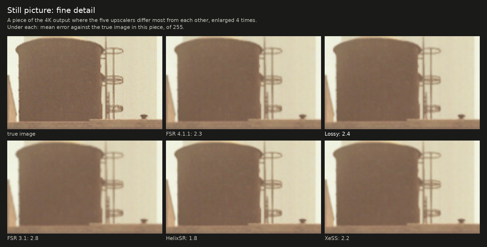
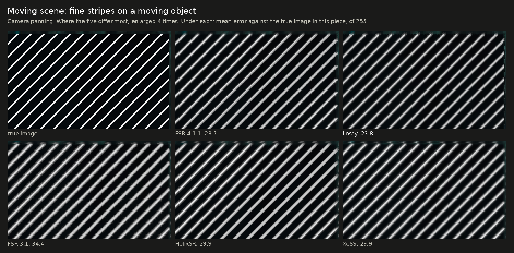
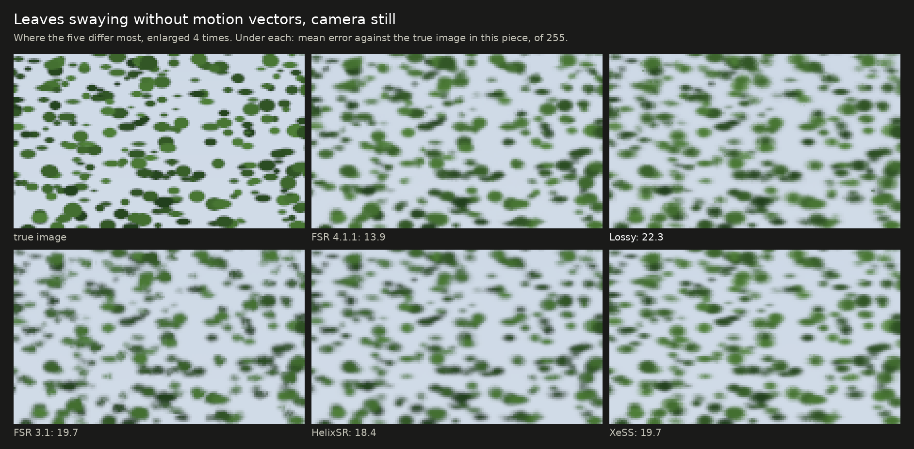
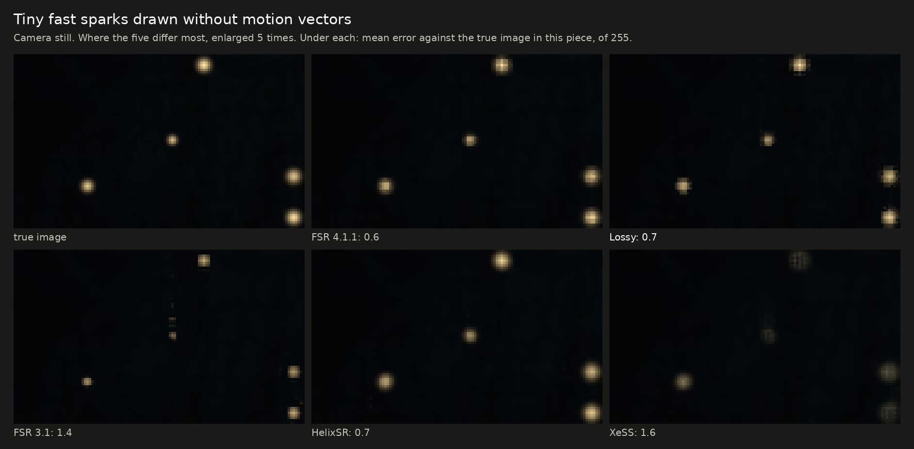
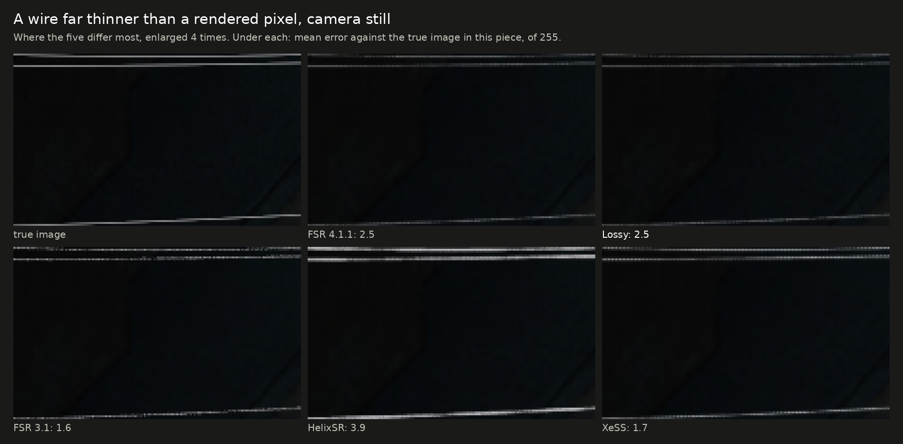
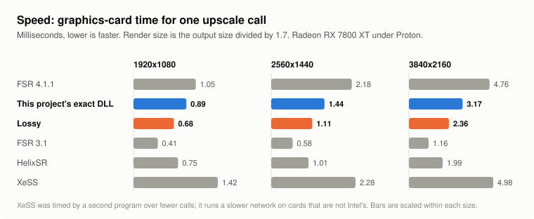

# The lossy DLL beside FSR 3.1, HelixSR and XeSS

[Back to the front page](../README.md) · [Exact and lossy compared](exact-vs-lossy.md)

People compare this project's lossy DLL with other upscalers they can run on the same card. This page puts five of them
through the same test scenes and the same timing, for comparison only. It is not a ranking, and it is not a review of the
other projects.

## In short

- **Picture accuracy:** the lossy DLL stays close to AMD's FSR 4.1.1 and ahead of the other three: within 0.2 dB of FSR 4
  on a still picture, where XeSS, HelixSR and FSR 3.1 are 2 to 4 dB behind.
- **Where the lossy DLL is last of the five:** leaves that sway without motion vectors, and a very thin wire under a slow
  pan. In film grain it is busier than FSR 3.1, HelixSR and XeSS (and far steadier than FSR 4).
- **Speed on this card:** FSR 3.1 is the fastest by a wide margin, then HelixSR, then the lossy DLL, then this project's
  exact DLL, with AMD's FSR 4.1.1 and XeSS the slowest.
- **Everything here is one graphics card, made-up scenes and single runs.** A game can come out differently.

<picture>
  <source media="(prefers-color-scheme: dark)" srcset="img/cmp5-tradeoff-dark.svg">
  
</picture>

The figures on this page are made by [`img/make_upscaler_comparison.py`](img/make_upscaler_comparison.py); the crops show the piece
of the picture where the five differ most from each other, picked by that script from the data.

## What was compared

| Name here | What it is | Version | Settings |
|---|---|---|---|
| FSR 4.1.1 | AMD's FSR 4 (INT8 model) with AMD's own shaders. This project's exact DLL gives the same picture, byte for byte | 4.1.1 | defaults |
| Lossy | this project's lossy DLL: FSR 4.1.1's network on every other frame | release `dll-2026-10-11.2` | defaults |
| FSR 3.1 | AMD's FSR 3.1 upscaler, from the same AMD file as FSR 4.1.1 | 3.1.5 | defaults |
| HelixSR | a community upscaler that runs NVIDIA's DLSS "Model E" network as ordinary compute shaders behind FSR 3.1's interface | 1.2.0 | defaults (its main network, sharpening off) |
| XeSS | Intel's XeSS, in the form that runs on any graphics card | 2.0.2 | defaults, no auto exposure |

- **Same inputs for all:** the same rendered frames, camera jitter, motion vectors and depth, from the test rig that the
  rest of this repository uses. Output 3840x2160 from 2260x1272, the size FSR calls "Balanced" (XeSS calls this ratio
  "Quality"). No sharpening anywhere.
- **Same measurements:** the last 8 of 40 frames, against the true 4K image.
- **One card:** a Radeon RX 7800 XT on Linux, through Proton.
- **Checked before measuring:** that each upscaler receives the inputs the way it expects. For XeSS the sign of the jitter and
  of the motion vectors was tested both ways and the better one used, which is also what Intel's guide describes. FSR 3.1
  and HelixSR take the same interface as FSR 4.

## Accuracy

<picture>
  <source media="(prefers-color-scheme: dark)" srcset="img/cmp5-quality-dark.svg">
  
</picture>

Against the true image; higher dB is better, lower error is better.

| Scene | FSR 4.1.1 | Lossy | FSR 3.1 | HelixSR | XeSS |
|---|---|---|---|---|---|
| Still picture | 44.33 dB | 44.15 dB | 39.94 dB | 41.99 dB | 42.14 dB |
| Moving scene: background | 49.27 dB | 48.72 dB | 47.95 dB | 46.92 dB | 47.70 dB |
| Moving scene: thin railing | 41.82 dB | 41.34 dB | 38.36 dB | 40.12 dB | 40.86 dB |
| Moving scene: areas a moving object has just uncovered | 34.48 dB | 36.34 dB | 29.22 dB | 27.11 dB | 30.20 dB |
| A still bright object over fast ground at the same depth: error where its old image lands, of 255 | 1.62 | 2.57 | 3.09 | 2.27 | 2.15 |
| Leaves swaying without motion vectors, camera still: error of 255 | 12.1 | 18.6 | 16.8 | 15.5 | 15.5 |
| The same, camera panning | 10.7 | 18.2 | 15.4 | 16.8 | 16.8 |
| Still leaves, camera panning | 6.2 | 7.9 | 7.6 | 8.2 | 7.4 |

- The lossy DLL is the most accurate after FSR 4 in the first four rows, and the best of all five in just-uncovered areas.
- **Behind a still bright object over fast ground it is behind HelixSR and XeSS** and ahead of FSR 3.1; FSR 4 is clearly best there.
  This row is new with release `dll-2026-10-11.2`, which fixed a ghost in that case (the release before it scored 6.06).
- **In swaying foliage it is the least accurate of the five.** Its picture there is averaged over about one more frame
  than FSR 4's ([why](exact-vs-lossy.md#limits-of-the-lossy-builds)).

## Things a game draws without motion vectors

Bright dots drawn into the picture only, as games draw sparks and embers. For the lossy DLL the figures are for the frames
that skip the network; the same alternate frames are measured for the others.

| Scene | FSR 4.1.1 | Lossy | FSR 3.1 | HelixSR | XeSS |
|---|---|---|---|---|---|
| Large glowing particles: error of 255 | 0.66 | 1.38 | 3.21 | 0.77 | 1.01 |
| Tiny fast sparks: share of their brightness shown | 83% | 76% | 40% | 79% | 50% |
| Tiny slow embers: share shown | 81% | 81% | 53% | 79% | 69% |

FSR 4 and HelixSR handle these best. The lossy DLL is close on embers and behind on large particles and fast sparks. FSR 3.1
loses more than half of the small ones.

## Steadiness

How much the picture changes from one frame to the next where it should not, in steps of 255. Lower is steadier.

| Scene | FSR 4.1.1 | Lossy | FSR 3.1 | HelixSR | XeSS |
|---|---|---|---|---|---|
| Still picture, whole frame | 0.037 | 0.027 | 0.014 | 0.020 | 0.084 |
| Moving scene: background | 0.079 | 0.032 | 0.077 | 0.193 | 0.085 |
| A wire half a pixel wide, camera still | 2.9 | 3.3 | 2.3 | 2.4 | 4.2 |
| The same wire under a slow pan | 7.2 | 17.9 | 8.2 | 5.6 | 10.1 |
| Still picture with grain of 6 of 255 | 0.785 | 0.294 | 0.162 | 0.213 | 0.182 |
| Still picture with grain of 10 of 255 | 1.724 | 1.046 | 0.308 | 0.300 | 0.228 |

- The lossy DLL has the steadiest moving background of the five.
- **A thin wire under a slow pan is its weakest steadiness case:** about two and a half times FSR 4's flicker, and more than any of the others.
- **Grain:** FSR 4 passes grain on almost unchanged. The lossy DLL holds it back on the frames it skips, but FSR 3.1, HelixSR
  and XeSS all hold it back further.
- Steadier is not always more accurate. FSR 3.1 has the steadiest still picture and the least accurate one. The wire also
  shows this: HelixSR draws it brighter than the true image (143 of 255 against a true 111), FSR 4 and the lossy DLL
  dimmer (67 and 69), XeSS and FSR 3.1 in between (96 and 91).

## Speed

<picture>
  <source media="(prefers-color-scheme: dark)" srcset="img/cmp5-speed-dark.svg">
  
</picture>

Graphics-card time for one upscale call, in milliseconds, at the same render ratio. Lower is faster.

| Output | FSR 4.1.1 | This project's exact DLL | Lossy | FSR 3.1 | HelixSR | XeSS |
|---|---|---|---|---|---|---|
| 1920x1080 | 1.05 | 0.89 | 0.67 | 0.41 | 0.75 | 1.42 |
| 2560x1440 | 2.18 | 1.44 | 1.10 | 0.58 | 1.01 | 2.28 |
| 3840x2160 | 4.76 | 3.17 | 2.34 | 1.16 | 1.99 | 4.98 |

- FSR 4.1.1, the two DLLs of this project, FSR 3.1 and HelixSR were timed by the same program, 200 calls after 40 to warm
  up. XeSS has another interface and was timed by a second program over 32 calls, so its column is not measured in quite
  the same way.
- The lossy figure is an average over the two kinds of frame: at 4K, 3.24 ms when the network runs and 1.44 ms when it is skipped.
- XeSS runs a different, slower network on cards that are not Intel's than on Intel Arc. These figures say nothing about XeSS on Arc.
- All of this is under Proton on Linux. On Windows the same card's FSR 4.1.1 timings differ
  ([what is known](results.md)).

## What this page does not show

- **Games.** These are made-up scenes built to isolate one thing each. They are useful for telling upscalers apart, not for
  predicting how a particular game will look.
- **Other cards and systems.** HelixSR's author develops on different hardware; XeSS and FSR 3.1 behave differently across
  vendors. One RX 7800 XT on Linux is one data point.
- **Other settings.** Each upscaler was run at its defaults. HelixSR can use another network and optional sharpening; XeSS has
  auto exposure, which raised its still-picture score here from 42.1 to 42.7 dB when tried; none of that was explored.
- **Other render ratios.** Only the 1.7 ratio was measured.
- **Run-to-run spread.** Single runs.

## How to reproduce it

The scenes and measures are in [`research/pruning`](../research/pruning): `gen_inputs.py` and `gen_motion.py` write the
input frames, `metric_motion.py`, `particles.py`, `wires.py` and `foliage.py` measure the output. `fsr4img.c` drives anything
that speaks AMD's FidelityFX interface and selects the upscaler by version name (`4.1.1`, `3.1`); HelixSR is run by putting its
DLL in the upscaler's place. [`xessmot.c`](../research/pruning/xessmot.c) is the same program for XeSS and needs Intel's
XeSS SDK headers to build and `libxess.dll` to run. None of the other projects' files are in this repository; get them from
their own sources.

Corrections are welcome, most of all from the other projects' authors: if a setting here is unfair to one of them, an issue
on this repository will get it rerun.
