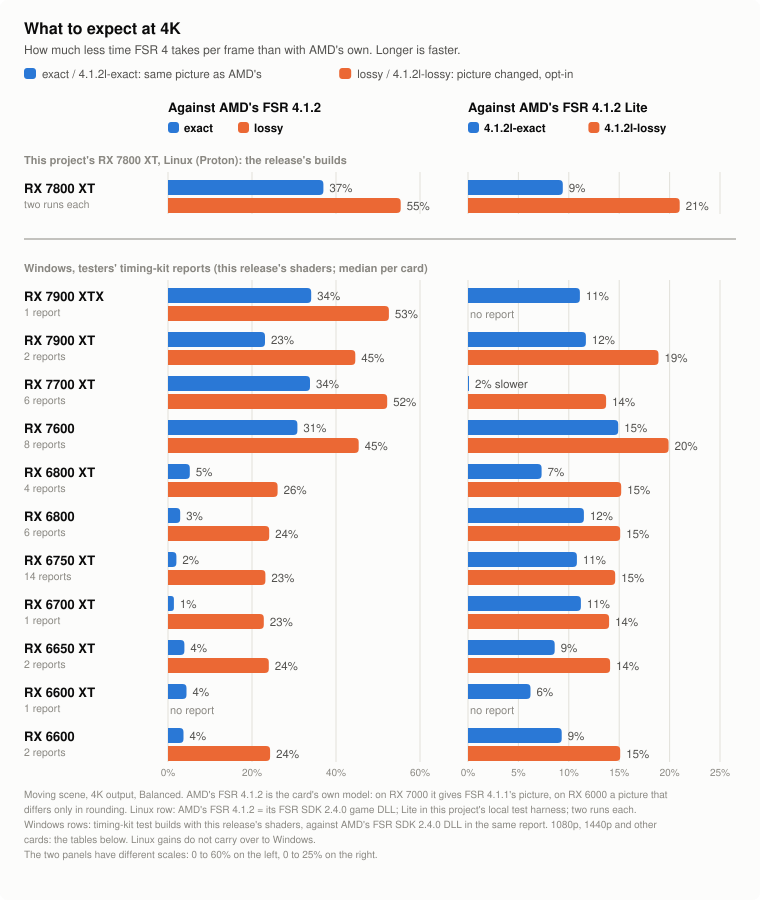

# What to expect

[Back to the README](../README.md)

How much faster this project's builds are depends on the graphics chip, on Windows or Linux, and on the size and mode. The front page shows a
chart per card; this page has the full tables, the notes behind them and an example in one game.

<picture>
  <source media="(prefers-color-scheme: dark)" srcset="img/quickstart-dark.svg">
  
</picture>

- **What the chart compares.** Exact and lossy against AMD's own FSR 4.1.2 on the same card (the model AMD's driver picks there: on RX 7000
  it gives FSR 4.1.1's picture, on RX 6000 a picture that differs only in rounding), and the Lite builds against AMD's FSR 4.1.2 Lite. The
  right column shows how much less time AMD's Lite itself takes than AMD's FSR 4.1.2: Lite is a smaller network with a different picture
  ([how it compares](upscaler-comparison.md)).
- **It depends on your graphics chip, and on Windows or Linux.** Less time per frame than AMD's, moving scene, 1080p / 1440p / 4K
  (exact and lossy against AMD's FSR 4.1.2, the Lite builds against AMD's Lite, the last column Lite against FSR 4.1.2):

  | Graphics card | Source | Exact | Lossy | 4.1.2l-exact | 4.1.2l-lossy | AMD's Lite itself |
  |---|---|---|---|---|---|---|
  | Radeon RX 7800 XT | Linux, this project (release builds) | 15% / 35% / 37% | 35% / 52% / 55% | 10% / 11% / 9% | 19% / 20% / 21% | 40% / 56% / 60% |
  | Radeon RX 7900 XTX | Windows, 1 report | 7% / 29% / 34% | 28% / 44% / 48% | 12% / 13% / 10% | 21% / 21% / 18% | 46% / 55% / 58% |
  | Radeon RX 7900 XT | Windows, 1 report | 4% / 16% / 17% | 25% / 33% / 34% | 15% / 13% / 11% | 20% / 21% / 19% | 42% / 46% / 46% |
  | Radeon RX 7800 XT | Windows, 1 report | 7% / 8% / 9% | 26% / 26% / 27% | 12% / 14% / 12% | 21% / 22% / 20% | 41% / 40% / 41% |
  | Radeon RX 7600 | Windows, 1 report | 24% / 25% / 31% | 37% / 37% / 40% | 18% / 17% / 16% | 23% / 22% / 21% | 50% / 48% / 52% |
  | Radeon RX 6800 XT | Windows, 1 report | 2% / 3% / 6% | 20% / 18% / 20% | 15% / 14% / 10% | 18% / 18% / 17% | 40% / 36% / 34% |
  | Radeon RX 6750 XT | Windows, 3 reports | 1% / 2% / 2% | 18% / 17% / 16% | 14% / 14% / 12% | 16% / 17% / 15% | 38% / 34% / 34% |
  | Radeon RX 6700 XT | Windows, 1 report | 0% / 2% / 2% | 17% / 17% / 16% | 14% / 14% / 13% | 16% / 16% / 14% | 37% / 34% / 34% |
  | Radeon RX 6650 XT | Windows, 3 reports | 3% / 4% / 4% | 18% / 18% / 18% | 10% / 11% / 10% | 14% / 15% / 15% | 36% / 34% / 35% |

  The Windows rows are testers' timing-kit reports (test packs 2026-11-04 and 2026-11-04.2 of the self-updating kit, median per card). Exact and lossy are the DLLs of
  `dll-2026-10-29`, unchanged in this release; the two Lite columns are this release's 4.1.2l-exact and 4.1.2l-lossy (in the Windows rows: the RX 6000 form; the RX 7000 archive's own 4.1.2l-lossy has one Windows report so far, RX 7600: 0.3 to 0.7% faster). Results much slower than the median for the same card model are left out (more than 3 scaled median deviations and more than 3 points; cards with at least 3 reports), because other work on a desktop PC can slow a run; faster ones are kept. One
  report per card is one run. At 1440p, AMD's Lite is the kit's Lite reference less the time one of its passes spends on a whole size class there, which AMD's own
  Lite DLL does not do: taken from each report's own figures, and measured on this project's RX 7800 XT (1.025 → 0.962 ms); 1080p and 4K are as measured.
  The Linux row is this project's own RX 7800 XT with the release's builds (AMD's FSR 4.1.2 there = its FSR SDK 2.4.0
  game DLL, Lite in this project's local test harness; two runs each). The same DLL saves much more under Linux on most Radeon cards, most likely
  because Linux's driver runs two of AMD's shaders (the last pass and network pass 11) in a slower mode than Windows does. We do not yet know
  what decides where a card falls in its range.

  Other graphics chips are not in those kits' reports yet. Earlier builds (`dll-2026-10-15` to `dll-2026-10-19`) against AMD's FSR 4.1.1, 4K,
  reports up to October 17, 2026:

  | Graphics chip | Exact DLL, Windows | Exact DLL, Linux | Lossy DLL, Windows | Lossy DLL, Linux |
  |---|---|---|---|---|
  | Integrated graphics and handhelds (Steam Deck, Radeon 890M) | from 8% faster to 4% slower | 5% (Steam Deck) | 23 to 32% | about 29 to 36% |
  | Intel Arc (B580; integrated Arc in one report) | 6 to 10% | not measured | 30 to 33% | not measured |
  | GeForce (GTX 1650, RTX 3060 Ti, 3090, 5070) | none | not measured | 24 to 37% | not measured |
  | Radeon RX 5000 (RDNA 1, e.g. RX 5700 XT) | not supported: does not work | not supported | not supported: does not work | not supported |
  | RX Vega, Radeon Pro VII | does not work: no picture (RX Vega) | 6% (Pro VII, shaders only) | does not work: no picture (RX Vega) | about 35% (Pro VII, shaders only) |

  Newer, one report (Windows, kit 2026-10-28.2, test builds with this release's shaders): **the built-in graphics of a Ryzen Z1 Extreme (RDNA 3)**,
  1080p / 1440p / 4K. The `igpu-r3` exact DLL takes 5% / 6% / 8% and the lossy DLL 21% / 20% / 21% less time than AMD's FSR 4.1.1 (AMD's FSR 4.1.2
  RX 7000 and RX 6000 models run there at 4.1.1's speed; which model AMD's driver picks on such chips, most likely Lite, is not confirmed).
  4.1.2l-exact takes 5% / 1% / 0% and 4.1.2l-lossy 11% / 11% / 8% less than AMD's Lite, which itself takes 36% / 32% / 36% less than FSR 4.1.1.

  **None of this project's DLLs work on Radeon RX 5000 (RDNA 1) cards,** on Windows or Linux: FSR 4 gives only a black picture there
  ([issue #43](https://github.com/zgauthier2000/fsr4-shader-performance-overrides/issues/43)). On RX Vega cards under Windows it is the same.
  The timing kit's reports from those cards show the same picture for every build, the lossy ones included, which a working FSR 4
  cannot do, so the figures this table used to show for them timed no real upscaling. The Linux figures for the Radeon Pro VII
  come from the Linux kit, which times
  the shaders alone; whether games show a picture on it is not known.
  Most Linux cells rest on one or two runs per card. The Linux lossy figures are derived: the Linux kit times a frame
  that runs the network and a frame that skips it, and the lossy DLL alternates them, so the table gives their average.
  [Results by graphics chip](results.md#by-gpu-type), [timing kit results](../timing-kit/RESULTS.md).
- **It only shows when the graphics card is the limit.** If the processor limits your frame rate,
  the frame rate does not change.
- **The exact DLL cannot change the picture.** Its output was compared with AMD's byte for byte at
  720p, 1080p, 1440p, 4K and 5K, in still and moving scenes. On RX 6000 cards it gives the picture of AMD's own
  FSR 4.1.2 for RX 6000 (the model AMD's driver uses there), which differs from 4.1.1's only in rounding: in recorded
  game clips no difference could be measured ([AMD's 4.1.1 and 4.1.2](amd-411-vs-412.md)). Under Windows, AMD's
  4.1.1 file shows ghosting on RX 6000 cards; the exact DLL does not.
- **The lossy DLL trades a little accuracy for speed.** It runs FSR 4's neural network on every
  other frame and carries its result along with the picture's motion in between. Measured
  differences and comparison crops: [exact and lossy compared](exact-vs-lossy.md). What the
  alternating cost means for frame caps and V-Sync: [frame pacing](frame-pacing.md).

One card, one game, as an example: a Radeon RX 7800 XT under Linux, Shadow of the Tomb Raider's benchmark, 4K output, FSR 4.1.1 Balanced,
with earlier builds (this release's builds have not been run through it yet). Your card and your game will give other numbers:

| | FSR 4 time per frame | Frame rate | Picture |
|---|---|---|---|
| AMD's shaders | 4.16 ms | 97 FPS | the reference |
| Exact | 2.96 ms (−29%) | 109 FPS (+12%) | identical (RX 7000 build, one run, `dll-2026-10-22`) |
| Lossy2 of `dll-2026-10-19` (this release's lossy is it trained further) | 2.09 ms (−50%) | 121 FPS (+25%) | still picture within 0.5 dB of AMD's (one run) |
| The old untrained lossy (last in `dll-2026-10-22`) | 2.06 ms (−50%) | 122 FPS (+26%) | still picture within 0.2 dB of AMD's |

More games and resolutions: [all results](results.md).

Two more notes on the front page: [FSR's debug view and Ultra Performance mode](../README.md#good-to-know).
