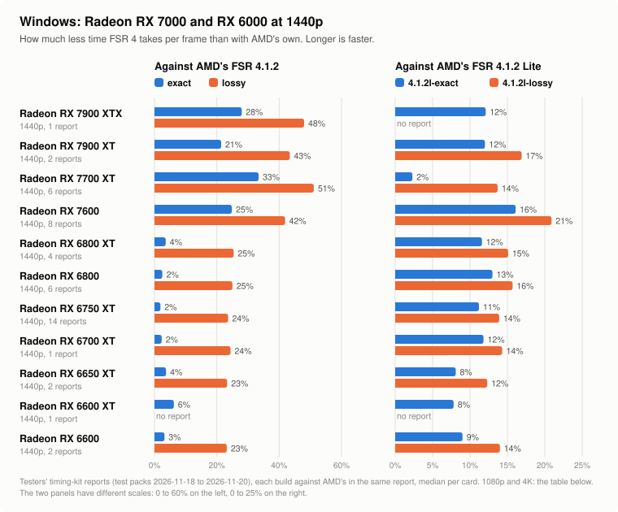
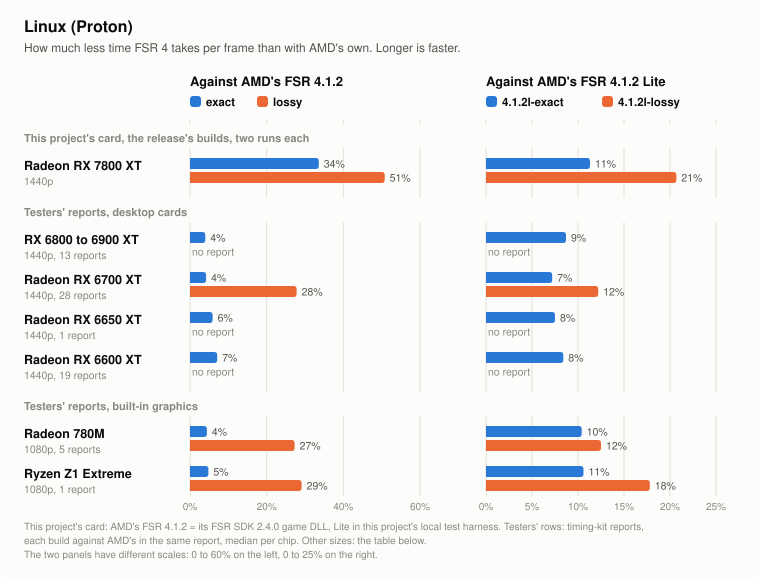
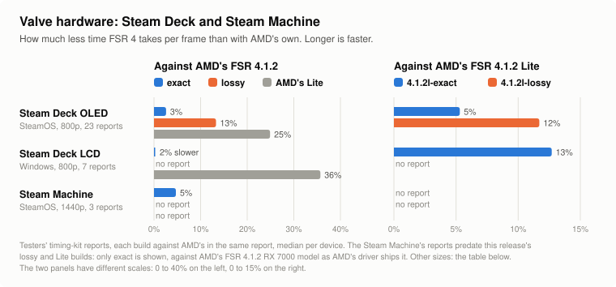
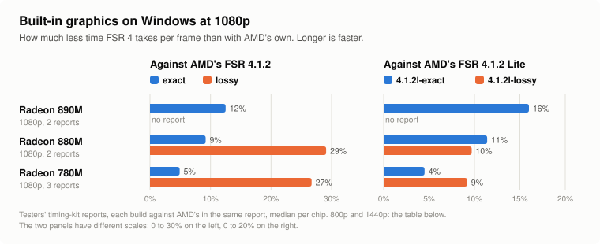

# What to expect

[Back to the README](../README.md)

How much faster this project's builds are depends on the graphics chip, on Windows or Linux, and on the size and mode. The front page shows a
chart per card at 4K; this page has charts per section, with every size in collapsed tables, for release `dll-2026-11-22`: [Windows desktop cards](#windows-radeon-rx-7000-and-rx-6000),
[Linux](#linux), [Valve hardware](#valve-hardware-steam-deck-and-steam-machine), [built-in graphics on Windows](#built-in-graphics-on-windows),
and an example in one game.

<picture>
  <source media="(prefers-color-scheme: dark)" srcset="img/quickstart-dark.svg">
  
</picture>

**How to read the tables.** Each cell is how much less time FSR 4 takes per frame than with AMD's own, moving scene, Balanced, at three output
sizes. Exact and lossy are compared with AMD's own FSR 4.1.2 on the same card (AMD's FSR SDK 2.4.0 DLL running the model for that chip: on RX 7000
and other RDNA 3 chips it gives FSR 4.1.1's picture, on RX 6000 and other RDNA 2 chips a picture that differs only in rounding), the Lite builds with
AMD's FSR 4.1.2 Lite, and the last column shows how much less time AMD's Lite itself takes than AMD's FSR 4.1.2: Lite is a smaller network with a
different picture ([how it compares](upscaler-comparison.md)). "Slower" means more time than AMD's. "No report" means no tester has timed that
build on that chip yet.

**Where the figures come from.** Testers' timing-kit reports (the self-updating kit's test builds with this release's shaders), each build compared
with AMD's in the same report, then the median per chip; this project's own RX 7800 XT under Linux with the release's builds. One report is one run.
A report whose AMD reference ran far slower than the same AMD model in another slot of the same run is left out at that size.

## Windows: Radeon RX 7000 and RX 6000

Test packs 2026-11-18 to 2026-11-20; the table: 1080p / 1440p / 4K. Results much slower than the median for the same card model are left out (more than 3 scaled
median deviations and more than 3 points; cards with at least 3 reports), because other work on a desktop PC can slow a run; faster ones are kept.

<picture>
  <source media="(prefers-color-scheme: dark)" srcset="img/wte-windows-dark.svg">
  
</picture>

All sizes, as a table

| Graphics card | Reports | Exact | Lossy | 4.1.2l-exact | 4.1.2l-lossy | AMD's Lite itself |
|---|---|---|---|---|---|---|
| Radeon RX 7900 XTX | 1 | 6% / 28% / 34% | 34% / 48% / 53% | 11% / 12% / 11% | no report | 46% / 56% / 59% |
| Radeon RX 7900 XT | 2 | 9% / 21% / 23% | 34% / 43% / 45% | 11% / 12% / 12% | 18% / 17% / 19% | 46% / 52% / 51% |
| Radeon RX 7700 XT | 6 | 33% / 33% / 34% | 51% / 51% / 52% | 7% / 2% / 2% slower | 16% / 14% / 14% | 59% / 58% / 57% |
| Radeon RX 7600 | 8 | 24% / 25% / 31% | 42% / 42% / 45% | 17% / 16% / 15% | 22% / 21% / 20% | 51% / 50% / 53% |
| Radeon RX 6800 XT | 4 | 2% / 4% / 5% | 27% / 25% / 26% | 13% / 12% / 7% | 16% / 15% / 15% | 42% / 39% / 36% |
| Radeon RX 6800 | 6 | 2% / 2% / 3% | 26% / 25% / 24% | 14% / 13% / 12% | 16% / 16% / 15% | 40% / 38% / 35% |
| Radeon RX 6750 XT | 14 | 0% / 2% / 2% | 24% / 24% / 23% | 14% / 11% / 11% | 14% / 14% / 15% | 39% / 36% / 35% |
| Radeon RX 6700 XT | 1 | 1% / 2% / 1% | 26% / 24% / 23% | 13% / 12% / 11% | 15% / 14% / 14% | 40% / 37% / 35% |
| Radeon RX 6650 XT | 2 | 3% / 4% / 4% | 24% / 23% / 24% | 8% / 8% / 9% | 13% / 12% / 14% | 38% / 36% / 36% |
| Radeon RX 6600 XT | 1 | 4% / 6% / 4% | no report | 8% / 8% / 6% | no report | 38% / 36% / 36% |
| Radeon RX 6600 | 2 | 2% / 3% / 4% | 24% / 23% / 24% | 9% / 9% / 9% | 14% / 14% / 15% | 36% / 35% / 36% |

The RX 7000 rows time the RX 7000 archive's `4.1.2l-lossy` in its Windows form; the RX 6000 rows the RX 6000 archive's.

## Linux

Under Linux (Proton), the same DLLs save much more on most Radeon cards than under Windows, most likely because Linux's driver runs two of AMD's
shaders (the last pass and network pass 11) in a slower mode than Windows does. Under Linux, the RX 7000 archive's `4.1.2l-lossy` runs its Linux form.

<picture>
  <source media="(prefers-color-scheme: dark)" srcset="img/wte-linux-dark.svg">
  
</picture>

All sizes, as a table

Desktop cards 1080p / 1440p / 4K (testers: test packs from 2026-11-06; the lossy builds only from 2026-11-19), built-in graphics 800p / 1080p / 1440p (the archive for RDNA 3 built-in graphics):

| Graphics chip | Reports | Exact | Lossy | 4.1.2l-exact | 4.1.2l-lossy | AMD's Lite itself |
|---|---|---|---|---|---|---|
| Radeon RX 7800 XT | this project, two runs each | 13% / 34% / 37% | 35% / 51% / 55% | 14% / 11% / 9% | 24% / 21% / 21% | 37% / 55% / 59% |
| Radeon RX 6800 / 6800 XT / 6900 XT | 13 | 4% / 4% / 6% | no report | 7% / 9% / 8% | no report | 38% / 38% / 36% |
| Radeon RX 6700 XT | 28 (3 with the lossy builds) | 3% / 4% / 5% | 28% / 28% / 28% | 7% / 7% / 8% | 15% / 12% / 13% | 38% / 37% / 36% |
| Radeon RX 6650 XT | 1 | 4% / 6% / 6% | no report | 7% / 8% / 2% | no report | 36% / 34% / 36% |
| Radeon RX 6600 XT | 19 | 7% / 7% / 7% | no report | 8% / 8% / 5% | no report | 38% / 36% / 37% |
| Radeon 780M | 5 (1 with the lossy builds) | 4% / 4% / 4% | 26% / 27% / 26% | 10% / 10% / 10% | 9% / 12% / 11% | 42% / 40% / 39% |
| Ryzen Z1 Extreme | 1 | 6% / 5% / 6% | 29% / 29% / 28% | 10% / 11% / 10% | 15% / 18% / 17% | 41% / 40% / 39% |

## Valve hardware: Steam Deck and Steam Machine

The Steam Deck takes the Steam Deck / older built-in graphics archive (`igpu-rdna2`), whose `exact` uses AMD's own prepass from AMD's FSR SDK 2.4.0;
the Steam Machine takes the RX 7000 archive. AMD's FSR 4.1.2 here is the RX 6000 model on the Steam Deck and the RX 7000 model on the Steam Machine.

The Steam Machine's three reports all predate this release's lossy and Lite builds, so only `exact` (unchanged since then) can be shown.

<picture>
  <source media="(prefers-color-scheme: dark)" srcset="img/wte-valve-dark.svg">
  
</picture>

All sizes, as a table

Steam Deck 800p / 1080p / 1440p (test packs from 2026-11-06; the lossy builds only from 2026-11-19); Steam Machine 1080p / 1440p / 4K (packs of 2026-11-02 to 2026-11-04, reference AMD's FSR 4.1.2 RX 7000 model as AMD's driver ships it):

| Device | Reports | Exact | Lossy | 4.1.2l-exact | 4.1.2l-lossy | AMD's Lite itself |
|---|---|---|---|---|---|---|
| Steam Deck OLED, SteamOS | 23 (6 with the lossy builds) | 3% / 5% / 5% | 13% / 25% / 27% | 5% / 6% / 9% | 12% / 11% / 16% | 25% / 34% / 35% |
| Steam Deck LCD, Windows | 7 | 2% slower / 0% / 2% | no report | 13% / 8% / 12% | no report | 36% / 32% / 36% |
| Steam Machine, SteamOS | 3 | 4% / 5% / 10% | no report | no report | no report | no report |

## Built-in graphics on Windows

800p / 1080p / 1440p, the built-in graphics archive for RDNA 3 (test packs from 2026-11-06; the lossy builds only from 2026-11-19). On the Radeon
780M / 880M this release's `4.1.2l-lossy` is 1 to 4% slower than `dll-2026-11-05`'s (three reports), still faster than AMD's Lite.

<picture>
  <source media="(prefers-color-scheme: dark)" srcset="img/wte-igpu-dark.svg">
  
</picture>

All sizes, as a table

800p / 1080p / 1440p:

| Graphics chip | Reports | Exact | Lossy | 4.1.2l-exact | 4.1.2l-lossy | AMD's Lite itself |
|---|---|---|---|---|---|---|
| Radeon 890M | 2 | 8% / 12% / 12% | no report | 13% / 16% / 14% | no report | 62% / 44% / 43% |
| Radeon 880M | 2 | 8% / 9% / 12% | 32% / 29% / 30% | 12% / 11% / 14% | 14% / 10% / 15% | 40% / 40% / 39% |
| Radeon 780M | 3 (1 with the lossy builds) | 5% / 5% / 5% | 28% / 27% / 25% | 6% / 4% / 2% | 8% / 9% / 8% | 38% / 38% / 38% |

GeForce, Intel Arc and older Radeon cards have not been timed with this release's builds. Figures of earlier builds:
[results by graphics chip](results.md#by-gpu-type), [timing kit results](../timing-kit/RESULTS.md).

**None of this project's DLLs work on Radeon RX 5000 (RDNA 1) cards,** on Windows or Linux: FSR 4 gives only a black picture there
([issue #43](https://github.com/zgauthier2000/fsr4-shader-performance-overrides/issues/43)). On RX Vega cards under Windows it is the same.
The timing kit's reports from those cards show the same picture for every build, the lossy ones included, which a working FSR 4
cannot do, so figures from them timed no real upscaling.

## Good to know

- **It only shows when the graphics card is the limit.** If the processor limits your frame rate, the frame rate does not change.
- **The exact DLL cannot change the picture.** Its output was compared with AMD's byte for byte at
  720p, 1080p, 1440p, 4K and 5K, in still and moving scenes. On RX 6000 cards it gives the picture of AMD's own
  FSR 4.1.2 for RX 6000 (the model AMD's driver uses there), which differs from 4.1.1's only in rounding: in recorded
  game clips no difference could be measured ([AMD's 4.1.1 and 4.1.2](amd-411-vs-412.md)). Under Windows, AMD's
  4.1.1 file shows ghosting on RX 6000 cards; the exact DLL does not.
- **The lossy DLLs trade a little accuracy for speed.** They run FSR 4's neural network on every
  other frame and carry its result along with the picture's motion in between. Measured
  differences and comparison crops: [exact and lossy compared](exact-vs-lossy.md). What the
  alternating cost means for frame caps and V-Sync: [frame pacing](frame-pacing.md).

## Example: one game

One card, one game: a Radeon RX 7800 XT under Linux, Shadow of the Tomb Raider's benchmark, 4K output, FSR 4.1.1 Balanced,
with earlier builds (this release's builds have not been run through it yet). Your card and your game will give other numbers:

| | FSR 4 time per frame | Frame rate | Picture |
|---|---|---|---|
| AMD's shaders | 4.16 ms | 97 FPS | the reference |
| Exact | 2.96 ms (−29%) | 109 FPS (+12%) | identical (RX 7000 build, one run, `dll-2026-10-22`) |
| Lossy2 of `dll-2026-10-19` (this release's lossy is it trained further) | 2.09 ms (−50%) | 121 FPS (+25%) | still picture within 0.5 dB of AMD's (one run) |
| The old untrained lossy (last in `dll-2026-10-22`) | 2.06 ms (−50%) | 122 FPS (+26%) | still picture within 0.2 dB of AMD's |

More games and resolutions: [all results](results.md).

Two more notes on the front page: [FSR's debug view and Ultra Performance mode](../README.md#good-to-know).
