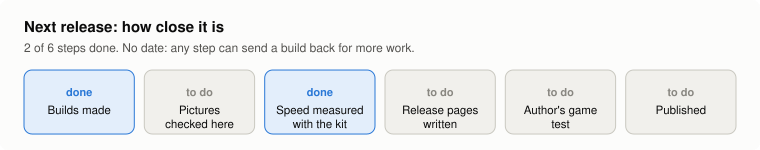
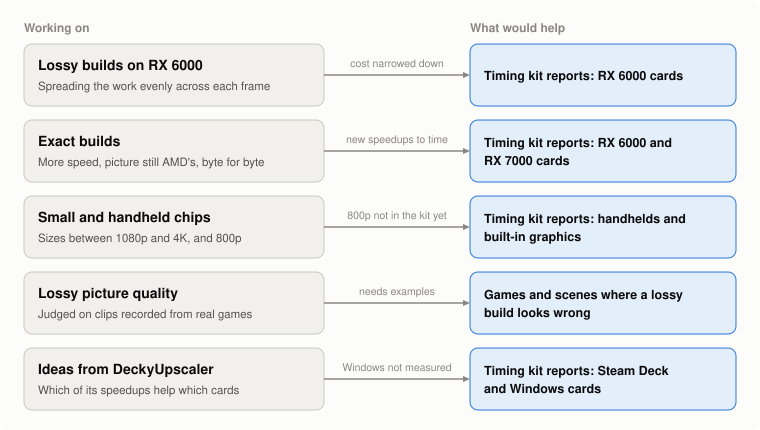
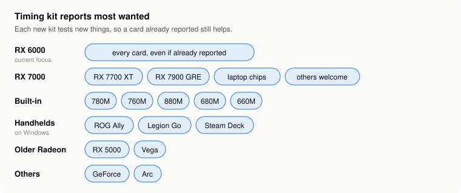
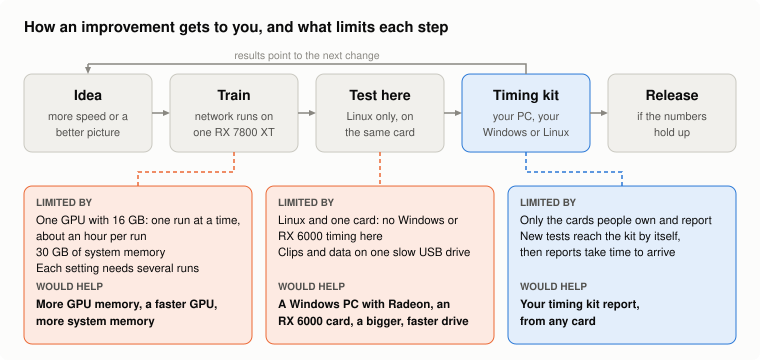
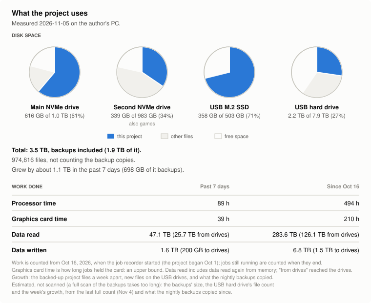

# What's moving

What this project is working on, and how you can help. These are aims, not promises, and nothing here is a release date.

Last updated: 2026-11-06.

<picture><source media="(prefers-color-scheme: dark)" srcset="img/wm-release-dark.svg"></picture>

<picture><source media="(prefers-color-scheme: dark)" srcset="img/wm-now-dark.svg"></picture>

**The timing kit now also times AMD's FSR 4.1.2 Lite as AMD's own FSR SDK 2.4.0 ships it** (the Lite that OptiScaler offers as "FSR 4.1.2" with the INT8 Lite model), next to the Lite this project has compared against so far. Kits from 2026-11-03 on pick this test up by themselves. We are also looking at what AMD's SDK does differently, to bring any speedup to this project's Lite builds first, and then the same check for the full FSR 4 builds (`exact` and `lossy`). Reports from RX 7000 cards on Windows and from handhelds are the most wanted for it.

**A cleaner Lite is measured against AMD's own FSR 4.1.2 Lite,** unchanged: the aim is a build that keeps Lite's strengths and fixes the places where it looks worse than AMD's full FSR 4, such as fine patterns that crawl. It is early and not in any release; it would not be AMD's picture, so it would be neither exact nor lossy. The current try learns, pixel by pixel, from whichever of AMD's Lite and full FSR 4 is closer to the true picture of the test scenes, so it should keep Lite where Lite is already better. The lag is now mostly fixed: earlier tries followed a brightening or fading scene clearly more slowly than AMD's Lite, and the newest is close to it. The current runs work on still scenes, where thin lines such as wires shimmer more than in AMD's Lite; ghost outlines behind moving objects are next.

**Tiled lossy is an internal experiment,** tested only through the timing kit: it is not in any release, and the released lossy builds do not work this way. It splits each frame into tiles that skip the network at different times, instead of skipping it on the whole frame every other frame.

<picture><source media="(prefers-color-scheme: dark)" srcset="img/wm-cards-dark.svg"></picture>

**To send a report:** download [the Windows timing kit](https://github.com/zgauthier2000/fsr4-shader-performance-overrides/releases/download/timing-kit-2026-11-03/fsr4-timing-kit-windows-2026-11-03.zip), unpack it and run `fsr4time.exe`, or [the Linux and Steam Deck kit](https://github.com/zgauthier2000/fsr4-shader-performance-overrides/releases/download/timing-kit-2026-11-03/fsr4-timing-kit-linux-2026-11-03.tar.gz), which runs under Proton: unpack it and run `bash run.sh`. It tests this project's experiments on your card. Kits from 2026-11-03 on download new tests by themselves when they start, so there is no need to download a new kit for them. [More about the kit](../timing-kit/README.md).

<picture><source media="(prefers-color-scheme: dark)" srcset="img/wm-path-dark.svg"></picture>

<picture><source media="(prefers-color-scheme: dark)" srcset="img/wm-stats-dark.svg"></picture>
