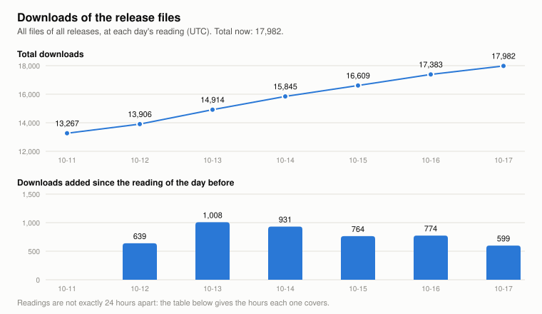

# Downloads of the release files

**Total downloads: 25,507**

Updated 2026-10-31 10:54 UTC; counted since 2026-10-11 22:32 UTC. Files that were replaced before then are not in it. Since counting began: 12,240 downloads in 19.5 days, 627 per 24 hours on average.

<picture>
  <source media="(prefers-color-scheme: dark)" srcset="downloads-dark.svg">
  
</picture>

## Per day

One line per day (UTC), from that day's last reading. "Added" is what came in since the last reading of the day before; the readings are not exactly 24 hours apart, so the hours each one covers are given.

| Day | Read at | Total | Added | Hours covered | Added: DLLs, desktop | Added: DLLs, integrated | Added: Windows kit | Added: Linux kit |
|---|---|---|---|---|---|---|---|---|
| 2026-10-31 | 10:54 | 25,507 | 621 | 23.5 | 317 | 157 | 112 | 0 |
| 2026-10-30 | 11:23 | 24,886 | 1,041 | 23.9 | 508 | 283 | 111 | 10 |
| 2026-10-29 | 11:29 | 23,845 | 218 | 24.2 | 97 | 36 | 73 | 0 |
| 2026-10-28 | 11:19 | 23,627 | 180 | 24.8 | 90 | 52 | 23 | 0 |
| 2026-10-27 | 10:31 | 23,447 | 249 | 23.4 | 136 | 81 | 24 | 0 |
| 2026-10-26 | 11:04 | 23,198 | 363 | 25.3 | 180 | 104 | 53 | 0 |
| 2026-10-25 | 09:47 | 22,835 | 423 | 24.3 | 196 | 146 | 68 | 0 |
| 2026-10-24 | 09:31 | 22,412 | 711 | 23.5 | 356 | 266 | 27 | 0 |
| 2026-10-23 | 10:01 | 21,701 | 553 | 23.9 | 331 | 130 | 36 | 1 |
| 2026-10-22 | 10:09 | 21,148 | 624 | 24.1 | 382 | 153 | 48 | 0 |
| 2026-10-21 | 10:06 | 20,524 | 758 | 24.1 | 495 | 154 | 54 | 0 |
| 2026-10-20 | 10:01 | 19,766 | 574 | 23.3 | 403 | 86 | 69 | 0 |
| 2026-10-19 | 10:44 | 19,192 | 599 | 25.1 | 335 | 118 | 125 | 0 |
| 2026-10-18 | 09:35 | 18,593 | 611 | 24.3 | 411 | 114 | 68 | 0 |
| 2026-10-17 | 09:19 | 17,982 | 599 | 23.6 | 439 | 99 | 45 | 0 |
| 2026-10-16 | 09:46 | 17,383 | 774 | 23.9 | 498 | 158 | 87 | 0 |
| 2026-10-15 | 09:52 | 16,609 | 764 | 23.7 | 506 | 159 | 52 | 13 |
| 2026-10-14 | 10:10 | 15,845 | 931 | 21.2 | 611 | 190 | 93 | 17 |
| 2026-10-13 | 12:59 | 14,914 | 1,008 | 23.9 | 714 | 163 | 94 | 20 |
| 2026-10-12 | 13:08 | 13,906 | 639 | 14.6 | 450 | 112 | 55 | 8 |
| 2026-10-11 | 22:32 | 13,267 | counting began | | | | | |

The four columns on the right do not add up to "Added": checksum files and other small files are downloaded too.

## By kind and by release

| Kind of download | Downloads | Of these, in files since replaced |
|---|---|---|
| DLLs: desktop cards and other | 19,189 | 0 |
| DLLs: integrated graphics | 4,019 | 0 |
| Timing kit: Linux | 71 | 0 |
| Timing kit: Windows | 1,323 | 0 |

| Archive, by graphics (since `dll-2026-10-22`, .zip and .7z together) | Downloads |
|---|---|
| RX 7000 (rx7000) | 746 |
| RX 6000 (rx6000) | 1,069 |
| Integrated RDNA 3, GeForce, Arc, others (igpu rdna3) | 614 |
| Steam Deck, 680M, older integrated (igpu rdna2) | 491 |

| Release | Downloads | Of these, in files since replaced |
|---|---|---|
| `timing-kit-2026-10-31` | 0 | 0 |
| `timing-kit-2026-10-30.9` | 30 | 0 |
| `timing-kit-2026-10-30.8` | 15 | 0 |
| `timing-kit-2026-10-30.7` | 9 | 0 |
| `timing-kit-2026-10-30.6` | 8 | 0 |
| `timing-kit-2026-10-30.5` | 5 | 0 |
| `timing-kit-2026-10-30.4` | 14 | 0 |
| `timing-kit-2026-10-30.3` | 8 | 0 |
| `timing-kit-2026-10-30.2` | 12 | 0 |
| `timing-kit-2026-10-30` | 13 | 0 |
| `timing-kit-2026-10-29.2` | 55 | 0 |
| `timing-kit-2026-10-29` | 35 | 0 |
| `dll-2026-10-29` | 1,037 | 0 |
| `timing-kit-2026-10-28.2` | 54 | 0 |
| `timing-kit-2026-10-28` | 19 | 0 |
| `timing-kit-2026-10-25.2` | 81 | 0 |
| `timing-kit-2026-10-25` | 12 | 0 |
| `timing-kit-2026-10-24` | 71 | 0 |
| `timing-kit-2026-10-22` | 75 | 0 |
| `dll-2026-10-22` | 2,065 | 0 |
| `timing-kit-2026-10-19` | 146 | 0 |
| `dll-2026-10-19` | 1,680 | 0 |
| `timing-kit-2026-10-18.3` | 85 | 0 |
| `timing-kit-2026-10-18.2` | 35 | 0 |
| `timing-kit-2026-10-18` | 54 | 0 |
| `timing-kit-2026-10-15.3` | 139 | 0 |
| `timing-kit-2026-10-15.2` | 23 | 0 |
| `timing-kit-2026-10-15` | 69 | 0 |
| `dll-2026-10-15` | 2,012 | 0 |
| `timing-kit-2026-10-14` | 69 | 0 |
| `dll-2026-10-14` | 728 | 0 |
| `timing-kit-2026-10-13.2` | 90 | 0 |
| `timing-kit-2026-10-13` | 57 | 0 |
| `dll-2026-10-13.2` | 569 | 0 |
| `dll-2026-10-13` | 350 | 0 |
| `timing-kit-2026-10-12.6` | 56 | 0 |
| `timing-kit-2026-10-12.5` | 12 | 0 |
| `timing-kit-2026-10-12.4` | 40 | 0 |
| `timing-kit-2026-10-12.3` | 84 | 0 |
| `dll-2026-10-12.2` | 373 | 0 |
| `dll-2026-10-12` | 300 | 0 |
| `dll-2026-10-11.7` | 640 | 0 |
| `dll-2026-10-11.6` | 68 | 0 |
| `dll-2026-10-11.5` | 320 | 0 |
| `dll-2026-10-11.4` | 415 | 0 |
| `dll-2026-10-11.3` | 485 | 0 |
| `dll-2026-10-11.2` | 192 | 0 |
| `dll-2026-10-11` | 109 | 0 |
| `dll-2026-10-10` | 599 | 0 |
| `dll-2026-10-09` | 761 | 0 |
| `dll-2026-10-07` | 6,076 | 0 |
| `dll-2026-10-06.6` | 4,096 | 0 |
| `dll-2026-10-06.5` | 72 | 0 |
| `dll-2026-10-06.4` | 27 | 0 |
| `dll-2026-10-06.3` | 58 | 0 |
| `dll-2026-10-06.2` | 73 | 0 |
| `dll-2026-10-06` | 47 | 0 |
| `dll-2026-10-05.4` | 110 | 0 |
| `dll-2026-10-05.3` | 105 | 0 |
| `dll-2026-10-05.2` | 64 | 0 |
| `dll-2026-10-05` | 62 | 0 |
| `timing-kit-2026-10-05` | 26 | 0 |
| `dll-2026-10-04.5` | 144 | 0 |
| `dll-2026-10-04.4` | 13 | 0 |
| `dll-2026-10-04.3` | 90 | 0 |
| `dll-2026-10-04.2` | 95 | 0 |
| `dll-2026-10-04` | 37 | 0 |
| `dll-2026-10-03` | 134 | 0 |

All files: 25,507. `downloads.csv` has a line for every day a file's count changed; `runs.csv` has the totals of every run.
