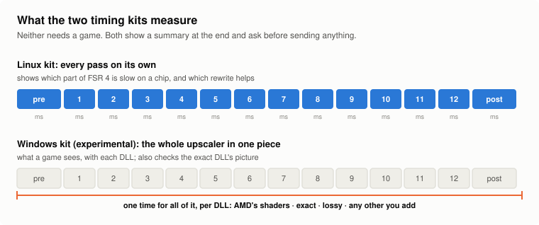

# Timing kit: FSR 4.1.1's shaders, pass by pass, on your GPU

[Back to the front page](../README.md)

A folder you download and run on Linux. It times each of FSR 4.1.1's shader passes on your GPU
with AMD's shaders and with this repository's rewrites, the model's 12 passes in sequence as a game runs them, and the
[lossy version's](../research/frame-skip) postpass on a frame that skips the model, and writes the readings to a results folder. No game, no OptiScaler and no DLL are involved.

## In short

<picture>
  <source media="(prefers-color-scheme: dark)" srcset="../docs/img/explain-kits-dark.svg">
  
</picture>

- **What a timing kit is:** a small download that measures how long FSR 4 takes on your graphics chip, with AMD's shaders
  and with this project's, without a game. It installs nothing and changes nothing.
- **Why it exists:** the project is developed on one graphics card. What it does on every other chip is only known from
  what people measure and send in.
- **Which one:** on Windows, [the Windows kit](#windows-experimental) (experimental): double-click and wait about 15 minutes
  (it uses the time for repeat rounds; a slow or integrated chip may take up to about 20).
  On Linux or a Steam Deck in desktop mode, the Linux kit described below: one command, about 15 minutes on an RX 7800 XT, or a
  minute or two for the short run.
- **The output check of the model passes now means something (kit 2026-10-10.1).** Earlier kits filled the small buffer that
  holds each pass's output scales and offsets with random bytes. That drove nearly every output to its limits, so a pass with
  different arithmetic still wrote the same bytes and was reported as identical. The kit now carries that buffer as FSR 4 fills
  it (`shaders/model_data.bin`, 128 KB), and the summary says whether the lossy build's folded pass, which must differ, was told apart.
  The prepass and postpass checks were not affected. The exact model passes still match AMD's with the real buffer.
- **What happens to the result:** you see a short summary and are asked whether to send it. Only that summary is sent (the
  Windows kit, since version 2026-10-18, also sends `results-raw.txt`, the per-run figures the summary is made from, saved beside it).
  If you send it, you can also type a name or nickname to be listed on the project's [thank-you page](../docs/thanks.md):
  optional, and published there only if you type one (since kit versions 2026-10-11.3).

**Windows kit version 2026-10-19** (download again if you have an earlier one): one download for everything.

- **The study run is in the main kit now,** for RDNA2 and, new, RDNA3 graphics: double-click `run-study.cmd` (or `fsr4time.exe
  --study`). It times each change in the exact DLL on its own, to find which help on your kind of chip and which help only together:
  six changes on RDNA2 (RX 6000 and the RDNA2 chips built into processors), seven on RDNA3 (RX 7000 and the Radeon 780M, 890M and other
  RDNA3 chips built into processors), where splitting the last shader's dot products is studied too. About 30 minutes; on other
  graphics it says so and stops. The separate RDNA2 study download is gone. See `STUDY.txt` inside.
- **Windows 10:** Windows 10's own DirectX 12 runtime offers shader model 6.5, and FSR 4 needs 6.6, so every DLL failed there. Where
  the card offers less than 6.6, the kit now asks whether to fetch Microsoft's newer runtime (`D3D12Core.dll`, 22 MB, from
  Microsoft's package on nuget.org; the kit checks the file), tests it with a small helper program (`win10-helper.exe`, which only
  shows a message if opened by hand) and runs the DLLs with it only if the test reaches 6.6. Where Windows' own runtime offers 6.6 or
  more (Windows 11 with a recent graphics driver), nothing is asked and the kit runs as before: this is not the 2026-10-18.2 change that
  stopped the kit on Windows 11 23H2. An older graphics chip whose driver offers less than 6.6 is asked too, on Windows 11 as well; the
  newer runtime most likely cannot raise what its driver offers, and the DLLs then fail as before. Tested here only under Proton, by making the kit treat
  Proton's runtime as too old; not yet on Windows 10 itself. You can also put the file there by hand (see `README.txt`).
- **Test DLLs:** `6-durandal-test` stays; `6a`, `6b` and `6c` are replaced by `6d-durandal-test-wideloads` and
  `6e-durandal-test-unrolled`, other forms of the same test DLL.
- The kit still times the exact and lossy DLLs of release `dll-2026-10-15`. The exact DLL is also release `dll-2026-10-19`'s; that
  release's lossy DLLs (and lossy2) are not in this kit.

**Windows kit version 2026-10-18.3:** a fix. Version 2026-10-18.2 did not start on Windows 11
23H2 (build 22631): every attempt to open the graphics card failed with `0x887E0003`. The cause was its Windows 10 change, which asked
Windows to use a newer DirectX 12 runtime when one is in a `D3D12` folder; 2026-10-18.3 leaves that out, so it starts the way 2026-10-18
did. Windows 10 PCs are back to Windows' own runtime (a different way is planned). Everything else is as in 2026-10-18.2.

**Windows kit version 2026-10-18.2:** the DLLs of version 2026-10-18 plus three more test
DLLs whose speed the project is measuring (`6a-durandal-test-deep`, `6b-durandal-test-outer`, `6c-durandal-test-fused`). Also new:

- **All presets, if you like:** `fsr4time.exe --all-presets` also times the Quality and Performance presets' render sizes (lines marked
  `Q` and `P`), about 30 minutes instead of 15. The normal run is unchanged.
- **RDNA2 graphics built into processors** (Steam Deck, Radeon 680M, 660M, 610M, Ryzen 7000 and 9000 desktop processors) are compared
  with `1b-amd-shaders-dots-split` too: they show the same ghosting as RX 6000 cards under Windows with AMD's original last shader.
- **Windows 10:** the kit offered to fetch Microsoft's newer DirectX 12 runtime into a `D3D12` folder and use it (withdrawn in
  2026-10-18.3, see above). Every summary also names the runtime used and the highest shader model the card offers.
- **An RDNA2 study edition,** a separate download for RX 6000 and the built-in RDNA2 chips: the same program with fourteen exact DLLs,
  each of the exact DLL's six changes added on its own and left out on its own, to find which changes help on RDNA2 and which only help
  together. It takes about 30 minutes (an hour with `--all-presets`); see `STUDY.txt` inside.

**Windows kit version 2026-10-18:** seven DLLs instead of fourteen, so each gets more
rounds in the same 15 minutes. They are AMD's shaders; AMD's shaders with the dot products split (`1b-amd-shaders-dots-split`, back
from the kits up to 2026-10-14); the exact and lossy DLLs of release `dll-2026-10-15` for both flavors; and `6-durandal-test`, a
test DLL whose speed the project is measuring. The test DLLs of versions 2026-10-15.2 and 2026-10-15.3 are gone. Also new:

- **RX 6000 cards:** the summary's percentages are against `1b-amd-shaders-dots-split`, since under Windows these cards show ghosting
  with AMD's original form of the last shader, and that DLL is the one to compare with there.
- **A time limit per DLL:** each DLL runs in a program of its own, and one that does not finish in time (a driver call that
  never returns, as on a GeForce GTX 1660 with version 2026-10-15.3) is stopped and noted in the summary, and the run goes on with the
  next DLL. A crash is noted the same way, with the module it happened in.
  Since version 2026-10-21 the limit is three times the longest run that finished on that PC, rounded up to whole minutes
  (at least 2, at most 10; 10 until a first run has finished): a stuck DLL costs a few minutes instead of 10.
- **Re-timing:** time left after the rounds goes to the DLLs whose runs disagreed by more than 3%: they are timed again.
- **One message per report:** a short line with two attached files, the summary and `results-raw.txt` (every run's time, which shows
  how steady the card is), and a report ID (in the summary too). A run in which no DLL gave timings says so.

The Linux kit is unchanged.

**Windows kit version 2026-10-15.3** adds a postpass tuned for drivers that run it 32-wide (`2p-exact-postpass-for-32-wide`,
`4p-igpu-exact-postpass-for-32-wide`): the exact DLLs with the last shader writing its three output images AMD's way, keeping only
the shared color taps. The exact DLLs' postpass writes them through the card's shared memory, which pays off 64-wide but not
32-wide. Measured on Linux on an RX 7800 XT, with the driver made to run the postpass alone 32-wide: AMD's 0.87 ms, the exact
DLLs' 0.81, this one 0.80. Run 64-wide, as the Linux driver does by default, it takes 1.88 ms against the exact DLLs' 0.61, so
under Proton the whole DLL is slower than the exact one (4K: 4.41 ms against 3.15; AMD's 4.90). Whether Windows' driver runs the
postpass 32-wide, and so whether this helps there, is what Windows results show. It gives AMD's picture.

**Windows kit version 2026-10-15.2** adds a wave-size test: the exact DLLs with every FSR 4 shader asking the driver for
64-wide waves (`2v-exact-wave64`, `4v-igpu-exact-wave64`), and a control asking for 32-wide ones (`2x-exact-wave32-control`). All
three give AMD's picture. On Linux the driver runs these shaders 64-wide, and forced to 32-wide the exact DLL takes 4.50 ms instead of
3.15 at 4K (RX 7800 XT, under Proton). Whether AMD's Windows driver runs them 32-wide is not known; on one tester's RX 7800 XT under
Windows, asking for 64-wide changed nothing. The control in your result shows which width your driver uses. The Linux kit is unchanged.

**Version 2026-10-15 of both kits** (download again if you have an earlier one): they carry release `dll-2026-10-15`, and time each
of its two changes that may behave differently on other graphics chips than on the one the project is developed on, by timing the
release's DLL also without that change.

- **Shared color taps (exact):** the last shader converts the colors it needs once instead of up to four times. Same picture as AMD's;
  on an RX 7800 XT the last shader is 4 to 6% faster. It needs more registers: on RX 6000 cards, the RX 7600 and integrated graphics
  it runs half as many groups of threads at once (8 instead of 16). Results from those chips since: it is not slower there but about
  1% faster (RX 6000 cards, 14 reports; RX 7600 1.5%; a Radeon 890M 2 to 4%, one report). The Windows kit has the exact DLLs with and without it (`2w-`, `4w-...-without-shared-taps`: the exact DLLs of
  `dll-2026-10-14`); the Linux kit times the shipped postpass against the previous one ("candidate previous").
- **Register cut (lossy):** the lossy DLL's last shader needs 80 registers instead of 128 on those same chips, so 12 groups of
  threads run at once instead of 8. Same picture; on an RX 7800 XT it changes nothing measurable. The Windows kit has the lossy DLLs
  with and without it (`3w-`, `5w-...-without-register-cut`); the Linux kit times the lossy postpass both ways.
- **Windows kit:** also times **Ultra Performance** (render size a third of the output, with the 72 jitter steps FSR asks a game for),
  where this release's lossy DLL skips frames too. Those lines are marked "UP" and are **for Ultra Performance only, not
  representative of the lossy DLL in other modes.** Instead of two fixed runs per DLL it times in rounds for about 15 minutes, so a
  fast card gives steadier figures. The four folders for older questions (split dot products, the 4.1.1b changes, postpass only,
  without postpass) are gone.
- **Smaller downloads:** the Windows kit is about 8 MB instead of 235: its nine DLLs, which are variants of one file, come as one
  compressed pack that `fsr4time.exe` unpacks into `dlls\` on its first start (under a second on a desktop PC; about 380 MB on disk).
  The Linux kit is a `.tar.xz` of about 5 MB instead of a 10 MB `.tar.gz`; `tar xf` unpacks it the same way.
- **Linux kit:** the pass 11 versions and the store probes, older questions, are gone; that time goes to repeat rounds of the
  per-pass timing while the run stays within about 15 minutes (on an RX 7800 XT one round takes ten minutes, so the repeat is at
  1080p only; the full run took 14.7 minutes).

**Linux kit version 2026-10-14** (download again if you have an earlier one): its lossy shaders are those of release `dll-2026-10-14` (the probes of
the prepass and the postpass on a skipped frame). Nothing else changed. Since version 2026-10-12.6 it times the lossy build's prepass on a skipped frame too (a probe that always takes the short copy
the prepass has for such frames since `dll-2026-10-12.2`), and the summary's "lossy, skipped frame" is that probe plus the postpass probe.
On an RX 7800 XT at 4K, one quick run: skipped frame 0.92 ms, average of the two kinds of frame 2.00 ms (version 2026-10-13.2 with
`dll-2026-10-13.2`'s build: 0.91 and 1.99; version 2026-10-12.6 with `dll-2026-10-12.2`'s: 0.85 and 1.96). The probes have read a skipped frame 0.06 to
0.07 ms higher at 4K since `dll-2026-10-13`; the Windows kit, which times whole frames, reads those builds alike under Proton, and so did a game benchmark. Results from earlier kit versions describe the lossy build of the release they carried.

**Since 2026-10-12.5:** the time it gives for the lossy build's postpass on
a skipped frame was too high and is corrected. The probe worked out the last layer's inputs again on every frame; in a game the frame
before keeps them, and the probe now takes them as present. On an RX 7800 XT at 4K that reading falls from 0.84 to 0.54 ms (one quick run each), and
the summary's "lossy, skipped frame" and its average fall with it. Earlier Linux kit results overstate those two figures by that
much; nothing else in them is affected, and the Windows kit, which times whole frames, never was. From 2026-10-12.3 to 2026-10-12.5 its lossy shaders
(the two skipped-frame probes and the two layers of the network the lossy build changes) were those of release `dll-2026-10-12`. Since 2026-10-12.1: a shorter full run, because three tests whose question is settled are
gone (the two forms of the dot product, the earlier postpass candidates and the old postpass versions); the summary gives
the PCIe link of the card and of the ports above it; the GPU load is read from the card that is tested, and when that card
stays busy the script asks you to close what is using it before it goes on.

From the versions before it: an optional name for the thank-you notes, the lossy build's shaders
(its skipped-frame postpass, and the one model pass that build still changes slightly, pass 10, in the summary), a real output check for
the model passes (see below), the 12
model passes also timed in sequence, a whole-frame figure, an estimate for the lossy build's skipped frames, a warning when
a run looks unlike what games do, and one optional question about what a game showed. [Earlier versions](#earlier-versions-of-the-linux-kit).

## Why

Tester reports so far are one number per build: the upscaler time a game's overlay shows. That
says whether a build is faster, not which pass made it so. This measures every pass separately,
on the same inputs on every machine, so results from different GPUs can be compared.

## Windows (experimental)

[`fsr4-timing-kit-windows-2026-10-19.zip`](https://github.com/zgauthier2000/fsr4-shader-performance-overrides/releases/download/timing-kit-2026-10-19/fsr4-timing-kit-windows-2026-10-19.zip) (about 20 MB, version 2026-10-19; it takes each DLL out of its pack only while it times it, so at most one, about 40 MB, is on disk) is a different program for the same purpose. Unpack it, close games and
browsers, and double-click `fsr4time.exe`. It takes about 15 minutes: it times in rounds until then (on an RX 7800 XT under Proton, six
rounds in 14.6 minutes). A chip that needs more than ten minutes for one round stops after it; one that needs between 7.5 and
ten does two, up to about 20 minutes.

**On Linux, the Windows kit runs under Proton too,** and it times some DLLs the Linux kit does not have (the test DLLs, such as
`6-durandal-test`). Through Steam: unpack the zip; in Steam choose *Games → Add a Non-Steam Game to My Library*, *Browse* to
`fsr4time.exe` in the unpacked folder and add it; in its *Properties → Compatibility* tick *Force the use of a specific Steam Play
compatibility tool* and pick a Proton (Proton Experimental works); then press *Play*. A console window opens: answer its questions there.
The summary and `results-raw.txt` are saved in the unpacked folder. It runs the same as on Windows and sends the same report; the summary
shows "(Wine/Proton)". Figures under Proton are not Windows figures: the drivers differ.

For RDNA2 and RDNA3 owners with time for a longer run: `run-study.cmd` in the same folder starts the study run (about 30 minutes; see `STUDY.txt` inside).

**New in version 2026-10-19:** the study run in the main kit, for RDNA2 and RDNA3; a way for Windows 10 PCs; test DLLs 6d and 6e instead of
6a to 6c (see [above](#in-short)).

**New in version 2026-10-18.3:** starts on Windows 11 23H2 again (see [above](#in-short)).

**New in version 2026-10-18.2:** three more test DLLs, `--all-presets` (Quality and Performance sizes too), RDNA2 chips built into
processors compared with `1b-amd-shaders-dots-split`, and the RDNA2 study edition (see [above](#in-short)).

**New in version 2026-10-18:** seven DLLs, percentages against `1b-amd-shaders-dots-split` on RX 6000 cards, a time limit per DLL,
re-timing of unsteady readings, and one message per report with the summary and the per-run figures attached (see [above](#in-short)).

**New in version 2026-10-15.3:** a postpass tuned for 32-wide drivers (`2p-exact-postpass-for-32-wide`,
`4p-igpu-exact-postpass-for-32-wide`; see [above](#in-short)), fourteen DLLs in all.

**New in version 2026-10-15.2:** a wave-size test (`2v-exact-wave64`, `4v-igpu-exact-wave64`, `2x-exact-wave32-control`; see
[above](#in-short)). The DLLs are no longer unpacked on the first start (520 MB on disk with these twelve): each is taken out of the
pack when it is timed and replaced by the next, and none is left at the end. To time a DLL of your own, make a folder `dlls\` next to
`fsr4time.exe` and a folder for the DLL in it. The header at the top of the window now also stays in place under Wine and Proton, whose console ignores
the scroll region it used.

**New in version 2026-10-15:** release `dll-2026-10-15`'s DLLs, each also without one of its two changes (see [above](#in-short));
Ultra Performance sizes (marked "UP": figures for Ultra Performance only, not representative of other modes); rounds for about 15
minutes instead of two runs per DLL; the four folders for older questions are gone. While it runs, a header at the top of the window thanks you and asks
you not to use the graphics card or a web browser (with a rhyming joke about the upscaler that changes every 10 seconds); it stays in place while the lines below it scroll. On an RX 7800 XT under Proton, 4K, moving, mean
of 6 rounds: AMD 5.00 ms, exact 3.16 (3.18 without shared taps), lossy 2.23 (2.23 without the register cut). **Ultra Performance
only:** 4K AMD 4.64 ms, exact 3.07, lossy 2.50 (`dll-2026-10-14`'s lossy DLL, which did not skip frames there, 3.18).

**New in version 2026-10-14:** its lossy DLLs are those of release `dll-2026-10-14` (slow fades keep up better, small dark things are shown more fully with the camera still, less of an old image beside moving objects). Nothing else changed.

**New in version 2026-10-13.2:** its lossy DLLs are those of release `dll-2026-10-13.2` (a thin wire keeps more of its brightness in a camera pan; small dark things pulse less). Nothing else changed.

**New in version 2026-10-12.4:** its lossy DLLs are those of release `dll-2026-10-12` (slowly swaying foliage). Nothing else changed.

**New in version 2026-10-12.3:**

- **When a DLL gives a different picture in its two runs, the summary says how different:** how many 16x16-pixel blocks of
  the picture differ, the area they lie in, and the largest shift of a block's mean value. Two reports from one RX 7800 XT
  under Windows flagged the lossy DLL at 4K in the moving scene, and the kit could not say whether that was one pixel or a
  region. Under Proton here no DLL has ever differed between its runs.

**New in version 2026-10-12.2:**

- **Two more DLLs, to show which part of the exact DLL saves time on a card:** AMD's shaders with only the rewritten last
  shader (the postpass), and AMD's shaders with every other rewrite of the exact DLL. Under Proton on an RX 7800 XT at 4K
  the first takes 32% off AMD's time, the second 5%, and the exact DLL with both 34% (one run of the kit).
- **Every DLL is timed twice,** all of them in order and then all in reverse order. The summary gives the mean of the two
  and both figures where they differ by more than 3%, so a disturbed reading can be told from a real difference.
  `fsr4time.exe --once` times each once, as before.
- **A DLL that offers more than one FSR 4 version is timed with each of them,** and the DLL no longer has to be 4.1.1.
  AMD's 4.1.1 DLL offers one, so nothing changes for the DLLs in the kit; this is for other and later DLLs put into a new
  folder under `dlls`. Tested here only by listing the one version twice.
- The run is longer for it: the 15 to 20 minutes given then were an estimate from the number of runs, and too high: measured since, 2 minutes on an RX 7800 XT under Proton, and people report about 5 under Windows.

- **What it times:** whole upscale calls, as a game makes them, through AMD's FidelityFX API on Direct3D 12, with each DLL in
  its `dlls` folder: AMD's shaders (the reference), this project's exact and lossy DLLs, and the two for integrated graphics.
  1080p, 1440p and 4K output, picture still and camera moving. For a lossy DLL the frame that runs the model and the skipped
  frame are given apart. Put another FSR 4.1.1 DLL into a new folder under `dlls` to time it as well.
- **What it checks:** it takes a fingerprint of each DLL's picture from the still scene and, since kit 2026-10-12.1, from the moving one, and names the first DLL that gave the
  same picture, byte for byte. The exact DLLs must match AMD's shaders; the lossy ones differ. **RX 6000 cards under Windows
  are the exception:** AMD's own shaders show ghosting there, so the exact DLLs are expected to differ from them and to match
  the second reference instead, AMD's shaders with only the last shader's dot products split into two steps. A third
  reference carries all three changes of the community's 4.1.1b fix for those cards, rebuilt here from AMD's shaders.
- **Every DLL is timed twice, in opposite order:** all of them in order, then all in reverse order. A DLL timed early in a run
  can read differently from one timed late (the GPU warming up, something else starting on the PC); with both orders each DLL gets
  an early and a late slot. The summary gives the mean of the two runs, and both figures where they differ by more than 3%, so a
  disturbed reading can be told from a real difference. `fsr4time.exe --once` times each DLL once, in about half the time.
- **Other makes of graphics card:** nothing in the kit is specific to Radeon, and the DLLs should run on any graphics chip whose driver supports DirectX 12 with Shader Model 6.6.
  People run them on GeForce and Intel Arc graphics as well, and no timing from such a card exists yet. A run there shows whether the rewrites, which were made for
  Radeon chips, help or cost time, and whether the exact DLL's picture is AMD's on that driver too.
- **Experimental:** reports from Windows PCs are in from eleven graphics chips so far: Radeon RX 6600, RX 6700, RX 6700 XT,
  RX 6750 XT, RX 7600, RX 7800 XT and RX 7900 XTX, the Radeon 890M, the Steam Deck's chip, a GeForce RTX 3060 Ti and an
  Intel Arc B580. The project itself can only run it under Proton, on one RX 7800 XT (4K: 4.7 to 4.9 ms with AMD's shaders,
  3.17 ms exact, 2.24 ms lossy; exact: same picture). Since kit
  2026-10-12.1 the moving scene has a fingerprint too; since
  2026-10-14 its lossy DLLs are those of release `dll-2026-10-14`; since 2026-10-11.3 it asks for an optional name for the thank-you notes. The program is not signed, so Windows warns about it;
  the source is [`windows/fsr4time.c`](windows/fsr4time.c), with the command that builds it at its top.
- At the end it shows a summary, saves it next to the program and asks whether to send it. Not for RX 9000 cards.

## What you need

- Linux with an AMD GPU on the standard Mesa (RADV) driver. Any Linux gaming setup has this, and
  so does a Steam Deck in desktop mode.
- On a Windows machine: a live Linux USB stick (for example CachyOS). Boot from it, and nothing is
  written to the machine's disk. Put the kit on the same stick (with Ventoy) or on a second one.

Nothing is installed, nothing on the machine is changed, and no root access is needed.

## Run it

Unpack the archive, open a terminal in the folder and type:

    bash run.sh

That runs the full set (kit 2026-10-14: 16.5 minutes on an RX 7800 XT, measured 2026-10-15; earlier kits about 20 minutes):

- every pass (prepass, model passes 1 to 12, postpass) at 1080p, 1440p and 4K output, AMD's
  against the rewrites;
- the postpass comparison: AMD's postpass, the shipped rewrite and AMD's with its stores removed
  (kits up to 2026-10-11.5 also: earlier candidate rewrites and the RDNA2 dot-product test);
- the pass 11 versions, the store probes and compiler statistics (kits up to 2026-10-11.5 also:
  eight older postpass versions).

Other ways to run it:

| Command | What it runs | Time on an RX 7800 XT |
|---|---|---|
| `bash run.sh postpass` | only the postpass comparison | about half a minute |
| `bash run.sh quick` | every pass at the three sizes and the postpass comparison, without the versions and probes | about 10 minutes |
| `bash run.sh traffic` | the full set, plus a capture of memory traffic with a bundled driver build | a few minutes more than the full set |

Slower GPUs take longer; an integrated GPU may take several times as long. Plug a laptop into the
wall and close games and browsers first.

## Sending the results

At the end the script prints a short summary and asks whether to send it.

- **Answer Y** and the summary is posted to the project's Discord results channel. No account is
  needed. What is sent is exactly what was printed: the GPU, driver and kernel versions, the CPU
  model, the amount of memory, and the timings. Nothing else leaves the machine, and the machine's
  name is not recorded.
- **Answer N** and nothing is sent.
- The script also prints a link that opens a pre-filled issue on this repository with the same
  summary, for those who prefer GitHub (it needs an account; nothing is sent until you press
  "Submit new issue").

Everything is also kept in `results/<machine>-<date>/` inside the folder: the full output, plus
`summary.txt` and `submit-link.txt`. `python3 submit.py results/<folder> --discord` sends an
earlier run's summary.

## What it measures

- **Each pass** (prepass, model passes 1 to 12, postpass) at 1080p, 1440p and 4K output: AMD's
  shader and the exact rewrite. Since kit 2026-10-09.1 also the 12 model passes in sequence, a whole-frame figure put
  together from prepass, sequence and postpass (the postpass read in both orders), and two probes of the lossy postpass on
  a skipped frame (estimates: every frame is treated as skipped, on made-up buffers).
- **Four versions of model pass 11,** to see which suits a GPU: the two DLL flavors differ in this
  pass. (Kits up to 2026-10-11.5 also timed eight older versions of the postpass.)
- **The postpass on its own** at each size: AMD's, the shipped rewrite and the no-stores floor,
  with how each compiles.
- **How the card is connected** (kit 2026-10-12.1): the PCIe link speed and width of the card and
  of the ports above it, and the size of its first memory window. On two cards so far the kit's
  readings were unusable because writes to memory took far too long, and this is there to find
  out why.
- **Probes with the stores removed,** which show how much of a pass's time goes to writing.
- **Compiler statistics** for a few shaders as your GPU's driver compiles them: registers, waves
  per SIMD, instruction counts.
- **Memory traffic** (only with `traffic`): megabytes read and write requests per pass, from the
  GPU's own counters. This step uses the driver build in `mesa/` and may not work everywhere; if
  it fails, the rest of the results are still good.

## Reading the output

- Times are per run of one pass, in milliseconds, as a median over repeated bursts.
- **They are not game times.** Each pass runs alone on made-up inputs, which ranks versions
  reliably but reads higher than in a game (on an RX 7800 XT the twelve model passes add up to
  2.03 ms here and to 1.86 ms in Shadow of the Tomb Raider).
- `IDENTICAL to reference` means a version wrote the same bytes as AMD's shader in that run.
- `SUSPECT RUN` in the summary means writes to memory were far slower than on other machines with the same kind of GPU
  (AMD's postpass more than six times as long as the same code without its stores). Several RX 6600 runs were in that
  state, and games on those cards do not show it; such readings are kept apart.
- At the end the script asks, optionally, for OptiScaler's upscaler time in a game with AMD's file and with this
  project's. The kit's back-to-back timing does not always match a game (it predicted 6% at 1080p on an RX 7800 XT where
  the game showed about 1%), so that one line is what ties a report to real use.

## Earlier versions of the Linux kit

**Version 2026-10-06.3** (download again if you have an earlier one).

- **`bash run.sh` on its own now runs the full set** (about 20 minutes on a desktop card), so one
  run gives every pass at three sizes as well as the postpass comparison. The two-minute postpass
  test is now `bash run.sh postpass`, and the memory-traffic capture stays optional
  (`bash run.sh traffic`).

Since 2026-10-06.2:

- **Three new postpass candidates replace the two earlier ones,** which the first RDNA2 results
  showed do not help. All three give AMD's output byte for byte:
  - `taps`: AMD's own postpass with its nine neighborhood reads made branch-free and nothing
    else, for the sizes where the rewrite loses to AMD's (1080p and 1440p on an RX 6800 XT);
  - `shipped_taps`: the shipped rewrite with the same branch-free reads, the recipe a tester
    described for their own fastest exact postpass on an RX 6700M;
  - `direct_taps`: the same on top of the leaner "direct trim" version.
- The summary names any candidate whose output differs from AMD's, per size.

Since 2026-10-06.1:

- **A test for RX 6000-series (RDNA2) GPUs: two forms of the dot product.** FSR 4's model is
  mostly int8 dot products. On RDNA2, Mesa compiles nearly all of them as `v_dot4c_i32_i8`, a
  two-operand instruction that adds onto its own result (768 of the 832 in model pass 1), because
  that encoding is shorter. A community member reports that the three-operand `v_dot4_i32_i8` is
  faster on that hardware. The kit's bundled driver build can keep the three-operand form
  (`AC_NO_DOT4C=1`), and the default run now times model passes 1 and 12 and the postpass both
  ways, with the same shaders and the same driver. On other GPUs the two are the same code. If the
  claim holds it applies to every model pass, and the place to fix it is the driver.

- **A second candidate postpass** ("direct trim": the first candidate with leaner flush code) is
  timed alongside the first.
- (2026-10-06.2 only: `bash run.sh` on its own ran the short postpass test. Since 2026-10-06.3
  that is `bash run.sh postpass`.)
- **It carries a candidate postpass for the smaller GPUs, and a quick way to time it.** On RX 6000
  cards, the Steam Machine, the Steam Deck and integrated GPUs the shipped postpass runs with
  fewer threads at once than AMD's (12 waves per SIMD against 16), because it holds more values
  in registers. The candidate ("direct") puts one of the three images into workgroup memory as
  soon as each pixel is computed, so it needs fewer registers and compiles at 16 waves there. Its
  output is byte-for-byte AMD's. On an RX 7800 XT it is exactly as fast as the shipped one; whether
  it is faster on the smaller GPUs is what needs measuring:
  **`bash run.sh postpass`** (under a minute on a desktop card) times it against AMD's and the
  shipped version at 1080p, 1440p and 4K.

Since 2026-10-05.6, which applied what the first three machines' results showed:

- **A closer look at the postpass,** the pass where GPUs differ most. At 1080p, 1440p and 4K it
  times AMD's postpass several times, the shipped rewrite, and AMD's with its stores removed
  (the floor a rewrite can reach), and reports how they compile on your GPU.
  `bash run.sh postpass` runs only this.
- **Steadier postpass readings.** The first runs after a change of shader are no longer counted,
  the script checks before starting whether something else is using the GPU, and the summary
  shows the range when AMD's postpass does not repeat.
- **Room for candidate shaders.** Versions placed in `shaders/<set>/candidates/` are timed against
  AMD's automatically, so new rewrites can be tried on testers' GPUs without a new script.
- **The memory-traffic step works on any CPU** (it was wrongly limited to CPUs with AVX-512).
- Since 2026-10-05.5: **the summary flags unsteady postpass readings.** AMD's postpass does not always give a steady
  time at 4K, most of all when something else is using the GPU, so close games, browsers and
  video before a run.
- Since 2026-10-05.4: **times 1440p output as well** as 1080p and 4K. FSR 4 uses the same shader versions at 1440p
  as at 4K, so this shows how the same code behaves on a smaller picture; it is the size where
  the RX 6000 game reports are least clear.
- Since 2026-10-05.3: **fixes "CPU ISA level is lower than required".** The first two archives only started on CPUs
  with AVX-512 (Ryzen 7000 and newer); the first tester, on a Ryzen 5000 laptop, hit this. The
  programs now run on any 64-bit CPU.
- **On a machine with two GPUs the discrete one is tested,** and the summary names the GPU that
  was actually used. `KIT_GPU=integrated bash run.sh` tests the integrated one instead.
- Since 2026-10-05.2: the prepass and postpass of the 1080p and 4K sets run on real inputs (in
  the first archive they ran on blank ones, so their times were wrong), and the results can be
  sent at the end.

**Status:** reports have come in from sixteen kinds of GPU: Radeon RX 7800 XT, RX 7900 GRE,
RX 7900 XT and RX 7900 XTX, a Steam Machine (Navi 33, SteamOS), RX 6600, RX 6600 XT, RX 6700 XT,
RX 6800, RX 6800 XT and RX 6900 XT, the laptop chips RX 7700S, RX 6700M and RX 6600M, a Steam Deck
and the integrated graphics of a Ryzen 5 5600G. Most of them are one run each, and many were made
with earlier versions of the kit. On the RX 6600 and the RX 6600M the readings are not usable yet
(image stores take far too long there under the kit). No report has come from a Radeon 780M, 890M
or another current integrated GPU yet. If something looks wrong on your machine, please report it.

Download: [`fsr4-timing-kit.tar.xz`](https://github.com/zgauthier2000/fsr4-shader-performance-overrides/releases/tag/timing-kit-2026-10-15) (about 5 MB; until kit 2026-10-14 a `.tar.gz` of 10 MB).

Results received so far: [RESULTS.md](RESULTS.md).

## What is in the archive, and here

| In the archive | |
|---|---|
| `bin/` | the three benchmark programs, built from `src/` |
| `shaders/` | the shader sets and versions listed above, as SPIR-V |
| `mesa/` | a Mesa RADV build that prints the GPU's memory counters (the change is in [`mesa-tiling-override.patch`](../research/postpass-and-prepass/mesa-tiling-override.patch)) |
| `run.sh`, `submit.py`, `README.txt`, `NOTICE.txt` | the script, the summary and sending step, short instructions, license notice |

This folder of the repository has `run.sh`, `NOTICE.txt` and `src/` (`bench.c` for the postpass,
`mbench.c` for the model passes, `pbench2.c` for the prepass). To build the programs:

    gcc -std=gnu11 -O2 -march=x86-64 src/bench.c -o bin/bench -lvulkan -lm       # likewise mbench and pbench2

The shaders are not in the repository. AMD's are what vkd3d-proton writes with
`VKD3D_SHADER_DUMP_PATH` for a 720p-to-1080p and a 1440p-to-4K run; the exact versions are the
matching files of [`prebuilt/`](../prebuilt). The prepass and postpass files need `prep.py` (it moves their input images to the slot the benchmark binds; without it they run on blank inputs); the lossy ones come from
[`research/lossy`](../research/lossy); the pass 11 versions from `zconst.py` and
`pass11_stores.py`.
